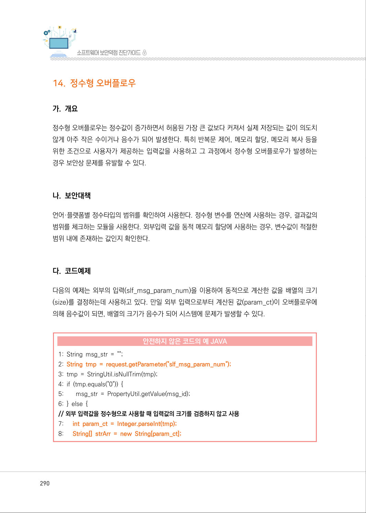
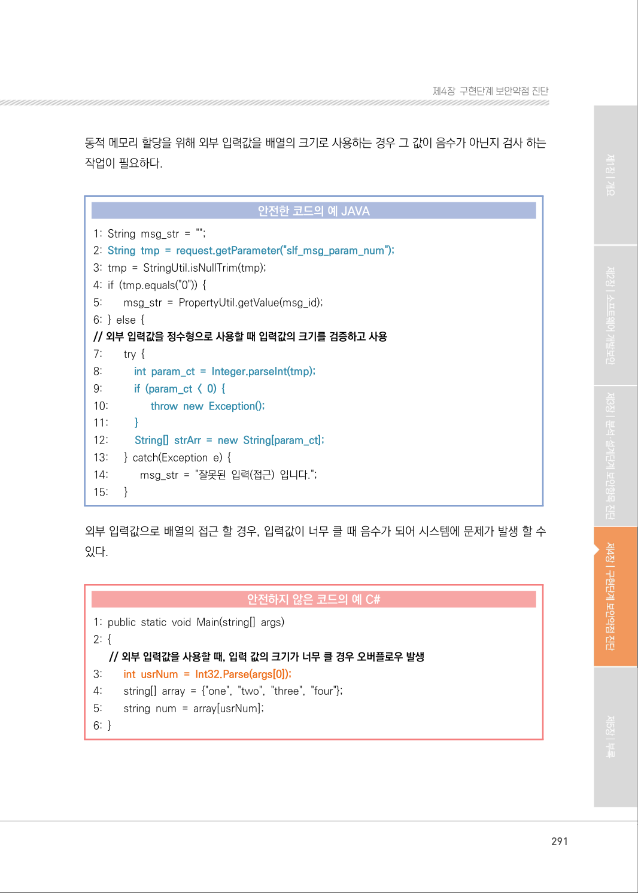
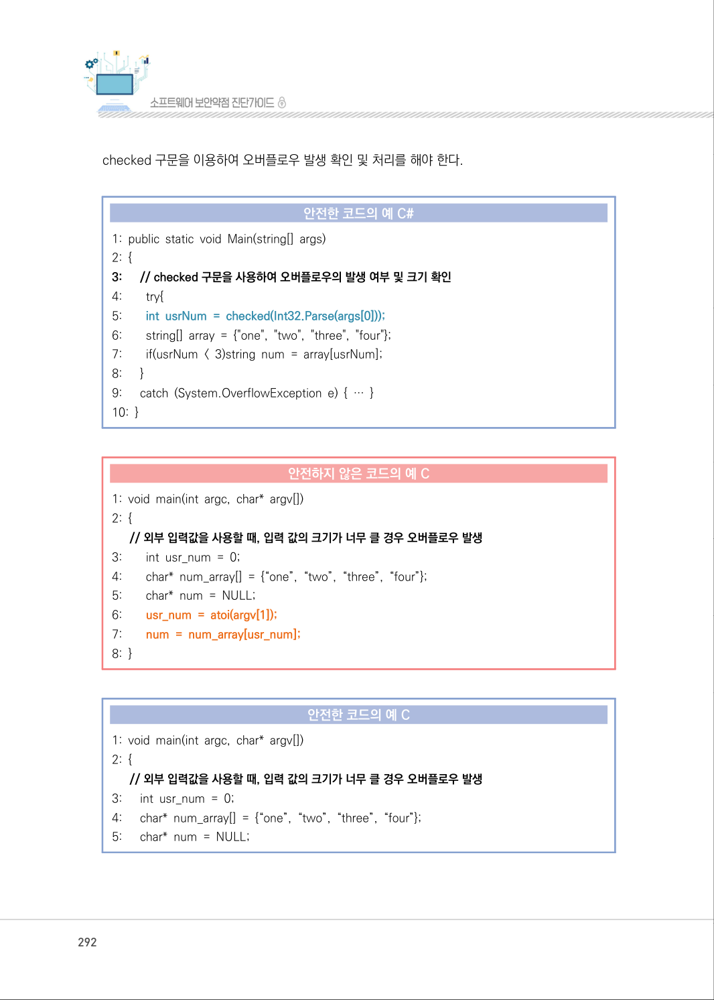
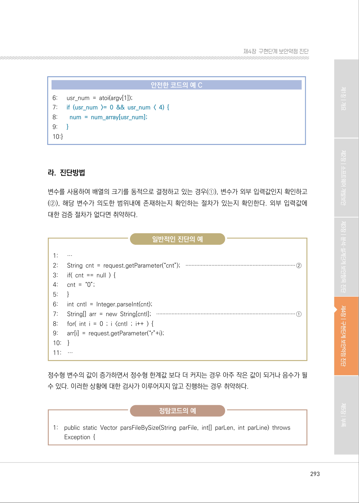
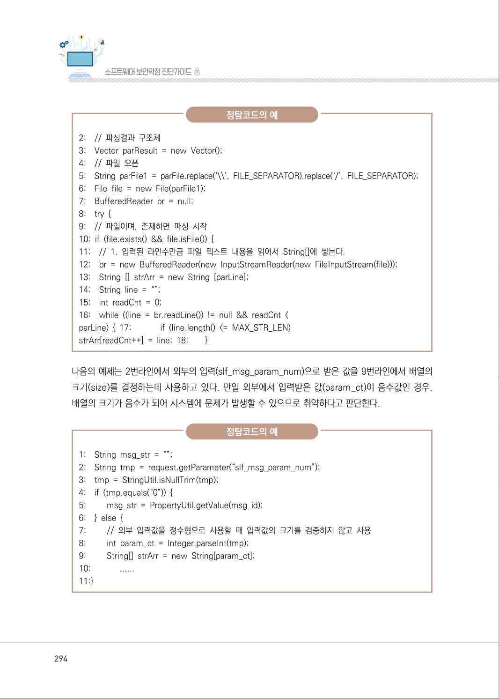
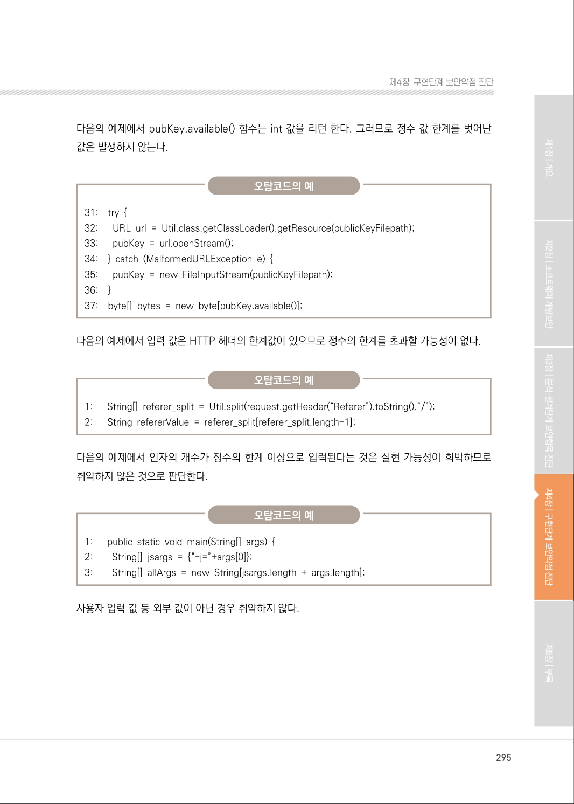
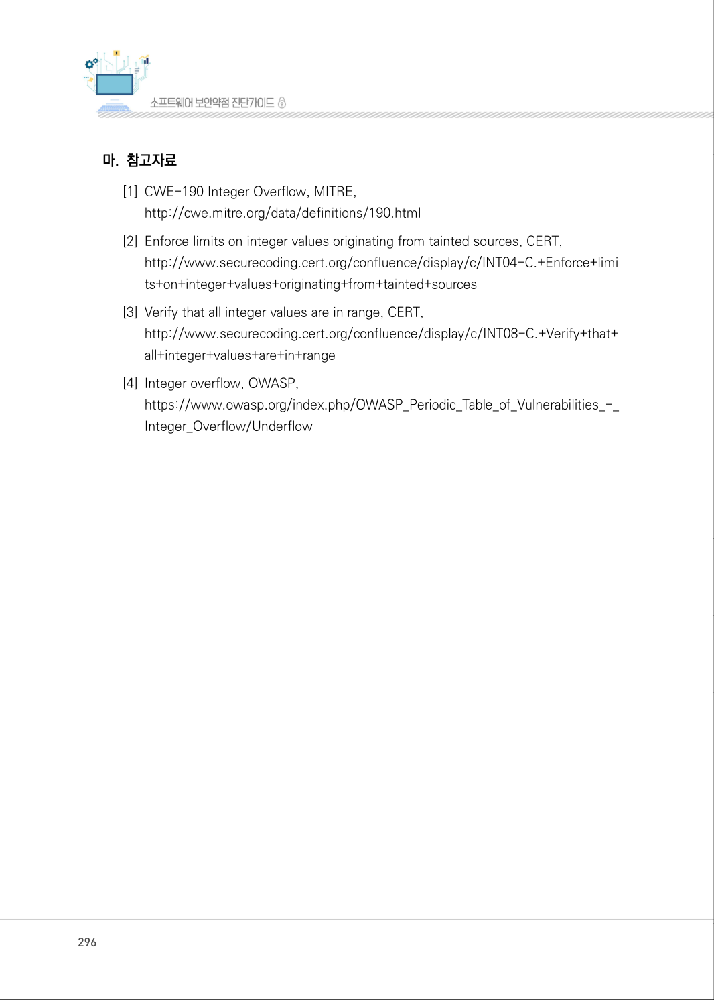
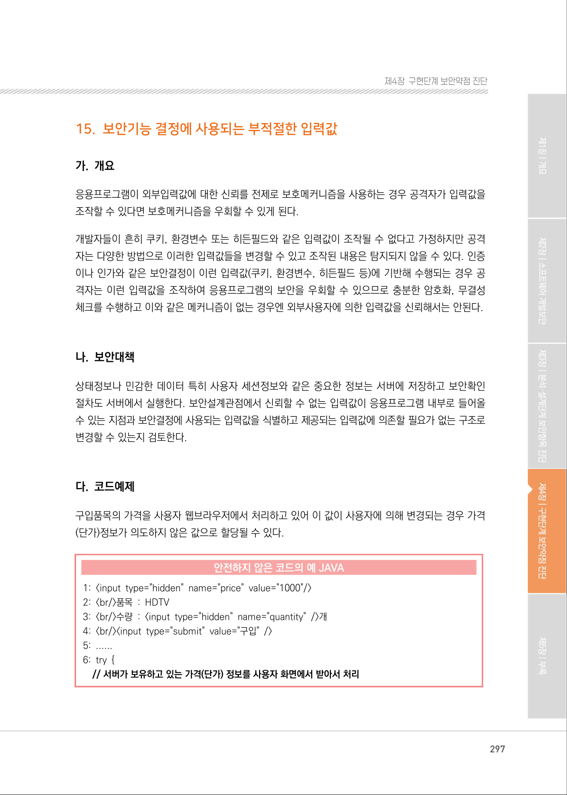

# 14. 정수형 오버플로우

> 변환 안내(원문 외): 아래 본문은 PDF 텍스트를 추출한 전사입니다. 코드 줄번호·특수 공백·원문 오류를 유지했습니다. 실행용 코드가 아닙니다. 표·그림·들여쓰기는 연결된 페이지 이미지와 대조하세요. 페이지 경계의 줄바꿈을 보존하며, 동일 페이지가 여러 항목에 나뉘면 각 항목의 본문은 해당 구간만 포함합니다.

### PDF 290페이지 / 인쇄 290페이지

<!-- source-page:SW-Diagnosis-2021:290; source-lines:0,1,2,3,4,5,6,7,8,9,10,11,12,13,14,15,16,17,18,19,20,21,22,23,24,25,26,27 -->

290

#### 14. 정수형 오버플로우

#### 가. 개요

정수형 오버플로우는 정수값이 증가하면서 허용된 가장 큰 값보다 커져서 실제 저장되는 값이 의도치 
않게 아주 작은 수이거나 음수가 되어 발생한다. 특히 반복문 제어, 메모리 할당, 메모리 복사 등을 
위한 조건으로 사용자가 제공하는 입력값을 사용하고 그 과정에서 정수형 오버플로우가 발생하는 
경우 보안상 문제를 유발할 수 있다.

#### 나. 보안대책

언어·플랫폼별 정수타입의 범위를 확인하여 사용한다. 정수형 변수를 연산에 사용하는 경우, 결과값의 
범위를 체크하는 모듈을 사용한다. 외부입력 값을 동적 메모리 할당에 사용하는 경우, 변수값이 적절한 
범위 내에 존재하는 값인지 확인한다.

#### 다. 코드예제

다음의 예제는 외부의 입력(slf_msg_param_num)을 이용하여 동적으로 계산한 값을 배열의 크기
(size)를 결정하는데 사용하고 있다. 만일 외부 입력으로부터 계산된 값(param_ct)이 오버플로우에 
의해 음수값이 되면, 배열의 크기가 음수가 되어 시스템에 문제가 발생할 수 있다.

#### 안전하지 않은 코드의 예 JAVA

```java
1: String msg_str = "";
2: String tmp = request.getParameter("slf_msg_param_num");
3: tmp = StringUtil.isNullTrim(tmp); 
4: if (tmp.equals("0")) { 
5:        msg_str = PropertyUtil.getValue(msg_id); 
6: } else { 
// 외부 입력값을 정수형으로 사용할 때 입력값의 크기를 검증하지 않고 사용
7:      int param_ct = Integer.parseInt(tmp);
8:      String[] strArr = new String[param_ct];
```

<details><summary>원본 페이지 이미지 (변환 외 보존 자료)</summary>



</details>

### PDF 291페이지 / 인쇄 291페이지

<!-- source-page:SW-Diagnosis-2021:291; source-lines:0,1,2,3,4,5,6,7,8,9,10,11,12,13,14,15,16,17,18,19,20,21,22,23,24,25,26,27,28,29,30,31,32,33,34,35,36,37,38,39,40,41,42,43 -->

291

제4장구현단계 보안약점 진단

동적 메모리 할당을 위해 외부 입력값을 배열의 크기로 사용하는 경우 그 값이 음수가 아닌지 검사 하는 
작업이 필요하다.

#### 안전한 코드의 예 JAVA

```java
1: String msg_str = "";
2: String tmp = request.getParameter("slf_msg_param_num");
3: tmp = StringUtil.isNullTrim(tmp); 
4: if (tmp.equals("0")) { 
5:        msg_str = PropertyUtil.getValue(msg_id); 
6: } else { 
// 외부 입력값을 정수형으로 사용할 때 입력값의 크기를 검증하고 사용
7:        try { 
8:           int param_ct = Integer.parseInt(tmp);
9:           if (param_ct < 0) {
10:               throw new Exception();
11:         }
12:         String[] strArr = new String[param_ct];
13:      } catch(Exception e) { 
14:           msg_str = "잘못된 입력(접근) 입니다.";
15:      }
```

외부 입력값으로 배열의 접근 할 경우, 입력값이 너무 클 때 음수가 되어 시스템에 문제가 발생 할 수 
있다.

#### 안전하지 않은 코드의 예 C#

```csharp
1: public static void Main(string[] args) 
2: {
// 외부 입력값을 사용할 때, 입력 값의 크기가 너무 클 경우 오버플로우 발생
3:        int usrNum = Int32.Parse(args[0]);
4:        string[] array = {"one", "two", "three", "four"};
5:        string num = array[usrNum];
6: }
```

<details><summary>원본 페이지 이미지 (변환 외 보존 자료)</summary>



</details>

### PDF 292페이지 / 인쇄 292페이지

<!-- source-page:SW-Diagnosis-2021:292; source-lines:0,1,2,3,4,5,6,7,8,9,10,11,12,13,14,15,16,17,18,19,20,21,22,23,24,25,26,27,28,29,30,31,32,33,34,35,36,37,38,39,40,41,42,43,44 -->

292

checked 구문을 이용하여 오버플로우 발생 확인 및 처리를 해야 한다.

#### 안전한 코드의 예 C#

```csharp
1: public static void Main(string[] args) 
2: {
3:      // checked 구문을 사용하여 오버플로우의 발생 여부 및 크기 확인
4:        try{
5:        int usrNum = checked(Int32.Parse(args[0]));
6:        string[] array = {"one", "two", "three", "four"}; 
7:        if(usrNum < 3)string num = array[usrNum]; 
8:      }
9:      catch (System.OverflowException e) { … } 
10: }
```

#### 안전하지 않은 코드의 예 C

```c
1: void main(int argc, char* argv[]) 
2: {
// 외부 입력값을 사용할 때, 입력 값의 크기가 너무 클 경우 오버플로우 발생
3:        int usr_num = 0;
4:        char* num_array[] = {“one”, “two”, “three”, “four”};
5:        char* num = NULL;
6:        usr_num = atoi(argv[1]);
7:        num = num_array[usr_num];
8: }
```

#### 안전한 코드의 예 C

```c
1: void main(int argc, char* argv[]) 
2: {
// 외부 입력값을 사용할 때, 입력 값의 크기가 너무 클 경우 오버플로우 발생
3:      int usr_num = 0;
4:      char* num_array[] = {“one”, “two”, “three”, “four”};
5:      char* num = NULL;
```

<details><summary>원본 페이지 이미지 (변환 외 보존 자료)</summary>



</details>

### PDF 293페이지 / 인쇄 293페이지

<!-- source-page:SW-Diagnosis-2021:293; source-lines:0,1,2,3,4,5,6,7,8,9,10,11,12,13,14,15,16,17,18,19,20,21,22,23,24,25,26,27,28,29,30,31,32,33,34,35,36,37,38,39,40,41,42,43,44 -->

293

제4장구현단계 보안약점 진단

#### 안전한 코드의 예 C

```c
6:      usr_num = atoi(argv[1]);
7:      if (usr_num >= 0 && usr_num < 4) {
8:        num = num_array[usr_num];
9:      }
10:}
```

#### 라. 진단방법

변수를 사용하여 배열의 크기를 동적으로 결정하고 있는 경우(①), 변수가 외부 입력값인지 확인하고 
(②), 해당 변수가 의도한 범위내에 존재하는지 확인하는 절차가 있는지 확인한다. 외부 입력값에 
대한 검증 절차가 없다면 취약하다.

일반적인 진단의 예

```text
1:      …
2:      String cnt = request.getParameter(“cnt”); ········································································②
3:      if( cnt == null ) { 
4:      cnt = “0”; 
5:      }
6:      int cntI = Integer.parseInt(cnt); 
7:      String[] arr = new String[cntI]; ···························································································①
8:      for( int i = 0 ; i <cntI ; i++ ) { 
9:      arr[i] = request.getParameter(“r”+i); 
10:    }
11:    …
```

정수형 변수의 값이 증가하면서 정수형 한계값 보다 더 커지는 경우 아주 작은 값이 되거나 음수가 될 
수 있다. 이러한 상황에 대한 검사가 이루어지지 않고 진행하는 경우 취약하다. 

정탐코드의 예

1:

public static Vector parsFileBySize(String parFile, int[] parLen, int parLine) throws 
Exception {

<details><summary>원본 페이지 이미지 (변환 외 보존 자료)</summary>



</details>

### PDF 294페이지 / 인쇄 294페이지

<!-- source-page:SW-Diagnosis-2021:294; source-lines:0,1,2,3,4,5,6,7,8,9,10,11,12,13,14,15,16,17,18,19,20,21,22,23,24,25,26,27,28,29,30,31,32,33,34,35,36,37,38,39,40,41,42,43,44,45,46,47,48,49,50,51,52,53,54,55,56,57,58,59 -->

294

정탐코드의 예

```text
2:    // 파싱결과 구조체
3:    Vector parResult = new Vector(); 
4:    // 파일 오픈 
5:    String parFile1 = parFile.replace(‘\\’, FILE_SEPARATOR).replace(‘/’, FILE_SEPARATOR);
6:    File file = new File(parFile1);
7:    BufferedReader br = null;
8:    try {
9:    // 파일이며, 존재하면 파싱 시작
10: if (file.exists() && file.isFile()) { 
11:    // 1. 입력된 라인수만큼 파일 텍스트 내용을 읽어서 String[]에 쌓는다. 
12:    br = new BufferedReader(new InputStreamReader(new FileInputStream(file)));
13:    String [] strArr = new String [parLine]; 
14:    String line = “”; 
15:    int readCnt = 0; 
16:    while ((line = br.readLine()) != null && readCnt < 
parLine) { 17:             if (line.length() <= MAX_STR_LEN)
strArr[readCnt++] = line; 18:        }
```

다음의 예제는 2번라인에서 외부의 입력(slf_msg_param_num)으로 받은 값을 9번라인에서 배열의 
크기(size)를 결정하는데 사용하고 있다. 만일 외부에서 입력받은 값(param_ct)이 음수값인 경우, 
배열의 크기가 음수가 되어 시스템에 문제가 발생할 수 있으므로 취약하다고 판단한다.

정탐코드의 예

```text
1:    String msg_str = “”; 
2:    String tmp = request.getParameter(“slf_msg_param_num”); 
3:    tmp = StringUtil.isNullTrim(tmp); 
4:    if (tmp.equals(“0”)) { 
5:         msg_str = PropertyUtil.getValue(msg_id); 
6:    } else { 
7:         // 외부 입력값을 정수형으로 사용할 때 입력값의 크기를 검증하지 않고 사용
8:         int param_ct = Integer.parseInt(tmp); 
9:         String[] strArr = new String[param_ct]; 
10:             ......
11:}
```

<details><summary>원본 페이지 이미지 (변환 외 보존 자료)</summary>



</details>

### PDF 295페이지 / 인쇄 295페이지

<!-- source-page:SW-Diagnosis-2021:295; source-lines:0,1,2,3,4,5,6,7,8,9,10,11,12,13,14,15,16,17,18,19,20,21,22,23,24,25,26,27,28,29,30,31,32,33,34 -->

295

제4장구현단계 보안약점 진단

다음의 예제에서 pubKey.available() 함수는 int 값을 리턴 한다. 그러므로 정수 값 한계를 벗어난 
값은 발생하지 않는다.

오탐코드의 예

```text
31:    try { 
32:      URL url = Util.class.getClassLoader().getResource(publicKeyFilepath);
33:      pubKey = url.openStream();
34:    } catch (MalformedURLException e) {
35:      pubKey = new FileInputStream(publicKeyFilepath);
36:    }
37:    byte[] bytes = new byte[pubKey.available()];
```

다음의 예제에서 입력 값은 HTTP 헤더의 한계값이 있으므로 정수의 한계를 초과할 가능성이 없다.

오탐코드의 예

```text
1:      String[] referer_split = Util.split(request.getHeader(“Referer”).toString(),”/”);
2:      String refererValue = referer_split[referer_split.length-1];
```

다음의 예제에서 인자의 개수가 정수의 한계 이상으로 입력된다는 것은 실현 가능성이 희박하므로 
취약하지 않은 것으로 판단한다.

오탐코드의 예

```text
1:      public static void main(String[] args) {
2:        String[] jsargs = {“-j=”+args[0]};
3:        String[] allArgs = new String[jsargs.length + args.length];
```

사용자 입력 값 등 외부 값이 아닌 경우 취약하지 않다.

<details><summary>원본 페이지 이미지 (변환 외 보존 자료)</summary>



</details>

### PDF 296페이지 / 인쇄 296페이지

<!-- source-page:SW-Diagnosis-2021:296; source-lines:0,1,2,3,4,5,6,7,8,9,10,11,12 -->

296

#### 마. 참고자료

[1] CWE-190 Integer Overflow, MITRE,

http://cwe.mitre.org/data/definitions/190.html 
[2] Enforce limits on integer values originating from tainted sources, CERT,

http://www.securecoding.cert.org/confluence/display/c/INT04-C.+Enforce+limi
ts+on+integer+values+originating+from+tainted+sources
[3] Verify that all integer values are in range, CERT,

http://www.securecoding.cert.org/confluence/display/c/INT08-C.+Verify+that+
all+integer+values+are+in+range
[4] Integer overflow, OWASP,

https://www.owasp.org/index.php/OWASP_Periodic_Table_of_Vulnerabilities_-_
Integer_Overflow/Underflow

<details><summary>원본 페이지 이미지 (변환 외 보존 자료)</summary>



</details>

### PDF 297페이지 / 인쇄 297페이지

<!-- source-page:SW-Diagnosis-2021:297; source-lines:1 -->

제4장구현단계 보안약점 진단

<details><summary>원본 페이지 이미지 (변환 외 보존 자료)</summary>



</details>

---

## 탐색 링크 (원문 외)

[통합 인덱스](../../../INDEX.md)

