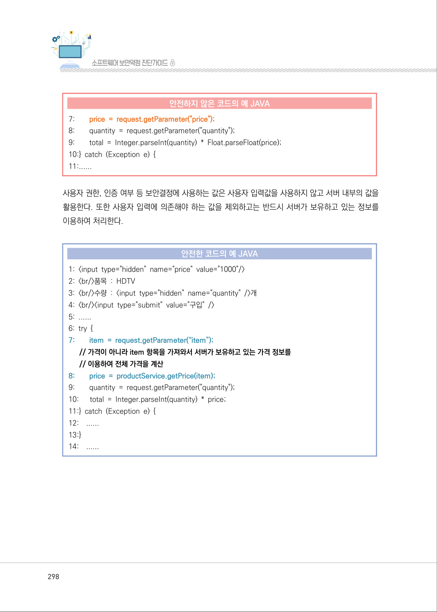
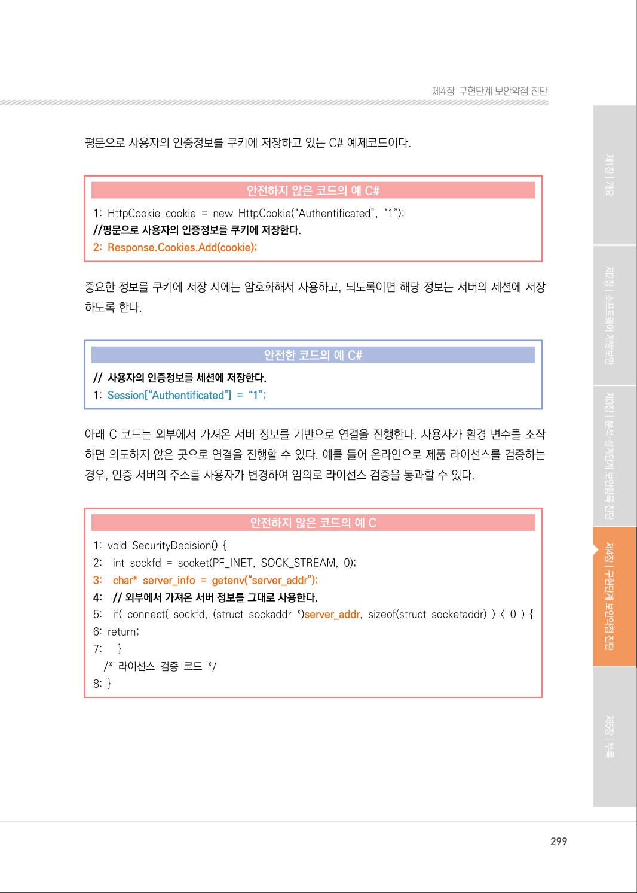
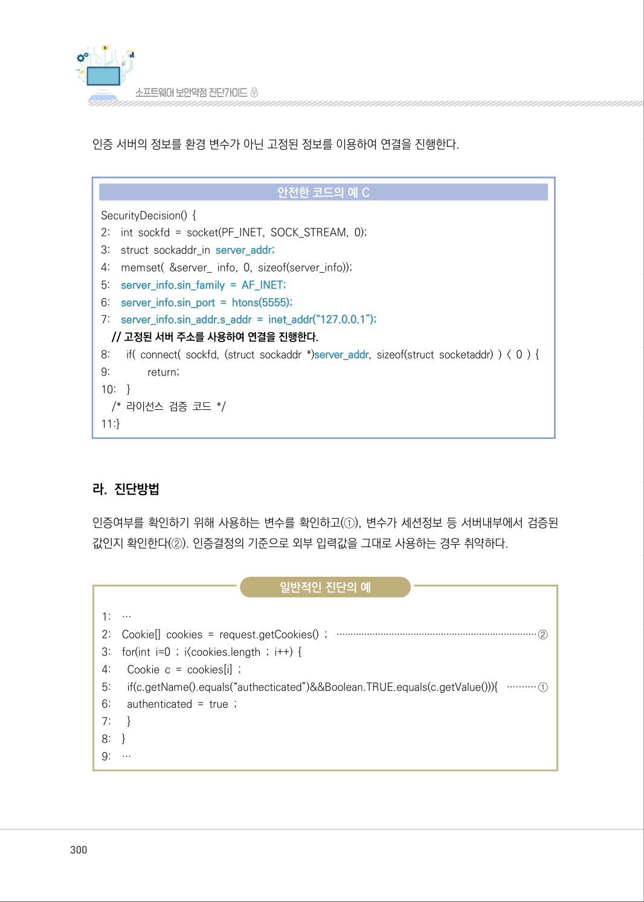
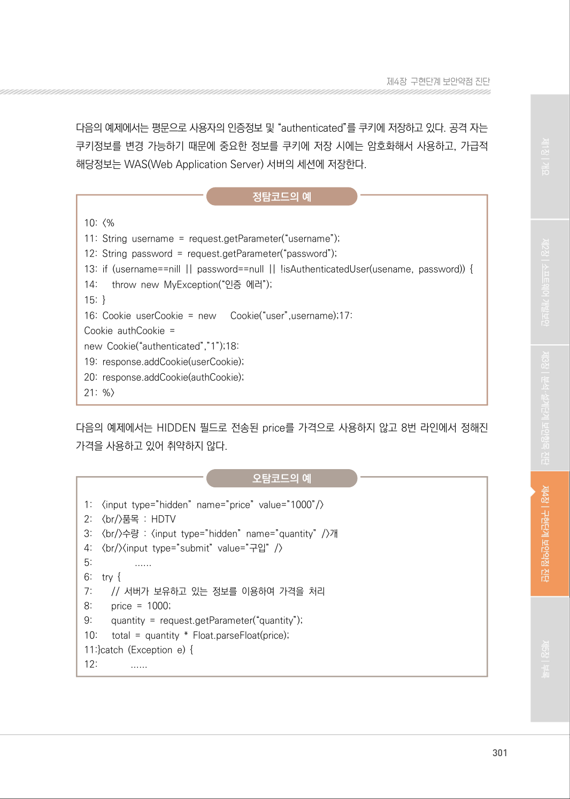
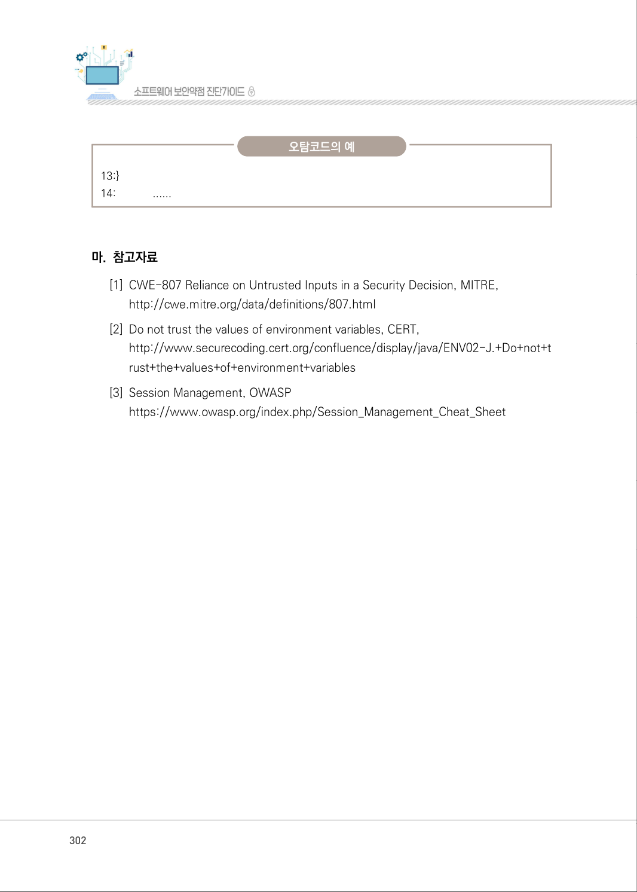
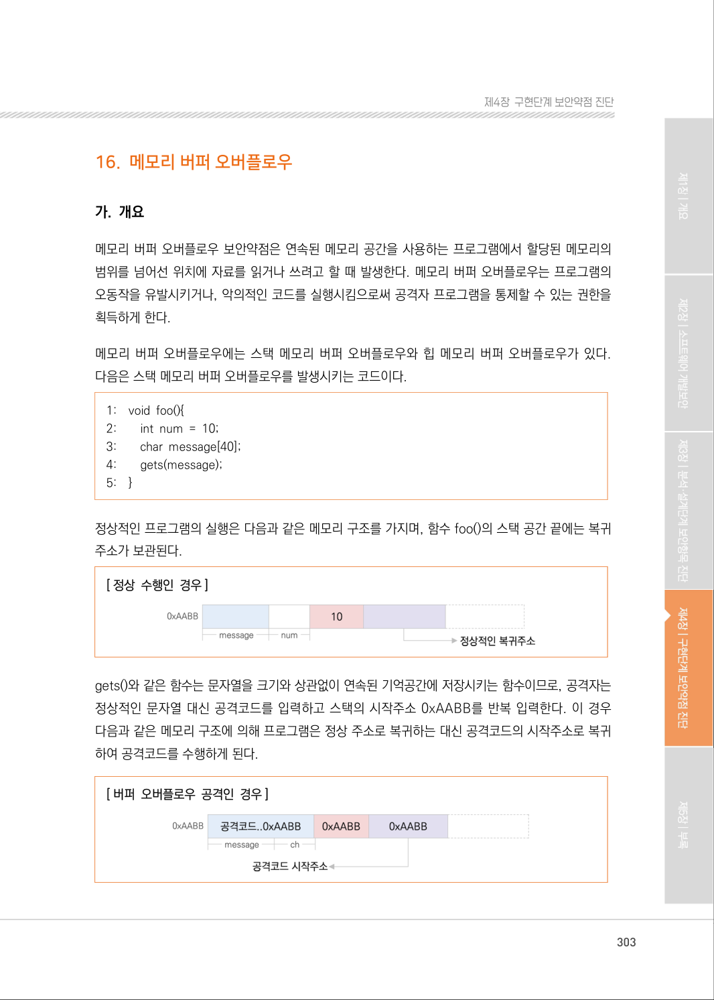

# 15. 보안기능 결정에 사용되는 부적절한 입력값

> 변환 안내(원문 외): 아래 본문은 PDF 텍스트를 추출한 전사입니다. 코드 줄번호·특수 공백·원문 오류를 유지했습니다. 실행용 코드가 아닙니다. 표·그림·들여쓰기는 연결된 페이지 이미지와 대조하세요. 페이지 경계의 줄바꿈을 보존하며, 동일 페이지가 여러 항목에 나뉘면 각 항목의 본문은 해당 구간만 포함합니다.

### PDF 297페이지 / 인쇄 297페이지

<!-- source-page:SW-Diagnosis-2021:297; source-lines:0,2,3,4,5,6,7,8,9,10,11,12,13,14,15,16,17,18,19,20,21,22,23,24,25,26 -->

297

#### 15. 보안기능 결정에 사용되는 부적절한 입력값

#### 가. 개요

응용프로그램이 외부입력값에 대한 신뢰를 전제로 보호메커니즘을 사용하는 경우 공격자가 입력값을 
조작할 수 있다면 보호메커니즘을 우회할 수 있게 된다.

개발자들이 흔히 쿠키, 환경변수 또는 히든필드와 같은 입력값이 조작될 수 없다고 가정하지만 공격
자는 다양한 방법으로 이러한 입력값들을 변경할 수 있고 조작된 내용은 탐지되지 않을 수 있다. 인증
이나 인가와 같은 보안결정이 이런 입력값(쿠키, 환경변수, 히든필드 등)에 기반해 수행되는 경우 공
격자는 이런 입력값을 조작하여 응용프로그램의 보안을 우회할 수 있으므로 충분한 암호화, 무결성 
체크를 수행하고 이와 같은 메커니즘이 없는 경우엔 외부사용자에 의한 입력값을 신뢰해서는 안된다.

#### 나. 보안대책

상태정보나 민감한 데이터 특히 사용자 세션정보와 같은 중요한 정보는 서버에 저장하고 보안확인 
절차도 서버에서 실행한다. 보안설계관점에서 신뢰할 수 없는 입력값이 응용프로그램 내부로 들어올 
수 있는 지점과 보안결정에 사용되는 입력값을 식별하고 제공되는 입력값에 의존할 필요가 없는 구조로 
변경할 수 있는지 검토한다.

#### 다. 코드예제

구입품목의 가격을 사용자 웹브라우저에서 처리하고 있어 이 값이 사용자에 의해 변경되는 경우 가격 
(단가)정보가 의도하지 않은 값으로 할당될 수 있다.

#### 안전하지 않은 코드의 예 JAVA

```java
1: <input type="hidden" name="price" value="1000"/> 
2: <br/>품목 : HDTV 
3: <br/>수량 : <input type="hidden" name="quantity" />개 
4: <br/><input type="submit" value="구입" /> 
5: ...... 
6: try { 
// 서버가 보유하고 있는 가격(단가) 정보를 사용자 화면에서 받아서 처리
```

<details><summary>원본 페이지 이미지 (변환 외 보존 자료)</summary>


</details>

### PDF 298페이지 / 인쇄 298페이지

<!-- source-page:SW-Diagnosis-2021:298; source-lines:0,1,2,3,4,5,6,7,8,9,10,11,12,13,14,15,16,17,18,19,20,21,22,23,24,25,26,27,28,29,30,31,32,33,34,35 -->

298

#### 안전하지 않은 코드의 예 JAVA

```java
7:        price = request.getParameter("price");
8:        quantity = request.getParameter("quantity"); 
9:        total = Integer.parseInt(quantity) * Float.parseFloat(price); 
10:} catch (Exception e) { 
11:......
```

사용자 권한, 인증 여부 등 보안결정에 사용하는 값은 사용자 입력값을 사용하지 않고 서버 내부의 값을 
활용한다. 또한 사용자 입력에 의존해야 하는 값을 제외하고는 반드시 서버가 보유하고 있는 정보를 
이용하여 처리한다.

#### 안전한 코드의 예 JAVA

```java
1: <input type="hidden" name="price" value="1000"/>
2: <br/>품목 : HDTV 
3: <br/>수량 : <input type="hidden" name="quantity" />개 
4: <br/><input type="submit" value="구입" /> 
5: ......
6: try { 
7:        item = request.getParameter(“item”);
// 가격이 아니라 item 항목을 가져와서 서버가 보유하고 있는 가격 정보를
// 이용하여 전체 가격을 계산
```

```text
8:        price = productService.getPrice(item);
9:        quantity = request.getParameter("quantity");
10:      total = Integer.parseInt(quantity) * price;
11:} catch (Exception e) { 
12:    ......
13:}
14:    ......
```

<details><summary>원본 페이지 이미지 (변환 외 보존 자료)</summary>



</details>

### PDF 299페이지 / 인쇄 299페이지

<!-- source-page:SW-Diagnosis-2021:299; source-lines:0,1,2,3,4,5,6,7,8,9,10,11,12,13,14,15,16,17,18,19,20,21,22,23,24,25,26,27,28,29 -->

299

제4장구현단계 보안약점 진단

평문으로 사용자의 인증정보를 쿠키에 저장하고 있는 C# 예제코드이다.

#### 안전하지 않은 코드의 예 C#

```csharp
1: HttpCookie cookie = new HttpCookie(“Authentificated”, “1”);
//평문으로 사용자의 인증정보를 쿠키에 저장한다.
2: Response.Cookies.Add(cookie);
```

중요한 정보를 쿠키에 저장 시에는 암호화해서 사용하고, 되도록이면 해당 정보는 서버의 세션에 저장 
하도록 한다.

#### 안전한 코드의 예 C#

```csharp
// 사용자의 인증정보를 세션에 저장한다.
1: Session[“Authentificated”] = “1”;
```

아래 C 코드는 외부에서 가져온 서버 정보를 기반으로 연결을 진행한다. 사용자가 환경 변수를 조작 
하면 의도하지 않은 곳으로 연결을 진행할 수 있다. 예를 들어 온라인으로 제품 라이선스를 검증하는 
경우, 인증 서버의 주소를 사용자가 변경하여 임의로 라이선스 검증을 통과할 수 있다.

#### 안전하지 않은 코드의 예 C

```c
1: void SecurityDecision() { 
2:    int sockfd = socket(PF_INET, SOCK_STREAM, 0); 
3:    char* server_info = getenv(“server_addr”);
4:    // 외부에서 가져온 서버 정보를 그대로 사용한다.
5:    if( connect( sockfd, (struct sockaddr *)server_addr, sizeof(struct socketaddr) ) < 0 ) { 
6: return;
7:      }
/* 라이선스 검증 코드 */ 
8: }
```

<details><summary>원본 페이지 이미지 (변환 외 보존 자료)</summary>



</details>

### PDF 300페이지 / 인쇄 300페이지

<!-- source-page:SW-Diagnosis-2021:300; source-lines:0,1,2,3,4,5,6,7,8,9,10,11,12,13,14,15,16,17,18,19,20,21,22,23,24,25,26,27,28,29,30,31,32,33,34,35,36,37,38,39,40,41,42,43,44,45,46 -->

300

인증 서버의 정보를 환경 변수가 아닌 고정된 정보를 이용하여 연결을 진행한다.

#### 안전한 코드의 예 C

```c
SecurityDecision() { 
2:    int sockfd = socket(PF_INET, SOCK_STREAM, 0); 
3:    struct sockaddr_in server_addr;
4:    memset( &server_ info, 0, sizeof(server_info));
5:    server_info.sin_family = AF_INET;
6:    server_info.sin_port = htons(5555);
7:    server_info.sin_addr.s_addr = inet_addr(“127.0.0.1”);
// 고정된 서버 주소를 사용하여 연결을 진행한다.
8:      if( connect( sockfd, (struct sockaddr *)server_addr, sizeof(struct socketaddr) ) < 0 ) {
9:             return;
10:    }
/* 라이선스 검증 코드 */ 
11:}
```

#### 라. 진단방법

인증여부를 확인하기 위해 사용하는 변수를 확인하고(①), 변수가 세션정보 등 서버내부에서 검증된 
값인지 확인한다(②). 인증결정의 기준으로 외부 입력값을 그대로 사용하는 경우 취약하다.

일반적인 진단의 예

```text
1:    …
2:    Cookie[] cookies = request.getCookies() ; ·········································································②
3:    for(int i=0 ; i<cookies.length ; i++) { 
4:      Cookie c = cookies[i] ; 
5:      if(c.getName().equals(“authecticated”)&&Boolean.TRUE.equals(c.getValue())){ ··········①
6:      authenticated = true ; 
7:      }
8:    }
9:    …
```

<details><summary>원본 페이지 이미지 (변환 외 보존 자료)</summary>



</details>

### PDF 301페이지 / 인쇄 301페이지

<!-- source-page:SW-Diagnosis-2021:301; source-lines:0,1,2,3,4,5,6,7,8,9,10,11,12,13,14,15,16,17,18,19,20,21,22,23,24,25,26,27,28,29,30,31,32,33,34,35,36,37,38,39,40,41,42,43,44,45 -->

301

제4장구현단계 보안약점 진단

다음의 예제에서는 평문으로 사용자의 인증정보 및 “authenticated”를 쿠키에 저장하고 있다. 공격 자는 
쿠키정보를 변경 가능하기 때문에 중요한 정보를 쿠키에 저장 시에는 암호화해서 사용하고, 가급적 
해당정보는 WAS(Web Application Server) 서버의 세션에 저장한다.

정탐코드의 예

```text
10: <% 
11: String username = request.getParameter(“username”); 
12: String password = request.getParameter(“password”); 
13: if (username==nill || password==null || !isAuthenticatedUser(usename, password)) {
14:      throw new MyException(“인증 에러”);
15: }
16: Cookie userCookie = new      Cookie(“user”,username);17:
Cookie authCookie =
new Cookie(“authenticated”,”1”);18: 
```

```text
19: response.addCookie(userCookie); 
20: response.addCookie(authCookie); 
21: %>
```

다음의 예제에서는 HIDDEN 필드로 전송된 price를 가격으로 사용하지 않고 8번 라인에서 정해진 
가격을 사용하고 있어 취약하지 않다.

오탐코드의 예

```text
1:    <input type=”hidden” name=”price” value=”1000”/> 
2:    <br/>품목 : HDTV 
3:    <br/>수량 : <input type=”hidden” name=”quantity” />개 
4:    <br/><input type=”submit” value=”구입” /> 
5:                 ......
6:    try {
7:        // 서버가 보유하고 있는 정보를 이용하여 가격을 처리 
8:        price = 1000;
9:        quantity = request.getParameter(“quantity”);
10:      total = quantity * Float.parseFloat(price); 
11:}catch (Exception e) { 
12:             ......
```

<details><summary>원본 페이지 이미지 (변환 외 보존 자료)</summary>



</details>

### PDF 302페이지 / 인쇄 302페이지

<!-- source-page:SW-Diagnosis-2021:302; source-lines:0,1,2,3,4,5,6,7,8,9,10,11,12 -->

302

오탐코드의 예

```text
13:}
14:             ......
```

#### 마. 참고자료

[1] CWE-807 Reliance on Untrusted Inputs in a Security Decision, MITRE,

http://cwe.mitre.org/data/definitions/807.html
[2] Do not trust the values of environment variables, CERT,

http://www.securecoding.cert.org/confluence/display/java/ENV02-J.+Do+not+t
rust+the+values+of+environment+variables
[3] Session Management, OWASP

https://www.owasp.org/index.php/Session_Management_Cheat_Sheet

<details><summary>원본 페이지 이미지 (변환 외 보존 자료)</summary>



</details>

### PDF 303페이지 / 인쇄 303페이지

<!-- source-page:SW-Diagnosis-2021:303; source-lines:1 -->

제4장구현단계 보안약점 진단

<details><summary>원본 페이지 이미지 (변환 외 보존 자료)</summary>



</details>

---

## 탐색 링크 (원문 외)

[통합 인덱스](../../../INDEX.md)

