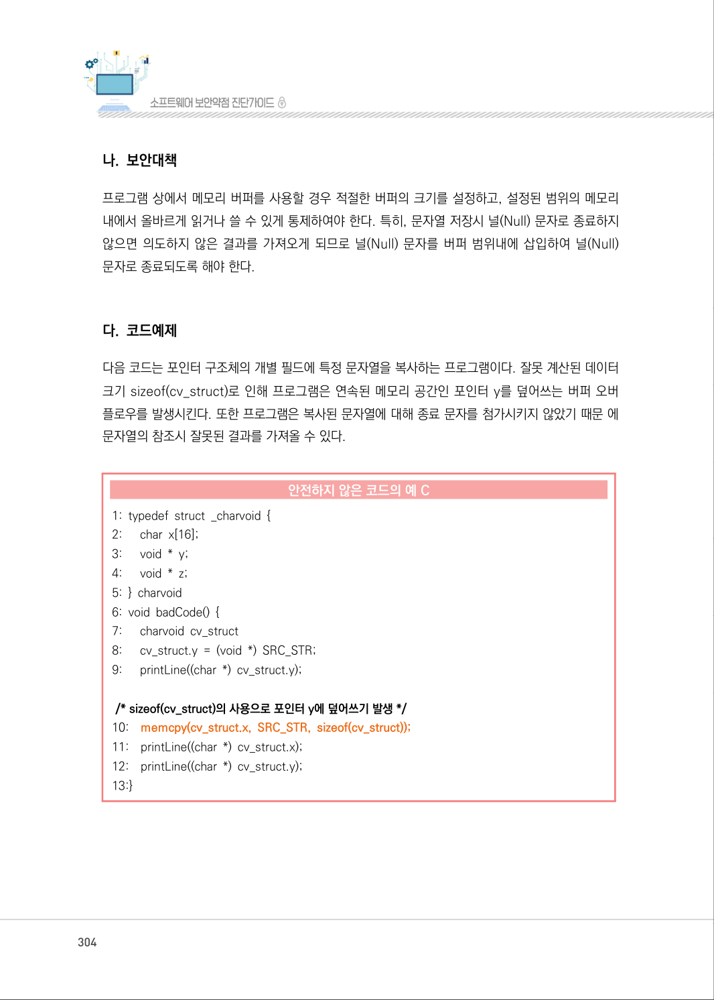
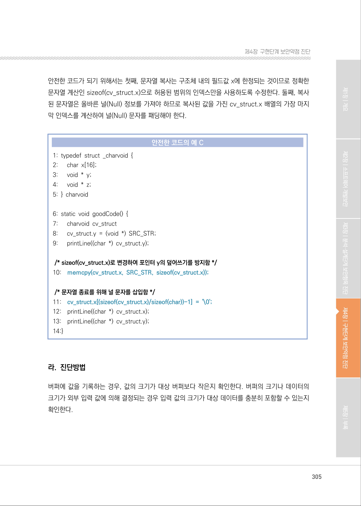
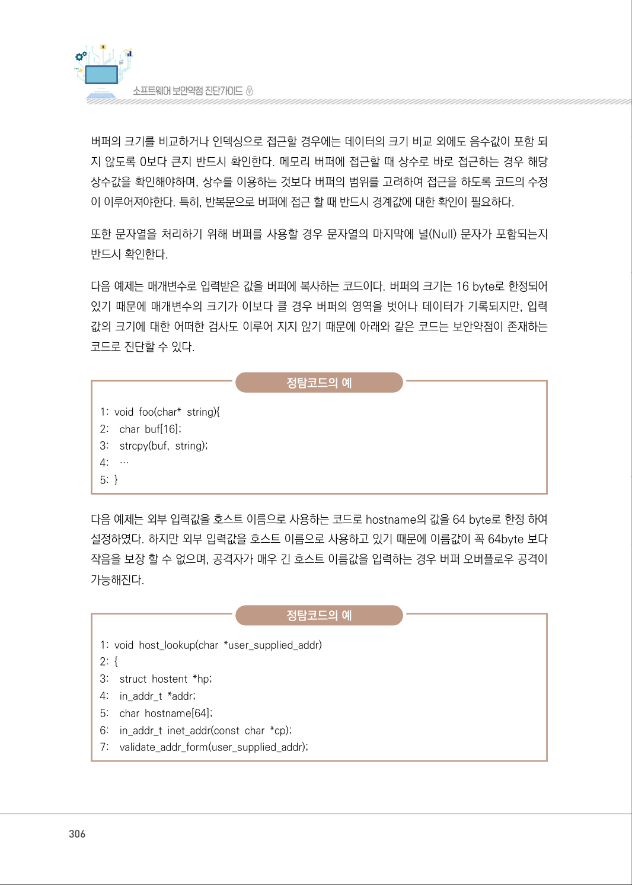
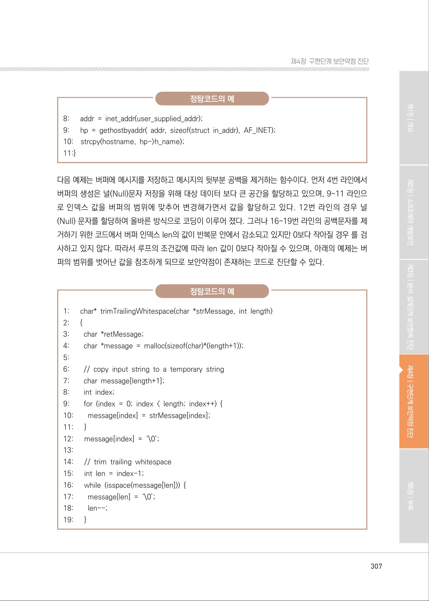
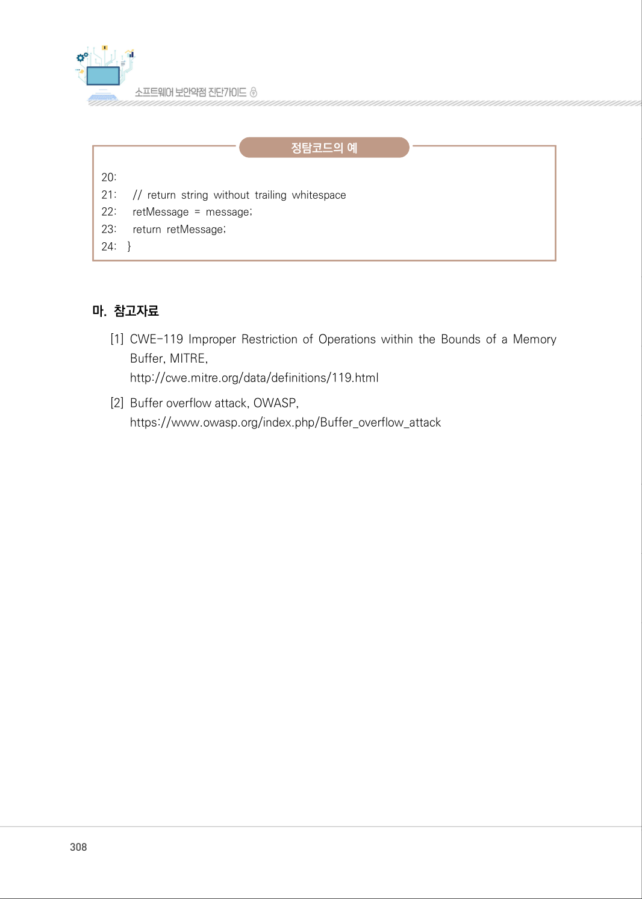
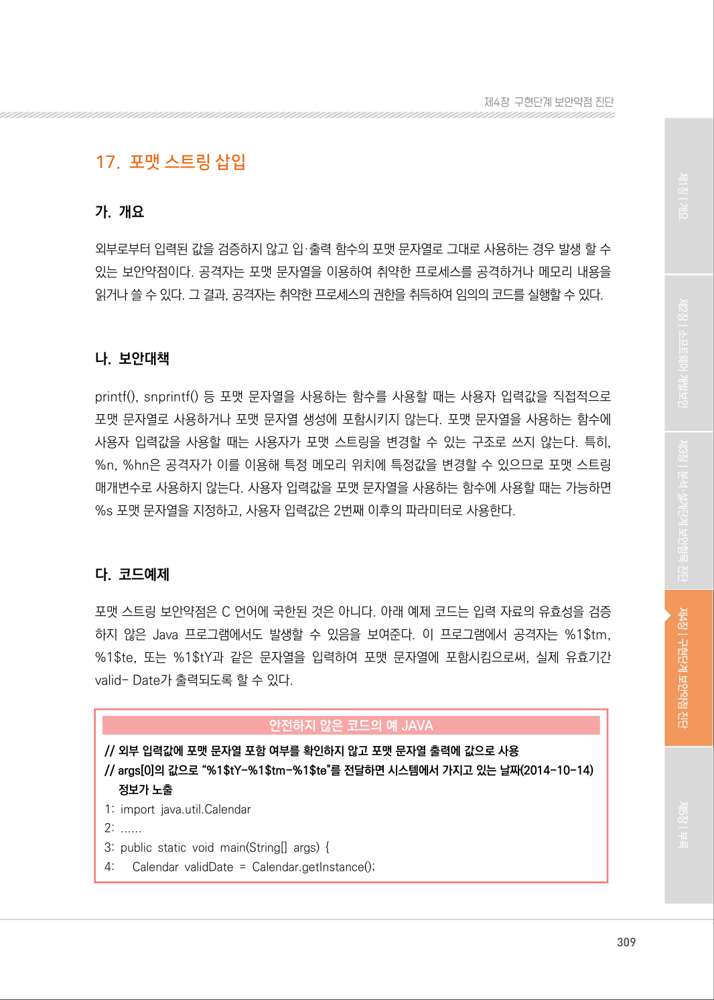

# 16. 메모리 버퍼 오버플로우

> 변환 안내(원문 외): 아래 본문은 PDF 텍스트를 추출한 전사입니다. 코드 줄번호·특수 공백·원문 오류를 유지했습니다. 실행용 코드가 아닙니다. 표·그림·들여쓰기는 연결된 페이지 이미지와 대조하세요. 페이지 경계의 줄바꿈을 보존하며, 동일 페이지가 여러 항목에 나뉘면 각 항목의 본문은 해당 구간만 포함합니다.

### PDF 303페이지 / 인쇄 303페이지

<!-- source-page:SW-Diagnosis-2021:303; source-lines:0,2,3,4,5,6,7,8,9,10,11,12,13,14,15,16,17,18,19,20,21,22,23,24,25,26,27 -->

303

#### 16. 메모리 버퍼 오버플로우

#### 가. 개요

메모리 버퍼 오버플로우 보안약점은 연속된 메모리 공간을 사용하는 프로그램에서 할당된 메모리의 
범위를 넘어선 위치에 자료를 읽거나 쓰려고 할 때 발생한다. 메모리 버퍼 오버플로우는 프로그램의 
오동작을 유발시키거나, 악의적인 코드를 실행시킴으로써 공격자 프로그램을 통제할 수 있는 권한을 
획득하게 한다.

메모리 버퍼 오버플로우에는 스택 메모리 버퍼 오버플로우와 힙 메모리 버퍼 오버플로우가 있다. 
다음은 스택 메모리 버퍼 오버플로우를 발생시키는 코드이다.

```text
1:    void foo(){
2:        int num = 10;
3:        char message[40];
4:        gets(message);
5:    }
```

정상적인 프로그램의 실행은 다음과 같은 메모리 구조를 가지며, 함수 foo()의 스택 공간 끝에는 복귀 
주소가 보관된다.

[ 정상 수행인 경우]

gets()와 같은 함수는 문자열을 크기와 상관없이 연속된 기억공간에 저장시키는 함수이므로, 공격자는 
정상적인 문자열 대신 공격코드를 입력하고 스택의 시작주소 0xAABB를 반복 입력한다. 이 경우 
다음과 같은 메모리 구조에 의해 프로그램은 정상 주소로 복귀하는 대신 공격코드의 시작주소로 복귀 
하여 공격코드를 수행하게 된다.

[ 버퍼 오버플로우 공격인 경우]

<details><summary>원본 페이지 이미지 (변환 외 보존 자료)</summary>


</details>

### PDF 304페이지 / 인쇄 304페이지

<!-- source-page:SW-Diagnosis-2021:304; source-lines:0,1,2,3,4,5,6,7,8,9,10,11,12,13,14,15,16,17,18,19,20,21,22,23,24,25,26,27,28,29,30,31,32,33,34 -->

304

#### 나. 보안대책

프로그램 상에서 메모리 버퍼를 사용할 경우 적절한 버퍼의 크기를 설정하고, 설정된 범위의 메모리 
내에서 올바르게 읽거나 쓸 수 있게 통제하여야 한다. 특히, 문자열 저장시 널(Null) 문자로 종료하지 
않으면 의도하지 않은 결과를 가져오게 되므로 널(Null) 문자를 버퍼 범위내에 삽입하여 널(Null) 
문자로 종료되도록 해야 한다.

#### 다. 코드예제

다음 코드는 포인터 구조체의 개별 필드에 특정 문자열을 복사하는 프로그램이다. 잘못 계산된 데이터 
크기 sizeof(cv_struct)로 인해 프로그램은 연속된 메모리 공간인 포인터 y를 덮어쓰는 버퍼 오버 
플로우를 발생시킨다. 또한 프로그램은 복사된 문자열에 대해 종료 문자를 첨가시키지 않았기 때문 에 
문자열의 참조시 잘못된 결과를 가져올 수 있다.

#### 안전하지 않은 코드의 예 C

```c
1: typedef struct _charvoid { 
2:      char x[16]; 
3:      void * y; 
4:      void * z; 
5: } charvoid 
6: void badCode() { 
7:      charvoid cv_struct 
8:      cv_struct.y = (void *) SRC_STR; 
9:      printLine((char *) cv_struct.y);
 /* sizeof(cv_struct)의 사용으로 포인터 y에 덮어쓰기 발생 */ 
```

```text
10:    memcpy(cv_struct.x, SRC_STR, sizeof(cv_struct)); 
11:    printLine((char *) cv_struct.x);
12:    printLine((char *) cv_struct.y);
13:}
```

<details><summary>원본 페이지 이미지 (변환 외 보존 자료)</summary>



</details>

### PDF 305페이지 / 인쇄 305페이지

<!-- source-page:SW-Diagnosis-2021:305; source-lines:0,1,2,3,4,5,6,7,8,9,10,11,12,13,14,15,16,17,18,19,20,21,22,23,24,25,26,27,28,29,30,31,32,33,34,35,36 -->

305

제4장구현단계 보안약점 진단

#### 안전한 코드가 되기 위해서는 첫째, 문자열 복사는 구조체 내의 필드값 x에 한정되는 것이므로 정확한 

문자열 계산인 sizeof(cv_struct.x)으로 허용된 범위의 인덱스만을 사용하도록 수정한다. 둘째, 복사
된 문자열은 올바른 널(Null) 정보를 가져야 하므로 복사된 값을 가진 cv_struct.x 배열의 가장 마지
막 인덱스를 계산하여 널(Null) 문자를 패딩해야 한다.

#### 안전한 코드의 예 C

```c
1: typedef struct _charvoid { 
2:      char x[16]; 
3:      void * y; 
4:      void * z; 
5: } charvoid 
6: static void goodCode() { 
7:      charvoid cv_struct 
8:      cv_struct.y = (void *) SRC_STR; 
9:      printLine((char *) cv_struct.y); 
 /* sizeof(cv_struct.x)로 변경하여 포인터 y의 덮어쓰기를 방지함 */
```

10:

memcpy(cv_struct.x, SRC_STR, sizeof(cv_struct.x));

 /* 문자열 종료를 위해 널 문자를 삽입함 */ 

```text
11:    cv_struct.x[(sizeof(cv_struct.x)/sizeof(char))-1] = '\0';
12:    printLine((char *) cv_struct.x); 
13:    printLine((char *) cv_struct.y); 
14:}
```

#### 라. 진단방법

버퍼에 값을 기록하는 경우, 값의 크기가 대상 버퍼보다 작은지 확인한다. 버퍼의 크기나 데이터의 
크기가 외부 입력 값에 의해 결정되는 경우 입력 값의 크기가 대상 데이터를 충분히 포함할 수 있는지 
확인한다.

<details><summary>원본 페이지 이미지 (변환 외 보존 자료)</summary>



</details>

### PDF 306페이지 / 인쇄 306페이지

<!-- source-page:SW-Diagnosis-2021:306; source-lines:0,1,2,3,4,5,6,7,8,9,10,11,12,13,14,15,16,17,18,19,20,21,22,23,24,25,26,27,28,29,30,31,32,33,34,35,36 -->

306

버퍼의 크기를 비교하거나 인덱싱으로 접근할 경우에는 데이터의 크기 비교 외에도 음수값이 포함 되
지 않도록 0보다 큰지 반드시 확인한다. 메모리 버퍼에 접근할 때 상수로 바로 접근하는 경우 해당 
상수값을 확인해야하며, 상수를 이용하는 것보다 버퍼의 범위를 고려하여 접근을 하도록 코드의 수정
이 이루어져야한다. 특히, 반복문으로 버퍼에 접근 할 때 반드시 경계값에 대한 확인이 필요하다.

또한 문자열을 처리하기 위해 버퍼를 사용할 경우 문자열의 마지막에 널(Null) 문자가 포함되는지 
반드시 확인한다.

다음 예제는 매개변수로 입력받은 값을 버퍼에 복사하는 코드이다. 버퍼의 크기는 16 byte로 한정되어 
있기 때문에 매개변수의 크기가 이보다 클 경우 버퍼의 영역을 벗어나 데이터가 기록되지만, 입력 
값의 크기에 대한 어떠한 검사도 이루어 지지 않기 때문에 아래와 같은 코드는 보안약점이 존재하는 
코드로 진단할 수 있다.

정탐코드의 예

```text
1: void foo(char* string){ 
2:    char buf[16]; 
3:    strcpy(buf, string); 
4:    …
5: }
```

다음 예제는 외부 입력값을 호스트 이름으로 사용하는 코드로 hostname의 값을 64 byte로 한정 하여 
설정하였다. 하지만 외부 입력값을 호스트 이름으로 사용하고 있기 때문에 이름값이 꼭 64byte 보다 
작음을 보장 할 수 없으며, 공격자가 매우 긴 호스트 이름값을 입력하는 경우 버퍼 오버플로우 공격이 
가능해진다.

정탐코드의 예

```text
1: void host_lookup(char *user_supplied_addr) 
2: {
3:    struct hostent *hp; 
4:    in_addr_t *addr; 
5:    char hostname[64]; 
6:    in_addr_t inet_addr(const char *cp); 
7:    validate_addr_form(user_supplied_addr);
```

<details><summary>원본 페이지 이미지 (변환 외 보존 자료)</summary>



</details>

### PDF 307페이지 / 인쇄 307페이지

<!-- source-page:SW-Diagnosis-2021:307; source-lines:0,1,2,3,4,5,6,7,8,9,10,11,12,13,14,15,16,17,18,19,20,21,22,23,24,25,26,27,28,29,30,31,32,33,34,35,36,37,38,39,40,41,42,43,44,45,46,47,48,49,50,51,52,53 -->

307

제4장구현단계 보안약점 진단

정탐코드의 예

```text
8:      addr = inet_addr(user_supplied_addr);
9:      hp = gethostbyaddr( addr, sizeof(struct in_addr), AF_INET);
10:    strcpy(hostname, hp->h_name);
11:}
```

다음 예제는 버퍼에 메시지를 저장하고 메시지의 뒷부분 공백을 제거하는 함수이다. 먼저 4번 라인에서 
버퍼의 생성은 널(Null)문자 저장을 위해 대상 데이터 보다 큰 공간을 할당하고 있으며, 9~11 라인으
로 인덱스 값을 버퍼의 범위에 맞추어 변경해가면서 값을 할당하고 있다. 12번 라인의 경우 널
(Null) 문자를 할당하여 올바른 방식으로 코딩이 이루어 졌다. 그러나 16~19번 라인의 공백문자를 제
거하기 위한 코드에서 버퍼 인덱스 len의 값이 반복문 안에서 감소되고 있지만 0보다 작아질 경우 를 검
사하고 있지 않다. 따라서 루프의 조건값에 따라 len 값이 0보다 작아질 수 있으며, 아래의 예제는 버
퍼의 범위를 벗어난 값을 참조하게 되므로 보안약점이 존재하는 코드로 진단할 수 있다.

정탐코드의 예

```text
1:      char* trimTrailingWhitespace(char *strMessage, int length) 
2:      {
3:        char *retMessage; 
4:        char *message = malloc(sizeof(char)*(length+1)); 
5:
6:        // copy input string to a temporary string 
7:        char message[length+1]; 
8:        int index; 
9:        for (index = 0; index < length; index++) { 
10:        message[index] = strMessage[index]; 
11:      }
12:      message[index] = ‘\0’; 
13:
14:      // trim trailing whitespace 
15:      int len = index-1; 
16:      while (isspace(message[len])) { 
17:        message[len] = ‘\0’; 
18:        len--;
19:      }
```

<details><summary>원본 페이지 이미지 (변환 외 보존 자료)</summary>



</details>

### PDF 308페이지 / 인쇄 308페이지

<!-- source-page:SW-Diagnosis-2021:308; source-lines:0,1,2,3,4,5,6,7,8,9,10,11,12,13,14,15,16 -->

308

정탐코드의 예

```text
20: 
21:      // return string without trailing whitespace 
22:      retMessage = message; 
23:      return retMessage; 
24:    }
```

#### 마. 참고자료

[1] CWE-119 Improper Restriction of Operations within the Bounds of a Memory 

Buffer, MITRE,
http://cwe.mitre.org/data/definitions/119.html
[2] Buffer overflow attack, OWASP,

https://www.owasp.org/index.php/Buffer_overflow_attack

<details><summary>원본 페이지 이미지 (변환 외 보존 자료)</summary>



</details>

### PDF 309페이지 / 인쇄 309페이지

<!-- source-page:SW-Diagnosis-2021:309; source-lines:1 -->

제4장구현단계 보안약점 진단

<details><summary>원본 페이지 이미지 (변환 외 보존 자료)</summary>



</details>

---

## 탐색 링크 (원문 외)

[통합 인덱스](../../../INDEX.md)

