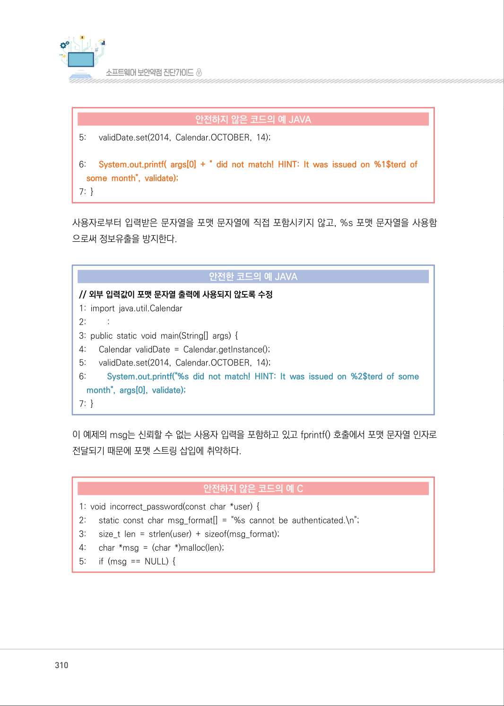
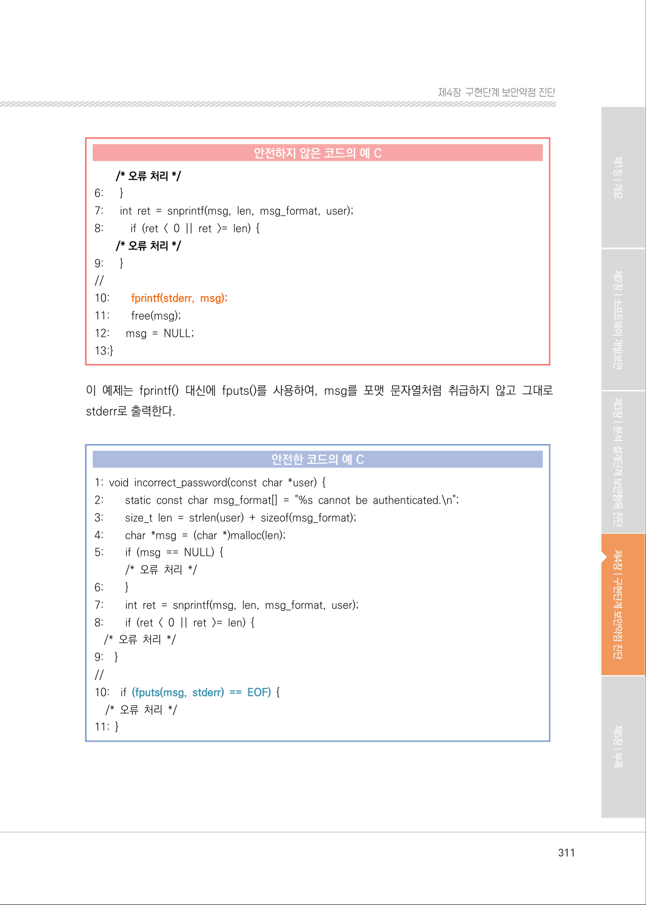
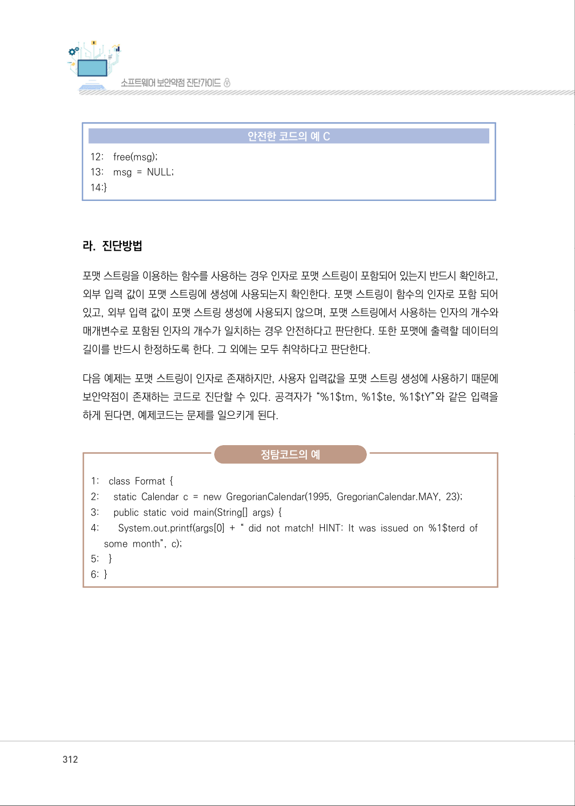
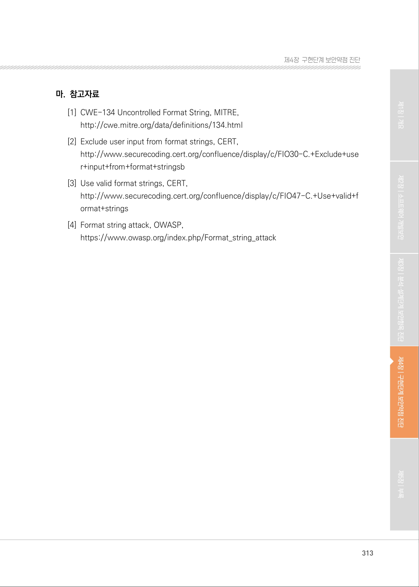

# 17. 포맷 스트링 삽입

> 변환 안내(원문 외): 아래 본문은 PDF 텍스트를 추출한 전사입니다. 코드 줄번호·특수 공백·원문 오류를 유지했습니다. 실행용 코드가 아닙니다. 표·그림·들여쓰기는 연결된 페이지 이미지와 대조하세요. 페이지 경계의 줄바꿈을 보존하며, 동일 페이지가 여러 항목에 나뉘면 각 항목의 본문은 해당 구간만 포함합니다.

### PDF 309페이지 / 인쇄 309페이지

<!-- source-page:SW-Diagnosis-2021:309; source-lines:0,2,3,4,5,6,7,8,9,10,11,12,13,14,15,16,17,18,19,20,21,22,23,24,25,26,27 -->

309

#### 17. 포맷 스트링 삽입

#### 가. 개요

외부로부터 입력된 값을 검증하지 않고 입·출력 함수의 포맷 문자열로 그대로 사용하는 경우 발생 할 수 
있는 보안약점이다. 공격자는 포맷 문자열을 이용하여 취약한 프로세스를 공격하거나 메모리 내용을 
읽거나 쓸 수 있다. 그 결과, 공격자는 취약한 프로세스의 권한을 취득하여 임의의 코드를 실행할 수 있다.

#### 나. 보안대책

printf(), snprintf() 등 포맷 문자열을 사용하는 함수를 사용할 때는 사용자 입력값을 직접적으로 
포맷 문자열로 사용하거나 포맷 문자열 생성에 포함시키지 않는다. 포맷 문자열을 사용하는 함수에 
사용자 입력값을 사용할 때는 사용자가 포맷 스트링을 변경할 수 있는 구조로 쓰지 않는다. 특히, 
%n, %hn은 공격자가 이를 이용해 특정 메모리 위치에 특정값을 변경할 수 있으므로 포맷 스트링 
매개변수로 사용하지 않는다. 사용자 입력값을 포맷 문자열을 사용하는 함수에 사용할 때는 가능하면 
%s 포맷 문자열을 지정하고, 사용자 입력값은 2번째 이후의 파라미터로 사용한다.

#### 다. 코드예제

포맷 스트링 보안약점은 C 언어에 국한된 것은 아니다. 아래 예제 코드는 입력 자료의 유효성을 검증
하지 않은 Java 프로그램에서도 발생할 수 있음을 보여준다. 이 프로그램에서 공격자는 %1$tm, 
%1$te, 또는 %1$tY과 같은 문자열을 입력하여 포맷 문자열에 포함시킴으로써, 실제 유효기간 
valid- Date가 출력되도록 할 수 있다.

#### 안전하지 않은 코드의 예 JAVA

```java
// 외부 입력값에 포맷 문자열 포함 여부를 확인하지 않고 포맷 문자열 출력에 값으로 사용
// args[0]의 값으로 “%1$tY-%1$tm-%1$te"를 전달하면 시스템에서 가지고 있는 날짜(2014-10-14) 
정보가 노출
1: import java.util.Calendar 
2: ......
3: public static void main(String[] args) {
4:      Calendar validDate = Calendar.getInstance();
```

<details><summary>원본 페이지 이미지 (변환 외 보존 자료)</summary>


</details>

### PDF 310페이지 / 인쇄 310페이지

<!-- source-page:SW-Diagnosis-2021:310; source-lines:0,1,2,3,4,5,6,7,8,9,10,11,12,13,14,15,16,17,18,19,20,21,22,23,24,25,26,27,28,29,30,31,32,33,34,35 -->

310

#### 안전하지 않은 코드의 예 JAVA

```java
5:      validDate.set(2014, Calendar.OCTOBER, 14); 
6:      System.out.printf( args[0] + " did not match! HINT: It was issued on %1$terd of 
some month", validate);
7: }
```

사용자로부터 입력받은 문자열을 포맷 문자열에 직접 포함시키지 않고, %s 포맷 문자열을 사용함
으로써 정보유출을 방지한다.

#### 안전한 코드의 예 JAVA

```java
// 외부 입력값이 포맷 문자열 출력에 사용되지 않도록 수정 
1: import java.util.Calendar 
2:         :
3: public static void main(String[] args) { 
4:      Calendar validDate = Calendar.getInstance(); 
5:      validDate.set(2014, Calendar.OCTOBER, 14); 
6:         System.out.printf("%s did not match! HINT: It was issued on %2$terd of some 
month", args[0], validate);
7: }
```

이 예제의 msg는 신뢰할 수 없는 사용자 입력을 포함하고 있고 fprintf() 호출에서 포맷 문자열 인자로 
전달되기 때문에 포맷 스트링 삽입에 취약하다.

#### 안전하지 않은 코드의 예 C

```c
1: void incorrect_password(const char *user) {
2:      static const char msg_format[] = "%s cannot be authenticated.\n";
3:      size_t len = strlen(user) + sizeof(msg_format);
4:      char *msg = (char *)malloc(len);
5:      if (msg == NULL) {
```

<details><summary>원본 페이지 이미지 (변환 외 보존 자료)</summary>



</details>

### PDF 311페이지 / 인쇄 311페이지

<!-- source-page:SW-Diagnosis-2021:311; source-lines:0,1,2,3,4,5,6,7,8,9,10,11,12,13,14,15,16,17,18,19,20,21,22,23,24,25,26,27,28,29,30,31,32,33,34,35,36,37,38,39,40,41,42,43,44,45,46,47 -->

311

제4장구현단계 보안약점 진단

#### 안전하지 않은 코드의 예 C

```c
/* 오류 처리 */
6:      }
7:      int ret = snprintf(msg, len, msg_format, user); 
8:         if (ret < 0 || ret >= len) { 
/* 오류 처리 */
9:      }
//
10:        fprintf(stderr, msg);
11:        free(msg);
12:      msg = NULL;
13:}
```

이 예제는 fprintf() 대신에 fputs()를 사용하여, msg를 포맷 문자열처럼 취급하지 않고 그대로 
stderr로 출력한다.

#### 안전한 코드의 예 C

```c
1: void incorrect_password(const char *user) { 
2:        static const char msg_format[] = "%s cannot be authenticated.\n"; 
3:        size_t len = strlen(user) + sizeof(msg_format); 
4:        char *msg = (char *)malloc(len); 
5:        if (msg == NULL) {
/* 오류 처리 */ 
6:        }
7:        int ret = snprintf(msg, len, msg_format, user); 
8:        if (ret < 0 || ret >= len) { 
/* 오류 처리 */ 
9:    }
//
10:    if (fputs(msg, stderr) == EOF) { 
/* 오류 처리 */ 
11: }
```

<details><summary>원본 페이지 이미지 (변환 외 보존 자료)</summary>



</details>

### PDF 312페이지 / 인쇄 312페이지

<!-- source-page:SW-Diagnosis-2021:312; source-lines:0,1,2,3,4,5,6,7,8,9,10,11,12,13,14,15,16,17,18,19,20,21,22,23,24,25,26,27,28 -->

312

#### 안전한 코드의 예 C

```c
12:    free(msg);
13:    msg = NULL;
14:}
```

#### 라. 진단방법

포맷 스트링을 이용하는 함수를 사용하는 경우 인자로 포맷 스트링이 포함되어 있는지 반드시 확인하고, 
외부 입력 값이 포맷 스트링에 생성에 사용되는지 확인한다. 포맷 스트링이 함수의 인자로 포함 되어 
있고, 외부 입력 값이 포맷 스트링 생성에 사용되지 않으며, 포맷 스트링에서 사용하는 인자의 개수와 
매개변수로 포함된 인자의 개수가 일치하는 경우 안전하다고 판단한다. 또한 포맷에 출력할 데이터의 
길이를 반드시 한정하도록 한다. 그 외에는 모두 취약하다고 판단한다.

다음 예제는 포맷 스트링이 인자로 존재하지만, 사용자 입력값을 포맷 스트링 생성에 사용하기 때문에 
보안약점이 존재하는 코드로 진단할 수 있다. 공격자가 “%1$tm, %1$te, %1$tY”와 같은 입력을 
하게 된다면, 예제코드는 문제를 일으키게 된다.

정탐코드의 예

```text
1:    class Format { 
2:      static Calendar c = new GregorianCalendar(1995, GregorianCalendar.MAY, 23);
3:      public static void main(String[] args) { 
4:        System.out.printf(args[0] + “ did not match! HINT: It was issued on %1$terd of 
some month”, c);
5:    }
6: }
```

<details><summary>원본 페이지 이미지 (변환 외 보존 자료)</summary>



</details>

### PDF 313페이지 / 인쇄 313페이지

<!-- source-page:SW-Diagnosis-2021:313; source-lines:0,1,2,3,4,5,6,7,8,9,10,11,12 -->

313

제4장구현단계 보안약점 진단

#### 마. 참고자료

[1] CWE-134 Uncontrolled Format String, MITRE,

http://cwe.mitre.org/data/definitions/134.html
[2] Exclude user input from format strings, CERT,

http://www.securecoding.cert.org/confluence/display/c/FIO30-C.+Exclude+use
r+input+from+format+stringsb
[3] Use valid format strings, CERT,

http://www.securecoding.cert.org/confluence/display/c/FIO47-C.+Use+valid+f
ormat+strings
[4] Format string attack, OWASP,

https://www.owasp.org/index.php/Format_string_attack

<details><summary>원본 페이지 이미지 (변환 외 보존 자료)</summary>



</details>

---

## 탐색 링크 (원문 외)

[통합 인덱스](../../../INDEX.md)

