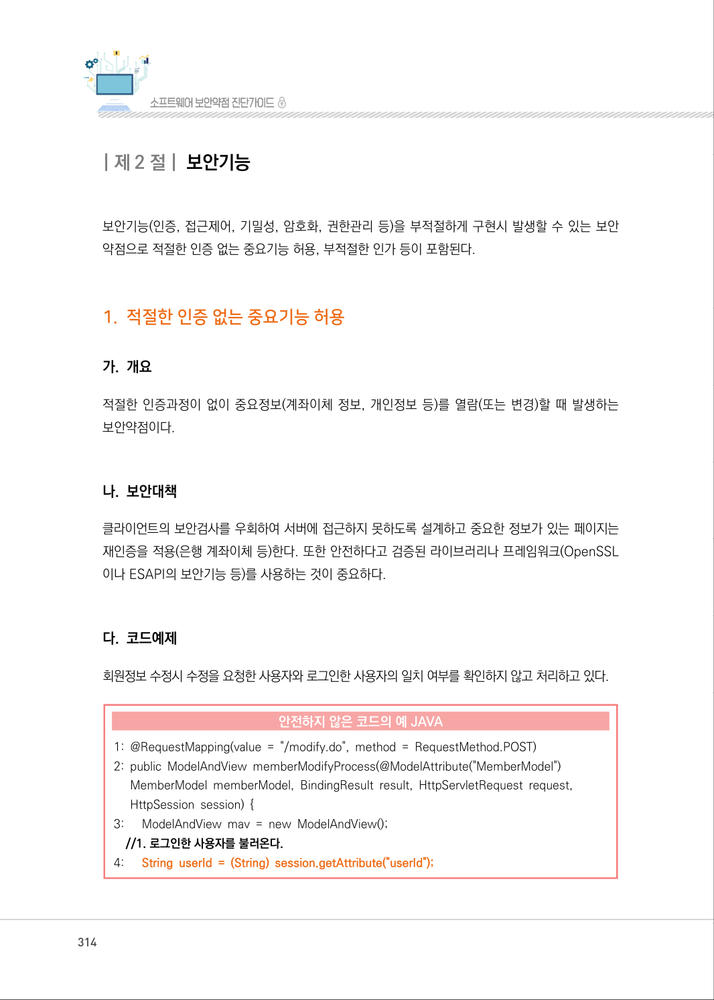
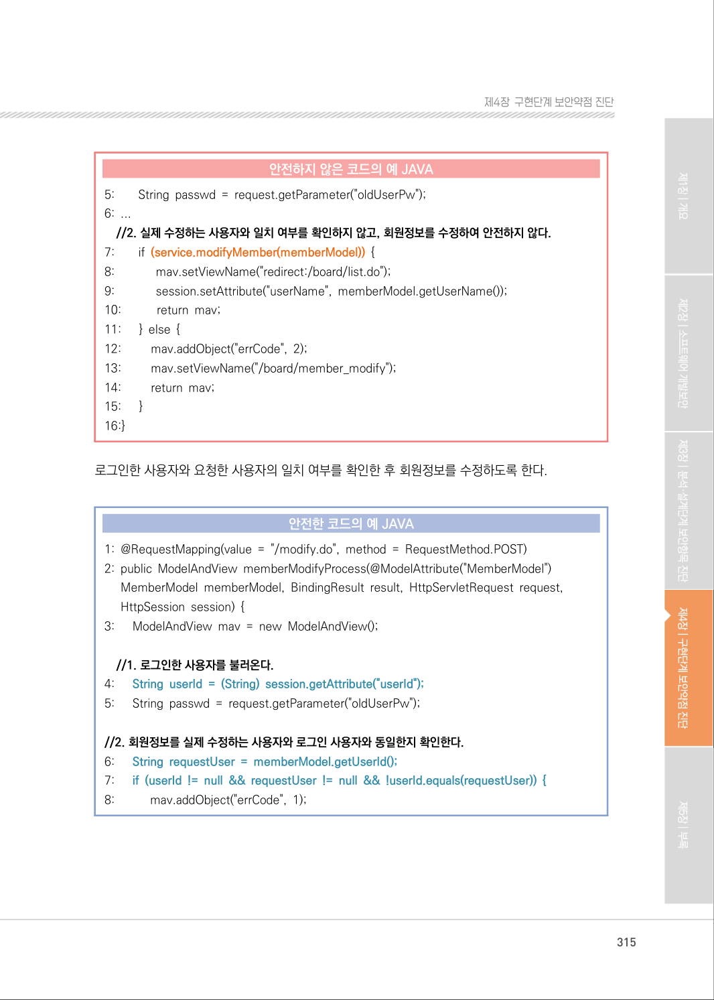
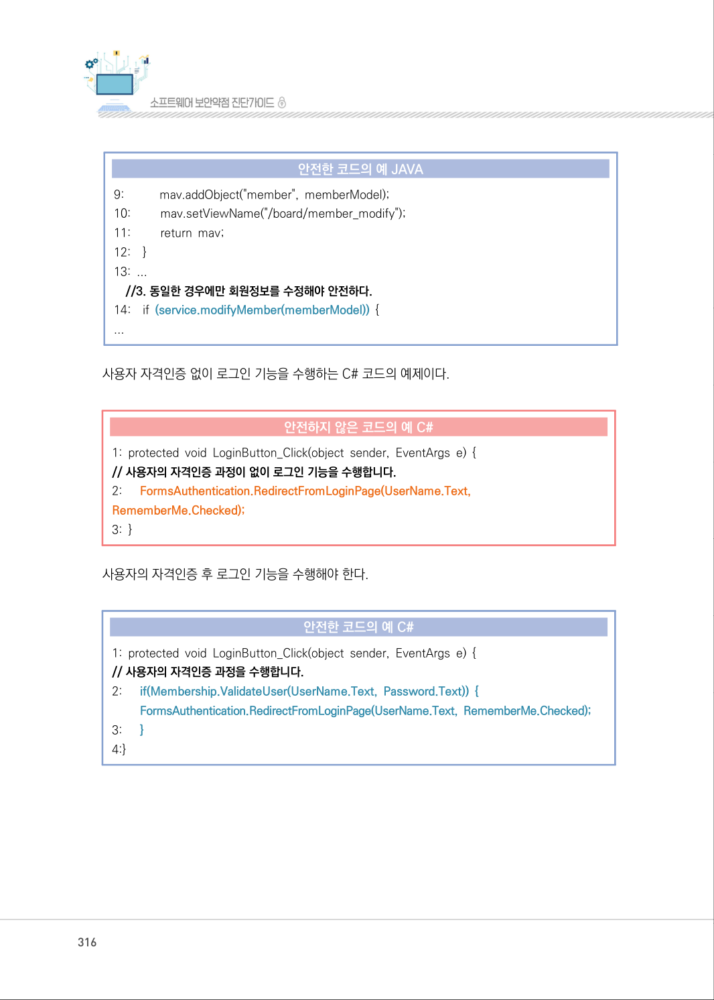
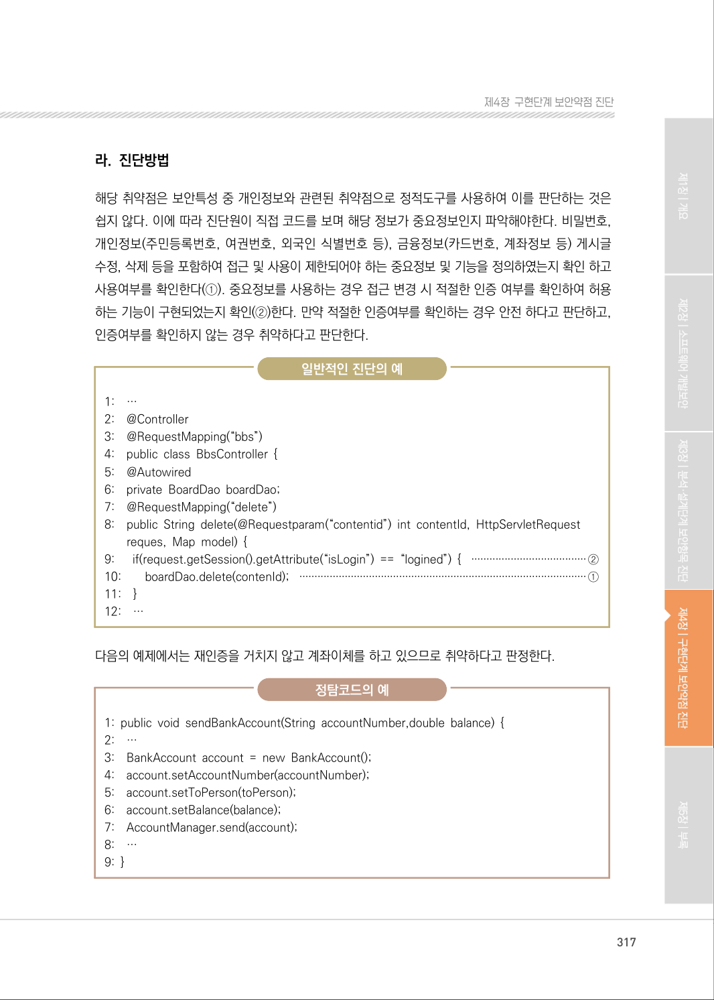
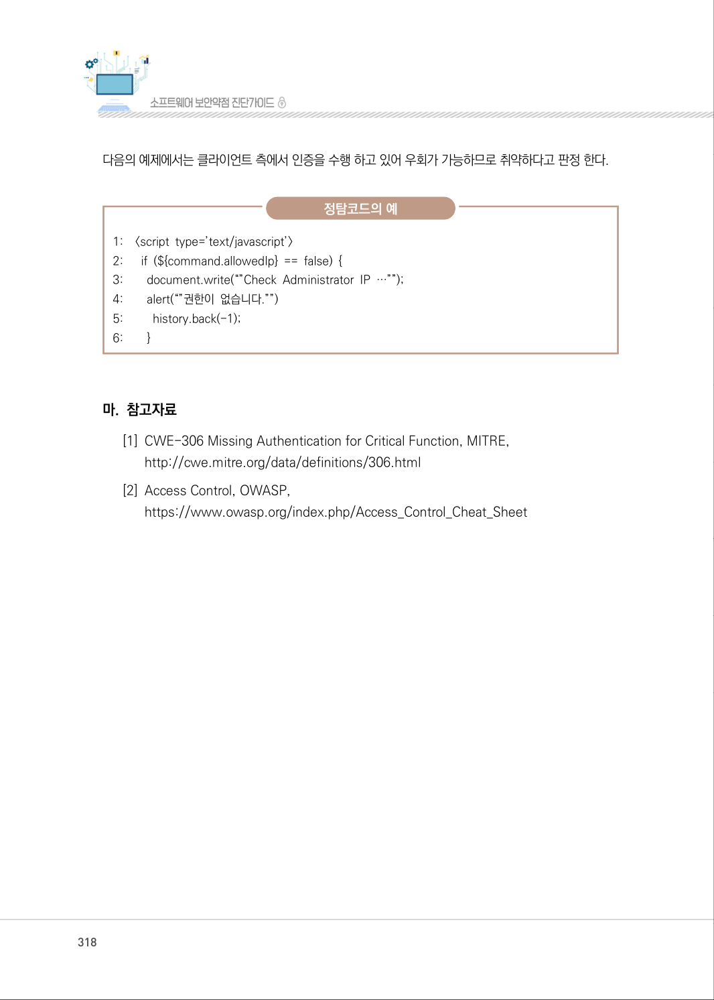
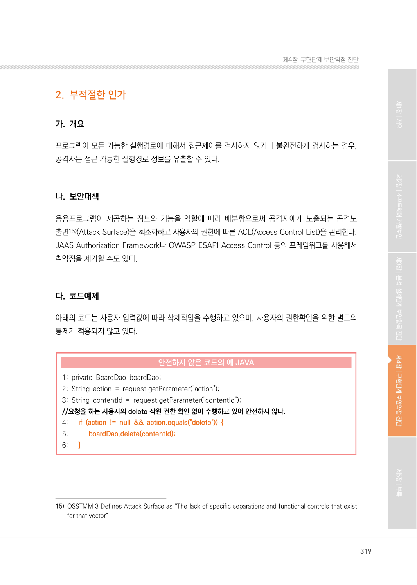

# 1. 적절한 인증 없는 중요기능 허용

> 변환 안내(원문 외): 아래 본문은 PDF 텍스트를 추출한 전사입니다. 코드 줄번호·특수 공백·원문 오류를 유지했습니다. 실행용 코드가 아닙니다. 표·그림·들여쓰기는 연결된 페이지 이미지와 대조하세요. 페이지 경계의 줄바꿈을 보존하며, 동일 페이지가 여러 항목에 나뉘면 각 항목의 본문은 해당 구간만 포함합니다.

### PDF 314페이지 / 인쇄 314페이지

<!-- source-page:SW-Diagnosis-2021:314; source-lines:0,4,5,6,7,8,9,10,11,12,13,14,15,16,17,18,19,20,21,22,23 -->

314

#### 1. 적절한 인증 없는 중요기능 허용

#### 가. 개요

적절한 인증과정이 없이 중요정보(계좌이체 정보, 개인정보 등)를 열람(또는 변경)할 때 발생하는 
보안약점이다.

#### 나. 보안대책

클라이언트의 보안검사를 우회하여 서버에 접근하지 못하도록 설계하고 중요한 정보가 있는 페이지는 
재인증을 적용(은행 계좌이체 등)한다. 또한 안전하다고 검증된 라이브러리나 프레임워크(OpenSSL
이나 ESAPI의 보안기능 등)를 사용하는 것이 중요하다.

#### 다. 코드예제

회원정보 수정시 수정을 요청한 사용자와 로그인한 사용자의 일치 여부를 확인하지 않고 처리하고 있다.

#### 안전하지 않은 코드의 예 JAVA

```java
1: @RequestMapping(value = "/modify.do", method = RequestMethod.POST) 
2: public ModelAndView memberModifyProcess(@ModelAttribute("MemberModel") 
MemberModel memberModel, BindingResult result, HttpServletRequest request, 
HttpSession session) { 
```

```text
3:      ModelAndView mav = new ModelAndView(); 
//1. 로그인한 사용자를 불러온다.
4:      String userId = (String) session.getAttribute("userId");
```

<details><summary>원본 페이지 이미지 (변환 외 보존 자료)</summary>



</details>

### PDF 315페이지 / 인쇄 315페이지

<!-- source-page:SW-Diagnosis-2021:315; source-lines:0,1,2,3,4,5,6,7,8,9,10,11,12,13,14,15,16,17,18,19,20,21,22,23,24,25,26,27,28,29,30,31,32,33,34,35,36,37,38,39,40,41,42,43,44,45 -->

315

제4장구현단계 보안약점 진단

#### 안전하지 않은 코드의 예 JAVA

```java
5:        String passwd = request.getParameter("oldUserPw"); 
6: ...
//2. 실제 수정하는 사용자와 일치 여부를 확인하지 않고, 회원정보를 수정하여 안전하지 않다.
7:        if (service.modifyMember(memberModel)) { 
8:             mav.setViewName("redirect:/board/list.do"); 
9:             session.setAttribute("userName", memberModel.getUserName());
10:           return mav;
11:      } else { 
12:         mav.addObject("errCode", 2); 
13:         mav.setViewName("/board/member_modify"); 
14:         return mav;
15:      }
16:}
```

로그인한 사용자와 요청한 사용자의 일치 여부를 확인한 후 회원정보를 수정하도록 한다. 

#### 안전한 코드의 예 JAVA

```java
1: @RequestMapping(value = "/modify.do", method = RequestMethod.POST) 
2: public ModelAndView memberModifyProcess(@ModelAttribute("MemberModel") 
MemberModel memberModel, BindingResult result, HttpServletRequest request, 
HttpSession session) { 
```

3:

ModelAndView mav = new ModelAndView(); 

//1. 로그인한 사용자를 불러온다.

```text
4:      String userId = (String) session.getAttribute("userId");
5:      String passwd = request.getParameter("oldUserPw");
//2. 회원정보를 실제 수정하는 사용자와 로그인 사용자와 동일한지 확인한다.
```

```text
6:      String requestUser = memberModel.getUserId();
7:      if (userId != null && requestUser != null && !userId.equals(requestUser)) {
8:           mav.addObject("errCode", 1);
```

<details><summary>원본 페이지 이미지 (변환 외 보존 자료)</summary>



</details>

### PDF 316페이지 / 인쇄 316페이지

<!-- source-page:SW-Diagnosis-2021:316; source-lines:0,1,2,3,4,5,6,7,8,9,10,11,12,13,14,15,16,17,18,19,20,21,22,23,24,25,26,27,28,29,30,31,32 -->

316

#### 안전한 코드의 예 JAVA

```java
9:           mav.addObject("member", memberModel); 
10:         mav.setViewName("/board/member_modify"); 
11:         return mav; 
12:    }
13: ...
//3. 동일한 경우에만 회원정보를 수정해야 안전하다.
14:    if (service.modifyMember(memberModel)) {
...
```

사용자 자격인증 없이 로그인 기능을 수행하는 C# 코드의 예제이다.

#### 안전하지 않은 코드의 예 C#

```csharp
1: protected void LoginButton_Click(object sender, EventArgs e) { 
// 사용자의 자격인증 과정이 없이 로그인 기능을 수행합니다.
2:      FormsAuthentication.RedirectFromLoginPage(UserName.Text,
RememberMe.Checked); 
3: }
```

사용자의 자격인증 후 로그인 기능을 수행해야 한다.

#### 안전한 코드의 예 C#

```csharp
1: protected void LoginButton_Click(object sender, EventArgs e) { 
// 사용자의 자격인증 과정을 수행합니다.
2:      if(Membership.ValidateUser(UserName.Text, Password.Text)) { 
FormsAuthentication.RedirectFromLoginPage(UserName.Text, RememberMe.Checked);
3:      }
4:}
```

<details><summary>원본 페이지 이미지 (변환 외 보존 자료)</summary>



</details>

### PDF 317페이지 / 인쇄 317페이지

<!-- source-page:SW-Diagnosis-2021:317; source-lines:0,1,2,3,4,5,6,7,8,9,10,11,12,13,14,15,16,17,18,19,20,21,22,23,24,25,26,27,28,29,30,31,32,33,34,35,36,37,38,39,40,41,42,43,44,45,46,47,48,49,50,51,52,53 -->

317

제4장구현단계 보안약점 진단

#### 라. 진단방법

해당 취약점은 보안특성 중 개인정보와 관련된 취약점으로 정적도구를 사용하여 이를 판단하는 것은 
쉽지 않다. 이에 따라 진단원이 직접 코드를 보며 해당 정보가 중요정보인지 파악해야한다. 비밀번호, 
개인정보(주민등록번호, 여권번호, 외국인 식별번호 등), 금융정보(카드번호, 계좌정보 등) 게시글 
수정, 삭제 등을 포함하여 접근 및 사용이 제한되어야 하는 중요정보 및 기능을 정의하였는지 확인 하고 
사용여부를 확인한다(①). 중요정보를 사용하는 경우 접근 변경 시 적절한 인증 여부를 확인하여 허용
하는 기능이 구현되었는지 확인(②)한다. 만약 적절한 인증여부를 확인하는 경우 안전 하다고 판단하고, 
인증여부를 확인하지 않는 경우 취약하다고 판단한다.

일반적인 진단의 예

```text
1:    …
2:    @Controller
3:    @RequestMapping(“bbs”) 
4:    public class BbsController { 
5:    @Autowired 
6:    private BoardDao boardDao; 
7:    @RequestMapping(“delete”) 
8:    public String delete(@Requestparam(“contentid”) int contentId, HttpServletRequest 
reques, Map model) { 
9:      if(request.getSession().getAttribute(“isLogin”) == “logined”) { ······································②
10:        boardDao.delete(contenId); ·······························································································①
11:    }
12:    …
```

다음의 예제에서는 재인증을 거치지 않고 계좌이체를 하고 있으므로 취약하다고 판정한다.

정탐코드의 예

```text
1: public void sendBankAccount(String accountNumber,double balance) {
2:    …
3:    BankAccount account = new BankAccount(); 
4:    account.setAccountNumber(accountNumber); 
5:    account.setToPerson(toPerson); 
6:    account.setBalance(balance); 
7:    AccountManager.send(account); 
8:    …
9: }
```

<details><summary>원본 페이지 이미지 (변환 외 보존 자료)</summary>



</details>

### PDF 318페이지 / 인쇄 318페이지

<!-- source-page:SW-Diagnosis-2021:318; source-lines:0,1,2,3,4,5,6,7,8,9,10,11,12,13,14,15,16,17,18,19 -->

318

다음의 예제에서는 클라이언트 측에서 인증을 수행 하고 있어 우회가 가능하므로 취약하다고 판정 한다.

정탐코드의 예

```text
1:    <script type=’text/javascript’> 
2:      if (${command.allowedIp} == false) { 
3:        document.write(“”Check Administrator IP …””); 
4:        alert(“”권한이 없습니다.””) 
5:         history.back(-1); 
6:        }
```

#### 마. 참고자료

[1] CWE-306 Missing Authentication for Critical Function, MITRE,

http://cwe.mitre.org/data/definitions/306.html 
[2] Access Control, OWASP,

https://www.owasp.org/index.php/Access_Control_Cheat_Sheet

<details><summary>원본 페이지 이미지 (변환 외 보존 자료)</summary>



</details>

### PDF 319페이지 / 인쇄 319페이지

<!-- source-page:SW-Diagnosis-2021:319; source-lines:1 -->

제4장구현단계 보안약점 진단

<details><summary>원본 페이지 이미지 (변환 외 보존 자료)</summary>



</details>

---

## 탐색 링크 (원문 외)

[통합 인덱스](../../../INDEX.md)

