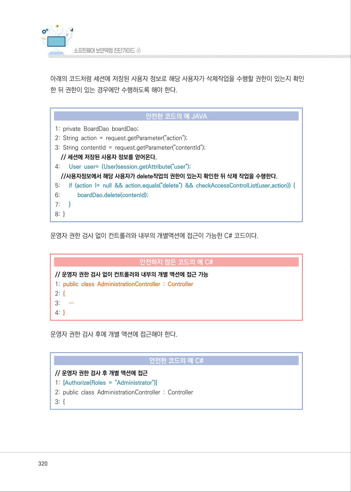
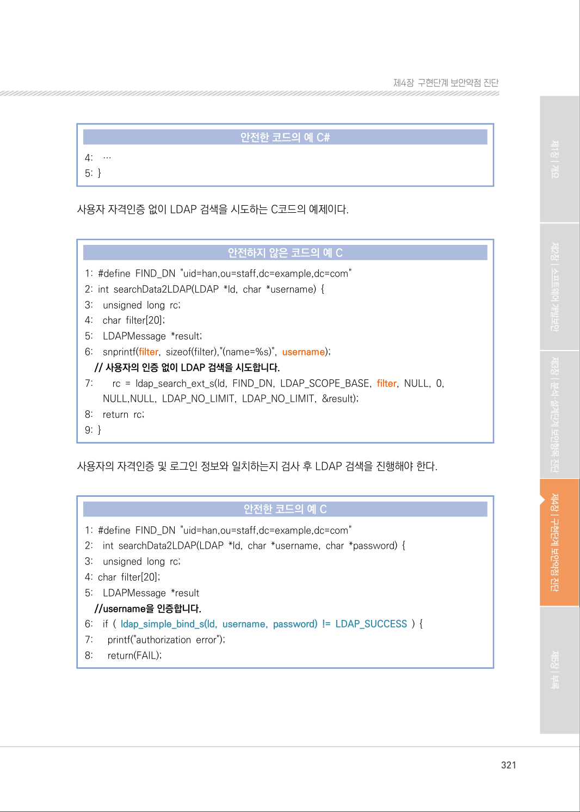
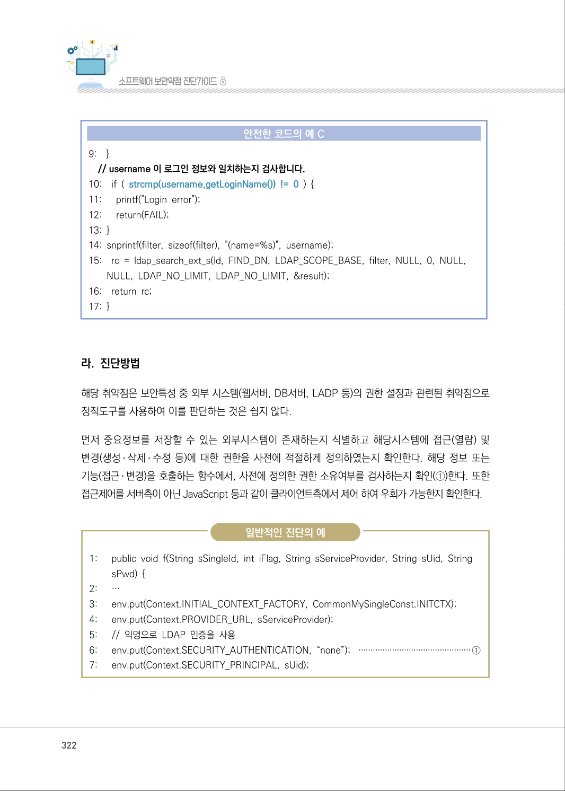
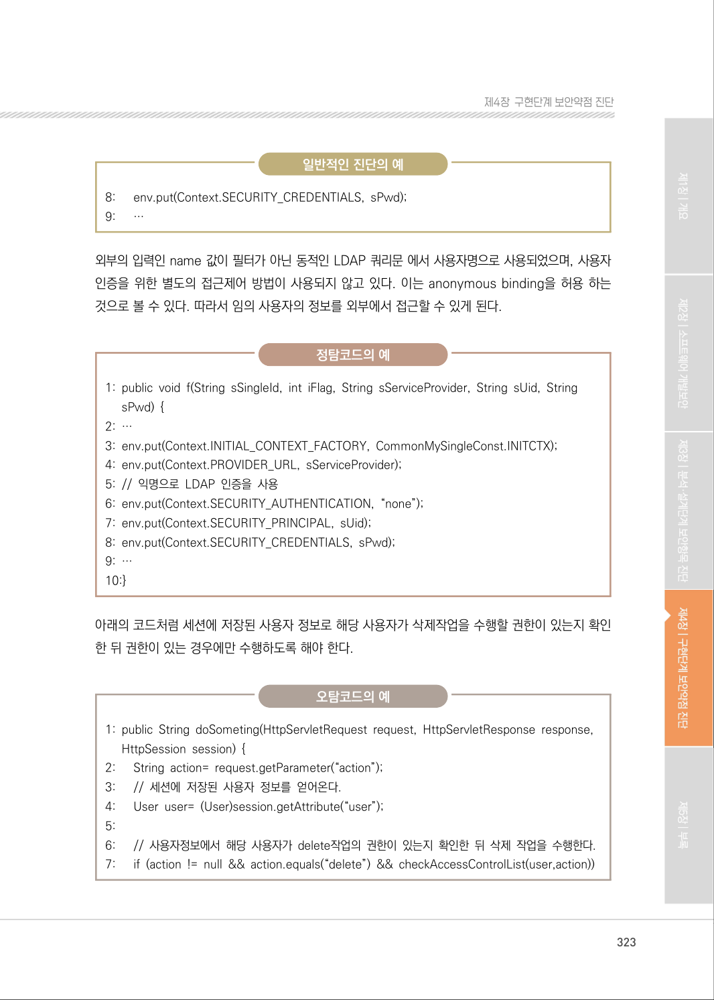
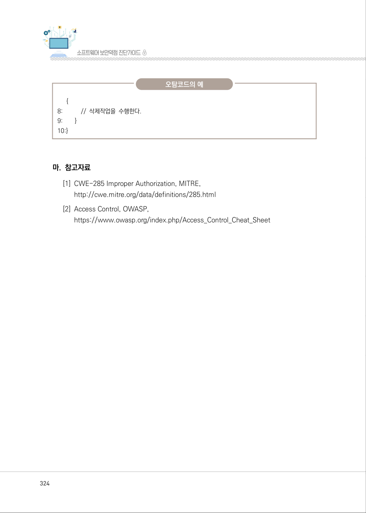

# 2. 부적절한 인가

> 변환 안내(원문 외): 아래 본문은 PDF 텍스트를 추출한 전사입니다. 코드 줄번호·특수 공백·원문 오류를 유지했습니다. 실행용 코드가 아닙니다. 표·그림·들여쓰기는 연결된 페이지 이미지와 대조하세요. 페이지 경계의 줄바꿈을 보존하며, 동일 페이지가 여러 항목에 나뉘면 각 항목의 본문은 해당 구간만 포함합니다.

### PDF 319페이지 / 인쇄 319페이지

<!-- source-page:SW-Diagnosis-2021:319; source-lines:0,2,3,4,5,6,7,8,9,10,11,12,13,14,15,16,17,18,19,20,21,22,23,24,25,26 -->

319

#### 2. 부적절한 인가

#### 가. 개요

프로그램이 모든 가능한 실행경로에 대해서 접근제어를 검사하지 않거나 불완전하게 검사하는 경우, 
공격자는 접근 가능한 실행경로 정보를 유출할 수 있다.

#### 나. 보안대책

응용프로그램이 제공하는 정보와 기능을 역할에 따라 배분함으로써 공격자에게 노출되는 공격노 
출면15)(Attack Surface)을 최소화하고 사용자의 권한에 따른 ACL(Access Control List)을 관리한다. 
JAAS Authorization Framework나 OWASP ESAPI Access Control 등의 프레임워크를 사용해서 
취약점을 제거할 수도 있다.

#### 다. 코드예제

아래의 코드는 사용자 입력값에 따라 삭제작업을 수행하고 있으며, 사용자의 권한확인을 위한 별도의 
통제가 적용되지 않고 있다.

#### 안전하지 않은 코드의 예 JAVA

```java
1: private BoardDao boardDao; 
2: String action = request.getParameter("action"); 
3: String contentId = request.getParameter("contentId"); 
//요청을 하는 사용자의 delete 작원 권한 확인 없이 수행하고 있어 안전하지 않다.
4:      if (action != null && action.equals("delete")) { 
5:           boardDao.delete(contentId);
6:      }
```

15) OSSTMM 3 Defines Attack Surface as “The lack of specific separations and functional controls that exist 

for that vector”

<details><summary>원본 페이지 이미지 (변환 외 보존 자료)</summary>


</details>

### PDF 320페이지 / 인쇄 320페이지

<!-- source-page:SW-Diagnosis-2021:320; source-lines:0,1,2,3,4,5,6,7,8,9,10,11,12,13,14,15,16,17,18,19,20,21,22,23,24,25,26,27,28,29,30,31 -->

320

아래의 코드처럼 세션에 저장된 사용자 정보로 해당 사용자가 삭제작업을 수행할 권한이 있는지 확인
한 뒤 권한이 있는 경우에만 수행하도록 해야 한다.

#### 안전한 코드의 예 JAVA

```java
1: private BoardDao boardDao; 
2: String action = request.getParameter("action"); 
3: String contentId = request.getParameter("contentId"); 
// 세션에 저장된 사용자 정보를 얻어온다. 
4:      User user= (User)session.getAttribute("user");
//사용자정보에서 해당 사용자가 delete작업의 권한이 있는지 확인한 뒤 삭제 작업을 수행한다.
5:      if (action != null && action.equals("delete") && checkAccessControlList(user,action)) {
6:           boardDao.delete(contenId);
7:      }
8: }
```

운영자 권한 검사 없이 컨트롤러와 내부의 개별액션에 접근이 가능한 C# 코드이다.

#### 안전하지 않은 코드의 예 C#

```csharp
// 운영자 권한 검사 없이 컨트롤러와 내부의 개별 액션에 접근 가능 
1: public class AdministrationController : Controller
2: {
3:      …
4: }
```

운영자 권한 검사 후에 개별 액션에 접근해야 한다.

#### 안전한 코드의 예 C#

```csharp
// 운영자 권한 검사 후 개별 액션에 접근 
1: [Authorize(Roles = "Administrator")]
2: public class AdministrationController : Controller
3: {
```

<details><summary>원본 페이지 이미지 (변환 외 보존 자료)</summary>



</details>

### PDF 321페이지 / 인쇄 321페이지

<!-- source-page:SW-Diagnosis-2021:321; source-lines:0,1,2,3,4,5,6,7,8,9,10,11,12,13,14,15,16,17,18,19,20,21,22,23,24,25,26,27,28,29,30,31,32,33,34,35,36,37,38,39,40,41 -->

321

제4장구현단계 보안약점 진단

#### 안전한 코드의 예 C#

```csharp
4:    …
5: }
```

사용자 자격인증 없이 LDAP 검색을 시도하는 C코드의 예제이다.

#### 안전하지 않은 코드의 예 C

```c
1: #define FIND_DN "uid=han,ou=staff,dc=example,dc=com" 
2: int searchData2LDAP(LDAP *ld, char *username) { 
3:    unsigned long rc; 
4:    char filter[20]; 
5:    LDAPMessage *result; 
6:    snprintf(filter, sizeof(filter),"(name=%s)", username);
// 사용자의 인증 없이 LDAP 검색을 시도합니다.
7:        rc = ldap_search_ext_s(ld, FIND_DN, LDAP_SCOPE_BASE, filter, NULL, 0, 
NULL,NULL, LDAP_NO_LIMIT, LDAP_NO_LIMIT, &result); 
8:    return rc; 
9: }
```

사용자의 자격인증 및 로그인 정보와 일치하는지 검사 후 LDAP 검색을 진행해야 한다. 

#### 안전한 코드의 예 C

```c
1: #define FIND_DN "uid=han,ou=staff,dc=example,dc=com" 
2:    int searchData2LDAP(LDAP *ld, char *username, char *password) {
3:    unsigned long rc;
4: char filter[20];
5:    LDAPMessage *result 
//username을 인증합니다.
6:    if ( ldap_simple_bind_s(ld, username, password) != LDAP_SUCCESS ) {
7:      printf("authorization error");
8:      return(FAIL);
```

<details><summary>원본 페이지 이미지 (변환 외 보존 자료)</summary>



</details>

### PDF 322페이지 / 인쇄 322페이지

<!-- source-page:SW-Diagnosis-2021:322; source-lines:0,1,2,3,4,5,6,7,8,9,10,11,12,13,14,15,16,17,18,19,20,21,22,23,24,25,26,27,28,29,30,31,32,33,34,35,36,37,38,39,40,41 -->

322

#### 안전한 코드의 예 C

```c
9:    }
// username 이 로그인 정보와 일치하는지 검사합니다.
10:    if ( strcmp(username,getLoginName()) != 0 ) { 
11:      printf("Login error"); 
12:      return(FAIL);
13: }
14: snprintf(filter, sizeof(filter), "(name=%s)", username); 
15:    rc = ldap_search_ext_s(ld, FIND_DN, LDAP_SCOPE_BASE, filter, NULL, 0, NULL, 
NULL, LDAP_NO_LIMIT, LDAP_NO_LIMIT, &result); 
16:    return rc; 
17: }
```

#### 라. 진단방법

해당 취약점은 보안특성 중 외부 시스템(웹서버, DB서버, LADP 등)의 권한 설정과 관련된 취약점으로 
정적도구를 사용하여 이를 판단하는 것은 쉽지 않다.

먼저 중요정보를 저장할 수 있는 외부시스템이 존재하는지 식별하고 해당시스템에 접근(열람) 및 
변경(생성․ 삭제․ 수정 등)에 대한 권한을 사전에 적절하게 정의하였는지 확인한다. 해당 정보 또는 
기능(접근․ 변경)을 호출하는 함수에서, 사전에 정의한 권한 소유여부를 검사하는지 확인(①)한다. 또한 
접근제어를 서버측이 아닌 JavaScript 등과 같이 클라이언트측에서 제어 하여 우회가 가능한지 확인한다.

일반적인 진단의 예

```text
1:      public void f(String sSingleId, int iFlag, String sServiceProvider, String sUid, String 
sPwd) { 
2:      …
3:      env.put(Context.INITIAL_CONTEXT_FACTORY, CommonMySingleConst.INITCTX);
4:      env.put(Context.PROVIDER_URL, sServiceProvider); 
5:      // 익명으로 LDAP 인증을 사용 
6:      env.put(Context.SECURITY_AUTHENTICATION, “none”); ···············································①
7:      env.put(Context.SECURITY_PRINCIPAL, sUid);
```

<details><summary>원본 페이지 이미지 (변환 외 보존 자료)</summary>



</details>

### PDF 323페이지 / 인쇄 323페이지

<!-- source-page:SW-Diagnosis-2021:323; source-lines:0,1,2,3,4,5,6,7,8,9,10,11,12,13,14,15,16,17,18,19,20,21,22,23,24,25,26,27,28,29,30,31,32,33,34,35,36,37 -->

323

제4장구현단계 보안약점 진단

일반적인 진단의 예

```text
8:      env.put(Context.SECURITY_CREDENTIALS, sPwd); 
9:      …
```

외부의 입력인 name 값이 필터가 아닌 동적인 LDAP 쿼리문 에서 사용자명으로 사용되었으며, 사용자 
인증을 위한 별도의 접근제어 방법이 사용되지 않고 있다. 이는 anonymous binding을 허용 하는 
것으로 볼 수 있다. 따라서 임의 사용자의 정보를 외부에서 접근할 수 있게 된다.

정탐코드의 예

```text
1: public void f(String sSingleId, int iFlag, String sServiceProvider, String sUid, String 
sPwd) {
2: …
3: env.put(Context.INITIAL_CONTEXT_FACTORY, CommonMySingleConst.INITCTX);
4: env.put(Context.PROVIDER_URL, sServiceProvider);
5: // 익명으로 LDAP 인증을 사용
6: env.put(Context.SECURITY_AUTHENTICATION, “none”);
7: env.put(Context.SECURITY_PRINCIPAL, sUid);
8: env.put(Context.SECURITY_CREDENTIALS, sPwd);
9: …
10:}
```

아래의 코드처럼 세션에 저장된 사용자 정보로 해당 사용자가 삭제작업을 수행할 권한이 있는지 확인
한 뒤 권한이 있는 경우에만 수행하도록 해야 한다.

오탐코드의 예

```text
1: public String doSometing(HttpServletRequest request, HttpServletResponse response, 
HttpSession session) {
2:      String action= request.getParameter(“action”);
3:      // 세션에 저장된 사용자 정보를 얻어온다.
4:      User user= (User)session.getAttribute(“user”); 
5:
6:      // 사용자정보에서 해당 사용자가 delete작업의 권한이 있는지 확인한 뒤 삭제 작업을 수행한다.
7:      if (action != null && action.equals(“delete”) && checkAccessControlList(user,action))
```

<details><summary>원본 페이지 이미지 (변환 외 보존 자료)</summary>



</details>

### PDF 324페이지 / 인쇄 324페이지

<!-- source-page:SW-Diagnosis-2021:324; source-lines:0,1,2,3,4,5,6,7,8,9,10,11,12 -->

324

오탐코드의 예

{

```text
8:           // 삭제작업을 수행한다.
9:        }
10:}
```

#### 마. 참고자료

[1] CWE-285 Improper Authorization, MITRE,

http://cwe.mitre.org/data/definitions/285.html
[2] Access Control, OWASP,

https://www.owasp.org/index.php/Access_Control_Cheat_Sheet

<details><summary>원본 페이지 이미지 (변환 외 보존 자료)</summary>



</details>

### PDF 325페이지 / 인쇄 325페이지

<!-- source-page:SW-Diagnosis-2021:325; source-lines:1 -->

제4장구현단계 보안약점 진단

<details><summary>원본 페이지 이미지 (변환 외 보존 자료)</summary>


</details>

---

## 탐색 링크 (원문 외)

[통합 인덱스](../../../INDEX.md)

