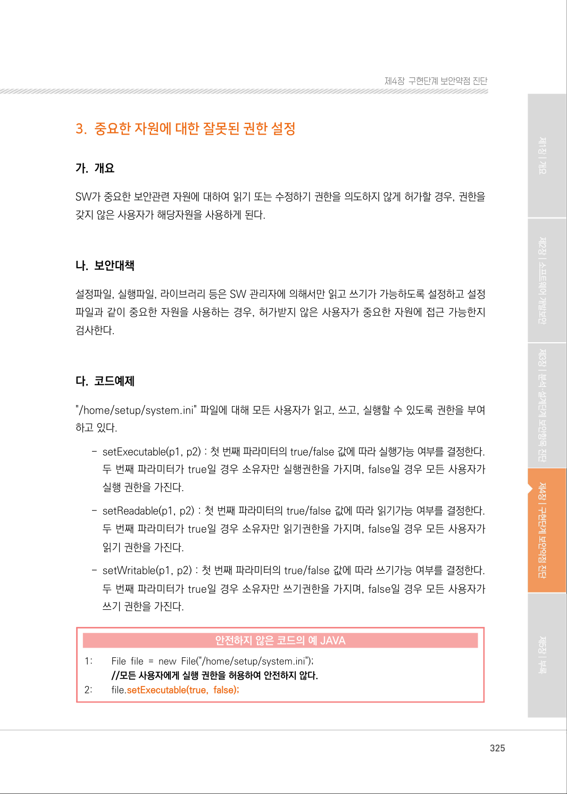
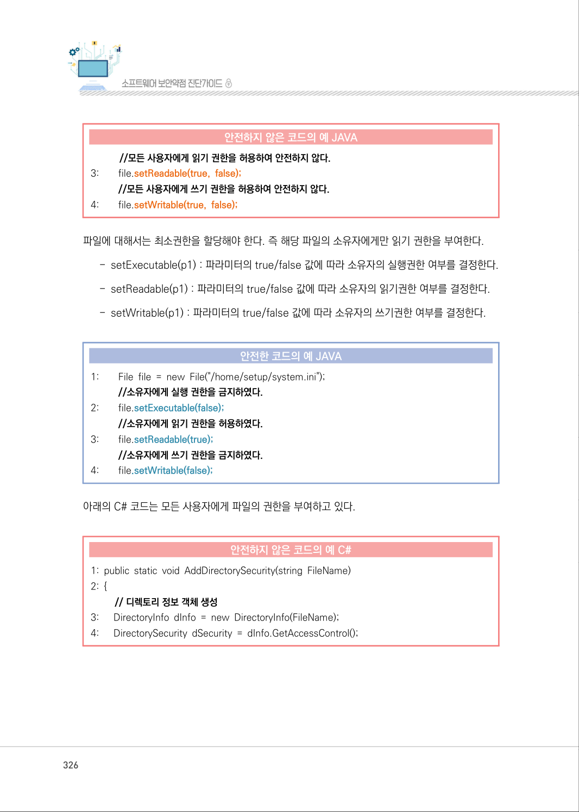
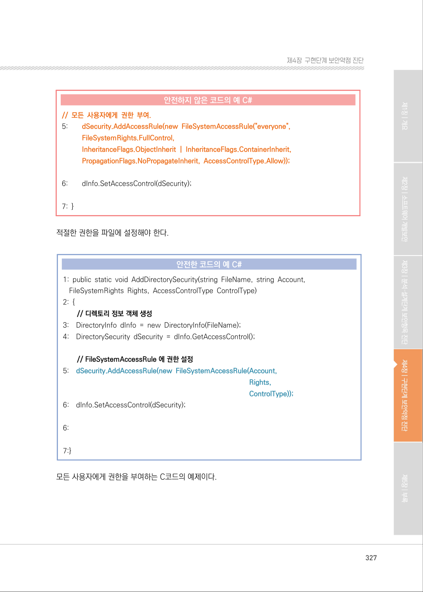
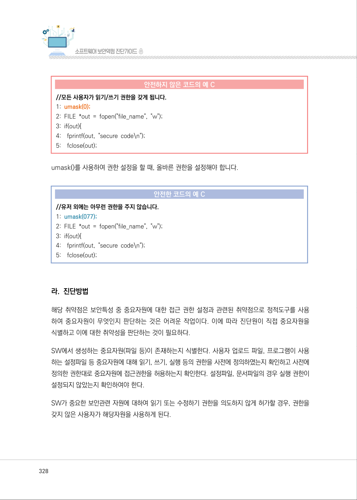
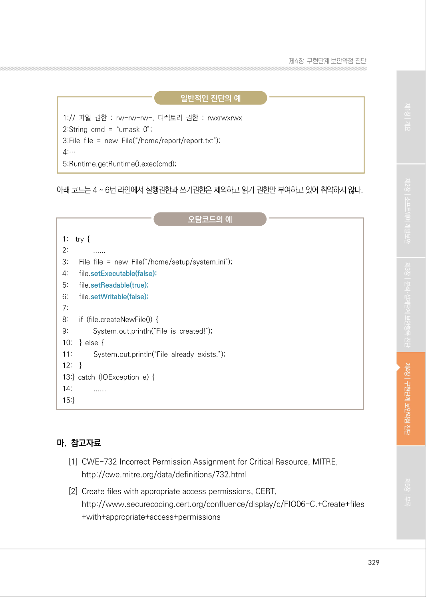

# 3. 중요한 자원에 대한 잘못된 권한 설정

> 변환 안내(원문 외): 아래 본문은 PDF 텍스트를 추출한 전사입니다. 코드 줄번호·특수 공백·원문 오류를 유지했습니다. 실행용 코드가 아닙니다. 표·그림·들여쓰기는 연결된 페이지 이미지와 대조하세요. 페이지 경계의 줄바꿈을 보존하며, 동일 페이지가 여러 항목에 나뉘면 각 항목의 본문은 해당 구간만 포함합니다.

### PDF 325페이지 / 인쇄 325페이지

<!-- source-page:SW-Diagnosis-2021:325; source-lines:0,2,3,4,5,6,7,8,9,10,11,12,13,14,15,16,17,18,19,20,21,22,23,24,25,26,27 -->

325

#### 3. 중요한 자원에 대한 잘못된 권한 설정

#### 가. 개요

SW가 중요한 보안관련 자원에 대하여 읽기 또는 수정하기 권한을 의도하지 않게 허가할 경우, 권한을 
갖지 않은 사용자가 해당자원을 사용하게 된다.

#### 나. 보안대책

설정파일, 실행파일, 라이브러리 등은 SW 관리자에 의해서만 읽고 쓰기가 가능하도록 설정하고 설정 
파일과 같이 중요한 자원을 사용하는 경우, 허가받지 않은 사용자가 중요한 자원에 접근 가능한지 
검사한다.

#### 다. 코드예제

"/home/setup/system.ini" 파일에 대해 모든 사용자가 읽고, 쓰고, 실행할 수 있도록 권한을 부여
하고 있다.

- setExecutable(p1, p2) : 첫 번째 파라미터의 true/false 값에 따라 실행가능 여부를 결정한다. 

두 번째 파라미터가 true일 경우 소유자만 실행권한을 가지며, false일 경우 모든 사용자가 
실행 권한을 가진다.
- setReadable(p1, p2) : 첫 번째 파라미터의 true/false 값에 따라 읽기가능 여부를 결정한다. 

두 번째 파라미터가 true일 경우 소유자만 읽기권한을 가지며, false일 경우 모든 사용자가 
읽기 권한을 가진다.
- setWritable(p1, p2) : 첫 번째 파라미터의 true/false 값에 따라 쓰기가능 여부를 결정한다. 

두 번째 파라미터가 true일 경우 소유자만 쓰기권한을 가지며, false일 경우 모든 사용자가 
쓰기 권한을 가진다.

#### 안전하지 않은 코드의 예 JAVA

```java
1:        File file = new File("/home/setup/system.ini");
//모든 사용자에게 실행 권한을 허용하여 안전하지 않다.
2:        file.setExecutable(true, false);
```

<details><summary>원본 페이지 이미지 (변환 외 보존 자료)</summary>



</details>

### PDF 326페이지 / 인쇄 326페이지

<!-- source-page:SW-Diagnosis-2021:326; source-lines:0,1,2,3,4,5,6,7,8,9,10,11,12,13,14,15,16,17,18,19,20,21,22,23,24,25,26,27,28,29,30,31,32 -->

326

#### 안전하지 않은 코드의 예 JAVA

```java
//모든 사용자에게 읽기 권한을 허용하여 안전하지 않다.
3:        file.setReadable(true, false);
//모든 사용자에게 쓰기 권한을 허용하여 안전하지 않다.
4:        file.setWritable(true, false);
```

파일에 대해서는 최소권한을 할당해야 한다. 즉 해당 파일의 소유자에게만 읽기 권한을 부여한다.

- setExecutable(p1) : 파라미터의 true/false 값에 따라 소유자의 실행권한 여부를 결정한다.
- setReadable(p1) : 파라미터의 true/false 값에 따라 소유자의 읽기권한 여부를 결정한다.
- setWritable(p1) : 파라미터의 true/false 값에 따라 소유자의 쓰기권한 여부를 결정한다.

#### 안전한 코드의 예 JAVA

```java
1:        File file = new File("/home/setup/system.ini");
//소유자에게 실행 권한을 금지하였다.
2:        file.setExecutable(false);
//소유자에게 읽기 권한을 허용하였다.
3:        file.setReadable(true);
//소유자에게 쓰기 권한을 금지하였다.
4:        file.setWritable(false);
```

아래의 C# 코드는 모든 사용자에게 파일의 권한을 부여하고 있다.

#### 안전하지 않은 코드의 예 C#

```csharp
1: public static void AddDirectorySecurity(string FileName) 
2: {
// 디렉토리 정보 객체 생성
3:      DirectoryInfo dInfo = new DirectoryInfo(FileName);
4:      DirectorySecurity dSecurity = dInfo.GetAccessControl();
```

<details><summary>원본 페이지 이미지 (변환 외 보존 자료)</summary>



</details>

### PDF 327페이지 / 인쇄 327페이지

<!-- source-page:SW-Diagnosis-2021:327; source-lines:0,1,2,3,4,5,6,7,8,9,10,11,12,13,14,15,16,17,18,19,20,21,22,23,24,25,26,27,28,29,30,31 -->

327

제4장구현단계 보안약점 진단

#### 안전하지 않은 코드의 예 C#

```csharp
// 모든 사용자에게 권한 부여.
5:        dSecurity.AddAccessRule(new FileSystemAccessRule("everyone", 
FileSystemRights.FullControl, 
InheritanceFlags.ObjectInherit | InheritanceFlags.ContainerInherit, 
PropagationFlags.NoPropagateInherit, AccessControlType.Allow));
```

```text
6:        dInfo.SetAccessControl(dSecurity);
7: }
```

적절한 권한을 파일에 설정해야 한다.

#### 안전한 코드의 예 C#

```csharp
1: public static void AddDirectorySecurity(string FileName, string Account, 
FileSystemRights Rights, AccessControlType ControlType)
2: {
// 디렉토리 정보 객체 생성
3:    DirectoryInfo dInfo = new DirectoryInfo(FileName);
4:    DirectorySecurity dSecurity = dInfo.GetAccessControl();
// FileSystemAccessRule 에 권한 설정
```

5:

dSecurity.AddAccessRule(new FileSystemAccessRule(Account,

Rights,
ControlType));

6:

dInfo.SetAccessControl(dSecurity); 

```text
6:
7:}
```

모든 사용자에게 권한을 부여하는 C코드의 예제이다.

<details><summary>원본 페이지 이미지 (변환 외 보존 자료)</summary>



</details>

### PDF 328페이지 / 인쇄 328페이지

<!-- source-page:SW-Diagnosis-2021:328; source-lines:0,1,2,3,4,5,6,7,8,9,10,11,12,13,14,15,16,17,18,19,20,21,22,23,24,25,26,27,28,29 -->

328

#### 안전하지 않은 코드의 예 C

```c
//모든 사용자가 읽기/쓰기 권한을 갖게 됩니다.
1: umask(0);
2: FILE *out = fopen("file_name", "w");
3: if(out){
4:    fprintf(out, "secure code\n");
5:    fclose(out);
```

umask()를 사용하여 권한 설정을 할 때, 올바른 권한을 설정해야 합니다.

#### 안전한 코드의 예 C

```c
//유저 외에는 아무런 권한을 주지 않습니다.
1: umask(077);
2: FILE *out = fopen("file_name", "w");
3: if(out){
4:    fprintf(out, "secure code\n");
5:    fclose(out);
```

#### 라. 진단방법

해당 취약점은 보안특성 중 중요자원에 대한 접근 권한 설정과 관련된 취약점으로 정적도구를 사용 
하여 중요자원이 무엇인지 판단하는 것은 어려운 작업이다. 이에 따라 진단원이 직접 중요자원을 
식별하고 이에 대한 취약성을 판단하는 것이 필요하다.

SW에서 생성하는 중요자원(파일 등)이 존재하는지 식별한다. 사용자 업로드 파일, 프로그램이 사용
하는 설정파일 등 중요자원에 대해 읽기, 쓰기, 실행 등의 권한을 사전에 정의하였는지 확인하고 사전에 
정의한 권한대로 중요자원에 접근권한을 허용하는지 확인한다. 설정파일, 문서파일의 경우 실행 권한이 
설정되지 않았는지 확인하여야 한다.

SW가 중요한 보안관련 자원에 대하여 읽기 또는 수정하기 권한을 의도하지 않게 허가할 경우, 권한을 
갖지 않은 사용자가 해당자원을 사용하게 된다.

<details><summary>원본 페이지 이미지 (변환 외 보존 자료)</summary>



</details>

### PDF 329페이지 / 인쇄 329페이지

<!-- source-page:SW-Diagnosis-2021:329; source-lines:0,1,2,3,4,5,6,7,8,9,10,11,12,13,14,15,16,17,18,19,20,21,22,23,24,25,26,27,28,29,30,31,32,33,34,35,36,37,38,39,40,41,42 -->

329

제4장구현단계 보안약점 진단

일반적인 진단의 예

```text
1:// 파일 권한 : rw-rw-rw-, 디렉토리 권한 : rwxrwxrwx
2:String cmd = “umask 0”;
3:File file = new File(“/home/report/report.txt”);
4:…
5:Runtime.getRuntime().exec(cmd);
```

아래 코드는 4 ~ 6번 라인에서 실행권한과 쓰기권한은 제외하고 읽기 권한만 부여하고 있어 취약하지 않다.

오탐코드의 예

```text
1:    try {
2:             ......
3:      File file = new File(“/home/setup/system.ini”); 
4:      file.setExecutable(false);
5:      file.setReadable(true);
6:      file.setWritable(false);
7:
8:      if (file.createNewFile()) {
9:             System.out.println(“File is created!”); 
10:    } else { 
11:           System.out.println(“File already exists.”); 
12:    }
13:} catch (IOException e) {
14:           ......
15:}
```

#### 마. 참고자료

[1] CWE-732 Incorrect Permission Assignment for Critical Resource, MITRE,

http://cwe.mitre.org/data/definitions/732.html
[2] Create files with appropriate access permissions, CERT,

http://www.securecoding.cert.org/confluence/display/c/FIO06-C.+Create+files
+with+appropriate+access+permissions

<details><summary>원본 페이지 이미지 (변환 외 보존 자료)</summary>



</details>

---

## 탐색 링크 (원문 외)

[통합 인덱스](../../../INDEX.md)

