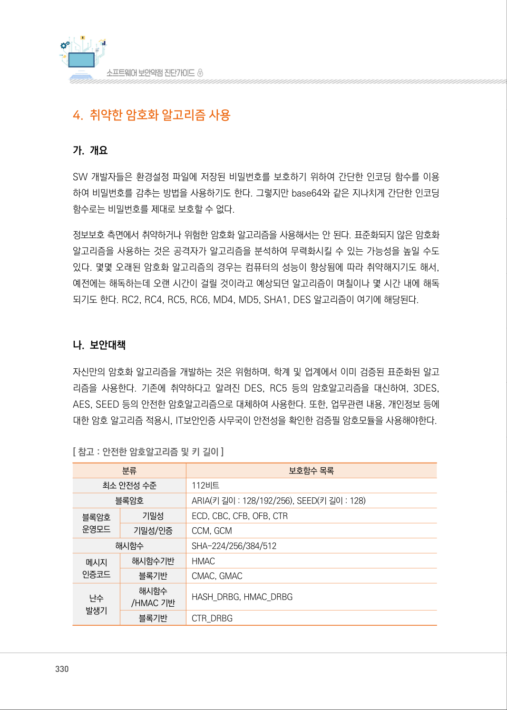
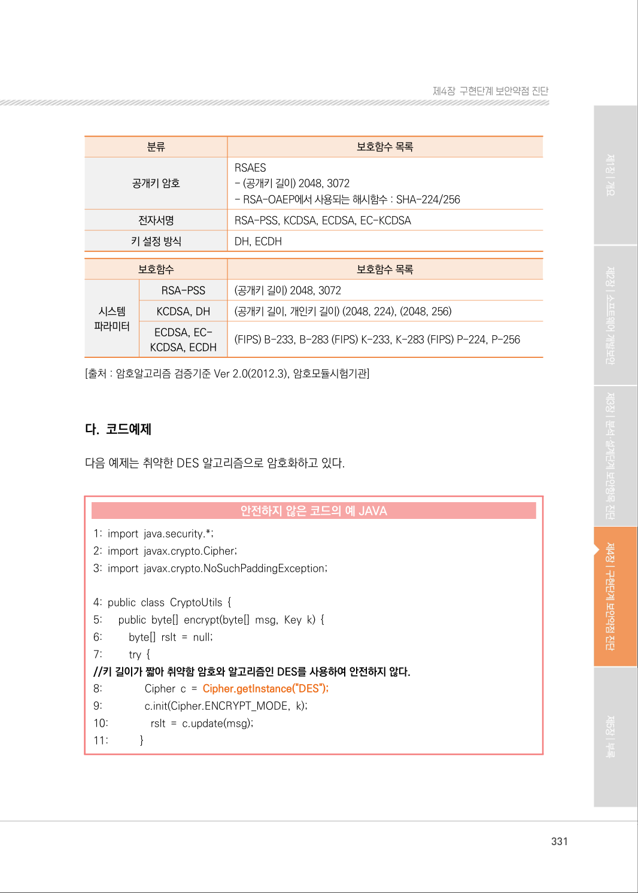
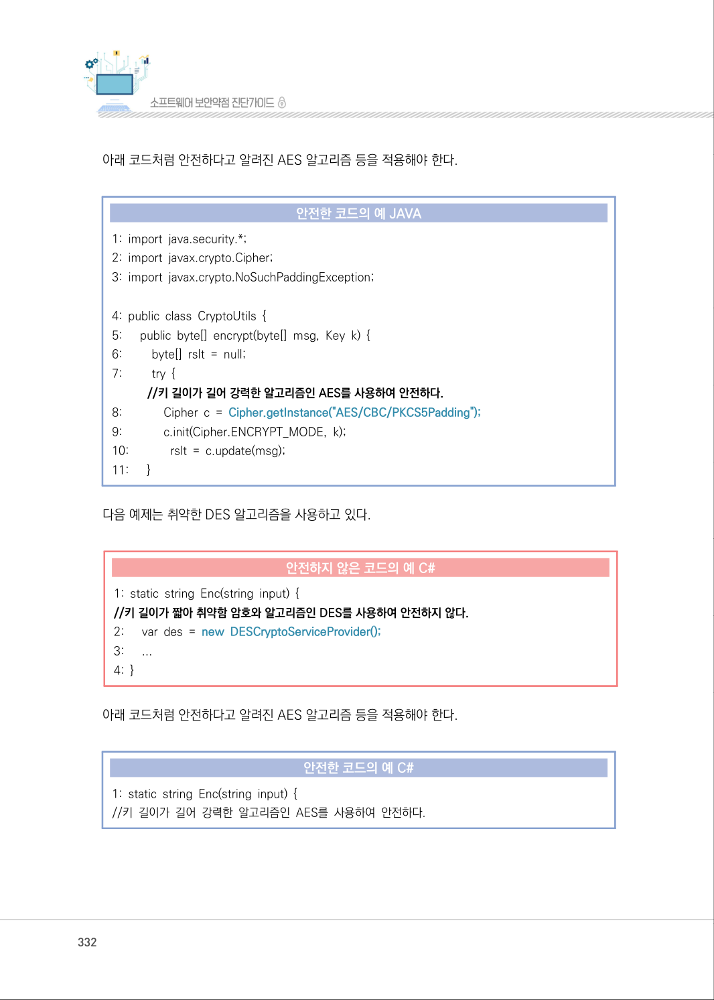
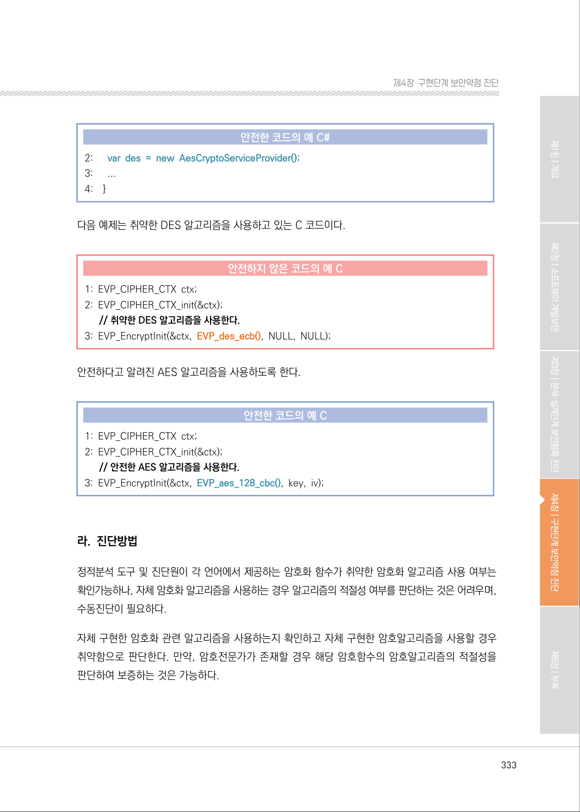
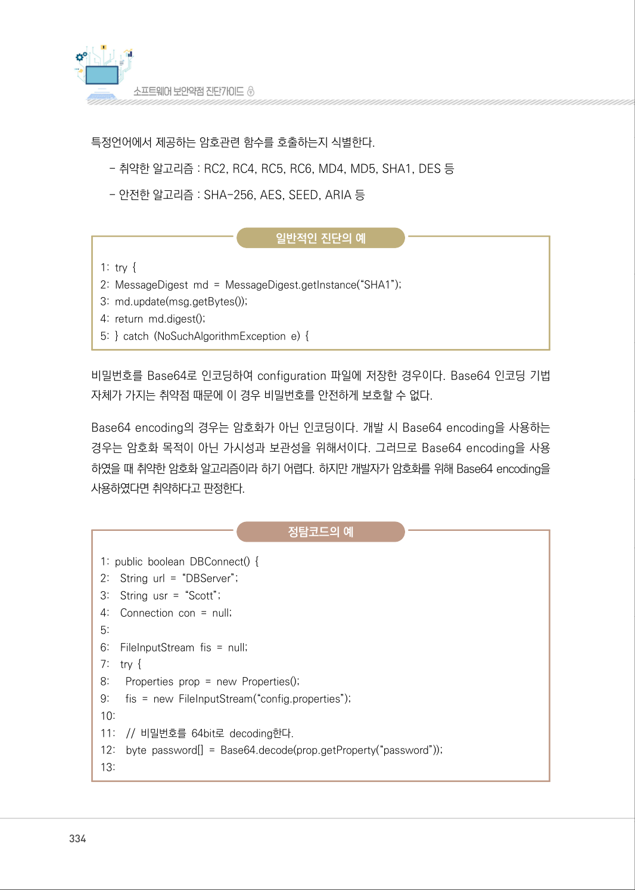
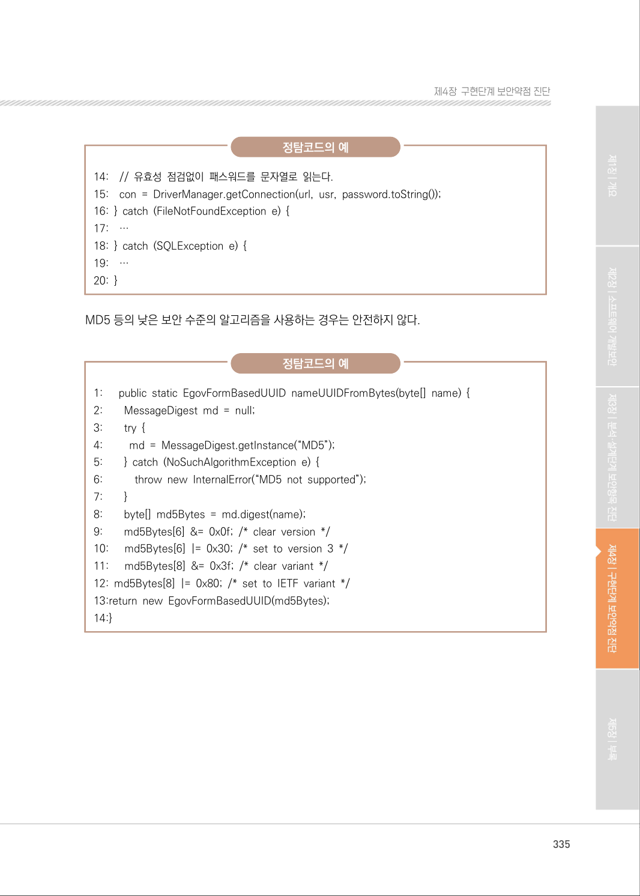
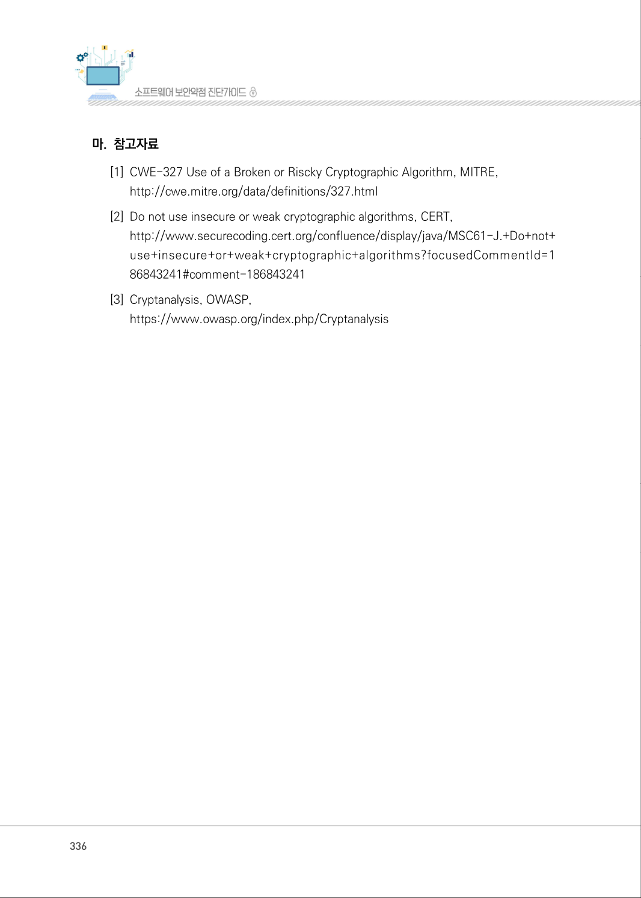
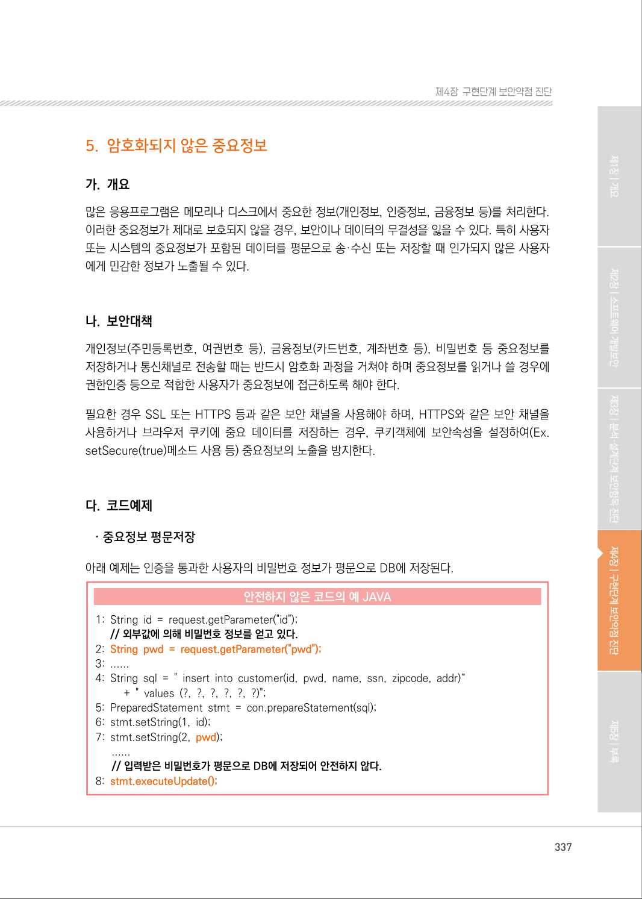

# 4. 취약한 암호화 알고리즘 사용

> 변환 안내(원문 외): 아래 본문은 PDF 텍스트를 추출한 전사입니다. 코드 줄번호·특수 공백·원문 오류를 유지했습니다. 실행용 코드가 아닙니다. 표·그림·들여쓰기는 연결된 페이지 이미지와 대조하세요. 페이지 경계의 줄바꿈을 보존하며, 동일 페이지가 여러 항목에 나뉘면 각 항목의 본문은 해당 구간만 포함합니다.

### PDF 330페이지 / 인쇄 330페이지

<!-- source-page:SW-Diagnosis-2021:330; source-lines:0,1,2,3,4,5,6,7,8,9,10,11,12,13,14,15,16,17,18,19,20,21,22,23,24,25,26,27,28,29,30,31,32,33,34,35,36,37,38,39,40,41,42,43 -->

330

#### 4. 취약한 암호화 알고리즘 사용

#### 가. 개요

SW 개발자들은 환경설정 파일에 저장된 비밀번호를 보호하기 위하여 간단한 인코딩 함수를 이용
하여 비밀번호를 감추는 방법을 사용하기도 한다. 그렇지만 base64와 같은 지나치게 간단한 인코딩 
함수로는 비밀번호를 제대로 보호할 수 없다.

정보보호 측면에서 취약하거나 위험한 암호화 알고리즘을 사용해서는 안 된다. 표준화되지 않은 암호화 
알고리즘을 사용하는 것은 공격자가 알고리즘을 분석하여 무력화시킬 수 있는 가능성을 높일 수도 
있다. 몇몇 오래된 암호화 알고리즘의 경우는 컴퓨터의 성능이 향상됨에 따라 취약해지기도 해서, 
예전에는 해독하는데 오랜 시간이 걸릴 것이라고 예상되던 알고리즘이 며칠이나 몇 시간 내에 해독
되기도 한다. RC2, RC4, RC5, RC6, MD4, MD5, SHA1, DES 알고리즘이 여기에 해당된다.

#### 나. 보안대책

자신만의 암호화 알고리즘을 개발하는 것은 위험하며, 학계 및 업계에서 이미 검증된 표준화된 알고
리즘을 사용한다. 기존에 취약하다고 알려진 DES, RC5 등의 암호알고리즘을 대신하여, 3DES, 
AES, SEED 등의 안전한 암호알고리즘으로 대체하여 사용한다. 또한, 업무관련 내용, 개인정보 등에 
대한 암호 알고리즘 적용시, IT보안인증 사무국이 안전성을 확인한 검증필 암호모듈을 사용해야한다.

[ 참고 : 안전한 암호알고리즘 및 키 길이]

```text
분류
보호함수 목록
최소 안전성 수준
112비트
블록암호
ARIA(키 길이 : 128/192/256), SEED(키 길이 : 128)
블록암호 
운영모드
기밀성
ECD, CBC, CFB, OFB, CTR
기밀성/인증
CCM, GCM
해시함수
SHA-224/256/384/512
메시지 
인증코드
해시함수기반
HMAC
블록기반
CMAC, GMAC
난수
발생기
해시함수
/HMAC 기반
HASH_DRBG, HMAC_DRBG
블록기반
CTR_DRBG
```

<details><summary>원본 페이지 이미지 (변환 외 보존 자료)</summary>



</details>

### PDF 331페이지 / 인쇄 331페이지

<!-- source-page:SW-Diagnosis-2021:331; source-lines:0,1,2,3,4,5,6,7,8,9,10,11,12,13,14,15,16,17,18,19,20,21,22,23,24,25,26,27,28,29,30,31,32,33,34,35,36,37,38,39,40,41,42,43,44,45 -->

331

제4장구현단계 보안약점 진단

|  |  |
| --- | --- |
| 분류 | 보호함수 목록 |
| 공개키 암호 | RSAES<br>- (공개키 길이) 2048, 3072<br>- RSA-OAEP에서 사용되는 해시함수 : SHA-224/256 |
| 전자서명 | RSA-PSS, KCDSA, ECDSA, EC-KCDSA |
| 키 설정 방식 | DH, ECDH |

```text
보호함수
보호함수 목록
시스템
파라미터
RSA-PSS 
(공개키 길이) 2048, 3072
KCDSA, DH 
(공개키 길이, 개인키 길이) (2048, 224), (2048, 256)
ECDSA, EC-
KCDSA, ECDH 
(FIPS) B-233, B-283 (FIPS) K-233, K-283 (FIPS) P-224, P-256
```

[출처 : 암호알고리즘 검증기준 Ver 2.0(2012.3), 암호모듈시험기관]

#### 다. 코드예제

다음 예제는 취약한 DES 알고리즘으로 암호화하고 있다.

#### 안전하지 않은 코드의 예 JAVA

```java
1: import java.security.*;
2: import javax.crypto.Cipher;
3: import javax.crypto.NoSuchPaddingException;
4: public class CryptoUtils { 
5:      public byte[] encrypt(byte[] msg, Key k) { 
6:         byte[] rslt = null; 
7:         try {
//키 길이가 짧아 취약함 암호와 알고리즘인 DES를 사용하여 안전하지 않다.
8:               Cipher c = Cipher.getInstance("DES");
9:               c.init(Cipher.ENCRYPT_MODE, k);
10:               rslt = c.update(msg);
11:           }
```

<details><summary>원본 페이지 이미지 (변환 외 보존 자료)</summary>



</details>

### PDF 332페이지 / 인쇄 332페이지

<!-- source-page:SW-Diagnosis-2021:332; source-lines:0,1,2,3,4,5,6,7,8,9,10,11,12,13,14,15,16,17,18,19,20,21,22,23,24,25,26,27,28,29,30,31,32,33,34 -->

332

아래 코드처럼 안전하다고 알려진 AES 알고리즘 등을 적용해야 한다.

#### 안전한 코드의 예 JAVA

```java
1: import java.security.*; 
2: import javax.crypto.Cipher; 
3: import javax.crypto.NoSuchPaddingException; 
4: public class CryptoUtils { 
5:      public byte[] encrypt(byte[] msg, Key k) { 
6:         byte[] rslt = null; 
7:         try { 
//키 길이가 길어 강력한 알고리즘인 AES를 사용하여 안전하다.
8:             Cipher c = Cipher.getInstance("AES/CBC/PKCS5Padding");
9:             c.init(Cipher.ENCRYPT_MODE, k);
10:             rslt = c.update(msg);
11:      }
```

다음 예제는 취약한 DES 알고리즘을 사용하고 있다.

#### 안전하지 않은 코드의 예 C#

```csharp
1: static string Enc(string input) { 
//키 길이가 짧아 취약함 암호와 알고리즘인 DES를 사용하여 안전하지 않다.
2:      var des = new DESCryptoServiceProvider();
3:      ...
4: }
```

아래 코드처럼 안전하다고 알려진 AES 알고리즘 등을 적용해야 한다.

#### 안전한 코드의 예 C#

```csharp
1: static string Enc(string input) { 
//키 길이가 길어 강력한 알고리즘인 AES를 사용하여 안전하다.
```

<details><summary>원본 페이지 이미지 (변환 외 보존 자료)</summary>



</details>

### PDF 333페이지 / 인쇄 333페이지

<!-- source-page:SW-Diagnosis-2021:333; source-lines:0,1,2,3,4,5,6,7,8,9,10,11,12,13,14,15,16,17,18,19,20,21,22,23,24,25,26,27 -->

333

제4장구현단계 보안약점 진단

#### 안전한 코드의 예 C#

```csharp
2:      var des = new AesCryptoServiceProvider(); 
3:      ...
4:    }
```

다음 예제는 취약한 DES 알고리즘을 사용하고 있는 C 코드이다.

#### 안전하지 않은 코드의 예 C

```c
1: EVP_CIPHER_CTX ctx; 
2: EVP_CIPHER_CTX_init(&ctx); 
// 취약한 DES 알고리즘을 사용한다.
3: EVP_EncryptInit(&ctx, EVP_des_ecb(), NULL, NULL);
```

안전하다고 알려진 AES 알고리즘을 사용하도록 한다.

#### 안전한 코드의 예 C

```c
1: EVP_CIPHER_CTX ctx;
2: EVP_CIPHER_CTX_init(&ctx);
// 안전한 AES 알고리즘을 사용한다.
3: EVP_EncryptInit(&ctx, EVP_aes_128_cbc(), key, iv);
```

#### 라. 진단방법

정적분석 도구 및 진단원이 각 언어에서 제공하는 암호화 함수가 취약한 암호화 알고리즘 사용 여부는 
확인가능하나, 자체 암호화 알고리즘을 사용하는 경우 알고리즘의 적절성 여부를 판단하는 것은 어려우며, 
수동진단이 필요하다.

자체 구현한 암호화 관련 알고리즘을 사용하는지 확인하고 자체 구현한 암호알고리즘을 사용할 경우 
취약함으로 판단한다. 만약, 암호전문가가 존재할 경우 해당 암호함수의 암호알고리즘의 적절성을 
판단하여 보증하는 것은 가능하다.

<details><summary>원본 페이지 이미지 (변환 외 보존 자료)</summary>



</details>

### PDF 334페이지 / 인쇄 334페이지

<!-- source-page:SW-Diagnosis-2021:334; source-lines:0,1,2,3,4,5,6,7,8,9,10,11,12,13,14,15,16,17,18,19,20,21,22,23,24,25,26,27,28,29,30,31,32,33,34,35,36,37,38 -->

334

특정언어에서 제공하는 암호관련 함수를 호출하는지 식별한다.

- 취약한 알고리즘 : RC2, RC4, RC5, RC6, MD4, MD5, SHA1, DES 등
- 안전한 알고리즘 : SHA-256, AES, SEED, ARIA 등

일반적인 진단의 예

```text
1: try { 
2: MessageDigest md = MessageDigest.getInstance(“SHA1”); 
3: md.update(msg.getBytes()); 
4: return md.digest(); 
5: } catch (NoSuchAlgorithmException e) { 
```

비밀번호를 Base64로 인코딩하여 configuration 파일에 저장한 경우이다. Base64 인코딩 기법 
자체가 가지는 취약점 때문에 이 경우 비밀번호를 안전하게 보호할 수 없다.

Base64 encoding의 경우는 암호화가 아닌 인코딩이다. 개발 시 Base64 encoding을 사용하는 
경우는 암호화 목적이 아닌 가시성과 보관성을 위해서이다. 그러므로 Base64 encoding을 사용 
하였을 때 취약한 암호화 알고리즘이라 하기 어렵다. 하지만 개발자가 암호화를 위해 Base64 encoding을 
사용하였다면 취약하다고 판정한다.

정탐코드의 예

```text
1: public boolean DBConnect() { 
2:    String url = “DBServer”; 
3:    String usr = “Scott”; 
4:    Connection con = null; 
5:
6:    FileInputStream fis = null; 
7:    try { 
8:      Properties prop = new Properties(); 
9:      fis = new FileInputStream(“config.properties”); 
10:
11:    // 비밀번호를 64bit로 decoding한다. 
12:    byte password[] = Base64.decode(prop.getProperty(“password”));
13:
```

<details><summary>원본 페이지 이미지 (변환 외 보존 자료)</summary>



</details>

### PDF 335페이지 / 인쇄 335페이지

<!-- source-page:SW-Diagnosis-2021:335; source-lines:0,1,2,3,4,5,6,7,8,9,10,11,12,13,14,15,16,17,18,19,20,21,22,23,24,25,26,27,28,29,30,31,32,33,34,35,36,37,38,39,40 -->

335

제4장구현단계 보안약점 진단

정탐코드의 예

```text
14:    // 유효성 점검없이 패스워드를 문자열로 읽는다. 
15:    con = DriverManager.getConnection(url, usr, password.toString());
16: } catch (FileNotFoundException e) { 
17:    …
18: } catch (SQLException e) { 
19:    …
20: }
```

MD5 등의 낮은 보안 수준의 알고리즘을 사용하는 경우는 안전하지 않다.

정탐코드의 예

```text
1:      public static EgovFormBasedUUID nameUUIDFromBytes(byte[] name) {
2:        MessageDigest md = null; 
3:        try { 
4:         md = MessageDigest.getInstance(“MD5”); 
5:        } catch (NoSuchAlgorithmException e) { 
6:           throw new InternalError(“MD5 not supported”); 
7:        }
8:        byte[] md5Bytes = md.digest(name); 
9:        md5Bytes[6] &= 0x0f; /* clear version */ 
10:      md5Bytes[6] |= 0x30; /* set to version 3 */ 
11:      md5Bytes[8] &= 0x3f; /* clear variant */ 
12: md5Bytes[8] |= 0x80; /* set to IETF variant */
13:return new EgovFormBasedUUID(md5Bytes);
14:}
```

<details><summary>원본 페이지 이미지 (변환 외 보존 자료)</summary>



</details>

### PDF 336페이지 / 인쇄 336페이지

<!-- source-page:SW-Diagnosis-2021:336; source-lines:0,1,2,3,4,5,6,7,8,9 -->

336

#### 마. 참고자료

[1] CWE-327 Use of a Broken or Riscky Cryptographic Algorithm, MITRE,

http://cwe.mitre.org/data/definitions/327.html 
[2] Do not use insecure or weak cryptographic algorithms, CERT,

http://www.securecoding.cert.org/confluence/display/java/MSC61-J.+Do+not+
use+insecure+or+weak+cryptographic+algorithms?focusedCommentId=1 
86843241#comment-186843241 
[3] Cryptanalysis, OWASP,

https://www.owasp.org/index.php/Cryptanalysis

<details><summary>원본 페이지 이미지 (변환 외 보존 자료)</summary>



</details>

### PDF 337페이지 / 인쇄 337페이지

<!-- source-page:SW-Diagnosis-2021:337; source-lines:1 -->

제4장구현단계 보안약점 진단

<details><summary>원본 페이지 이미지 (변환 외 보존 자료)</summary>



</details>

---

## 탐색 링크 (원문 외)

[통합 인덱스](../../../INDEX.md)

