# 5. 암호화되지 않은 중요정보

> 변환 안내(원문 외): 아래 본문은 PDF 텍스트를 추출한 전사입니다. 코드 줄번호·특수 공백·원문 오류를 유지했습니다. 실행용 코드가 아닙니다. 표·그림·들여쓰기는 연결된 페이지 이미지와 대조하세요. 페이지 경계의 줄바꿈을 보존하며, 동일 페이지가 여러 항목에 나뉘면 각 항목의 본문은 해당 구간만 포함합니다.

### PDF 337페이지 / 인쇄 337페이지

<!-- source-page:SW-Diagnosis-2021:337; source-lines:0,2,3,4,5,6,7,8,9,10,11,12,13,14,15,16,17,18,19,20,21,22,23,24,25,26,27,28,29,30 -->

337

#### 5. 암호화되지 않은 중요정보

#### 가. 개요

많은 응용프로그램은 메모리나 디스크에서 중요한 정보(개인정보, 인증정보, 금융정보 등)를 처리한다. 
이러한 중요정보가 제대로 보호되지 않을 경우, 보안이나 데이터의 무결성을 잃을 수 있다. 특히 사용자 
또는 시스템의 중요정보가 포함된 데이터를 평문으로 송·수신 또는 저장할 때 인가되지 않은 사용자
에게 민감한 정보가 노출될 수 있다.

#### 나. 보안대책

개인정보(주민등록번호, 여권번호 등), 금융정보(카드번호, 계좌번호 등), 비밀번호 등 중요정보를 
저장하거나 통신채널로 전송할 때는 반드시 암호화 과정을 거쳐야 하며 중요정보를 읽거나 쓸 경우에 
권한인증 등으로 적합한 사용자가 중요정보에 접근하도록 해야 한다.

필요한 경우 SSL 또는 HTTPS 등과 같은 보안 채널을 사용해야 하며, HTTPS와 같은 보안 채녈을 
사용하거나 브라우저 쿠키에 중요 데이터를 저장하는 경우, 쿠키객체에 보안속성을 설정하여(Ex. 
setSecure(true)메소드 사용 등) 중요정보의 노출을 방지한다.

#### 다. 코드예제

ㆍ중요정보 평문저장
아래 예제는 인증을 통과한 사용자의 비밀번호 정보가 평문으로 DB에 저장된다.

#### 안전하지 않은 코드의 예 JAVA

```java
1: String id = request.getParameter("id"); 
// 외부값에 의해 비밀번호 정보를 얻고 있다.
2: String pwd = request.getParameter("pwd");
3: ......
4: String sql = " insert into customer(id, pwd, name, ssn, zipcode, addr)“
+ " values (?, ?, ?, ?, ?, ?)";
5: PreparedStatement stmt = con.prepareStatement(sql);
6: stmt.setString(1, id);
7: stmt.setString(2, pwd);
......
// 입력받은 비밀번호가 평문으로 DB에 저장되어 안전하지 않다.
8: stmt.executeUpdate();
```

<details><summary>원본 페이지 이미지 (변환 외 보존 자료)</summary>


</details>

### PDF 338페이지 / 인쇄 338페이지

<!-- source-page:SW-Diagnosis-2021:338; source-lines:0,1,2,3,4,5,6,7,8,9,10,11,12,13,14,15,16,17,18,19,20,21,22,23,24,25,26,27,28,29,30,31,32,33,34,35,36 -->

338

다음 예제는 비밀번호 등 중요 데이터를 해시값으로 변환하여 저장하고 있다.

#### 안전한 코드의 예 JAVA

```java
1: String id = request.getParameter("id");
// 외부값에 의해 비밀번호 정보를 얻고 있다. 
2: String pwd = request.getParameter("pwd"); 
// 비밀번호를 솔트값을 포함하여 SHA-256 해시로 변경하여 안전하게 저장한다.
3: MessageDigest md = MessageDigest.getInstance("SHA-256");
4: md.reset();
5: md.update(salt);
6: byte[] hashInBytes = md.digest(pwd.getBytes()); 
7: StringBuilder sb = new StringBuilder(); 
8:         for (byte b : hashInBytes) { 
9:             sb.append(String.format("%02x", b)); 
10:        }
11:pwd = sb.toString();
12: ......
13:String sql = " insert into customer(id, pwd, name, ssn, zipcode, addr)“
+ " values (?, ?, ?, ?, ?, ?)"; 
14:PreparedStatement stmt = con.prepareStatement(sql); 
15:stmt.setString(1, id); 
16:stmt.setString(2, pwd);
17: ......
18:stmt.executeUpdate();
```

다음은 사용자의 비밀번호를 평문으로 저장해 놓고 출력하는 C# 코드의 예제이다. 

#### 안전하지 않은 코드의 예 C#

```csharp
1: namespace Security
2: {
3:      public class FindPassword : System.Web.UI.Page 
4:      {
5:         protected void Page_Load(object sender, EventArgs e)
```

<details><summary>원본 페이지 이미지 (변환 외 보존 자료)</summary>

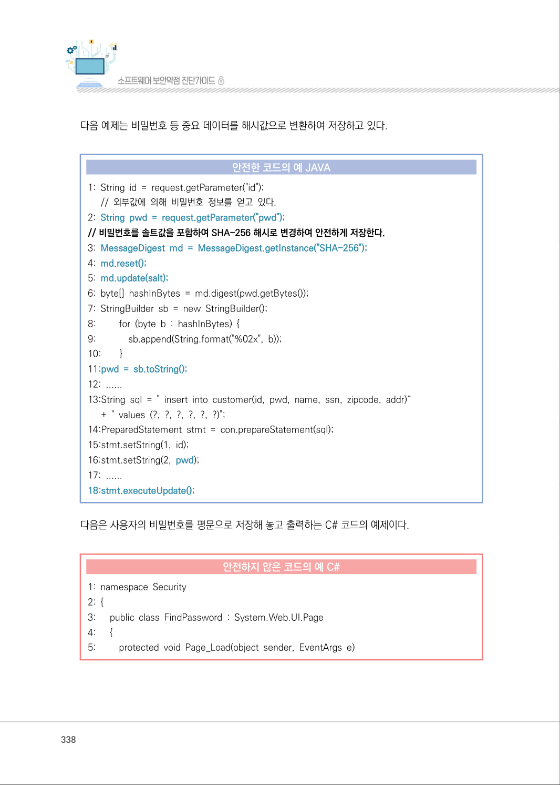

</details>

### PDF 339페이지 / 인쇄 339페이지

<!-- source-page:SW-Diagnosis-2021:339; source-lines:0,1,2,3,4,5,6,7,8,9,10,11,12,13,14,15,16,17,18,19,20,21,22,23,24,25,26,27,28,29,30,31,32,33,34,35,36,37,38,39,40,41,42,43,44,45,46,47,48,49,50,51,52,53,54,55 -->

339

제4장구현단계 보안약점 진단

#### 안전하지 않은 코드의 예 C#

```csharp
6:        {
7:           var userId = "tmp"; 
8:           MembershipUser user = Membership.GetUser(userId);
9:           if (user != null) 
10:         {
11:             var password = user.GetPassword(); 
12:             Response.Write(password);
13:         }
14:         else
15:         {
16:             Response.Write("the given userId is not valid");
17:         }
18:      }
19:    }
20:}
```

비밀번호는 암호화 하여 저장해야 하며, 출력하지 않도록 한다.

#### 안전한 코드의 예 C#

```csharp
1: namespace Security
2: {
3:      public class FindPassword : System.Web.UI.Page
4:      {
5:         protected void Page_Load(object sender, EventArgs e)
6:         {
7:             var userId = "tmp";
8:             MembershipUser user = Membership.GetUser(userId);
9:             if (user != null)
10:           {
11:               var encrypetedPassword = user.GetPassword();
12:               SecureFindPasswordFunction();
```

<details><summary>원본 페이지 이미지 (변환 외 보존 자료)</summary>

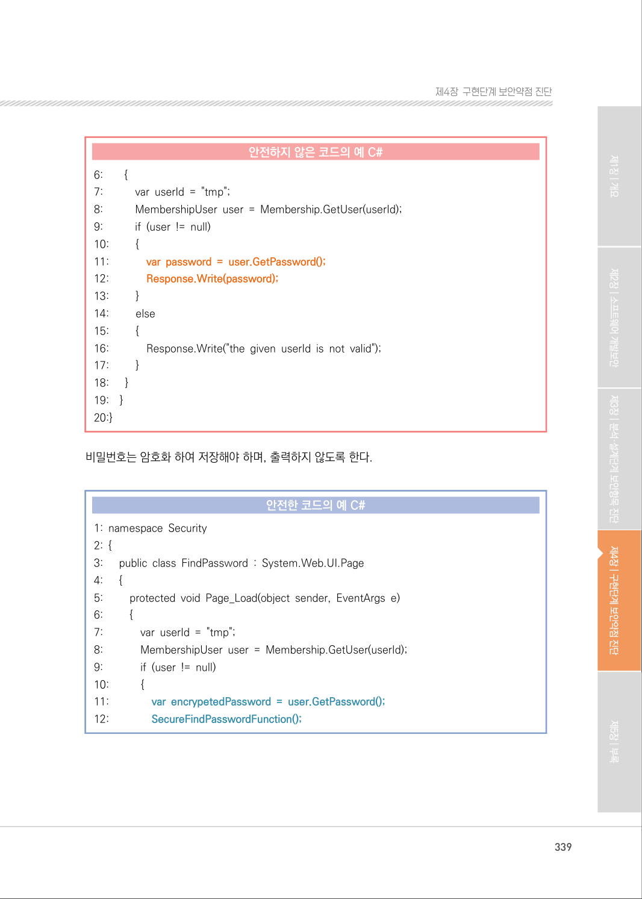

</details>

### PDF 340페이지 / 인쇄 340페이지

<!-- source-page:SW-Diagnosis-2021:340; source-lines:0,1,2,3,4,5,6,7,8,9,10,11,12,13,14,15,16,17,18,19,20,21,22,23,24,25,26,27,28,29,30,31,32,33 -->

340

#### 안전한 코드의 예 C#

```csharp
13:           }
14:           else
15:           {
16:             Response.Write("the given userId is not valid");
17:           }
18:        }
19:    }
20:}
```

ㆍ중요정보 평문전송

아래 예제는 비밀번호를 암호화하지 않고 네트워크로 전송하고 있다. 이 경우 패킷 스니핑으로 비
밀번호가 노출될 수 있다.

#### 안전하지 않은 코드의 예 JAVA

```java
1: try {
2:      Socket s = new Socket("taranis", 4444);
3:      PrintWriter o = new PrintWriter(s.getOutputStream(), true);
//비밀번호를 평문으로 전송하여 안전하지 않다.
4:      String password = getPassword();
5:      o.write(password);
6: } catch (FileNotFoundException e) {
7:      ……
```

<details><summary>원본 페이지 이미지 (변환 외 보존 자료)</summary>

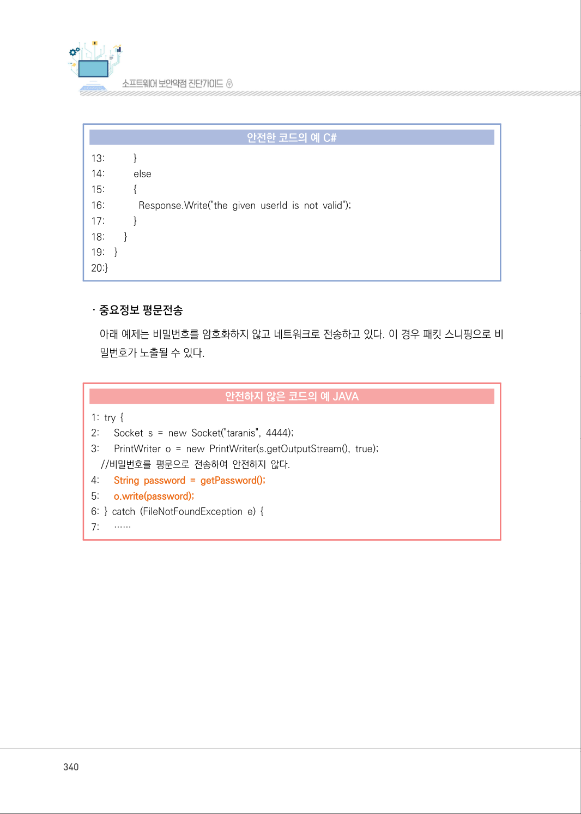

</details>

### PDF 341페이지 / 인쇄 341페이지

<!-- source-page:SW-Diagnosis-2021:341; source-lines:0,1,2,3,4,5,6,7,8,9,10,11,12,13,14,15,16,17,18,19,20,21,22,23,24,25,26,27,28,29,30,31,32,33,34,35,36,37,38,39,40,41,42,43,44,45 -->

341

제4장구현단계 보안약점 진단

아래 예제는 비밀번호를 네트워크로 서버로 전송하기 전에 AES 등의 안전한 암호알고리즘으로 암호
화한 안전한 프로그램이다.

#### 안전한 코드의 예 JAVA

```java
// 비밀번호를 암호화 하여 전송
1: try {
2:      Socket s = new Socket("taranis", 4444);
3:      PrintStream o = new PrintStream(s.getOutputStream(), true);
//비밀번호를 강력한 AES암호화 알고리즘으로 전송하여 사용한다.
4:      Cipher c = Cipher.getInstance("AES/CBC/PKCS5Padding");
5:      String password = getPassword();
6:      byte[] encPassword = c.update(password.getBytes());
7:    o.write(encPassword, 0, encPassword.length);
8: } catch (FileNotFoundException e) {
9:        ……
```

아래 C# 예제 또한 비밀번호를 암호화하지 않고 네트워크로 전송하고 있다. 이 경우 패킷 스니핑으로 비
밀번호가 노출될 수 있다.

#### 안전하지 않은 코드의 예 C#

```csharp
1: public void EmailPassword_OnClick(object sender, EventArgs args) 
2: {
3:    MembershipUser u = Membership.GetUser(UsernameTextBox.Text, false);
4:    String password;
5:    if (u != null)
6:    {
7:      try
8:      {
9:        password = u.GetPassword(); // sensitive data created
10:    }
11:    catch (Exception e)
```

<details><summary>원본 페이지 이미지 (변환 외 보존 자료)</summary>

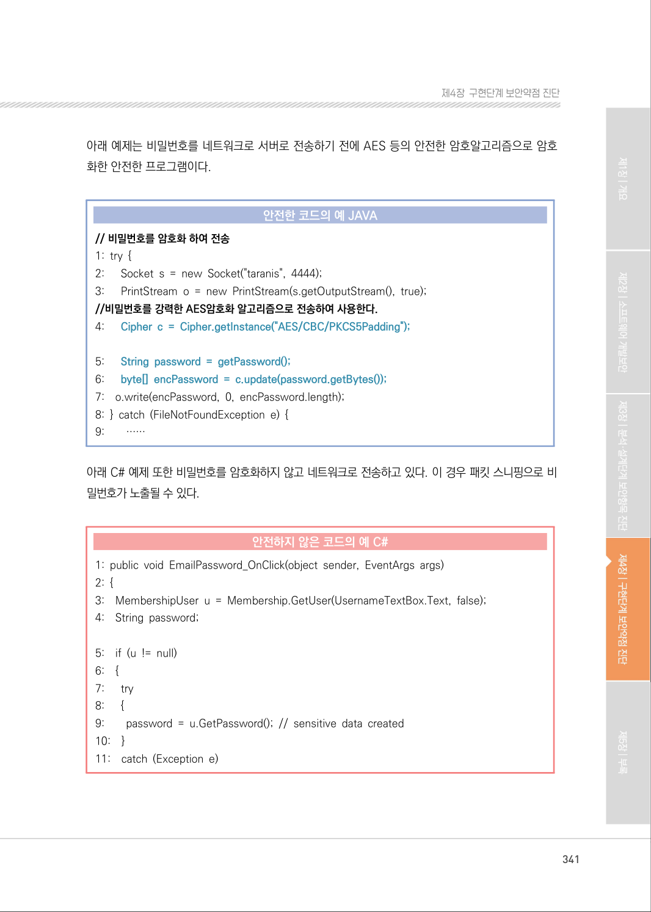

</details>

### PDF 342페이지 / 인쇄 342페이지

<!-- source-page:SW-Diagnosis-2021:342; source-lines:0,1,2,3,4,5,6,7,8,9,10,11,12,13,14,15,16,17,18,19,20,21,22,23,24,25,26,27,28,29,30,31,32,33,34,35,36,37,38,39,40,41,42,43,44,45,46,47,48 -->

342

#### 안전하지 않은 코드의 예 C#

```csharp
12:    {
13:                   Msg.Text = "An exception occurred retrieving your password: " + 
Server.HtmlEncode(e.Message);
14:      return;
15:    }
16:    MailMessage Message = new MailMessage(); 
17:    Message.Body = "Your password is: " + Server.HtmlEncode(password);
//비밀번호가 포함된 메시지를 네트워크로 전송하고 있다.
18:    SmtpMail.Send(Message);
19:    Msg.Text = "Password sent via e-mail.";
20: }
21: else
22: {
23:    Msg.Text = "User name is not valid. Please check the value and try again.";
24: }
25:}
```

비밀번호를 네트워크로 전송할 때에는 암호화 하는 것이 바람직하다.

#### 안전한 코드의 예 C#

```csharp
1: public void EmailPassword_OnClick(object sender, EventArgs args) 
2: {
3:    MembershipUser u = Membership.GetUser(UsernameTextBox.Text, false);
4:    String password;
5:    if (u != null) 
6:    {
7:      try
8:      {
9:        password = u.GetPassword(); 
10:      byte[] data = System.Text.Encoding.ASCII.GetBytes(password);
11:      data = new
```

<details><summary>원본 페이지 이미지 (변환 외 보존 자료)</summary>

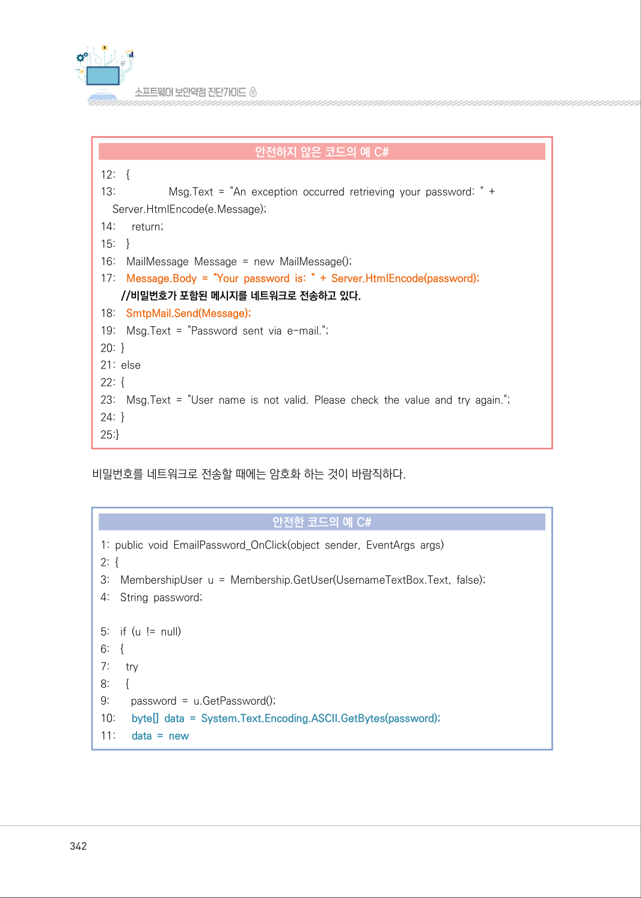

</details>

### PDF 343페이지 / 인쇄 343페이지

<!-- source-page:SW-Diagnosis-2021:343; source-lines:0,1,2,3,4,5,6,7,8,9,10,11,12,13,14,15,16,17,18,19,20,21,22,23,24,25,26,27,28,29,30,31,32,33,34,35,36,37,38,39,40,41,42,43,44,45,46,47,48,49 -->

343

제4장구현단계 보안약점 진단

#### 안전한 코드의 예 C#

```csharp
System.Security.Cryptography.SHA256Managed().ComputeHash(data); String 
hashedPassword = System.Text.Encoding.ASCII.GetString(data);
12:    }
13:    catch (Exception e)
14:    {
15:                       Msg.Text = "An exception occurred retrieving your password: " + 
Server.HtmlEncode(e.Message); 
16:      return; 
17:    }
18:    MailMessage Message = new MailMessage(); 
19:    Message.Body ="Your password is: "+Server.HtmlEncode(hasedPassword);
20:    SmtpMail.Send(Message);
21:    Msg.Text = "Password sent via e-mail."; 
22: } 
23: else 
24: { 
25:    Msg.Text = "User name is not valid. Please check the value and try again.";
26: }
27:}
```

파일에서 읽어온 비밀번호를 바로 사용하는 C예제 코드이다.

#### 안전하지 않은 코드의 예 C

```c
1: int dbaccess(){
2:    FILE *fp; char *server = "DBserver"; 
3:    char passwd[20]; 
4:    char user[20]; 
5:    SQLHENV henv; 
6:    SQLHDBC hdbc; 
7:    fp = fopen("config", "r"); 
8:    fgets(user, sizeof(user), fp);
```

<details><summary>원본 페이지 이미지 (변환 외 보존 자료)</summary>

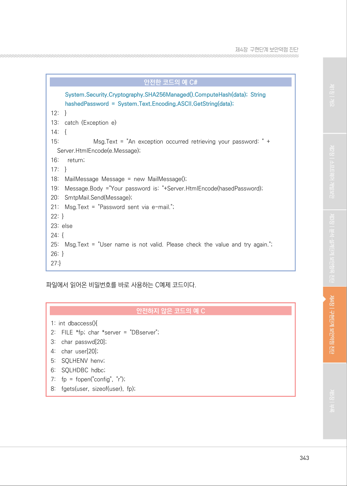

</details>

### PDF 344페이지 / 인쇄 344페이지

<!-- source-page:SW-Diagnosis-2021:344; source-lines:0,1,2,3,4,5,6,7,8,9,10,11,12,13,14,15,16,17,18,19,20,21,22,23,24,25,26,27,28,29,30,31,32,33,34,35,36,37,38,39,40,41,42,43,44,45,46,47,48,49,50 -->

344

#### 안전하지 않은 코드의 예 C

```c
// 비밀번호를 파일에서 읽어 옵니다.
9:    fgets(passwd, sizeof(passwd), fp);
10: fclose(fp);
11: SQLAllocHandle(SQL_HANDLE_ENV, SQL_NULL_HANDLE, &henv);
12: SQLAllocHandle(SQL_HANDLE_DBC, henv, &hdbc);
13: SQLConnect(hdbc, 
14:                       (SQLCHAR*) server, 
15:                       (SQLSMALLINT) strlen(server), 
16:                       (SQLCHAR*) user, 
17:                       (SQLSMALLINT) strlen(user), 
18:                       //비밀번호의 암호화 없이 직접 연결합니다.
19:                       (SQLCHAR*) passwd,
20:                       (SQLSMALLINT) strlen(passwd) ); 
21: return 0;
```

외부에서 입력된 비밀번호는 검증의 과정을 거쳐서 사용해야 한다.

#### 안전한 코드의 예 C

```c
1: int dbaccess(){
2:    FILE *fp; char *server = "DBserver"; 
3:    char passwd[20]; 
4:    char user[20]; 
5:    char *encPasswd; 
6:    char *key;
7:    SQLHENV henv; 
8:    SQLHDBC hdbc; 
// AES-CBC로 암호화 모드를 설정합니다.
9:    HCkCrypt2 crypt = CkCrypt2_putCryptAlgorithm(crypt,”aes”);
10:    CkCrypt2_putCipherMode(crypt,”cbc”);
// 외부에서 암호화 키를 불러와 설정합니다.
11:    key = getenv(“encrypt_key”);
12:    CkCrypt2_SetEncodedKey(crypt,key,”hex”);
```

<details><summary>원본 페이지 이미지 (변환 외 보존 자료)</summary>

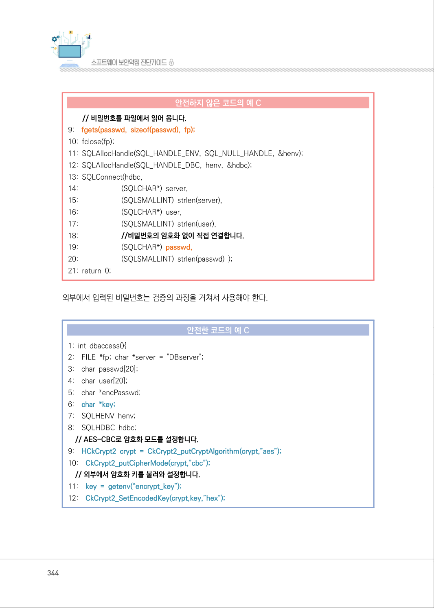

</details>

### PDF 345페이지 / 인쇄 345페이지

<!-- source-page:SW-Diagnosis-2021:345; source-lines:0,1,2,3,4,5,6,7,8,9,10,11,12,13,14,15,16,17,18,19,20,21,22,23,24,25,26,27,28 -->

345

제4장구현단계 보안약점 진단

#### 안전한 코드의 예 C

```c
13: fp = fopen("config", "r"); 
14: fgets(user, sizeof(user), fp); 
// 비밀번호를 파일에서 읽어옵니다.
15: fgets(passwd, sizeof(passwd), fp);
16: fclose(fp);
// 비밀번호 암호화를 진행합니다.
17: ncPasswd = CkCrypt2_encryptStringENC(crypt, passwd);
18: SQLAllocHandle(SQL_HANDLE_ENV, SQL_NULL_HANDLE, &henv);
19: SQLAllocHandle(SQL_HANDLE_DBC, henv, &hdbc);
20: SQLConnect(hdbc,
21:                         (SQLCHAR*) server,
22:                         (SQLSMALLINT) strlen(server),
23:                         (SQLCHAR*) user,
24:                         (SQLSMALLINT) strlen(user),
25:                         // 암호화된 비밀번호를 사용합니다.
26:                         (SQLCHAR*) encPasswd,
27:                         (SQLSMALLINT) strlen(verifiedPwd) );
28: return 0;
29:}
```

<details><summary>원본 페이지 이미지 (변환 외 보존 자료)</summary>

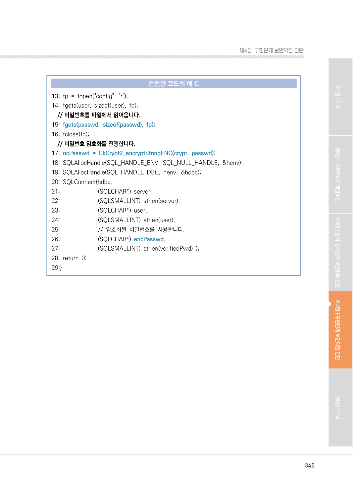

</details>

### PDF 346페이지 / 인쇄 346페이지

<!-- source-page:SW-Diagnosis-2021:346; source-lines:0,1,2,3,4,5,6,7,8,9,10,11,12,13,14,15,16,17,18,19,20,21,22,23,24,25,26,27 -->

346

#### 라. 진단방법

ㆍ중요정보 평문저장

중요정보란 일반적으로 설계과정에서 결정되기 때문에, 중요정보의 평문저장을 일반적으로 검사
할 수 있는 기법은 존재하지 않는다. 따라서 이러한 정보를 저장하고 사용하는 경우 반드시는 
암호화 및 복호화 과정을 거쳐야 한다. 다만, 로그인이나 암호의 사용과 같은 특정한 경우 해당 
메소드의 인자 값 추적으로 평문 유무를 판단할 수 있다. 
중요정보라고 판단된 데이터 경우에는 불필요한 참조가 존재하지 않도록 제거해야하며, 임의의 
변수에 임시 저장할 경우에도 암호화 유무를 확인해야하며 사용이 완료된 임시변수의 값은 반드시 
초기화 해주어야 한다. 또한, 쿠키에 값을 저장하는 경우에는 중요정보를 저장하지 않거나 또는 
저장을 하더라도 암호화로 저장해야 한다.
다음 예제는 소켓 연결이 수립되고 난 후, 전달 받은 암호 값을 password_buffer에 저장하고 이를 
다시 파일에 직접 기록하는 코드이다. 이 때, 전달받은 값을 암호화하지 않고 저장하기 때문에 
해당 파일에 접근할 수 있는 사용자라면, 암호 값을 획득할 수 있다.

정탐코드의 예

```text
1: if (connect(sock, (struct sockaddr *)&server, sizeof server) < 0) 
2: error(“Connecting”); 
3: …
4: while ((n=read(sock,buffer,BUFSIZE-1))!=-1) { 
5: … // buffer값을 password_buffer에 추가 
6: write(passFileD,password_buffer,n); 
7: …
```

중요정보를 암호화 작업 없이 password_buffer에 그대로 유지하고 있으며, 해당 내용을 파일에 
저장하기 때문에 위 예제 코드는 보안약점이 존재한다고 진단할 수 있으며, 임시 변수인 buffer를 
사용완료하고 난 후 값의 초기화 여부 또한 확인해야 한다.
다음 예제는 데이터베이스에 접근하기 위한 정보를 설정파일로 작성한 경우이다. 다른 소스 파일
에서 해당 파일을 포함(Include)하여 사용하지만, 설정파일에 데이터베이스를 접근하는 ID와 
비밀번호가 평문으로 저장되어 있기 때문에 이러한 정보가 외부로 노출될 수 있는 위험성이 있다.

<details><summary>원본 페이지 이미지 (변환 외 보존 자료)</summary>

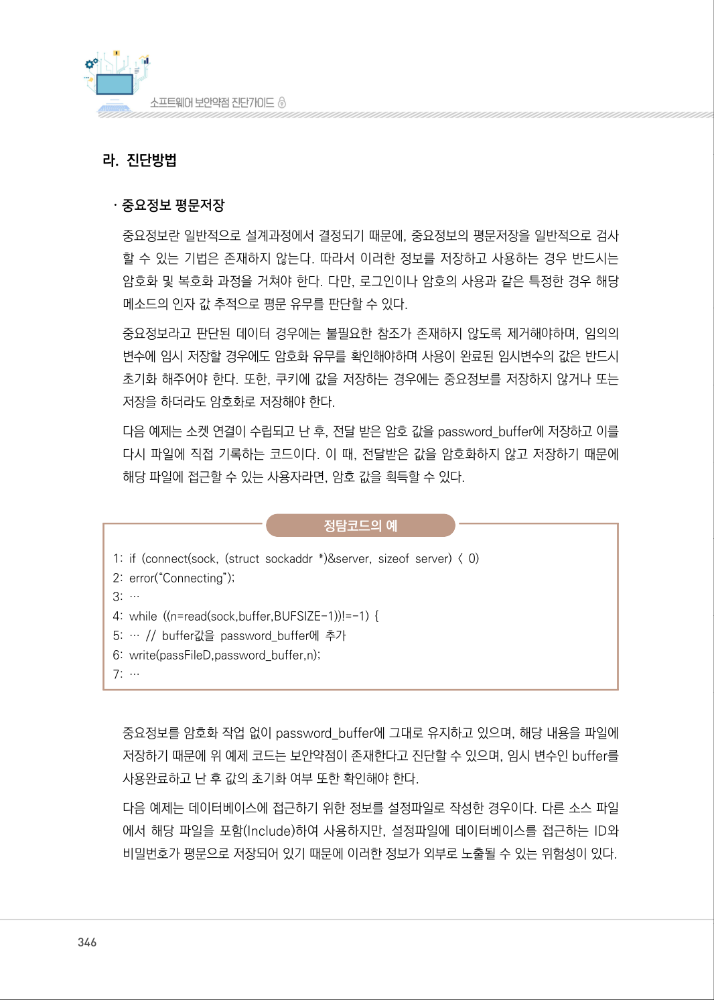

</details>

### PDF 347페이지 / 인쇄 347페이지

<!-- source-page:SW-Diagnosis-2021:347; source-lines:0,1,2,3,4,5,6,7,8,9,10,11,12,13,14,15,16,17,18,19,20,21,22,23,24,25,26,27,28,29,30,31,32,33,34,35,36 -->

347

제4장구현단계 보안약점 진단

정탐코드의 예

```text
1: …
2: <connectionStrings> 
3: <add name=”ud_DEV” connectionString=”connectDB=uDB; uid=db2admin; pwd=- 
password; dbalias=uDB;” providerName=”System.Data.Odbc” /> 
4: </connectionStrings> 
5: … 
```

ㆍ중요정보 평문전송

해당 보안약점은 보안특정 중 평문전송과 관련된 내용으로 정적도구를 사용하여 중요정보의 기준을 
판단하는 것은 어렵다.
개인정보(주민등록번호, 여권번호 등), 금융정보(카드·계좌번호), 비밀번호 등 민감한 정보를 
다루는지 확인하고, 해당 정보가 네트워크 등으로 전송될 때 암호화 여부를 확인하고, 보안 채널
을 이용하도록 한다. 민감한 정보가 있는 URL을 전송할 경우에도 마찬가지로 암호화 작업을 수
행 하도록 한다. 또한 중요정보를 쿠키에 저장하여 전송할 경우 암호화하여 전송해야 하며, 특
히 setSecure(true)와 같은 함수를 이용하여 암호화를 해야 한다. 이러한 절차가 생략되어 있는 경
우 취약하다고 판단한다.
다음 예제는 외부에서 읽어 들인 비밀번호를 암호화하지 않고 네트워크로 서버에 전송하고 있다. 
이 경우 패킷 스니핑으로 비밀번호가 노출될 수 있기 때문에 보안약점이 존재하는 코드이다. 
또한 임시 변수 password는 값의 사용 후 반드시 초기화 해주어야 한다.

정탐코드의 예

```text
1: void foo() 
2: {
3:    try { 
4:      Socket socket = new Socket(“taranis”, 4444); 
5:      PrintWriter out = new PrintWriter(socket.getOutputStream(), true);
6:      String password = getPassword();
7:      out.write(password);
8:    } catch (FileNotFoundException e) {
9: …
```

<details><summary>원본 페이지 이미지 (변환 외 보존 자료)</summary>

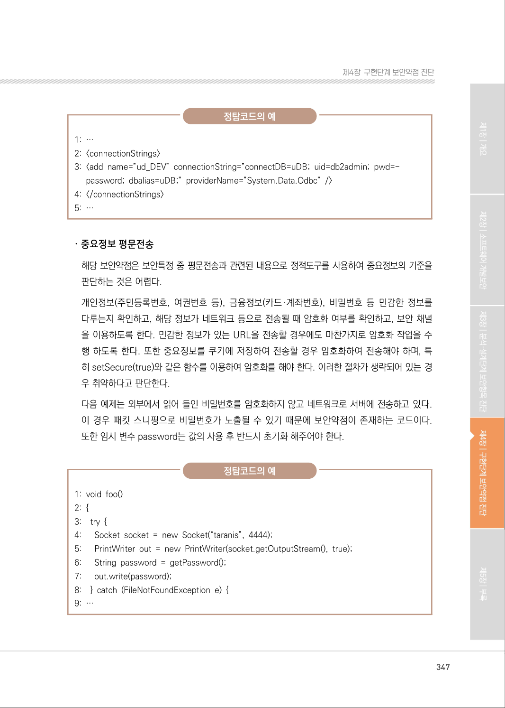

</details>

### PDF 348페이지 / 인쇄 348페이지

<!-- source-page:SW-Diagnosis-2021:348; source-lines:0,1,2,3,4,5,6,7,8,9,10,11,12,13,14,15,16,17,18,19,20,21,22,23,24,25,26,27,28,29,30,31,32,33,34,35,36 -->

348

다음 예제는 중요정보에 접근 가능한 URL을 일반 채널을 이용하여 연결하는 예제이다. 따라서 해당 
채널에서 주고받는 데이터는 외부에서 쉽게 확인이 가능하고 공격에 활용될 수 있다. 보안 채널을 
이용하고 있지 않기 때문에 보안약점을 가지고 있는 코드라고 진단할 수 있다.

정탐코드의 예

```text
1: try { 
2:        URL u = new URL(“http://www.secret.example.org/”); 
3:        HttpURLConnection hu = (HttpURLConnection) u.openConnection();
4:        hu.setRequestMethod(“PUT”); 
5:        hu.connect(); 
6:        OutputStream os = hu.getOutputStream();
7:        hu.disconnect();
8: } catch (IOException e) {
9:        //…
10:}
```

#### 마. 참고자료

[1] CWE-312, Cleartext Storage of Sensitive Information, MITRE,

http://cwe.mitre.org/data/definitions/312.html
[2] Clear sensitive information stored in reusable resources, CERT,

http://www.securecoding.cert.org/confluence/display/c/MEM03-
C.+Clear+sensitive+information+stored+in+reusable+resources 
[3] Be careful while handling sensitive data, such as passwords, in program code, CERT,

http://www.securecoding.cert.org/confluence/display/c/MSC18-C.+Be+careful+
while+handling+sensitive+data%2C+such+as+passwords%2C+in+program+code
[4] Never hard code sensitive information, CERT,

http://www.securecoding.cert.org/confluence/display/java/MSC03-J.+Never+h
ard+code+sensitive+information
[5] Do not store unencrypted sensitive information on the client side, CERT, 

http://www.securecoding.cert.org/confluence/display/java/FIO52-J.+Do+not+s
tore+unencrypted+sensitive+information+on+the+client+side

<details><summary>원본 페이지 이미지 (변환 외 보존 자료)</summary>

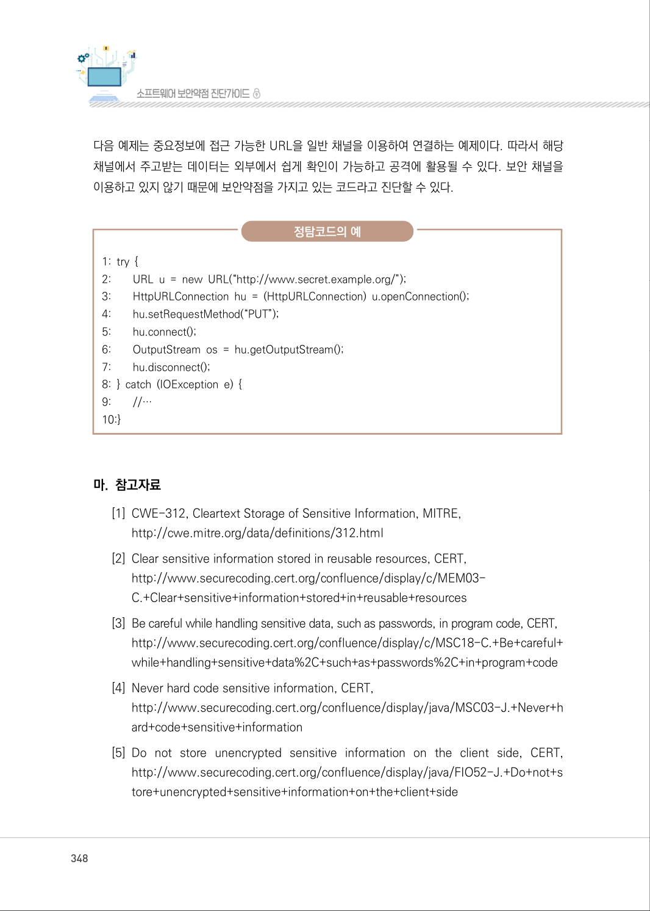

</details>

### PDF 349페이지 / 인쇄 349페이지

<!-- source-page:SW-Diagnosis-2021:349; source-lines:0,1,2,3,4,5,6,7 -->

349

제4장구현단계 보안약점 진단

[6] Password Plaintext Storage, OWASP

https://www.owasp.org/index.php/Password_Plaintext_Storage 
[7] CWE-319, Cleartext Transmission of Sensitive Information, MITRE,

http://cwe.mitre.org/data/definitions/319.html
[8] nsecure Transport, OWASP,

https://www.owasp.org/index.php/Insecure_Transport

<details><summary>원본 페이지 이미지 (변환 외 보존 자료)</summary>

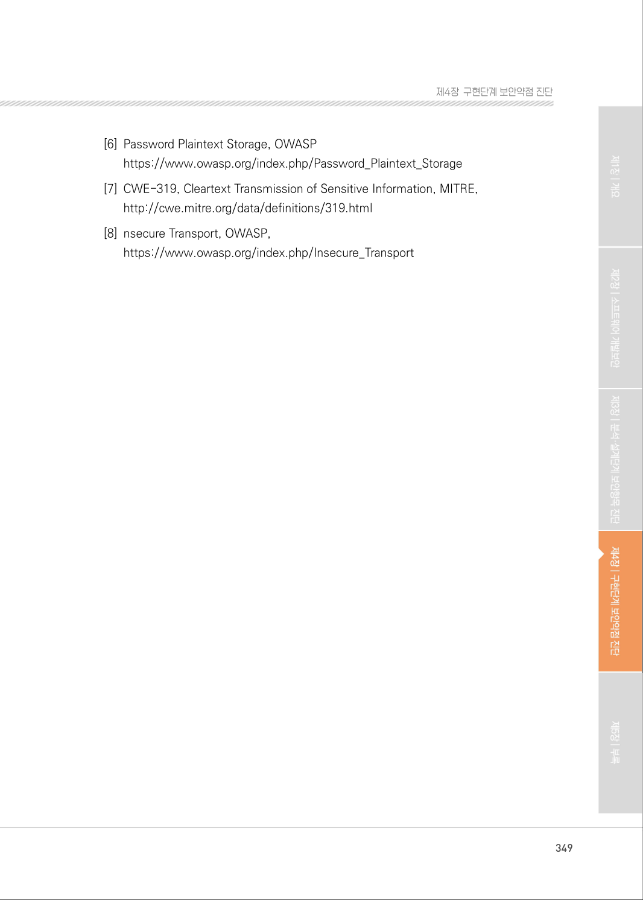

</details>

---

## 탐색 링크 (원문 외)

[통합 인덱스](../../../INDEX.md)

