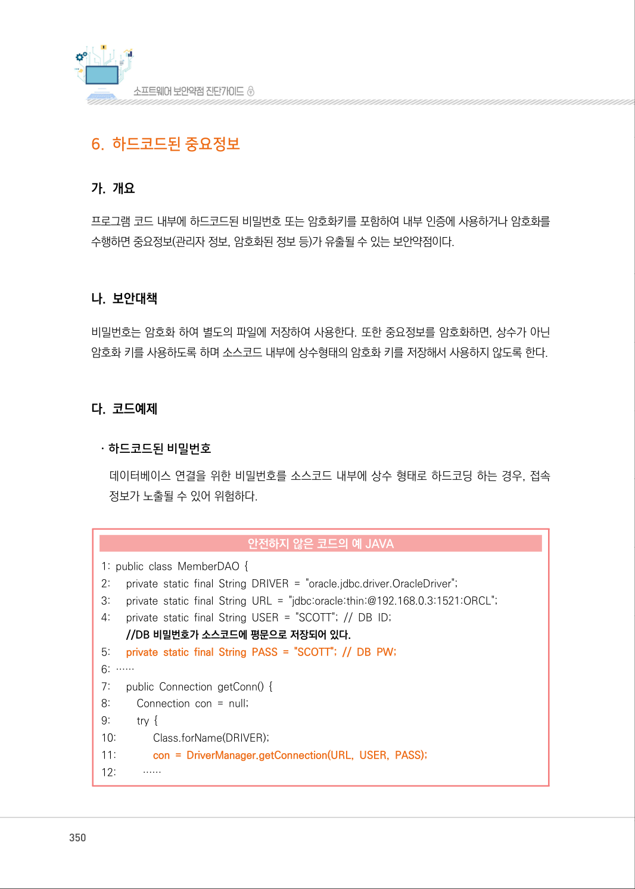
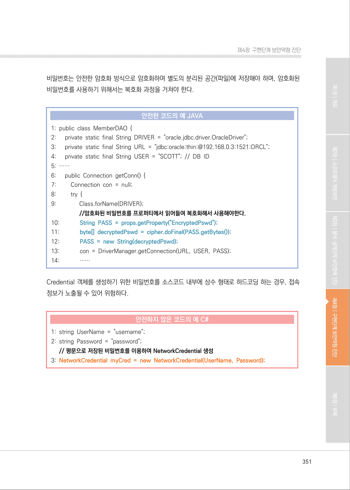
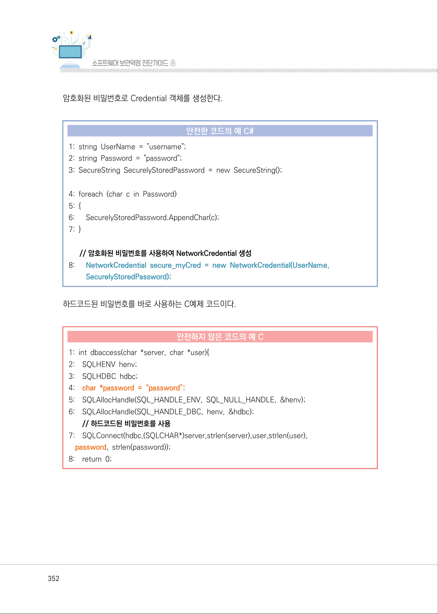
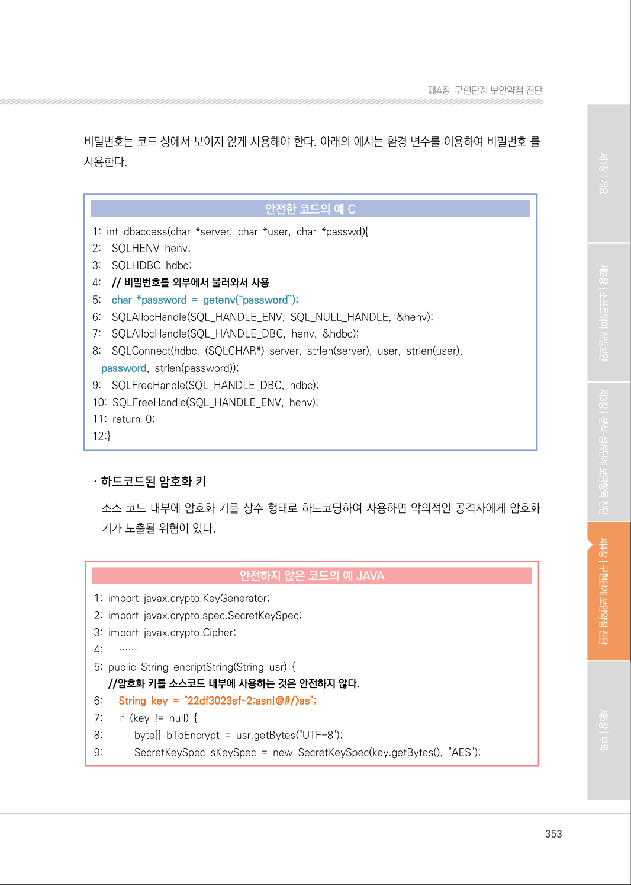
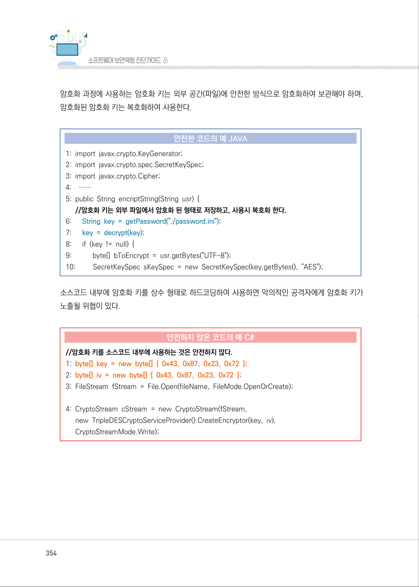
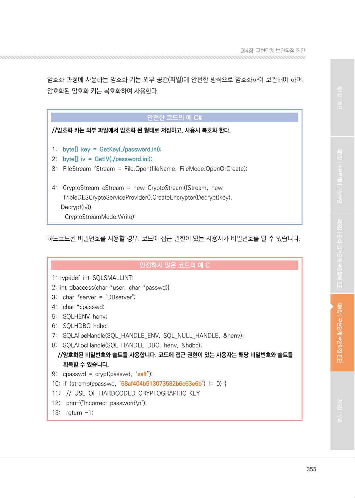
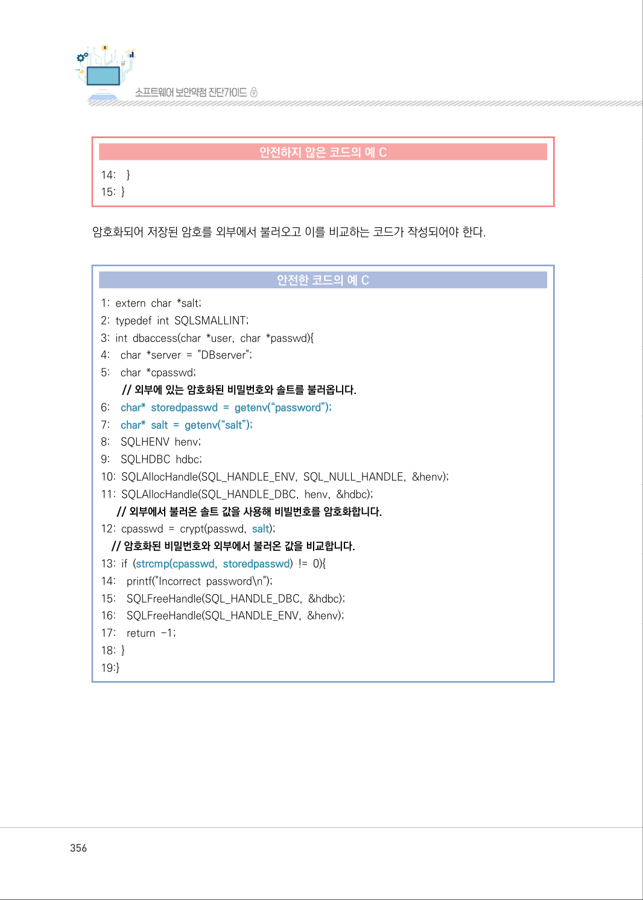
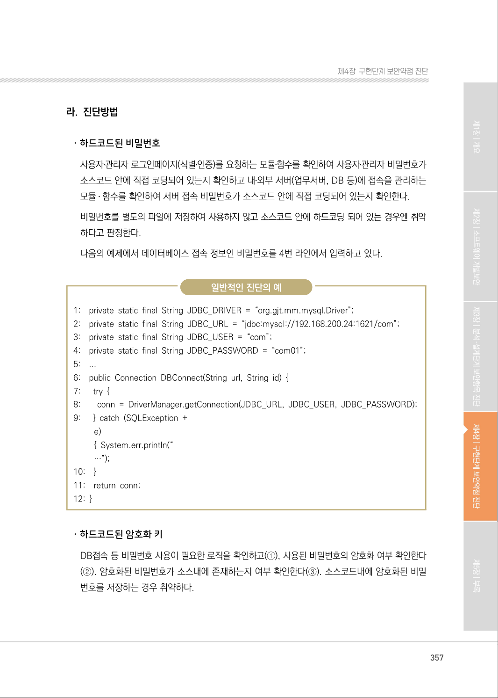
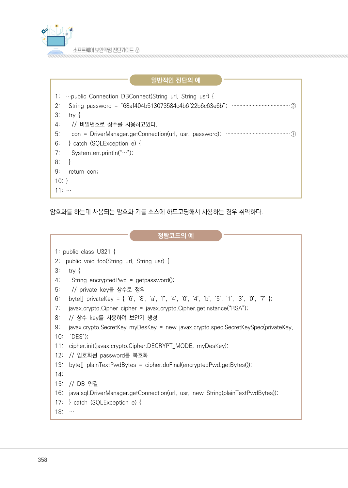
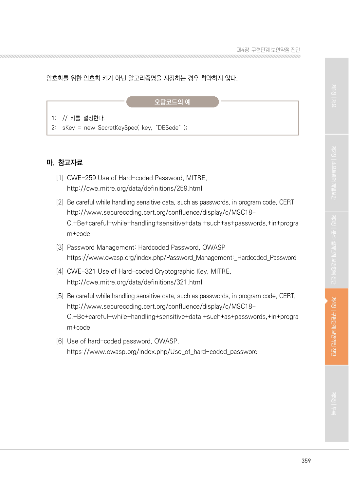

# 6. 하드코드된 중요정보

> 변환 안내(원문 외): 아래 본문은 PDF 텍스트를 추출한 전사입니다. 코드 줄번호·특수 공백·원문 오류를 유지했습니다. 실행용 코드가 아닙니다. 표·그림·들여쓰기는 연결된 페이지 이미지와 대조하세요. 페이지 경계의 줄바꿈을 보존하며, 동일 페이지가 여러 항목에 나뉘면 각 항목의 본문은 해당 구간만 포함합니다.

### PDF 350페이지 / 인쇄 350페이지

<!-- source-page:SW-Diagnosis-2021:350; source-lines:0,1,2,3,4,5,6,7,8,9,10,11,12,13,14,15,16,17,18,19,20,21,22,23,24,25,26,27,28,29,30,31,32,33,34,35 -->

350

#### 6. 하드코드된 중요정보

#### 가. 개요

프로그램 코드 내부에 하드코드된 비밀번호 또는 암호화키를 포함하여 내부 인증에 사용하거나 암호화를 
수행하면 중요정보(관리자 정보, 암호화된 정보 등)가 유출될 수 있는 보안약점이다.

#### 나. 보안대책

비밀번호는 암호화 하여 별도의 파일에 저장하여 사용한다. 또한 중요정보를 암호화하면, 상수가 아닌 
암호화 키를 사용하도록 하며 소스코드 내부에 상수형태의 암호화 키를 저장해서 사용하지 않도록 한다.

#### 다. 코드예제

ㆍ하드코드된 비밀번호

데이터베이스 연결을 위한 비밀번호를 소스코드 내부에 상수 형태로 하드코딩 하는 경우, 접속 
정보가 노출될 수 있어 위험하다.

#### 안전하지 않은 코드의 예 JAVA

```java
1: public class MemberDAO { 
2:      private static final String DRIVER = "oracle.jdbc.driver.OracleDriver";
3:      private static final String URL = "jdbc:oracle:thin:@192.168.0.3:1521:ORCL"; 
4:      private static final String USER = "SCOTT"; // DB ID; 
//DB 비밀번호가 소스코드에 평문으로 저장되어 있다. 
5:      private static final String PASS = "SCOTT"; // DB PW; 
6: ……
7:      public Connection getConn() {
8:         Connection con = null;
9:         try {
10:             Class.forName(DRIVER);
11:             con = DriverManager.getConnection(URL, USER, PASS);
12:         ……
```

<details><summary>원본 페이지 이미지 (변환 외 보존 자료)</summary>



</details>

### PDF 351페이지 / 인쇄 351페이지

<!-- source-page:SW-Diagnosis-2021:351; source-lines:0,1,2,3,4,5,6,7,8,9,10,11,12,13,14,15,16,17,18,19,20,21,22,23,24,25,26,27,28,29,30,31,32,33,34,35,36,37,38 -->

351

제4장구현단계 보안약점 진단

비밀번호는 안전한 암호화 방식으로 암호화하여 별도의 분리된 공간(파일)에 저장해야 하며, 암호화된 
비밀번호를 사용하기 위해서는 복호화 과정을 거쳐야 한다.

#### 안전한 코드의 예 JAVA

```java
1: public class MemberDAO { 
2:      private static final String DRIVER = "oracle.jdbc.driver.OracleDriver";
3:      private static final String URL = "jdbc:oracle:thin:@192.168.0.3:1521:ORCL";
4:      private static final String USER = "SCOTT"; // DB ID 
5: ……
6:      public Connection getConn() { 
7:         Connection con = null; 
8:         try {
9:               Class.forName(DRIVER);
//암호화된 비밀번호를 프로퍼티에서 읽어들여 복호화해서 사용해야한다.
10:             String PASS = props.getProperty("EncryptedPswd");
11:             byte[] decryptedPswd = cipher.doFinal(PASS.getBytes());
12:             PASS = new String(decryptedPswd);
13:             con = DriverManager.getConnection(URL, USER, PASS);
14:             ……
```

Credential 객체를 생성하기 위한 비밀번호를 소스코드 내부에 상수 형태로 하드코딩 하는 경우, 접속 
정보가 노출될 수 있어 위험하다.

#### 안전하지 않은 코드의 예 C#

```csharp
1: string UserName = "username"; 
2: string Password = "password";
// 평문으로 저장된 비밀번호를 이용하여 NetworkCredential 생성
3: NetworkCredential myCred = new NetworkCredential(UserName, Password);
```

<details><summary>원본 페이지 이미지 (변환 외 보존 자료)</summary>



</details>

### PDF 352페이지 / 인쇄 352페이지

<!-- source-page:SW-Diagnosis-2021:352; source-lines:0,1,2,3,4,5,6,7,8,9,10,11,12,13,14,15,16,17,18,19,20,21,22,23,24,25,26,27,28,29,30,31,32,33 -->

352

암호화된 비밀번호로 Credential 객체를 생성한다.

#### 안전한 코드의 예 C#

```csharp
1: string UserName = "username"; 
2: string Password = "password"; 
3: SecureString SecurelyStoredPassword = new SecureString(); 
4: foreach (char c in Password) 
5: { 
6:      SecurelyStoredPassword.AppendChar(c); 
7: }
// 암호화된 비밀번호를 사용하여 NetworkCredential 생성 
```

8:

NetworkCredential secure_myCred = new NetworkCredential(UserName, 
SecurelyStoredPassword);

하드코드된 비밀번호를 바로 사용하는 C예제 코드이다.

#### 안전하지 않은 코드의 예 C

```c
1: int dbaccess(char *server, char *user){ 
2:    SQLHENV henv; 
3:    SQLHDBC hdbc; 
4:    char *password = “password”;
5:    SQLAllocHandle(SQL_HANDLE_ENV, SQL_NULL_HANDLE, &henv);
6:    SQLAllocHandle(SQL_HANDLE_DBC, henv, &hdbc);
// 하드코드된 비밀번호를 사용
7:    SQLConnect(hdbc,(SQLCHAR*)server,strlen(server),user,strlen(user),
password, strlen(password));
8:    return 0;
```

<details><summary>원본 페이지 이미지 (변환 외 보존 자료)</summary>



</details>

### PDF 353페이지 / 인쇄 353페이지

<!-- source-page:SW-Diagnosis-2021:353; source-lines:0,1,2,3,4,5,6,7,8,9,10,11,12,13,14,15,16,17,18,19,20,21,22,23,24,25,26,27,28,29,30,31,32,33,34,35,36,37,38,39,40,41,42,43,44 -->

353

제4장구현단계 보안약점 진단

비밀번호는 코드 상에서 보이지 않게 사용해야 한다. 아래의 예시는 환경 변수를 이용하여 비밀번호 를 
사용한다.

#### 안전한 코드의 예 C

```c
1: int dbaccess(char *server, char *user, char *passwd){ 
2:    SQLHENV henv; 
3:    SQLHDBC hdbc; 
4:    // 비밀번호를 외부에서 불러와서 사용
5:    char *password = getenv(“password”);
6:    SQLAllocHandle(SQL_HANDLE_ENV, SQL_NULL_HANDLE, &henv);
7:    SQLAllocHandle(SQL_HANDLE_DBC, henv, &hdbc);
8:    SQLConnect(hdbc, (SQLCHAR*) server, strlen(server), user, strlen(user),
password, strlen(password));
9:    SQLFreeHandle(SQL_HANDLE_DBC, hdbc);
10: SQLFreeHandle(SQL_HANDLE_ENV, henv);
11: return 0;
12:}
```

ㆍ하드코드된 암호화 키

소스 코드 내부에 암호화 키를 상수 형태로 하드코딩하여 사용하면 악의적인 공격자에게 암호화 
키가 노출될 위협이 있다.

#### 안전하지 않은 코드의 예 JAVA

```java
1: import javax.crypto.KeyGenerator; 
2: import javax.crypto.spec.SecretKeySpec; 
3: import javax.crypto.Cipher; 
4:      ……
5: public String encriptString(String usr) { 
//암호화 키를 소스코드 내부에 사용하는 것은 안전하지 않다.
6:      String key = "22df3023sf~2;asn!@#/>as";
7:      if (key != null) {
8:           byte[] bToEncrypt = usr.getBytes("UTF-8");
9:           SecretKeySpec sKeySpec = new SecretKeySpec(key.getBytes(), "AES");
```

<details><summary>원본 페이지 이미지 (변환 외 보존 자료)</summary>



</details>

### PDF 354페이지 / 인쇄 354페이지

<!-- source-page:SW-Diagnosis-2021:354; source-lines:0,1,2,3,4,5,6,7,8,9,10,11,12,13,14,15,16,17,18,19,20,21,22,23,24,25,26,27,28,29,30 -->

354

암호화 과정에 사용하는 암호화 키는 외부 공간(파일)에 안전한 방식으로 암호화하여 보관해야 하며, 
암호화된 암호화 키는 복호화하여 사용한다.

#### 안전한 코드의 예 JAVA

```java
1: import javax.crypto.KeyGenerator; 
2: import javax.crypto.spec.SecretKeySpec; 
3: import javax.crypto.Cipher; 
4:    ……
5: public String encriptString(String usr) { 
//암호화 키는 외부 파일에서 암호화 된 형태로 저장하고, 사용시 복호화 한다.
6:      String key = getPassword("./password.ini");
7:      key = decrypt(key);
8:      if (key != null) { 
9:           byte[] bToEncrypt = usr.getBytes("UTF-8"); 
10:         SecretKeySpec sKeySpec = new SecretKeySpec(key.getBytes(), "AES"); 
```

소스코드 내부에 암호화 키를 상수 형태로 하드코딩하여 사용하면 악의적인 공격자에게 암호화 키가 
노출될 위협이 있다.

#### 안전하지 않은 코드의 예 C#

```csharp
//암호화 키를 소스코드 내부에 사용하는 것은 안전하지 않다. 
1: byte[] key = new byte[] { 0x43, 0x87, 0x23, 0x72 };
2: byte[] iv = new byte[] { 0x43, 0x87, 0x23, 0x72 };
3: FileStream fStream = File.Open(fileName, FileMode.OpenOrCreate);
4: CryptoStream cStream = new CryptoStream(fStream,
new TripleDESCryptoServiceProvider().CreateEncryptor(key, iv),
CryptoStreamMode.Write);
```

<details><summary>원본 페이지 이미지 (변환 외 보존 자료)</summary>



</details>

### PDF 355페이지 / 인쇄 355페이지

<!-- source-page:SW-Diagnosis-2021:355; source-lines:0,1,2,3,4,5,6,7,8,9,10,11,12,13,14,15,16,17,18,19,20,21,22,23,24,25,26,27,28,29,30,31,32,33,34,35,36,37,38,39,40,41,42,43 -->

355

제4장구현단계 보안약점 진단

암호화 과정에 사용하는 암호화 키는 외부 공간(파일)에 안전한 방식으로 암호화하여 보관해야 하며, 
암호화된 암호화 키는 복호화하여 사용한다.

#### 안전한 코드의 예 C#

```csharp
//암호화 키는 외부 파일에서 암호화 된 형태로 저장하고, 사용시 복호화 한다. 
1:    byte[] key = GetKey(./password.ini);
2:    byte[] iv = GetIV(./password.ini);
3:    FileStream fStream = File.Open(fileName, FileMode.OpenOrCreate);
4:    CryptoStream cStream = new CryptoStream(fStream, new 
TripleDESCryptoServiceProvider().CreateEncryptor(Decrypt(key),
Decrypt(iv)),
CryptoStreamMode.Write);
```

하드코드된 비밀번호를 사용할 경우, 코드에 접근 권한이 있는 사용자가 비밀번호를 알 수 있습니다.

#### 안전하지 않은 코드의 예 C

```c
1: typedef int SQLSMALLINT; 
2: int dbaccess(char *user, char *passwd){ 
3:    char *server = "DBserver"; 
4:    char *cpasswd; 
5:    SQLHENV henv; 
6:    SQLHDBC hdbc; 
7:    SQLAllocHandle(SQL_HANDLE_ENV, SQL_NULL_HANDLE, &henv); 
8:    SQLAllocHandle(SQL_HANDLE_DBC, henv, &hdbc); 
//암호화된 비밀번호와 솔트를 사용합니다. 코드에 접근 권한이 있는 사용자는 해당 비밀번호와 솔트를 
획득할 수 있습니다.
```

```text
9:    cpasswd = crypt(passwd, “salt”);
10: if (strcmp(cpasswd, "68af404b513073582b6c63e6b") != 0) { 
11:    // USE_OF_HARDCODED_CRYPTOGRAPHIC_KEY 
12:    printf("Incorrect password\n"); 
13:    return -1;
```

<details><summary>원본 페이지 이미지 (변환 외 보존 자료)</summary>



</details>

### PDF 356페이지 / 인쇄 356페이지

<!-- source-page:SW-Diagnosis-2021:356; source-lines:0,1,2,3,4,5,6,7,8,9,10,11,12,13,14,15,16,17,18,19,20,21,22,23,24,25,26,27,28,29,30,31,32,33,34,35,36,37 -->

356

#### 안전하지 않은 코드의 예 C

```c
14:    }
15: }
```

암호화되어 저장된 암호를 외부에서 불러오고 이를 비교하는 코드가 작성되어야 한다.

#### 안전한 코드의 예 C

```c
1: extern char *salt; 
2: typedef int SQLSMALLINT; 
3: int dbaccess(char *user, char *passwd){ 
4:    char *server = "DBserver"; 
5:    char *cpasswd;
// 외부에 있는 암호화된 비밀번호와 솔트를 불러옵니다.
6:    char* storedpasswd = getenv(“password”);
7: char* salt = getenv(“salt”);
8:    SQLHENV henv; 
9:    SQLHDBC hdbc; 
10: SQLAllocHandle(SQL_HANDLE_ENV, SQL_NULL_HANDLE, &henv);
11: SQLAllocHandle(SQL_HANDLE_DBC, henv, &hdbc); 
// 외부에서 불러온 솔트 값을 사용해 비빌번호를 암호화합니다.
12: cpasswd = crypt(passwd, salt);
// 암호화된 비밀번호와 외부에서 불러온 값을 비교합니다.
13: if (strcmp(cpasswd, storedpasswd) != 0){
14:    printf("Incorrect password\n"); 
15:    SQLFreeHandle(SQL_HANDLE_DBC, &hdbc); 
16:    SQLFreeHandle(SQL_HANDLE_ENV, &henv); 
17:    return -1; 
18: }
19:}
```

<details><summary>원본 페이지 이미지 (변환 외 보존 자료)</summary>



</details>

### PDF 357페이지 / 인쇄 357페이지

<!-- source-page:SW-Diagnosis-2021:357; source-lines:0,1,2,3,4,5,6,7,8,9,10,11,12,13,14,15,16,17,18,19,20,21,22,23,24,25,26,27,28,29,30,31,32,33,34,35,36,37,38,39,40 -->

357

제4장구현단계 보안약점 진단

#### 라. 진단방법

ㆍ하드코드된 비밀번호

사용자․관리자 로그인페이지(식별․인증)를 요청하는 모듈․함수를 확인하여 사용자․관리자 비밀번호가 
소스코드 안에 직접 코딩되어 있는지 확인하고 내․외부 서버(업무서버, DB 등)에 접속을 관리하는 
모듈․ 함수를 확인하여 서버 접속 비밀번호가 소스코드 안에 직접 코딩되어 있는지 확인한다.
비밀번호를 별도의 파일에 저장하여 사용하지 않고 소스코드 안에 하드코딩 되어 있는 경우엔 취약 
하다고 판정한다.
다음의 예제에서 데이터베이스 접속 정보인 비밀번호를 4번 라인에서 입력하고 있다.

일반적인 진단의 예

```text
1:    private static final String JDBC_DRIVER = “org.gjt.mm.mysql.Driver”;
2:    private static final String JDBC_URL = “jdbc:mysql://192.168.200.24:1621/com”;
3:    private static final String JDBC_USER = “com”; 
4:    private static final String JDBC_PASSWORD = “com01”; 
5:    ...
6:    public Connection DBConnect(String url, String id) { 
7:      try {
8:        conn = DriverManager.getConnection(JDBC_URL, JDBC_USER, JDBC_PASSWORD);
9:      } catch (SQLException +
e)
{ System.err.println(“ 
…”);
```

```text
10:    }
11:    return conn;
12: }
```

ㆍ하드코드된 암호화 키

DB접속 등 비밀번호 사용이 필요한 로직을 확인하고(①), 사용된 비밀번호의 암호화 여부 확인한다
(②). 암호화된 비밀번호가 소스내에 존재하는지 여부 확인한다(③). 소스코드내에 암호화된 비밀
번호를 저장하는 경우 취약하다.

<details><summary>원본 페이지 이미지 (변환 외 보존 자료)</summary>



</details>

### PDF 358페이지 / 인쇄 358페이지

<!-- source-page:SW-Diagnosis-2021:358; source-lines:0,1,2,3,4,5,6,7,8,9,10,11,12,13,14,15,16,17,18,19,20,21,22,23,24,25,26,27,28,29,30,31,32,33,34,35,36,37,38,39,40,41,42,43,44,45,46,47,48,49,50,51,52,53,54,55,56,57 -->

358

일반적인 진단의 예

```text
1:    …public Connection DBConnect(String url, String usr) { 
2:      String password = “68af404b513073584c4b6f22b6c63e6b”; ·······································②
3:      try { 
4:        // 비밀번호로 상수를 사용하고있다. 
5:        con = DriverManager.getConnection(url, usr, password); ···········································①
6:      } catch (SQLException e) {
7:        System.err.println(“…”);
8:      }
9:      return con;
10: }
11: …
```

암호화를 하는데 사용되는 암호화 키를 소스에 하드코딩해서 사용하는 경우 취약하다.

정탐코드의 예

```text
1: public class U321 { 
2:    public void foo(String url, String usr) { 
3:      try { 
4:        String encryptedPwd = getpassword(); 
5:        // private key를 상수로 정의 
6:      byte[] privateKey = { ‘6’, ‘8’, ‘a’, ‘f’, ‘4’, ‘0’, ‘4’, ‘b’, ‘5’, ‘1’, ‘3’, ‘0’, ‘7’ };
7:      javax.crypto.Cipher cipher = javax.crypto.Cipher.getInstance(“RSA”);
8:      // 상수 key를 사용하여 보안키 생성 
9:      javax.crypto.SecretKey myDesKey = new javax.crypto.spec.SecretKeySpec(privateKey,
10:    “DES”); 
11:    cipher.init(javax.crypto.Cipher.DECRYPT_MODE, myDesKey);
12:    // 암호화된 password를 복호화 
13:    byte[] plainTextPwdBytes = cipher.doFinal(encryptedPwd.getBytes());
14:
15:    // DB 연결 
16:    java.sql.DriverManager.getConnection(url, usr, new String(plainTextPwdBytes));
17:    } catch (SQLException e) { 
18:    …
```

<details><summary>원본 페이지 이미지 (변환 외 보존 자료)</summary>



</details>

### PDF 359페이지 / 인쇄 359페이지

<!-- source-page:SW-Diagnosis-2021:359; source-lines:0,1,2,3,4,5,6,7,8,9,10,11,12,13,14,15,16,17,18,19,20,21,22,23,24 -->

359

제4장구현단계 보안약점 진단

암호화를 위한 암호화 키가 아닌 알고리즘명을 지정하는 경우 취약하지 않다.

오탐코드의 예

```text
1:    // 키를 설정한다.
2:    sKey = new SecretKeySpec( key, “DESede” );
```

#### 마. 참고자료

[1] CWE-259 Use of Hard-coded Password, MITRE,

http://cwe.mitre.org/data/definitions/259.html
[2] Be careful while handling sensitive data, such as passwords, in program code, CERT

http://www.securecoding.cert.org/confluence/display/c/MSC18-
C.+Be+careful+while+handling+sensitive+data,+such+as+passwords,+in+progra
m+code
[3] Password Management: Hardcoded Password, OWASP

https://www.owasp.org/index.php/Password_Management:_Hardcoded_Password
[4] CWE-321 Use of Hard-coded Cryptographic Key, MITRE,

http://cwe.mitre.org/data/definitions/321.html
[5] Be careful while handling sensitive data, such as passwords, in program code, CERT,

http://www.securecoding.cert.org/confluence/display/c/MSC18-
C.+Be+careful+while+handling+sensitive+data,+such+as+passwords,+in+progra
m+code
[6] Use of hard-coded password, OWASP,

https://www.owasp.org/index.php/Use_of_hard-coded_password

<details><summary>원본 페이지 이미지 (변환 외 보존 자료)</summary>



</details>

---

## 탐색 링크 (원문 외)

[통합 인덱스](../../../INDEX.md)

