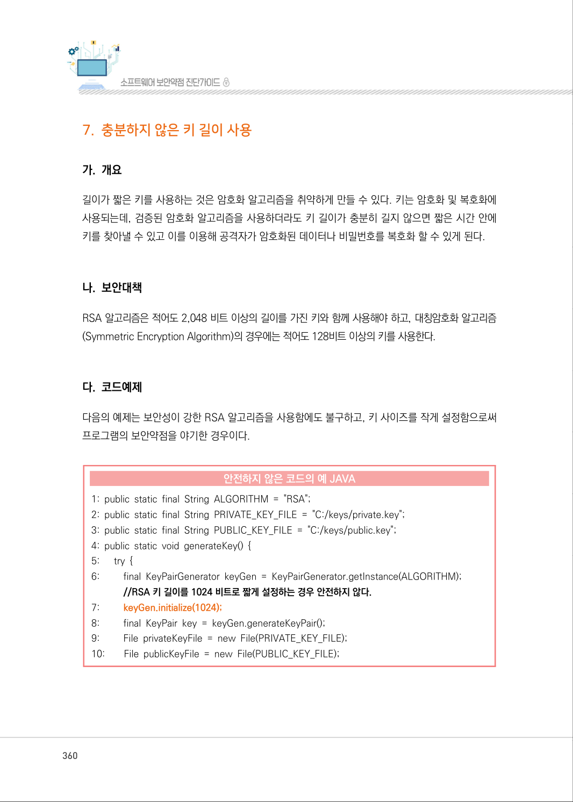
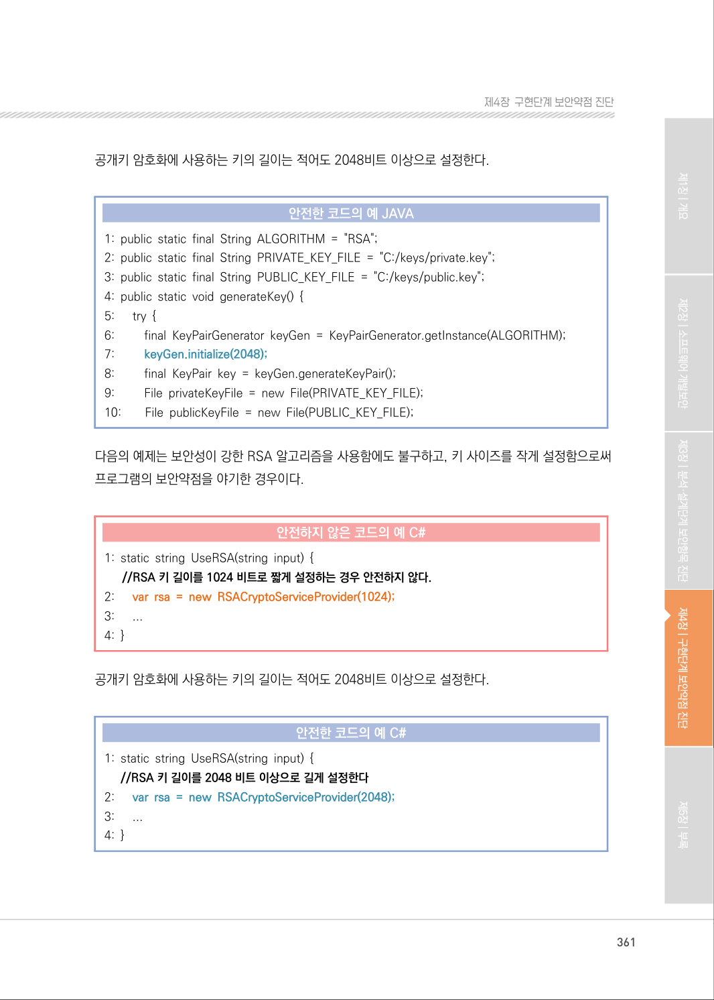
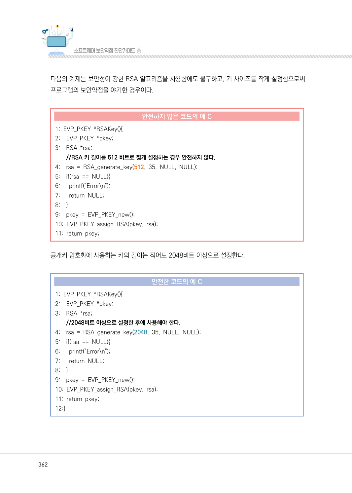
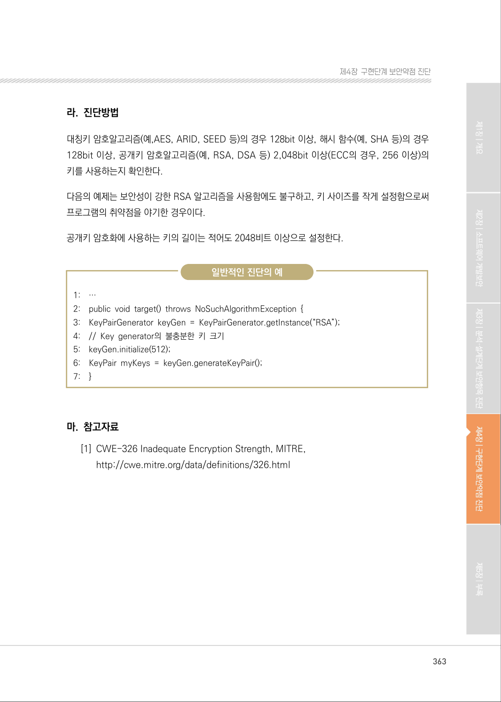

# 7. 충분하지 않은 키 길이 사용

> 변환 안내(원문 외): 아래 본문은 PDF 텍스트를 추출한 전사입니다. 코드 줄번호·특수 공백·원문 오류를 유지했습니다. 실행용 코드가 아닙니다. 표·그림·들여쓰기는 연결된 페이지 이미지와 대조하세요. 페이지 경계의 줄바꿈을 보존하며, 동일 페이지가 여러 항목에 나뉘면 각 항목의 본문은 해당 구간만 포함합니다.

### PDF 360페이지 / 인쇄 360페이지

<!-- source-page:SW-Diagnosis-2021:360; source-lines:0,1,2,3,4,5,6,7,8,9,10,11,12,13,14,15,16,17,18,19,20,21,22,23,24,25,26,27,28,29 -->

360

#### 7. 충분하지 않은 키 길이 사용

#### 가. 개요

길이가 짧은 키를 사용하는 것은 암호화 알고리즘을 취약하게 만들 수 있다. 키는 암호화 및 복호화에 
사용되는데, 검증된 암호화 알고리즘을 사용하더라도 키 길이가 충분히 길지 않으면 짧은 시간 안에 
키를 찾아낼 수 있고 이를 이용해 공격자가 암호화된 데이터나 비밀번호를 복호화 할 수 있게 된다.

#### 나. 보안대책

RSA 알고리즘은 적어도 2,048 비트 이상의 길이를 가진 키와 함께 사용해야 하고, 대칭암호화 알고리즘
(Symmetric Encryption Algorithm)의 경우에는 적어도 128비트 이상의 키를 사용한다.

#### 다. 코드예제

다음의 예제는 보안성이 강한 RSA 알고리즘을 사용함에도 불구하고, 키 사이즈를 작게 설정함으로써 
프로그램의 보안약점을 야기한 경우이다.

#### 안전하지 않은 코드의 예 JAVA

```java
1: public static final String ALGORITHM = "RSA"; 
2: public static final String PRIVATE_KEY_FILE = "C:/keys/private.key"; 
3: public static final String PUBLIC_KEY_FILE = "C:/keys/public.key"; 
4: public static void generateKey() { 
5:      try { 
6:         final KeyPairGenerator keyGen = KeyPairGenerator.getInstance(ALGORITHM);
//RSA 키 길이를 1024 비트로 짧게 설정하는 경우 안전하지 않다.
7:         keyGen.initialize(1024);
8:         final KeyPair key = keyGen.generateKeyPair(); 
9:         File privateKeyFile = new File(PRIVATE_KEY_FILE); 
10:        File publicKeyFile = new File(PUBLIC_KEY_FILE);
```

<details><summary>원본 페이지 이미지 (변환 외 보존 자료)</summary>



</details>

### PDF 361페이지 / 인쇄 361페이지

<!-- source-page:SW-Diagnosis-2021:361; source-lines:0,1,2,3,4,5,6,7,8,9,10,11,12,13,14,15,16,17,18,19,20,21,22,23,24,25,26,27,28,29,30,31,32,33,34,35,36,37,38 -->

361

제4장구현단계 보안약점 진단

공개키 암호화에 사용하는 키의 길이는 적어도 2048비트 이상으로 설정한다.

#### 안전한 코드의 예 JAVA

```java
1: public static final String ALGORITHM = "RSA"; 
2: public static final String PRIVATE_KEY_FILE = "C:/keys/private.key"; 
3: public static final String PUBLIC_KEY_FILE = "C:/keys/public.key"; 
4: public static void generateKey() { 
5:      try { 
6:         final KeyPairGenerator keyGen = KeyPairGenerator.getInstance(ALGORITHM);
7:         keyGen.initialize(2048);
8:         final KeyPair key = keyGen.generateKeyPair(); 
9:         File privateKeyFile = new File(PRIVATE_KEY_FILE); 
10:        File publicKeyFile = new File(PUBLIC_KEY_FILE); 
```

다음의 예제는 보안성이 강한 RSA 알고리즘을 사용함에도 불구하고, 키 사이즈를 작게 설정함으로써 
프로그램의 보안약점을 야기한 경우이다.

#### 안전하지 않은 코드의 예 C#

```csharp
1: static string UseRSA(string input) { 
//RSA 키 길이를 1024 비트로 짧게 설정하는 경우 안전하지 않다.
2:      var rsa = new RSACryptoServiceProvider(1024);
3:      ...
4: }
```

공개키 암호화에 사용하는 키의 길이는 적어도 2048비트 이상으로 설정한다.

#### 안전한 코드의 예 C#

```csharp
1: static string UseRSA(string input) { 
//RSA 키 길이를 2048 비트 이상으로 길게 설정한다
2:      var rsa = new RSACryptoServiceProvider(2048); 
3:      ...
4: }
```

<details><summary>원본 페이지 이미지 (변환 외 보존 자료)</summary>



</details>

### PDF 362페이지 / 인쇄 362페이지

<!-- source-page:SW-Diagnosis-2021:362; source-lines:0,1,2,3,4,5,6,7,8,9,10,11,12,13,14,15,16,17,18,19,20,21,22,23,24,25,26,27,28,29,30,31,32,33,34,35,36,37,38,39,40,41,42,43,44,45,46 -->

362

다음의 예제는 보안성이 강한 RSA 알고리즘을 사용함에도 불구하고, 키 사이즈를 작게 설정함으로써 
프로그램의 보안약점을 야기한 경우이다.

#### 안전하지 않은 코드의 예 C

```c
1: EVP_PKEY *RSAKey(){ 
2:    EVP_PKEY *pkey; 
3:    RSA *rsa;
//RSA 키 길이를 512 비트로 짧게 설정하는 경우 안전하지 않다.
4:    rsa = RSA_generate_key(512, 35, NULL, NULL);
5:    if(rsa == NULL){ 
6:      printf("Error\n"); 
7:      return NULL; 
8:    }
9:    pkey = EVP_PKEY_new(); 
10: EVP_PKEY_assign_RSA(pkey, rsa); 
11: return pkey;
```

공개키 암호화에 사용하는 키의 길이는 적어도 2048비트 이상으로 설정한다.

#### 안전한 코드의 예 C

```c
1: EVP_PKEY *RSAKey(){ 
2:    EVP_PKEY *pkey; 
3:    RSA *rsa; 
//2048비트 이상으로 설정한 후에 사용해야 한다.
4:    rsa = RSA_generate_key(2048, 35, NULL, NULL);
5:    if(rsa == NULL){ 
6:      printf("Error\n"); 
7:      return NULL; 
8:    }
9:    pkey = EVP_PKEY_new();
10: EVP_PKEY_assign_RSA(pkey, rsa);
11: return pkey;
12:}
```

<details><summary>원본 페이지 이미지 (변환 외 보존 자료)</summary>



</details>

### PDF 363페이지 / 인쇄 363페이지

<!-- source-page:SW-Diagnosis-2021:363; source-lines:0,1,2,3,4,5,6,7,8,9,10,11,12,13,14,15,16,17,18,19,20,21,22,23,24,25,26 -->

363

제4장구현단계 보안약점 진단

#### 라. 진단방법

대칭키 암호알고리즘(예,AES, ARID, SEED 등)의 경우 128bit 이상, 해시 함수(예, SHA 등)의 경우 
128bit 이상, 공개키 암호알고리즘(예, RSA, DSA 등) 2,048bit 이상(ECC의 경우, 256 이상)의 
키를 사용하는지 확인한다.

다음의 예제는 보안성이 강한 RSA 알고리즘을 사용함에도 불구하고, 키 사이즈를 작게 설정함으로써 
프로그램의 취약점을 야기한 경우이다.

공개키 암호화에 사용하는 키의 길이는 적어도 2048비트 이상으로 설정한다.

일반적인 진단의 예

```text
1:    … 
2:    public void target() throws NoSuchAlgorithmException { 
3:    KeyPairGenerator keyGen = KeyPairGenerator.getInstance(“RSA”); 
4:    // Key generator의 불충분한 키 크기 
5:    keyGen.initialize(512); 
6:    KeyPair myKeys = keyGen.generateKeyPair(); 
7:    }
```

#### 마. 참고자료

[1] CWE-326 Inadequate Encryption Strength, MITRE,

http://cwe.mitre.org/data/definitions/326.html

<details><summary>원본 페이지 이미지 (변환 외 보존 자료)</summary>



</details>

---

## 탐색 링크 (원문 외)

[통합 인덱스](../../../INDEX.md)

