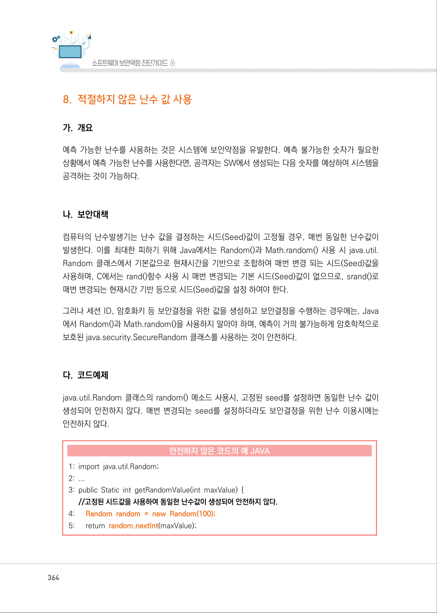
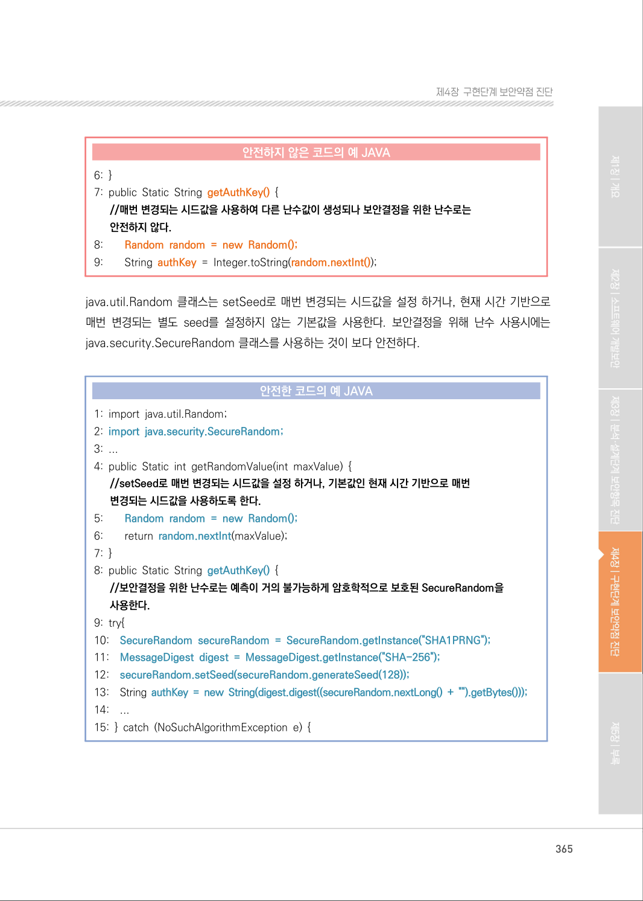
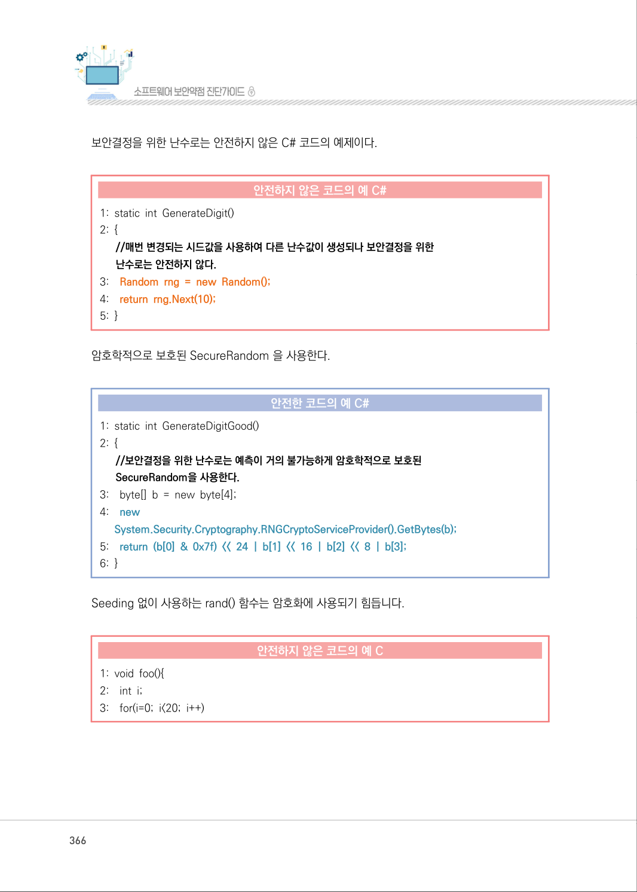
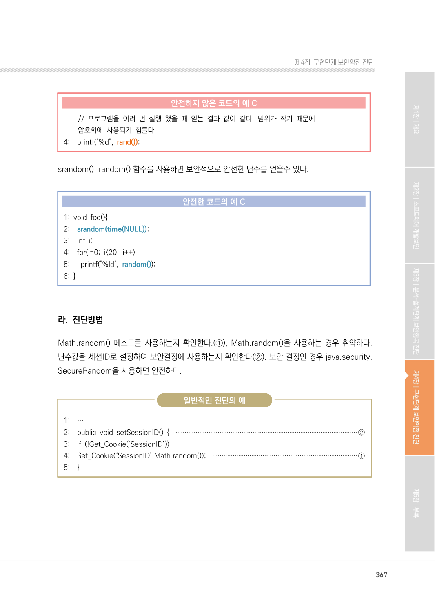
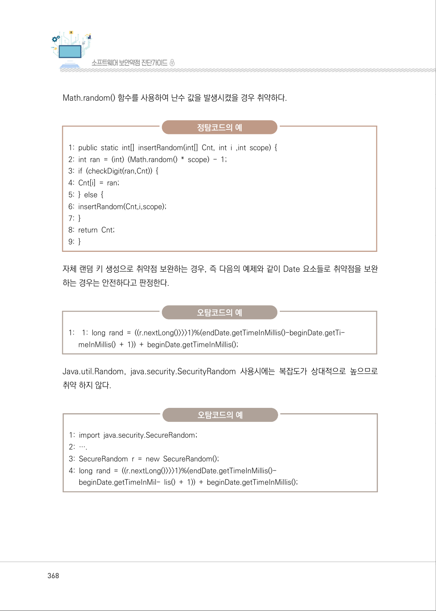
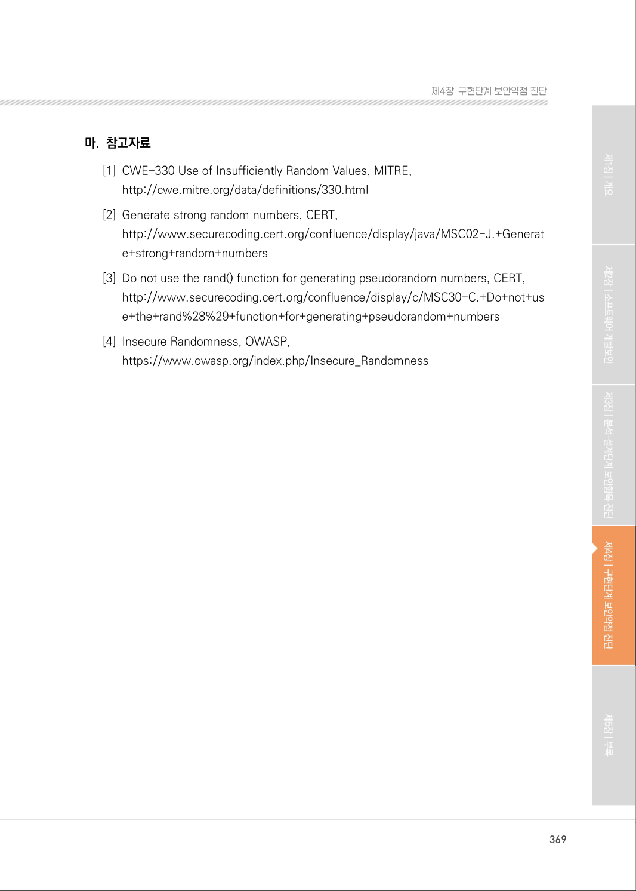

# 8. 적절하지 않은 난수 값 사용

> 변환 안내(원문 외): 아래 본문은 PDF 텍스트를 추출한 전사입니다. 코드 줄번호·특수 공백·원문 오류를 유지했습니다. 실행용 코드가 아닙니다. 표·그림·들여쓰기는 연결된 페이지 이미지와 대조하세요. 페이지 경계의 줄바꿈을 보존하며, 동일 페이지가 여러 항목에 나뉘면 각 항목의 본문은 해당 구간만 포함합니다.

### PDF 364페이지 / 인쇄 364페이지

<!-- source-page:SW-Diagnosis-2021:364; source-lines:0,1,2,3,4,5,6,7,8,9,10,11,12,13,14,15,16,17,18,19,20,21,22,23,24,25,26,27 -->

364

#### 8. 적절하지 않은 난수 값 사용

#### 가. 개요

예측 가능한 난수를 사용하는 것은 시스템에 보안약점을 유발한다. 예측 불가능한 숫자가 필요한 
상황에서 예측 가능한 난수를 사용한다면, 공격자는 SW에서 생성되는 다음 숫자를 예상하여 시스템을 
공격하는 것이 가능하다.

#### 나. 보안대책

컴퓨터의 난수발생기는 난수 값을 결정하는 시드(Seed)값이 고정될 경우, 매번 동일한 난수값이 
발생한다. 이를 최대한 피하기 위해 Java에서는 Random()과 Math.random() 사용 시 java.util. 
Random 클래스에서 기본값으로 현재시간을 기반으로 조합하여 매번 변경 되는 시드(Seed)값을 
사용하며, C에서는 rand()함수 사용 시 매번 변경되는 기본 시드(Seed)값이 없으므로, srand()로 
매번 변경되는 현재시간 기반 등으로 시드(Seed)값을 설정 하여야 한다.

그러나 세션 ID, 암호화키 등 보안결정을 위한 값을 생성하고 보안결정을 수행하는 경우에는, Java 
에서 Random()과 Math.random()을 사용하지 말아야 하며, 예측이 거의 불가능하게 암호학적으로 
보호된 java.security.SecureRandom 클래스를 사용하는 것이 안전하다.

#### 다. 코드예제

java.util.Random 클래스의 random() 메소드 사용시, 고정된 seed를 설정하면 동일한 난수 값이 
생성되어 안전하지 않다. 매번 변경되는 seed를 설정하더라도 보안결정을 위한 난수 이용시에는 
안전하지 않다.

#### 안전하지 않은 코드의 예 JAVA

```java
1: import java.util.Random;
2: ...
3: public Static int getRandomValue(int maxValue) { 
//고정된 시드값을 사용하여 동일한 난수값이 생성되어 안전하지 않다.
4:      Random random = new Random(100);
5:      return random.nextInt(maxValue);
```

<details><summary>원본 페이지 이미지 (변환 외 보존 자료)</summary>



</details>

### PDF 365페이지 / 인쇄 365페이지

<!-- source-page:SW-Diagnosis-2021:365; source-lines:0,1,2,3,4,5,6,7,8,9,10,11,12,13,14,15,16,17,18,19,20,21,22,23,24,25,26,27,28,29,30,31,32,33,34,35,36,37,38,39,40 -->

365

제4장구현단계 보안약점 진단

#### 안전하지 않은 코드의 예 JAVA

```java
6: }
7: public Static String getAuthKey() {
//매번 변경되는 시드값을 사용하여 다른 난수값이 생성되나 보안결정을 위한 난수로는
안전하지 않다.
```

```text
8:        Random random = new Random();
9:        String authKey = Integer.toString(random.nextInt());
```

java.util.Random 클래스는 setSeed로 매번 변경되는 시드값을 설정 하거나, 현재 시간 기반으로 
매번 변경되는 별도 seed를 설정하지 않는 기본값을 사용한다. 보안결정을 위해 난수 사용시에는 
java.security.SecureRandom 클래스를 사용하는 것이 보다 안전하다.

#### 안전한 코드의 예 JAVA

```java
1: import java.util.Random; 
2: import java.security.SecureRandom;
3: ...
4: public Static int getRandomValue(int maxValue) { 
//setSeed로 매번 변경되는 시드값을 설정 하거나, 기본값인 현재 시간 기반으로 매번
변경되는 시드값을 사용하도록 한다.
```

```text
5:        Random random = new Random();
6:        return random.nextInt(maxValue);
7: }
8: public Static String getAuthKey() { 
//보안결정을 위한 난수로는 예측이 거의 불가능하게 암호학적으로 보호된 SecureRandom을 
사용한다.
```

```text
9: try{
10:    SecureRandom secureRandom = SecureRandom.getInstance("SHA1PRNG");
11:    MessageDigest digest = MessageDigest.getInstance("SHA-256");
12:    secureRandom.setSeed(secureRandom.generateSeed(128));
13:    String authKey = new String(digest.digest((secureRandom.nextLong() + "").getBytes()));
14:    ...
15: } catch (NoSuchAlgorithmException e) {
```

<details><summary>원본 페이지 이미지 (변환 외 보존 자료)</summary>



</details>

### PDF 366페이지 / 인쇄 366페이지

<!-- source-page:SW-Diagnosis-2021:366; source-lines:0,1,2,3,4,5,6,7,8,9,10,11,12,13,14,15,16,17,18,19,20,21,22,23,24,25,26,27,28,29,30,31,32 -->

366

보안결정을 위한 난수로는 안전하지 않은 C# 코드의 예제이다.

#### 안전하지 않은 코드의 예 C#

```csharp
1: static int GenerateDigit() 
2: {
//매번 변경되는 시드값을 사용하여 다른 난수값이 생성되나 보안결정을 위한
난수로는 안전하지 않다.
```

```text
3:    Random rng = new Random();
4:    return rng.Next(10);
5: }
```

암호학적으로 보호된 SecureRandom 을 사용한다.

#### 안전한 코드의 예 C#

```csharp
1: static int GenerateDigitGood() 
2: { 
//보안결정을 위한 난수로는 예측이 거의 불가능하게 암호학적으로 보호된
SecureRandom을 사용한다.
```

```text
3:    byte[] b = new byte[4]; 
4:    new
System.Security.Cryptography.RNGCryptoServiceProvider().GetBytes(b);
5:    return (b[0] & 0x7f) << 24 | b[1] << 16 | b[2] << 8 | b[3];
6: }
```

Seeding 없이 사용하는 rand() 함수는 암호화에 사용되기 힘듭니다.

#### 안전하지 않은 코드의 예 C

```c
1: void foo(){ 
2:    int i; 
3:    for(i=0; i<20; i++)
```

<details><summary>원본 페이지 이미지 (변환 외 보존 자료)</summary>



</details>

### PDF 367페이지 / 인쇄 367페이지

<!-- source-page:SW-Diagnosis-2021:367; source-lines:0,1,2,3,4,5,6,7,8,9,10,11,12,13,14,15,16,17,18,19,20,21,22,23,24,25,26,27,28,29,30,31,32,33 -->

367

제4장구현단계 보안약점 진단

#### 안전하지 않은 코드의 예 C

```c
// 프로그램을 여러 번 실행 했을 때 얻는 결과 값이 같다. 범위가 작기 때문에 
암호화에 사용되기 힘들다. 
4:    printf("%d", rand()); 
```

srandom(), random() 함수를 사용하면 보안적으로 안전한 난수를 얻을수 있다.

#### 안전한 코드의 예 C

```c
1: void foo(){ 
2:    srandom(time(NULL));
3:    int i;
4:    for(i=0; i<20; i++)
5:      printf("%ld", random());
6: }
```

#### 라. 진단방법

Math.random() 메소드를 사용하는지 확인한다.(①), Math.random()을 사용하는 경우 취약하다. 
난수값을 세션ID로 설정하여 보안결정에 사용하는지 확인한다(②). 보안 결정인 경우 java.security. 
SecureRandom을 사용하면 안전하다.

일반적인 진단의 예

```text
1:    …
2:    public void setSessionID() { ···································································································②
3:    if (!Get_Cookie(‘SessionID’))
4:    Set_Cookie(‘SessionID’,Math.random()); ··············································································①
5:    }
```

<details><summary>원본 페이지 이미지 (변환 외 보존 자료)</summary>



</details>

### PDF 368페이지 / 인쇄 368페이지

<!-- source-page:SW-Diagnosis-2021:368; source-lines:0,1,2,3,4,5,6,7,8,9,10,11,12,13,14,15,16,17,18,19,20,21,22,23,24,25 -->

368

Math.random() 함수를 사용하여 난수 값을 발생시켰을 경우 취약하다.

정탐코드의 예

```text
1: public static int[] insertRandom(int[] Cnt, int i ,int scope) { 
2: int ran = (int) (Math.random() * scope) - 1; 
3: if (checkDigit(ran,Cnt)) { 
4: Cnt[i] = ran; 
5: } else { 
6: insertRandom(Cnt,i,scope); 
7: } 
8: return Cnt; 
9: }
```

자체 랜덤 키 생성으로 취약점 보완하는 경우, 즉 다음의 예제와 같이 Date 요소들로 취약점을 보완 
하는 경우는 안전하다고 판정한다.

오탐코드의 예

1:

1: long rand = ((r.nextLong()&gt;&gt;&gt;1)%(endDate.getTimeInMillis()-beginDate.getTi-
meInMillis() + 1)) + beginDate.getTimeInMillis(); 

Java.util.Random, java.security.SecurityRandom 사용시에는 복잡도가 상대적으로 높으므로 
취약 하지 않다.

오탐코드의 예

```text
1: import java.security.SecureRandom; 
2: ….
3: SecureRandom r = new SecureRandom(); 
4: long rand = ((r.nextLong()>>>1)%(endDate.getTimeInMillis()-
beginDate.getTimeInMil- lis() + 1)) + beginDate.getTimeInMillis();
```

<details><summary>원본 페이지 이미지 (변환 외 보존 자료)</summary>



</details>

### PDF 369페이지 / 인쇄 369페이지

<!-- source-page:SW-Diagnosis-2021:369; source-lines:0,1,2,3,4,5,6,7,8,9,10,11,12 -->

369

제4장구현단계 보안약점 진단

#### 마. 참고자료

[1] CWE-330 Use of Insufficiently Random Values, MITRE,

http://cwe.mitre.org/data/definitions/330.html
[2] Generate strong random numbers, CERT,

http://www.securecoding.cert.org/confluence/display/java/MSC02-J.+Generat
e+strong+random+numbers
[3] Do not use the rand() function for generating pseudorandom numbers, CERT,

http://www.securecoding.cert.org/confluence/display/c/MSC30-C.+Do+not+us
e+the+rand%28%29+function+for+generating+pseudorandom+numbers
[4] Insecure Randomness, OWASP,

https://www.owasp.org/index.php/Insecure_Randomness

<details><summary>원본 페이지 이미지 (변환 외 보존 자료)</summary>



</details>

---

## 탐색 링크 (원문 외)

[통합 인덱스](../../../INDEX.md)

