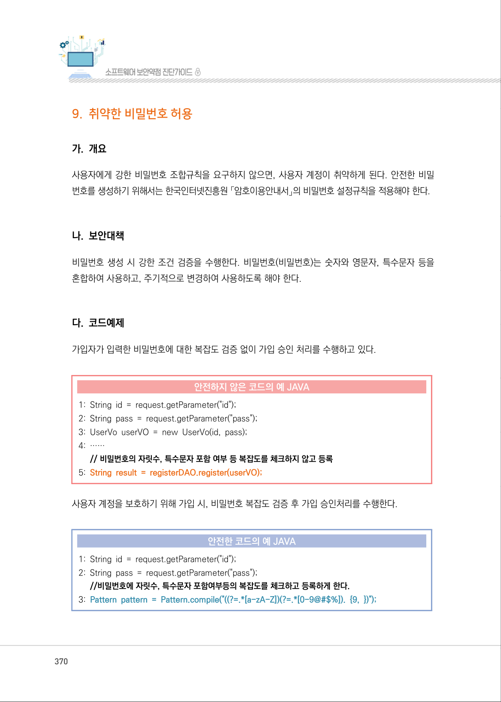
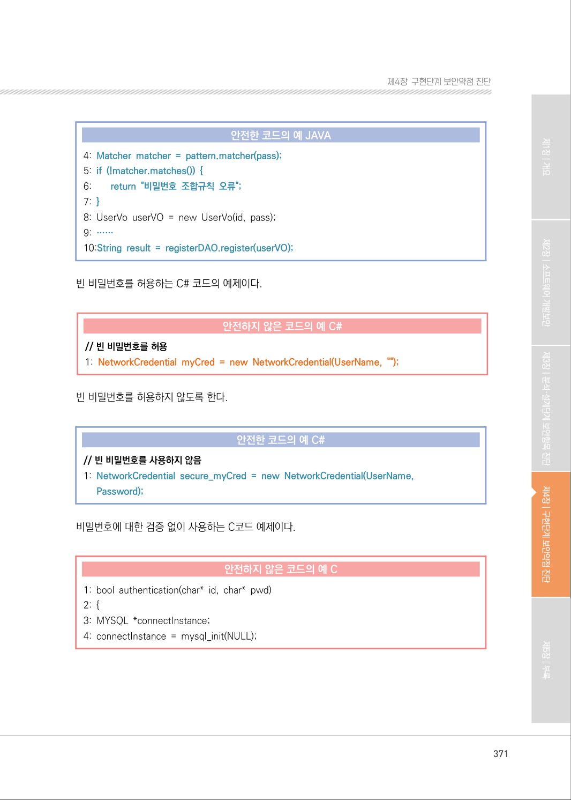
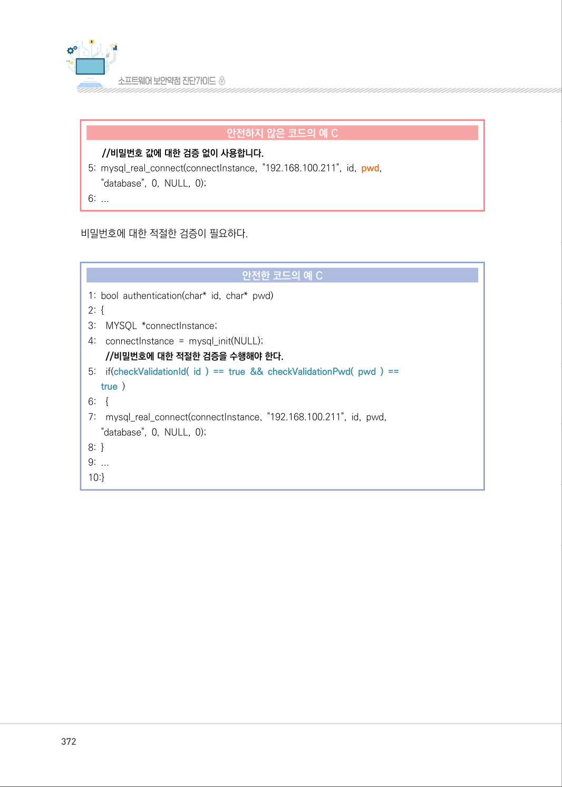
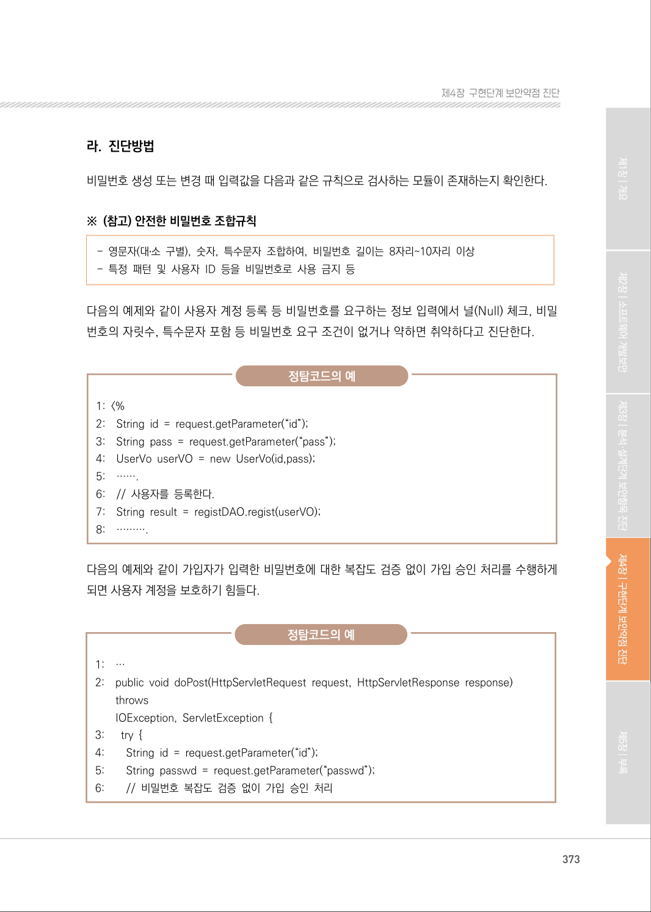
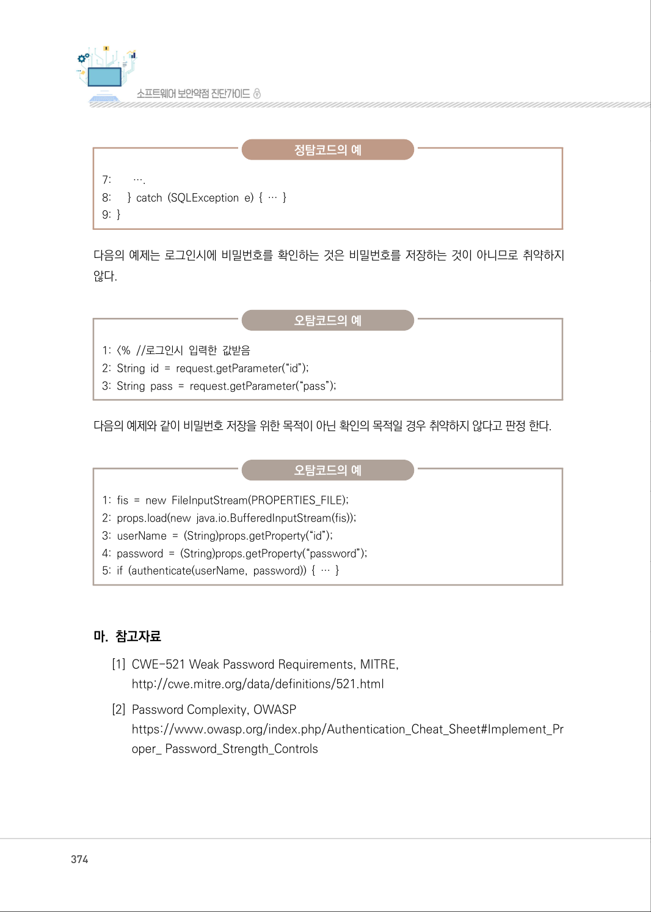
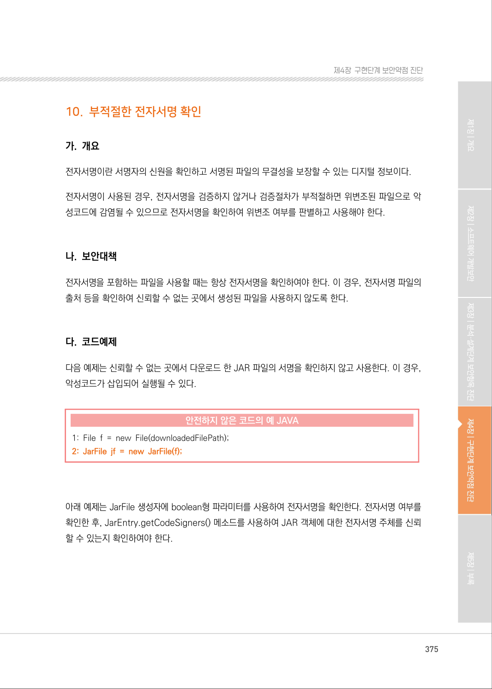

# 9. 취약한 비밀번호 허용

> 변환 안내(원문 외): 아래 본문은 PDF 텍스트를 추출한 전사입니다. 코드 줄번호·특수 공백·원문 오류를 유지했습니다. 실행용 코드가 아닙니다. 표·그림·들여쓰기는 연결된 페이지 이미지와 대조하세요. 페이지 경계의 줄바꿈을 보존하며, 동일 페이지가 여러 항목에 나뉘면 각 항목의 본문은 해당 구간만 포함합니다.

### PDF 370페이지 / 인쇄 370페이지

<!-- source-page:SW-Diagnosis-2021:370; source-lines:0,1,2,3,4,5,6,7,8,9,10,11,12,13,14,15,16,17,18,19,20,21,22 -->

370

#### 9. 취약한 비밀번호 허용

#### 가. 개요

사용자에게 강한 비밀번호 조합규칙을 요구하지 않으면, 사용자 계정이 취약하게 된다. 안전한 비밀
번호를 생성하기 위해서는 한국인터넷진흥원 「암호이용안내서」의 비밀번호 설정규칙을 적용해야 한다.

#### 나. 보안대책

비밀번호 생성 시 강한 조건 검증을 수행한다. 비밀번호(비밀번호)는 숫자와 영문자, 특수문자 등을 
혼합하여 사용하고, 주기적으로 변경하여 사용하도록 해야 한다.

#### 다. 코드예제

가입자가 입력한 비밀번호에 대한 복잡도 검증 없이 가입 승인 처리를 수행하고 있다.

#### 안전하지 않은 코드의 예 JAVA

```java
1: String id = request.getParameter("id"); 
2: String pass = request.getParameter("pass"); 
3: UserVo userVO = new UserVo(id, pass); 
4: …… 
// 비밀번호의 자릿수, 특수문자 포함 여부 등 복잡도를 체크하지 않고 등록
5: String result = registerDAO.register(userVO);
```

사용자 계정을 보호하기 위해 가입 시, 비밀번호 복잡도 검증 후 가입 승인처리를 수행한다.

#### 안전한 코드의 예 JAVA

```java
1: String id = request.getParameter("id"); 
2: String pass = request.getParameter("pass"); 
//비밀번호에 자릿수, 특수문자 포함여부등의 복잡도를 체크하고 등록하게 한다.
3: Pattern pattern = Pattern.compile("((?=.*[a-zA-Z])(?=.*[0-9@#$%]). {9, })");
```

<details><summary>원본 페이지 이미지 (변환 외 보존 자료)</summary>



</details>

### PDF 371페이지 / 인쇄 371페이지

<!-- source-page:SW-Diagnosis-2021:371; source-lines:0,1,2,3,4,5,6,7,8,9,10,11,12,13,14,15,16,17,18,19,20,21,22,23,24,25 -->

371

제4장구현단계 보안약점 진단

#### 안전한 코드의 예 JAVA

```java
4: Matcher matcher = pattern.matcher(pass);
5: if (!matcher.matches()) {
6:        return "비밀번호 조합규칙 오류";
7: }
8: UserVo userVO = new UserVo(id, pass); 
9: ……
10:String result = registerDAO.register(userVO);
```

빈 비밀번호를 허용하는 C# 코드의 예제이다.

#### 안전하지 않은 코드의 예 C#

```csharp
// 빈 비밀번호를 허용
1: NetworkCredential myCred = new NetworkCredential(UserName, ""); 
```

빈 비밀번호를 허용하지 않도록 한다.

#### 안전한 코드의 예 C#

```csharp
// 빈 비밀번호를 사용하지 않음
1: NetworkCredential secure_myCred = new NetworkCredential(UserName,
Password);
```

비밀번호에 대한 검증 없이 사용하는 C코드 예제이다.

#### 안전하지 않은 코드의 예 C

```c
1: bool authentication(char* id, char* pwd)
2: { 
3: MYSQL *connectInstance; 
4: connectInstance = mysql_init(NULL);
```

<details><summary>원본 페이지 이미지 (변환 외 보존 자료)</summary>



</details>

### PDF 372페이지 / 인쇄 372페이지

<!-- source-page:SW-Diagnosis-2021:372; source-lines:0,1,2,3,4,5,6,7,8,9,10,11,12,13,14,15,16,17,18,19,20,21,22,23,24,25 -->

372

#### 안전하지 않은 코드의 예 C

```c
//비밀번호 값에 대한 검증 없이 사용합니다.
5: mysql_real_connect(connectInstance, "192.168.100.211", id, pwd,
"database", 0, NULL, 0);
6: ...
```

비밀번호에 대한 적절한 검증이 필요하다.

#### 안전한 코드의 예 C

```c
1: bool authentication(char* id, char* pwd) 
2: { 
3:    MYSQL *connectInstance; 
4:    connectInstance = mysql_init(NULL); 
//비밀번호에 대한 적절한 검증을 수행해야 한다.
5:    if(checkValidationId( id ) == true && checkValidationPwd( pwd ) ==
true )
6:    { 
7:    mysql_real_connect(connectInstance, "192.168.100.211", id, pwd,
"database", 0, NULL, 0); 
8: }
9: ...
10:}
```

<details><summary>원본 페이지 이미지 (변환 외 보존 자료)</summary>



</details>

### PDF 373페이지 / 인쇄 373페이지

<!-- source-page:SW-Diagnosis-2021:373; source-lines:0,1,2,3,4,5,6,7,8,9,10,11,12,13,14,15,16,17,18,19,20,21,22,23,24,25,26,27,28,29,30,31,32,33,34,35,36,37,38,39,40,41 -->

373

제4장구현단계 보안약점 진단

#### 라. 진단방법

비밀번호 생성 또는 변경 때 입력값을 다음과 같은 규칙으로 검사하는 모듈이 존재하는지 확인한다.

※ (참고) 안전한 비밀번호 조합규칙

- 영문자(대․소 구별), 숫자, 특수문자 조합하여, 비밀번호 길이는 8자리~10자리 이상
- 특정 패턴 및 사용자 ID 등을 비밀번호로 사용 금지 등

다음의 예제와 같이 사용자 계정 등록 등 비밀번호를 요구하는 정보 입력에서 널(Null) 체크, 비밀
번호의 자릿수, 특수문자 포함 등 비밀번호 요구 조건이 없거나 약하면 취약하다고 진단한다.

정탐코드의 예

```text
1: <%
2:    String id = request.getParameter(“id”); 
3:    String pass = request.getParameter(“pass”); 
4:    UserVo userVO = new UserVo(id,pass); 
5:    …….
6:    // 사용자를 등록한다. 
7:    String result = registDAO.regist(userVO); 
8:    ……….
```

다음의 예제와 같이 가입자가 입력한 비밀번호에 대한 복잡도 검증 없이 가입 승인 처리를 수행하게 
되면 사용자 계정을 보호하기 힘들다.

정탐코드의 예

```text
1:    …
2:    public void doPost(HttpServletRequest request, HttpServletResponse response) 
throws
IOException, ServletException { 
```

```text
3:      try { 
4:        String id = request.getParameter(“id”); 
5:        String passwd = request.getParameter(“passwd”); 
6:        // 비밀번호 복잡도 검증 없이 가입 승인 처리
```

<details><summary>원본 페이지 이미지 (변환 외 보존 자료)</summary>



</details>

### PDF 374페이지 / 인쇄 374페이지

<!-- source-page:SW-Diagnosis-2021:374; source-lines:0,1,2,3,4,5,6,7,8,9,10,11,12,13,14,15,16,17,18,19,20,21,22,23,24,25 -->

374

정탐코드의 예

```text
7:        ….
8:      } catch (SQLException e) { … } 
9: }
```

다음의 예제는 로그인시에 비밀번호를 확인하는 것은 비밀번호를 저장하는 것이 아니므로 취약하지 
않다.

오탐코드의 예

```text
1: <% //로그인시 입력한 값받음 
2: String id = request.getParameter(“id”); 
3: String pass = request.getParameter(“pass”); 
```

다음의 예제와 같이 비밀번호 저장을 위한 목적이 아닌 확인의 목적일 경우 취약하지 않다고 판정 한다.

오탐코드의 예

```text
1: fis = new FileInputStream(PROPERTIES_FILE);
2: props.load(new java.io.BufferedInputStream(fis));
3: userName = (String)props.getProperty(“id”);
4: password = (String)props.getProperty(“password”);
5: if (authenticate(userName, password)) { … }
```

#### 마. 참고자료

[1] CWE-521 Weak Password Requirements, MITRE,

http://cwe.mitre.org/data/definitions/521.html
[2] Password Complexity, OWASP

https://www.owasp.org/index.php/Authentication_Cheat_Sheet#Implement_Pr
oper_ Password_Strength_Controls

<details><summary>원본 페이지 이미지 (변환 외 보존 자료)</summary>



</details>

### PDF 375페이지 / 인쇄 375페이지

<!-- source-page:SW-Diagnosis-2021:375; source-lines:1 -->

제4장구현단계 보안약점 진단

<details><summary>원본 페이지 이미지 (변환 외 보존 자료)</summary>



</details>

---

## 탐색 링크 (원문 외)

[통합 인덱스](../../../INDEX.md)

