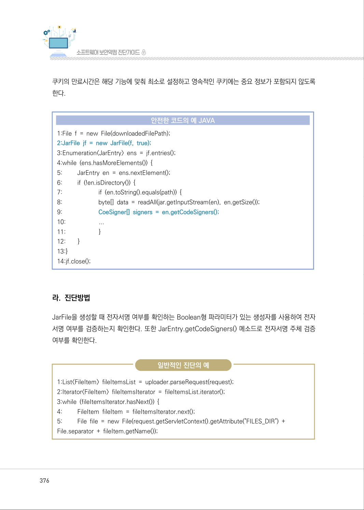
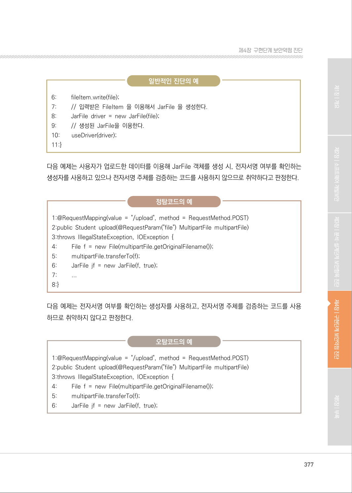
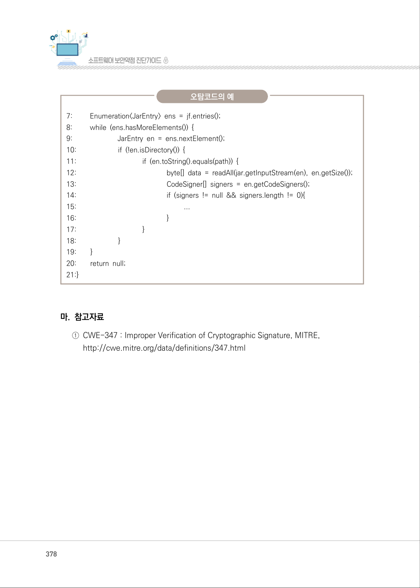

# 10. 부적절한 전자서명 확인

> 변환 안내(원문 외): 아래 본문은 PDF 텍스트를 추출한 전사입니다. 코드 줄번호·특수 공백·원문 오류를 유지했습니다. 실행용 코드가 아닙니다. 표·그림·들여쓰기는 연결된 페이지 이미지와 대조하세요. 페이지 경계의 줄바꿈을 보존하며, 동일 페이지가 여러 항목에 나뉘면 각 항목의 본문은 해당 구간만 포함합니다.

### PDF 375페이지 / 인쇄 375페이지

<!-- source-page:SW-Diagnosis-2021:375; source-lines:0,2,3,4,5,6,7,8,9,10,11,12,13,14,15,16,17,18 -->

375

#### 10. 부적절한 전자서명 확인

#### 가. 개요

전자서명이란 서명자의 신원을 확인하고 서명된 파일의 무결성을 보장할 수 있는 디지털 정보이다.

전자서명이 사용된 경우, 전자서명을 검증하지 않거나 검증절차가 부적절하면 위변조된 파일으로 악
성코드에 감염될 수 있으므로 전자서명을 확인하여 위변조 여부를 판별하고 사용해야 한다.

#### 나. 보안대책

전자서명을 포함하는 파일을 사용할 때는 항상 전자서명을 확인하여야 한다. 이 경우, 전자서명 파일의 
출처 등을 확인하여 신뢰할 수 없는 곳에서 생성된 파일을 사용하지 않도록 한다.

#### 다. 코드예제

다음 예제는 신뢰할 수 없는 곳에서 다운로드 한 JAR 파일의 서명을 확인하지 않고 사용한다. 이 경우, 
악성코드가 삽입되어 실행될 수 있다.

#### 안전하지 않은 코드의 예 JAVA

```java
1: File f = new File(downloadedFilePath);
2: JarFile jf = new JarFile(f);
```

아래 예제는 JarFile 생성자에 boolean형 파라미터를 사용하여 전자서명을 확인한다. 전자서명 여부를 
확인한 후, JarEntry.getCodeSigners() 메소드를 사용하여 JAR 객체에 대한 전자서명 주체를 신뢰
할 수 있는지 확인하여야 한다.

<details><summary>원본 페이지 이미지 (변환 외 보존 자료)</summary>


</details>

### PDF 376페이지 / 인쇄 376페이지

<!-- source-page:SW-Diagnosis-2021:376; source-lines:0,1,2,3,4,5,6,7,8,9,10,11,12,13,14,15,16,17,18,19,20,21,22,23,24,25,26,27,28,29,30,31,32,33,34,35,36,37,38 -->

376

쿠키의 만료시간은 해당 기능에 맞춰 최소로 설정하고 영속적인 쿠키에는 중요 정보가 포함되지 않도록 
한다.

#### 안전한 코드의 예 JAVA

```java
1:File f = new File(downloadedFilePath); 
2:JarFile jf = new JarFile(f, true);
3:Enumeration<JarEntry> ens = jf.entries(); 
4:while (ens.hasMoreElements()) { 
5:         JarEntry en = ens.nextElement(); 
6:         if (!en.isDirectory()) { 
7:                       if (en.toString().equals(path)) { 
8:                       byte[] data = readAll(jar.getInputStream(en), en.getSize());
9:                       CoeSigner[] signers = en.getCodeSigners();
10:                     ...
11:                     }
12:        }
13:}
14:jf.close();
```

#### 라. 진단방법

JarFile을 생성할 때 전자서명 여부를 확인하는 Boolean형 파라미터가 있는 생성자를 사용하여 전자
서명 여부를 검증하는지 확인한다. 또한 JarEntry.getCodeSigners() 메소드로 전자서명 주체 검증 
여부를 확인한다.

일반적인 진단의 예

```text
1:List<FileItem> fileItemsList = uploader.parseRequest(request); 
2:Iterator<FileItem> fileItemsIterator = fileItemsList.iterator(); 
3:while (fileItemsIterator.hasNext()) { 
4:         FileItem fileItem = fileItemsIterator.next(); 
5:         File file = new File(request.getServletContext().getAttribute("FILES_DIR") + 
File.separator + fileItem.getName());
```

<details><summary>원본 페이지 이미지 (변환 외 보존 자료)</summary>



</details>

### PDF 377페이지 / 인쇄 377페이지

<!-- source-page:SW-Diagnosis-2021:377; source-lines:0,1,2,3,4,5,6,7,8,9,10,11,12,13,14,15,16,17,18,19,20,21,22,23,24,25,26,27,28,29,30,31,32,33,34,35,36,37,38,39,40 -->

377

제4장구현단계 보안약점 진단

일반적인 진단의 예

```text
6:         fileItem.write(file);
7:         // 입력받은 FileItem 을 이용해서 JarFile 을 생성한다. 
8:         JarFile driver = new JarFile(file);
9:         // 생성된 JarFile을 이용한다. 
10:        useDriver(driver);
11:}
```

다음 예제는 사용자가 업로드한 데이터를 이용해 JarFile 객체를 생성 시, 전자서명 여부를 확인하는 
생성자를 사용하고 있으나 전자서명 주체를 검증하는 코드를 사용하지 않으므로 취약하다고 판정한다.

정탐코드의 예

```text
1:@RequestMapping(value = "/upload", method = RequestMethod.POST)
2:public Student upload(@RequestParam("file") MultipartFile multipartFile)
3:throws IllegalStateException, IOException {
4:         File f = new File(multipartFile.getOriginalFilename());
5:         multipartFile.transferTo(f);
6:         JarFile jf = new JarFile(f, true);
7:         ...
8:}
```

다음 예제는 전자서명 여부를 확인하는 생성자를 사용하고, 전자서명 주체를 검증하는 코드를 사용
하므로 취약하지 않다고 판정한다.

오탐코드의 예

```text
1:@RequestMapping(value = "/upload", method = RequestMethod.POST)
2:public Student upload(@RequestParam("file") MultipartFile multipartFile)
3:throws IllegalStateException, IOException {
4:         File f = new File(multipartFile.getOriginalFilename());
5:         multipartFile.transferTo(f);
6:         JarFile jf = new JarFile(f, true);
```

<details><summary>원본 페이지 이미지 (변환 외 보존 자료)</summary>



</details>

### PDF 378페이지 / 인쇄 378페이지

<!-- source-page:SW-Diagnosis-2021:378; source-lines:0,1,2,3,4,5,6,7,8,9,10,11,12,13,14,15,16,17,18,19,20,21,22,23,24,25,26,27,28,29,30,31,32,33 -->

378

오탐코드의 예

```text
7:         Enumeration<JarEntry> ens = jf.entries(); 
8:         while (ens.hasMoreElements()) { 
9:                         JarEntry en = ens.nextElement(); 
10:                       if (!en.isDirectory()) { 
11:                                    if (en.toString().equals(path)) { 
12:                                                 byte[] data = readAll(jar.getInputStream(en), en.getSize());
13:                                                 CodeSigner[] signers = en.getCodeSigners();
14:                                                 if (signers != null && signers.length != 0){
15:                                                           ...
16:                                                 }
17:                                    }
18:                       }
19:        }
20:        return null; 
21:}
```

#### 마. 참고자료

①CWE-347 : Improper Verification of Cryptographic Signature, MITRE,

http://cwe.mitre.org/data/definitions/347.html

<details><summary>원본 페이지 이미지 (변환 외 보존 자료)</summary>



</details>

### PDF 379페이지 / 인쇄 379페이지

<!-- source-page:SW-Diagnosis-2021:379; source-lines:1 -->

제4장구현단계 보안약점 진단

<details><summary>원본 페이지 이미지 (변환 외 보존 자료)</summary>


</details>

---

## 탐색 링크 (원문 외)

[통합 인덱스](../../../INDEX.md)

