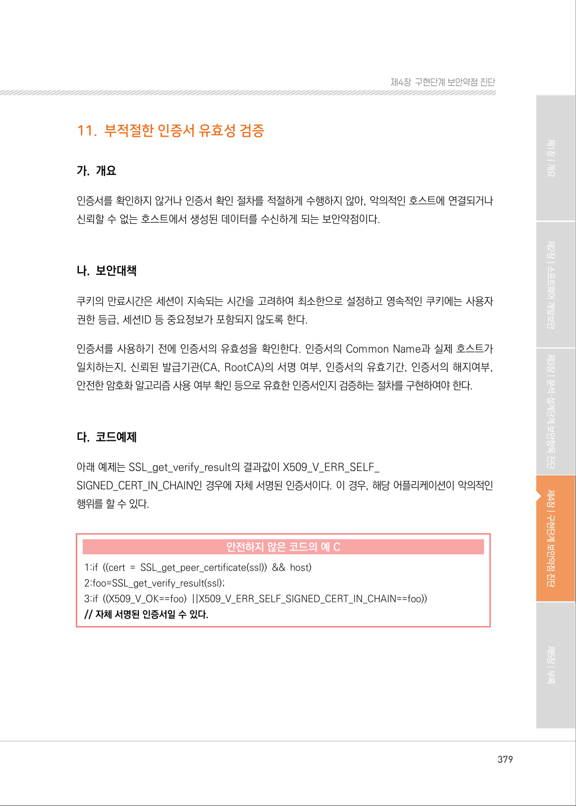
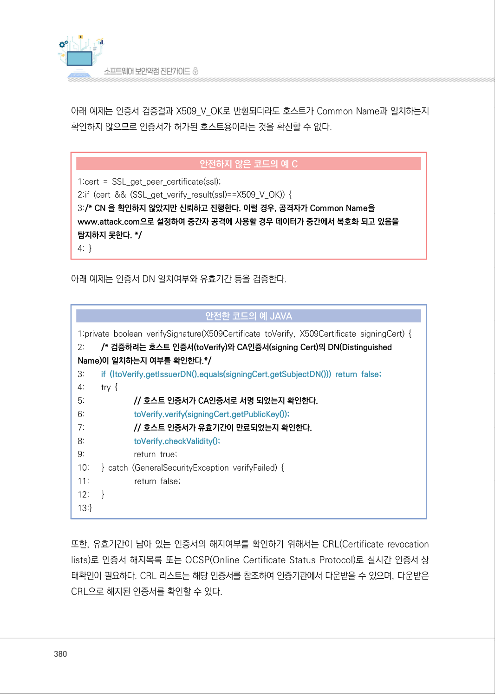
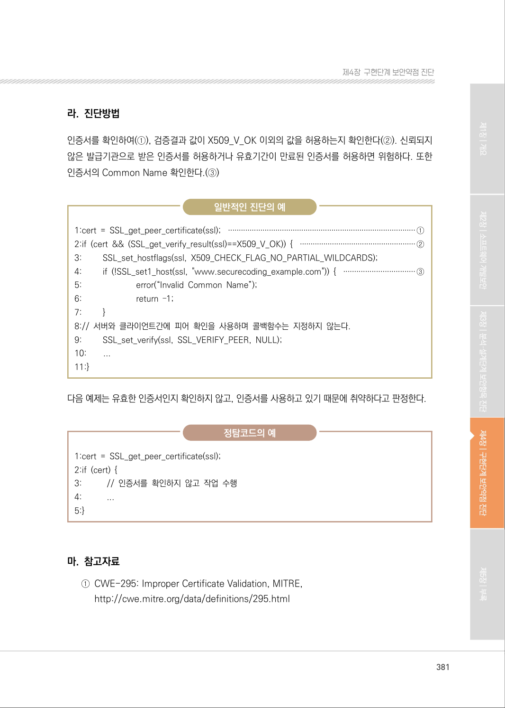

# 11. 부적절한 인증서 유효성 검증

> 변환 안내(원문 외): 아래 본문은 PDF 텍스트를 추출한 전사입니다. 코드 줄번호·특수 공백·원문 오류를 유지했습니다. 실행용 코드가 아닙니다. 표·그림·들여쓰기는 연결된 페이지 이미지와 대조하세요. 페이지 경계의 줄바꿈을 보존하며, 동일 페이지가 여러 항목에 나뉘면 각 항목의 본문은 해당 구간만 포함합니다.

### PDF 379페이지 / 인쇄 379페이지

<!-- source-page:SW-Diagnosis-2021:379; source-lines:0,2,3,4,5,6,7,8,9,10,11,12,13,14,15,16,17,18,19,20 -->

379

#### 11. 부적절한 인증서 유효성 검증

#### 가. 개요

인증서를 확인하지 않거나 인증서 확인 절차를 적절하게 수행하지 않아, 악의적인 호스트에 연결되거나 
신뢰할 수 없는 호스트에서 생성된 데이터를 수신하게 되는 보안약점이다.

#### 나. 보안대책

쿠키의 만료시간은 세션이 지속되는 시간을 고려하여 최소한으로 설정하고 영속적인 쿠키에는 사용자 
권한 등급, 세션ID 등 중요정보가 포함되지 않도록 한다.

인증서를 사용하기 전에 인증서의 유효성을 확인한다. 인증서의 Common Name과 실제 호스트가 
일치하는지, 신뢰된 발급기관(CA, RootCA)의 서명 여부, 인증서의 유효기간, 인증서의 해지여부, 
안전한 암호화 알고리즘 사용 여부 확인 등으로 유효한 인증서인지 검증하는 절차를 구현하여야 한다.

#### 다. 코드예제

아래 예제는 SSL_get_verify_result의 결과값이 X509_V_ERR_SELF_
SIGNED_CERT_IN_CHAIN인 경우에 자체 서명된 인증서이다. 이 경우, 해당 어플리케이션이 악의적인 
행위를 할 수 있다.

#### 안전하지 않은 코드의 예 C

```c
1:if ((cert = SSL_get_peer_certificate(ssl)) && host) 
2:foo=SSL_get_verify_result(ssl); 
3:if ((X509_V_OK==foo) ||X509_V_ERR_SELF_SIGNED_CERT_IN_CHAIN==foo))
// 자체 서명된 인증서일 수 있다.
```

<details><summary>원본 페이지 이미지 (변환 외 보존 자료)</summary>



</details>

### PDF 380페이지 / 인쇄 380페이지

<!-- source-page:SW-Diagnosis-2021:380; source-lines:0,1,2,3,4,5,6,7,8,9,10,11,12,13,14,15,16,17,18,19,20,21,22,23,24,25,26,27,28,29,30,31,32,33,34,35,36,37,38,39,40 -->

380

아래 예제는 인증서 검증결과 X509_V_OK로 반환되더라도 호스트가 Common Name과 일치하는지 
확인하지 않으므로 인증서가 허가된 호스트용이라는 것을 확신할 수 없다.

#### 안전하지 않은 코드의 예 C

```c
1:cert = SSL_get_peer_certificate(ssl); 
2:if (cert && (SSL_get_verify_result(ssl)==X509_V_OK)) { 
3:/* CN 을 확인하지 않았지만 신뢰하고 진행한다. 이럴 경우, 공격자가 Common Name을 
www.attack.com으로 설정하여 중간자 공격에 사용할 경우 데이터가 중간에서 복호화 되고 있음을 
탐지하지 못한다. */
```

4: }

아래 예제는 인증서 DN 일치여부와 유효기간 등을 검증한다.

#### 안전한 코드의 예 JAVA

```java
1:private boolean verifySignature(X509Certificate toVerify, X509Certificate signingCert) {
2:        /* 검증하려는 호스트 인증서(toVerify)와 CA인증서(signing Cert)의 DN(Distinguished 
Name)이 일치하는지 여부를 확인한다.*/
3:        if (!toVerify.getIssuerDN().equals(signingCert.getSubjectDN())) return false;
4:        try {
5:                       // 호스트 인증서가 CA인증서로 서명 되었는지 확인한다.
6:                       toVerify.verify(signingCert.getPublicKey());
7:                       // 호스트 인증서가 유효기간이 만료되었는지 확인한다.
8:                       toVerify.checkValidity();
9:                       return true;
10:      } catch (GeneralSecurityException verifyFailed) { 
11:                     return false; 
12:      }
13:}
```

또한, 유효기간이 남아 있는 인증서의 해지여부를 확인하기 위해서는 CRL(Certificate revocation 
lists)로 인증서 해지목록 또는 OCSP(Online Certificate Status Protocol)로 실시간 인증서 상
태확인이 필요하다. CRL 리스트는 해당 인증서를 참조하여 인증기관에서 다운받을 수 있으며, 다운받은 
CRL으로 해지된 인증서를 확인할 수 있다.

<details><summary>원본 페이지 이미지 (변환 외 보존 자료)</summary>



</details>

### PDF 381페이지 / 인쇄 381페이지

<!-- source-page:SW-Diagnosis-2021:381; source-lines:0,1,2,3,4,5,6,7,8,9,10,11,12,13,14,15,16,17,18,19,20,21,22,23,24,25,26,27,28,29,30,31,32,33,34,35,36 -->

381

제4장구현단계 보안약점 진단

#### 라. 진단방법

인증서를 확인하여(①), 검증결과 값이 X509_V_OK 이외의 값을 허용하는지 확인한다(②). 신뢰되지 
않은 발급기관으로 받은 인증서를 허용하거나 유효기간이 만료된 인증서를 허용하면 위험하다. 또한 
인증서의 Common Name 확인한다.(③)

일반적인 진단의 예

```text
1:cert = SSL_get_peer_certificate(ssl); ·······················································································①
2:if (cert && (SSL_get_verify_result(ssl)==X509_V_OK)) { ······················································②
3:         SSL_set_hostflags(ssl, X509_CHECK_FLAG_NO_PARTIAL_WILDCARDS);
4:         if (!SSL_set1_host(ssl, "www.securecoding_example.com")) { ·································③
5:                         error(“Invalid Common Name”);
6:                         return –1;
7:         }
8:// 서버와 클라이언트간에 피어 확인을 사용하며 콜백함수는 지정하지 않는다.
9:         SSL_set_verify(ssl, SSL_VERIFY_PEER, NULL);
10:        ...
11:}
```

다음 예제는 유효한 인증서인지 확인하지 않고, 인증서를 사용하고 있기 때문에 취약하다고 판정한다.

정탐코드의 예

```text
1:cert = SSL_get_peer_certificate(ssl);
2:if (cert) {
3:           // 인증서를 확인하지 않고 작업 수행
4:           ...
5:}
```

#### 마. 참고자료

①CWE-295: Improper Certificate Validation, MITRE,

http://cwe.mitre.org/data/definitions/295.html

<details><summary>원본 페이지 이미지 (변환 외 보존 자료)</summary>



</details>

---

## 탐색 링크 (원문 외)

[통합 인덱스](../../../INDEX.md)

