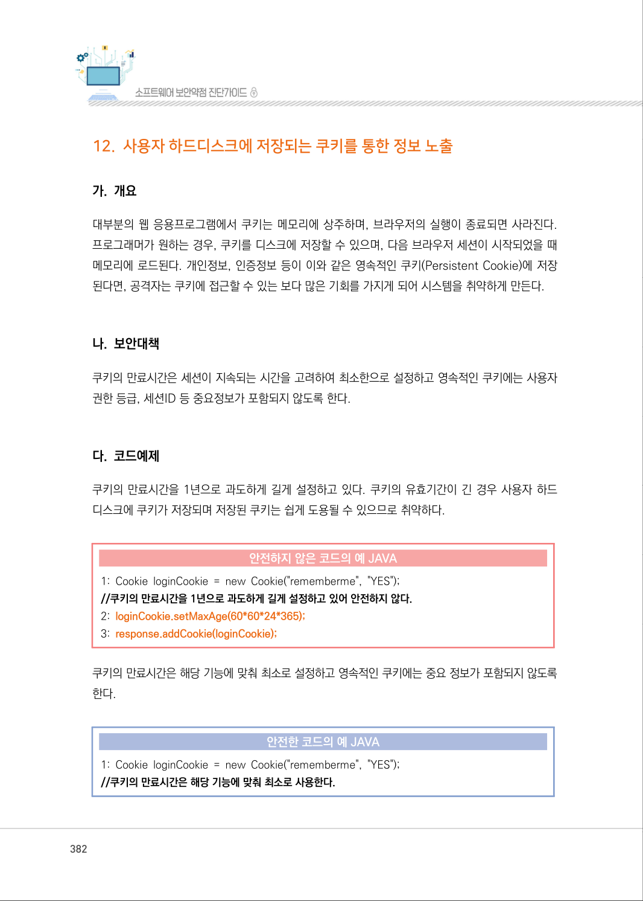
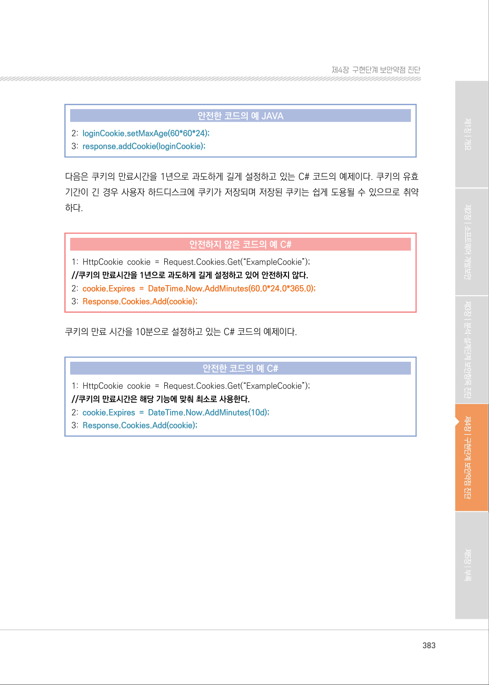
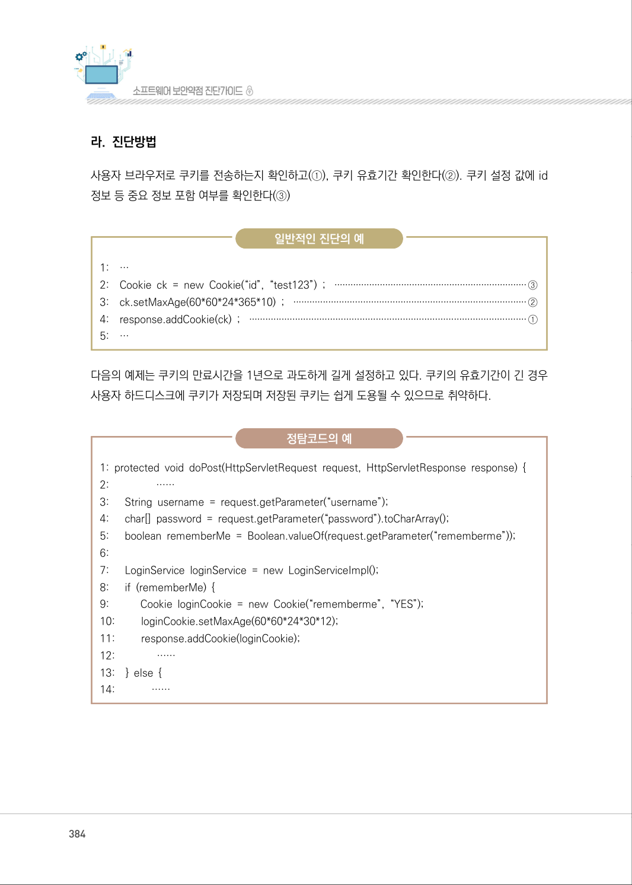
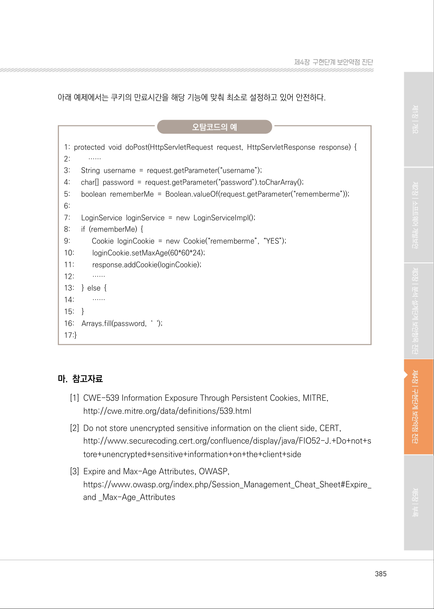

# 12. 사용자 하드디스크에 저장되는 쿠키를 통한 정보 노출

> 변환 안내(원문 외): 아래 본문은 PDF 텍스트를 추출한 전사입니다. 코드 줄번호·특수 공백·원문 오류를 유지했습니다. 실행용 코드가 아닙니다. 표·그림·들여쓰기는 연결된 페이지 이미지와 대조하세요. 페이지 경계의 줄바꿈을 보존하며, 동일 페이지가 여러 항목에 나뉘면 각 항목의 본문은 해당 구간만 포함합니다.

### PDF 382페이지 / 인쇄 382페이지

<!-- source-page:SW-Diagnosis-2021:382; source-lines:0,1,2,3,4,5,6,7,8,9,10,11,12,13,14,15,16,17,18,19,20,21,22 -->

382

#### 12. 사용자 하드디스크에 저장되는 쿠키를 통한 정보 노출

#### 가. 개요

대부분의 웹 응용프로그램에서 쿠키는 메모리에 상주하며, 브라우저의 실행이 종료되면 사라진다. 
프로그래머가 원하는 경우, 쿠키를 디스크에 저장할 수 있으며, 다음 브라우저 세션이 시작되었을 때 
메모리에 로드된다. 개인정보, 인증정보 등이 이와 같은 영속적인 쿠키(Persistent Cookie)에 저장 
된다면, 공격자는 쿠키에 접근할 수 있는 보다 많은 기회를 가지게 되어 시스템을 취약하게 만든다.

#### 나. 보안대책

쿠키의 만료시간은 세션이 지속되는 시간을 고려하여 최소한으로 설정하고 영속적인 쿠키에는 사용자 
권한 등급, 세션ID 등 중요정보가 포함되지 않도록 한다.

#### 다. 코드예제

쿠키의 만료시간을 1년으로 과도하게 길게 설정하고 있다. 쿠키의 유효기간이 긴 경우 사용자 하드 
디스크에 쿠키가 저장되며 저장된 쿠키는 쉽게 도용될 수 있으므로 취약하다.

#### 안전하지 않은 코드의 예 JAVA

```java
1: Cookie loginCookie = new Cookie("rememberme", "YES"); 
//쿠키의 만료시간을 1년으로 과도하게 길게 설정하고 있어 안전하지 않다.
2: loginCookie.setMaxAge(60*60*24*365);
3: response.addCookie(loginCookie);
```

쿠키의 만료시간은 해당 기능에 맞춰 최소로 설정하고 영속적인 쿠키에는 중요 정보가 포함되지 않도록 
한다.

#### 안전한 코드의 예 JAVA

```java
1: Cookie loginCookie = new Cookie("rememberme", "YES");
//쿠키의 만료시간은 해당 기능에 맞춰 최소로 사용한다.
```

<details><summary>원본 페이지 이미지 (변환 외 보존 자료)</summary>



</details>

### PDF 383페이지 / 인쇄 383페이지

<!-- source-page:SW-Diagnosis-2021:383; source-lines:0,1,2,3,4,5,6,7,8,9,10,11,12,13,14,15,16,17,18 -->

383

제4장구현단계 보안약점 진단

#### 안전한 코드의 예 JAVA

```java
2: loginCookie.setMaxAge(60*60*24);
3: response.addCookie(loginCookie);
```

다음은 쿠키의 만료시간을 1년으로 과도하게 길게 설정하고 있는 C# 코드의 예제이다. 쿠키의 유효 
기간이 긴 경우 사용자 하드디스크에 쿠키가 저장되며 저장된 쿠키는 쉽게 도용될 수 있으므로 취약 
하다.

#### 안전하지 않은 코드의 예 C#

```csharp
1: HttpCookie cookie = Request.Cookies.Get(“ExampleCookie”);
//쿠키의 만료시간을 1년으로 과도하게 길게 설정하고 있어 안전하지 않다.
2: cookie.Expires = DateTime.Now.AddMinutes(60.0*24.0*365.0);
3: Response.Cookies.Add(cookie);
```

쿠키의 만료 시간을 10분으로 설정하고 있는 C# 코드의 예제이다.

#### 안전한 코드의 예 C#

```csharp
1: HttpCookie cookie = Request.Cookies.Get(“ExampleCookie”); 
//쿠키의 만료시간은 해당 기능에 맞춰 최소로 사용한다.
2: cookie.Expires = DateTime.Now.AddMinutes(10d);
3: Response.Cookies.Add(cookie);
```

<details><summary>원본 페이지 이미지 (변환 외 보존 자료)</summary>



</details>

### PDF 384페이지 / 인쇄 384페이지

<!-- source-page:SW-Diagnosis-2021:384; source-lines:0,1,2,3,4,5,6,7,8,9,10,11,12,13,14,15,16,17,18,19,20,21,22,23,24,25,26,27,28,29,30,31,32,33,34,35,36,37,38,39,40,41,42,43 -->

384

#### 라. 진단방법

사용자 브라우저로 쿠키를 전송하는지 확인하고(①), 쿠키 유효기간 확인한다(②). 쿠키 설정 값에 id 
정보 등 중요 정보 포함 여부를 확인한다(③)

일반적인 진단의 예

```text
1:    …
2:    Cookie ck = new Cookie(“id”, “test123”) ; ········································································③
3:    ck.setMaxAge(60*60*24*365*10) ; ·······················································································②
4:    response.addCookie(ck) ; ·······································································································①
5:    …
```

다음의 예제는 쿠키의 만료시간을 1년으로 과도하게 길게 설정하고 있다. 쿠키의 유효기간이 긴 경우 
사용자 하드디스크에 쿠키가 저장되며 저장된 쿠키는 쉽게 도용될 수 있으므로 취약하다.

정탐코드의 예

```text
1: protected void doPost(HttpServletRequest request, HttpServletResponse response) {
2:                 ……
3:      String username = request.getParameter(“username”);
4:      char[] password = request.getParameter(“password”).toCharArray();
5:      boolean rememberMe = Boolean.valueOf(request.getParameter(“rememberme”));
6:
7:      LoginService loginService = new LoginServiceImpl(); 
8:      if (rememberMe) { 
9:           Cookie loginCookie = new Cookie(“rememberme”, “YES”); 
10:         loginCookie.setMaxAge(60*60*24*30*12);
11:         response.addCookie(loginCookie);
12:               ……
13:    } else {
14:             ……
```

<details><summary>원본 페이지 이미지 (변환 외 보존 자료)</summary>



</details>

### PDF 385페이지 / 인쇄 385페이지

<!-- source-page:SW-Diagnosis-2021:385; source-lines:0,1,2,3,4,5,6,7,8,9,10,11,12,13,14,15,16,17,18,19,20,21,22,23,24,25,26,27,28,29,30,31,32,33,34,35,36,37,38,39,40,41,42,43 -->

385

제4장구현단계 보안약점 진단

아래 예제에서는 쿠키의 만료시간을 해당 기능에 맞춰 최소로 설정하고 있어 안전하다.

오탐코드의 예

```text
1: protected void doPost(HttpServletRequest request, HttpServletResponse response) {
2:         …… 
3:      String username = request.getParameter(“username”); 
4:      char[] password = request.getParameter(“password”).toCharArray();
5:      boolean rememberMe = Boolean.valueOf(request.getParameter(“rememberme”));
6:
7:      LoginService loginService = new LoginServiceImpl();
8:      if (rememberMe) { 
9:           Cookie loginCookie = new Cookie(“rememberme”, “YES”); 
10:         loginCookie.setMaxAge(60*60*24); 
11:         response.addCookie(loginCookie); 
12:         ……
13:    } else { 
14:         ……
15:    }
16:    Arrays.fill(password, ‘ ‘); 
17:}
```

#### 마. 참고자료

[1] CWE-539 Information Exposure Through Persistent Cookies, MITRE,

http://cwe.mitre.org/data/definitions/539.html
[2] Do not store unencrypted sensitive information on the client side, CERT,

http://www.securecoding.cert.org/confluence/display/java/FIO52-J.+Do+not+s
tore+unencrypted+sensitive+information+on+the+client+side
[3] Expire and Max-Age Attributes, OWASP,

https://www.owasp.org/index.php/Session_Management_Cheat_Sheet#Expire_
and _Max-Age_Attributes

<details><summary>원본 페이지 이미지 (변환 외 보존 자료)</summary>



</details>

---

## 탐색 링크 (원문 외)

[통합 인덱스](../../../INDEX.md)

