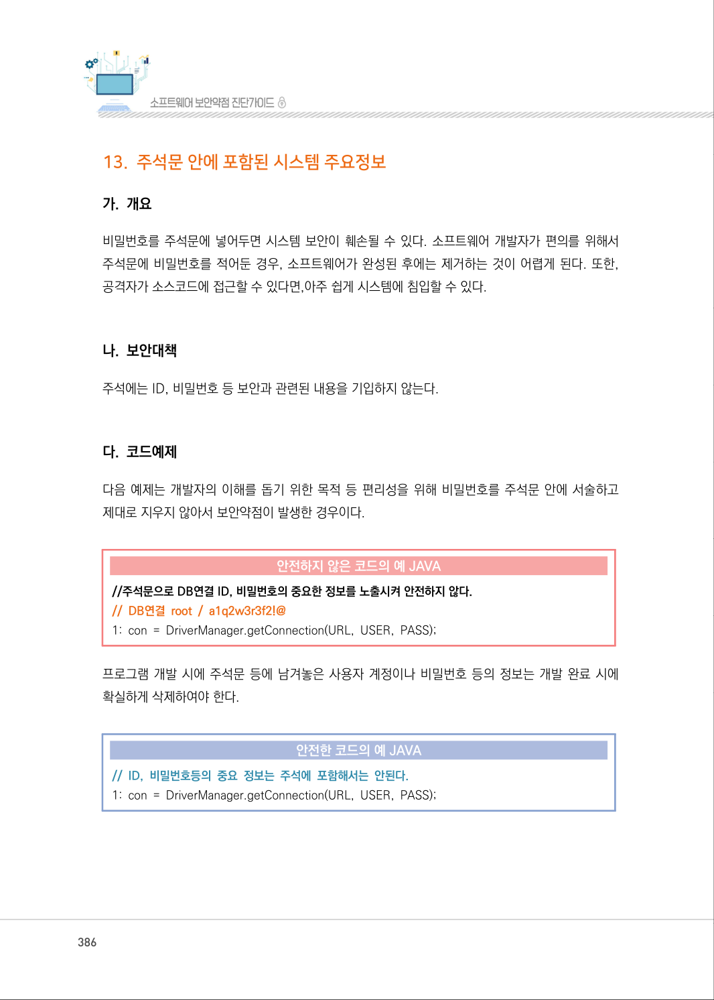
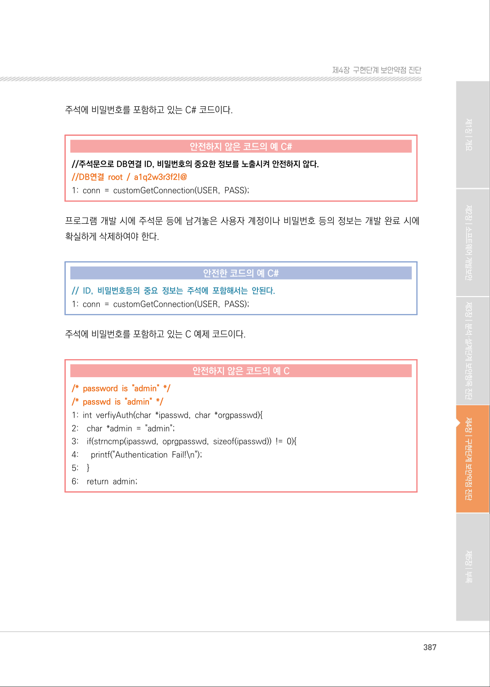
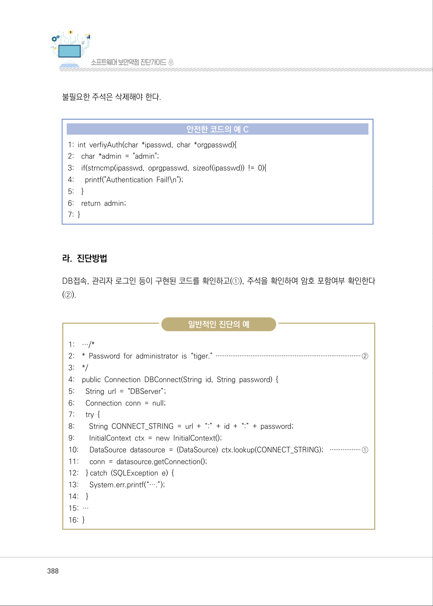
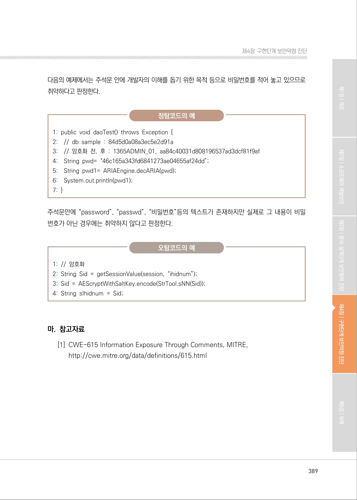

# 13. 주석문 안에 포함된 시스템 주요정보

> 변환 안내(원문 외): 아래 본문은 PDF 텍스트를 추출한 전사입니다. 코드 줄번호·특수 공백·원문 오류를 유지했습니다. 실행용 코드가 아닙니다. 표·그림·들여쓰기는 연결된 페이지 이미지와 대조하세요. 페이지 경계의 줄바꿈을 보존하며, 동일 페이지가 여러 항목에 나뉘면 각 항목의 본문은 해당 구간만 포함합니다.

### PDF 386페이지 / 인쇄 386페이지

<!-- source-page:SW-Diagnosis-2021:386; source-lines:0,1,2,3,4,5,6,7,8,9,10,11,12,13,14,15,16,17,18,19 -->

386

#### 13. 주석문 안에 포함된 시스템 주요정보

#### 가. 개요

비밀번호를 주석문에 넣어두면 시스템 보안이 훼손될 수 있다. 소프트웨어 개발자가 편의를 위해서 
주석문에 비밀번호를 적어둔 경우, 소프트웨어가 완성된 후에는 제거하는 것이 어렵게 된다. 또한, 
공격자가 소스코드에 접근할 수 있다면,아주 쉽게 시스템에 침입할 수 있다.

#### 나. 보안대책

주석에는 ID, 비밀번호 등 보안과 관련된 내용을 기입하지 않는다.

#### 다. 코드예제

다음 예제는 개발자의 이해를 돕기 위한 목적 등 편리성을 위해 비밀번호를 주석문 안에 서술하고 
제대로 지우지 않아서 보안약점이 발생한 경우이다.

#### 안전하지 않은 코드의 예 JAVA

```java
//주석문으로 DB연결 ID, 비밀번호의 중요한 정보를 노출시켜 안전하지 않다.
// DB연결 root / a1q2w3r3f2!@
1: con = DriverManager.getConnection(URL, USER, PASS); 
```

프로그램 개발 시에 주석문 등에 남겨놓은 사용자 계정이나 비밀번호 등의 정보는 개발 완료 시에 
확실하게 삭제하여야 한다.

#### 안전한 코드의 예 JAVA

```java
// ID, 비밀번호등의 중요 정보는 주석에 포함해서는 안된다.
1: con = DriverManager.getConnection(URL, USER, PASS);
```

<details><summary>원본 페이지 이미지 (변환 외 보존 자료)</summary>



</details>

### PDF 387페이지 / 인쇄 387페이지

<!-- source-page:SW-Diagnosis-2021:387; source-lines:0,1,2,3,4,5,6,7,8,9,10,11,12,13,14,15,16,17,18,19,20,21,22,23,24,25,26 -->

387

제4장구현단계 보안약점 진단

주석에 비밀번호를 포함하고 있는 C# 코드이다.

#### 안전하지 않은 코드의 예 C#

```csharp
//주석문으로 DB연결 ID, 비밀번호의 중요한 정보를 노출시켜 안전하지 않다. 
//DB연결 root / a1q2w3r3f2!@
1: conn = customGetConnection(USER, PASS);
```

프로그램 개발 시에 주석문 등에 남겨놓은 사용자 계정이나 비밀번호 등의 정보는 개발 완료 시에 
확실하게 삭제하여야 한다.

#### 안전한 코드의 예 C#

```csharp
// ID, 비밀번호등의 중요 정보는 주석에 포함해서는 안된다. 
1: conn = customGetConnection(USER, PASS);
```

주석에 비밀번호를 포함하고 있는 C 예제 코드이다.

#### 안전하지 않은 코드의 예 C

```c
/* password is "admin" */
/* passwd is "admin" */
1: int verfiyAuth(char *ipasswd, char *orgpasswd){
2:    char *admin = "admin";
3:    if(strncmp(ipasswd, oprgpasswd, sizeof(ipasswd)) != 0){
4:      printf("Authentication Fail!\n");
5:    }
6:    return admin;
```

<details><summary>원본 페이지 이미지 (변환 외 보존 자료)</summary>



</details>

### PDF 388페이지 / 인쇄 388페이지

<!-- source-page:SW-Diagnosis-2021:388; source-lines:0,1,2,3,4,5,6,7,8,9,10,11,12,13,14,15,16,17,18,19,20,21,22,23,24,25,26,27,28,29,30,31,32,33,34,35,36,37,38,39,40,41,42,43,44,45,46,47,48 -->

388

불필요한 주석은 삭제해야 한다.

#### 안전한 코드의 예 C

```c
1: int verfiyAuth(char *ipasswd, char *orgpasswd){ 
2:    char *admin = "admin"; 
3:    if(strncmp(ipasswd, oprgpasswd, sizeof(ipasswd)) != 0){ 
4:      printf("Authentication Fail!\n"); 
5:    }
6:    return admin;
7: }
```

#### 라. 진단방법

DB접속, 관리자 로그인 등이 구현된 코드를 확인하고(①), 주석을 확인하여 암호 포함여부 확인한다
(②).

일반적인 진단의 예

```text
1:    …/*
2:    * Password for administrator is “tiger.” ···············································································②
3:    */ 
4:    public Connection DBConnect(String id, String password) { 
5:      String url = “DBServer”; 
6:      Connection conn = null; 
7:      try { 
8:        String CONNECT_STRING = url + “:” + id + “:” + password; 
9:        InitialContext ctx = new InitialContext(); 
10:      DataSource datasource = (DataSource) ctx.lookup(CONNECT_STRING); ·················①
11:      conn = datasource.getConnection(); 
12:    } catch (SQLException e) { 
13:      System.err.printf(“….”); 
14:    }
15: …
16: }
```

<details><summary>원본 페이지 이미지 (변환 외 보존 자료)</summary>



</details>

### PDF 389페이지 / 인쇄 389페이지

<!-- source-page:SW-Diagnosis-2021:389; source-lines:0,1,2,3,4,5,6,7,8,9,10,11,12,13,14,15,16,17,18,19,20,21,22,23,24,25,26 -->

389

제4장구현단계 보안약점 진단

다음의 예제에서는 주석문 안에 개발자의 이해를 돕기 위한 목적 등으로 비밀번호를 적어 놓고 있으므로 
취약하다고 판정한다.

정탐코드의 예

```text
1: public void daoTest() throws Exception { 
2:    // db sample : 84d5d0a08a3ec5e2d91a 
3:    // 암호화 전, 후 : 1365ADMIN_01, aa84c40031d808196537ad3dcf81f9af
4:    String pwd= “46c165a343fd6841273ae04655af24dd”;
5:    String pwd1= ARIAEngine.decARIA(pwd);
6:    System.out.println(pwd1); 
7: }
```

주석문안에 “password”, “passwd”, “비밀번호”등의 텍스트가 존재하지만 실제로 그 내용이 비밀 
번호가 아닌 경우에는 취약하지 않다고 판정한다.

오탐코드의 예

```text
1: // 암호화
2: String Sid = getSessionValue(session, “ihidnum”);
3: Sid = AEScryptWithSaltKey.encode(StrTool.sNN(Sid));
4: String sIhidnum = Sid;
```

#### 마. 참고자료

[1] CWE-615 Information Exposure Through Comments, MITRE,

http://cwe.mitre.org/data/definitions/615.html

<details><summary>원본 페이지 이미지 (변환 외 보존 자료)</summary>



</details>

---

## 탐색 링크 (원문 외)

[통합 인덱스](../../../INDEX.md)

