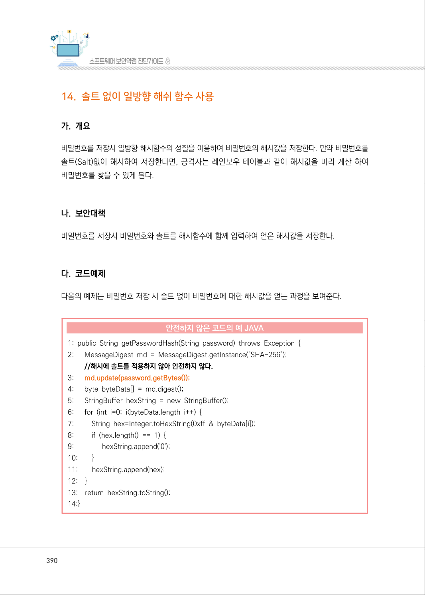
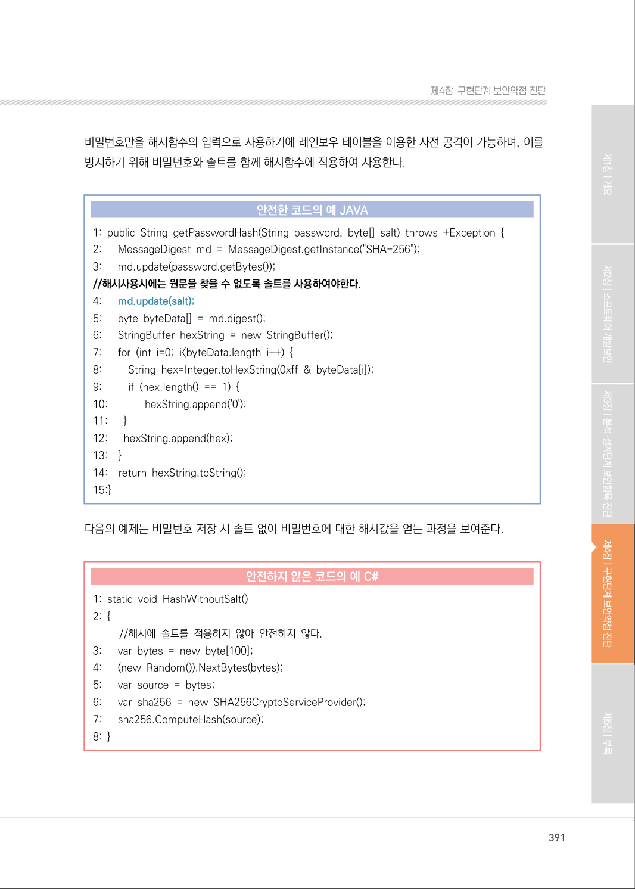
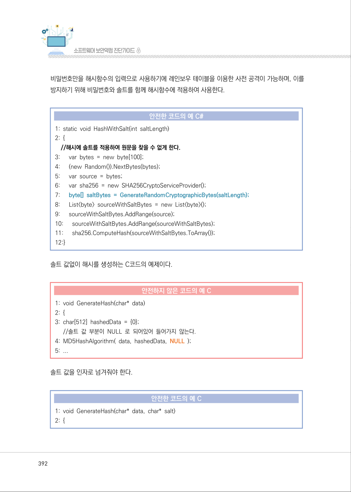
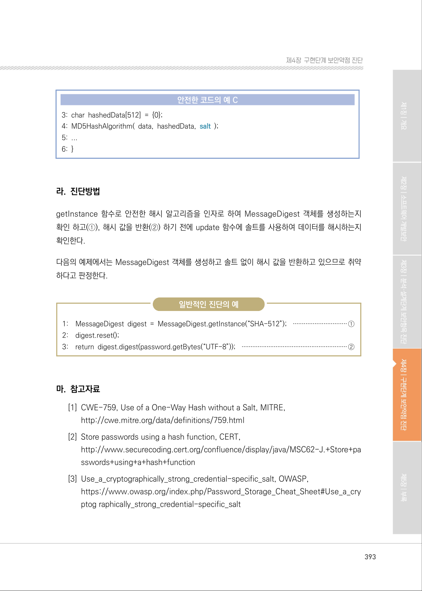

# 14. 솔트 없이 일방향 해쉬 함수 사용

> 변환 안내(원문 외): 아래 본문은 PDF 텍스트를 추출한 전사입니다. 코드 줄번호·특수 공백·원문 오류를 유지했습니다. 실행용 코드가 아닙니다. 표·그림·들여쓰기는 연결된 페이지 이미지와 대조하세요. 페이지 경계의 줄바꿈을 보존하며, 동일 페이지가 여러 항목에 나뉘면 각 항목의 본문은 해당 구간만 포함합니다.

### PDF 390페이지 / 인쇄 390페이지

<!-- source-page:SW-Diagnosis-2021:390; source-lines:0,1,2,3,4,5,6,7,8,9,10,11,12,13,14,15,16,17,18,19,20,21,22,23,24,25,26,27,28,29,30,31,32,33,34,35,36,37 -->

390

#### 14. 솔트 없이 일방향 해쉬 함수 사용

#### 가. 개요

비밀번호를 저장시 일방향 해시함수의 성질을 이용하여 비밀번호의 해시값을 저장한다. 만약 비밀번호를 
솔트(Salt)없이 해시하여 저장한다면, 공격자는 레인보우 테이블과 같이 해시값을 미리 계산 하여 
비밀번호를 찾을 수 있게 된다.

#### 나. 보안대책

비밀번호를 저장시 비밀번호와 솔트를 해시함수에 함께 입력하여 얻은 해시값을 저장한다.

#### 다. 코드예제

다음의 예제는 비밀번호 저장 시 솔트 없이 비밀번호에 대한 해시값을 얻는 과정을 보여준다.

#### 안전하지 않은 코드의 예 JAVA

```java
1: public String getPasswordHash(String password) throws Exception { 
2:      MessageDigest md = MessageDigest.getInstance("SHA-256"); 
//해시에 솔트를 적용하지 않아 안전하지 않다.
3:      md.update(password.getBytes());
4:      byte byteData[] = md.digest();
5:      StringBuffer hexString = new StringBuffer();
6:      for (int i=0; i<byteData.length i++) {
7:         String hex=Integer.toHexString(0xff & byteData[i]);
8:         if (hex.length() == 1) {
9:               hexString.append('0');
10:        }
11:        hexString.append(hex);
12:    }
13:    return hexString.toString();
14:}
```

<details><summary>원본 페이지 이미지 (변환 외 보존 자료)</summary>



</details>

### PDF 391페이지 / 인쇄 391페이지

<!-- source-page:SW-Diagnosis-2021:391; source-lines:0,1,2,3,4,5,6,7,8,9,10,11,12,13,14,15,16,17,18,19,20,21,22,23,24,25,26,27,28,29,30,31,32,33,34,35,36,37,38,39,40,41,42,43,44,45,46,47,48,49 -->

391

제4장구현단계 보안약점 진단

비밀번호만을 해시함수의 입력으로 사용하기에 레인보우 테이블을 이용한 사전 공격이 가능하며, 이를 
방지하기 위해 비밀번호와 솔트를 함께 해시함수에 적용하여 사용한다.

#### 안전한 코드의 예 JAVA

```java
1: public String getPasswordHash(String password, byte[] salt) throws +Exception {
2:      MessageDigest md = MessageDigest.getInstance("SHA-256");
3:      md.update(password.getBytes());
//해시사용시에는 원문을 찾을 수 없도록 솔트를 사용하여야한다.
4:      md.update(salt);
5:      byte byteData[] = md.digest();
6:      StringBuffer hexString = new StringBuffer();
7:      for (int i=0; i<byteData.length i++) {
8:         String hex=Integer.toHexString(0xff & byteData[i]);
9:         if (hex.length() == 1) { 
10:             hexString.append('0'); 
11:      }
12:      hexString.append(hex); 
13:    }
14:    return hexString.toString(); 
15:}
```

다음의 예제는 비밀번호 저장 시 솔트 없이 비밀번호에 대한 해시값을 얻는 과정을 보여준다.

#### 안전하지 않은 코드의 예 C#

```csharp
1: static void HashWithoutSalt() 
2: {
//해시에 솔트를 적용하지 않아 안전하지 않다.
3:      var bytes = new byte[100]; 
4:      (new Random()).NextBytes(bytes); 
5:      var source = bytes;
6:      var sha256 = new SHA256CryptoServiceProvider(); 
7:      sha256.ComputeHash(source); 
8: }
```

<details><summary>원본 페이지 이미지 (변환 외 보존 자료)</summary>



</details>

### PDF 392페이지 / 인쇄 392페이지

<!-- source-page:SW-Diagnosis-2021:392; source-lines:0,1,2,3,4,5,6,7,8,9,10,11,12,13,14,15,16,17,18,19,20,21,22,23,24,25,26,27,28,29,30,31,32,33,34,35,36,37 -->

392

비밀번호만을 해시함수의 입력으로 사용하기에 레인보우 테이블을 이용한 사전 공격이 가능하며, 이를 
방지하기 위해 비밀번호와 솔트를 함께 해시함수에 적용하여 사용한다.

#### 안전한 코드의 예 C#

```csharp
1: static void HashWithSalt(int saltLength) 
2: {
//해시에 솔트를 적용하여 원문을 찾을 수 없게 한다. 
3:      var bytes = new byte[100]; 
4:      (new Random()).NextBytes(bytes); 
5:      var source = bytes;
6:      var sha256 = new SHA256CryptoServiceProvider(); 
7:      byte[] saltBytes = GenerateRandomCryptographicBytes(saltLength);
8:      List<byte> sourceWithSaltBytes = new List<byte>();
9:      sourceWithSaltBytes.AddRange(source);
10:      sourceWithSaltBytes.AddRange(sourceWithSaltBytes);
11:      sha256.ComputeHash(sourceWithSaltBytes.ToArray());
12:}
```

솔트 값없이 해시를 생성하는 C코드의 예제이다.

#### 안전하지 않은 코드의 예 C

```c
1: void GenerateHash(char* data) 
2: {
3: char[512] hashedData = {0}; 
//솔트 값 부분이 NULL 로 되어있어 들어가지 않는다. 
4: MD5HashAlgorithm( data, hashedData, NULL ); 
5: ...
```

솔트 값을 인자로 넘겨줘야 한다.

#### 안전한 코드의 예 C

```c
1: void GenerateHash(char* data, char* salt) 
2: {
```

<details><summary>원본 페이지 이미지 (변환 외 보존 자료)</summary>



</details>

### PDF 393페이지 / 인쇄 393페이지

<!-- source-page:SW-Diagnosis-2021:393; source-lines:0,1,2,3,4,5,6,7,8,9,10,11,12,13,14,15,16,17,18,19,20,21,22,23,24,25,26,27,28 -->

393

제4장구현단계 보안약점 진단

#### 안전한 코드의 예 C

```c
3: char hashedData[512] = {0}; 
4: MD5HashAlgorithm( data, hashedData, salt );
5: ...
6: }
```

#### 라. 진단방법

getInstance 함수로 안전한 해시 알고리즘을 인자로 하여 MessageDigest 객체를 생성하는지 
확인 하고(①), 해시 값을 반환(②) 하기 전에 update 함수에 솔트를 사용하여 데이터를 해시하는지 
확인한다.

다음의 예제에서는 MessageDigest 객체를 생성하고 솔트 없이 해시 값을 반환하고 있으므로 취약 
하다고 판정한다.

일반적인 진단의 예

```text
1:    MessageDigest digest = MessageDigest.getInstance(“SHA-512”); ······························①
2:    digest.reset();
3:    return digest.digest(password.getBytes(“UTF-8”)); ···························································②
```

#### 마. 참고자료

[1] CWE-759, Use of a One-Way Hash without a Salt, MITRE,

http://cwe.mitre.org/data/definitions/759.html
[2] Store passwords using a hash function, CERT,

http://www.securecoding.cert.org/confluence/display/java/MSC62-J.+Store+pa
sswords+using+a+hash+function
[3] Use_a_cryptographically_strong_credential-specific_salt, OWASP,

https://www.owasp.org/index.php/Password_Storage_Cheat_Sheet#Use_a_cry
ptog raphically_strong_credential-specific_salt

<details><summary>원본 페이지 이미지 (변환 외 보존 자료)</summary>



</details>

---

## 탐색 링크 (원문 외)

[통합 인덱스](../../../INDEX.md)

