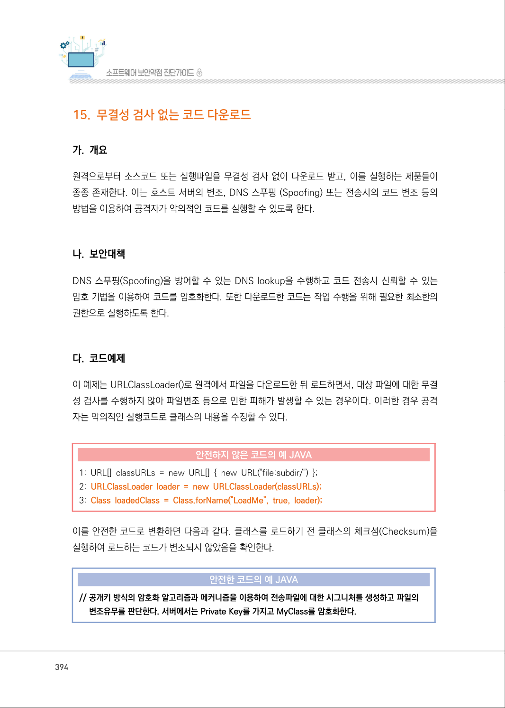
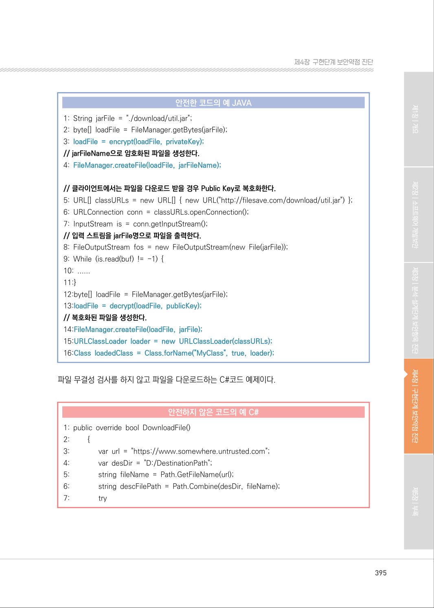
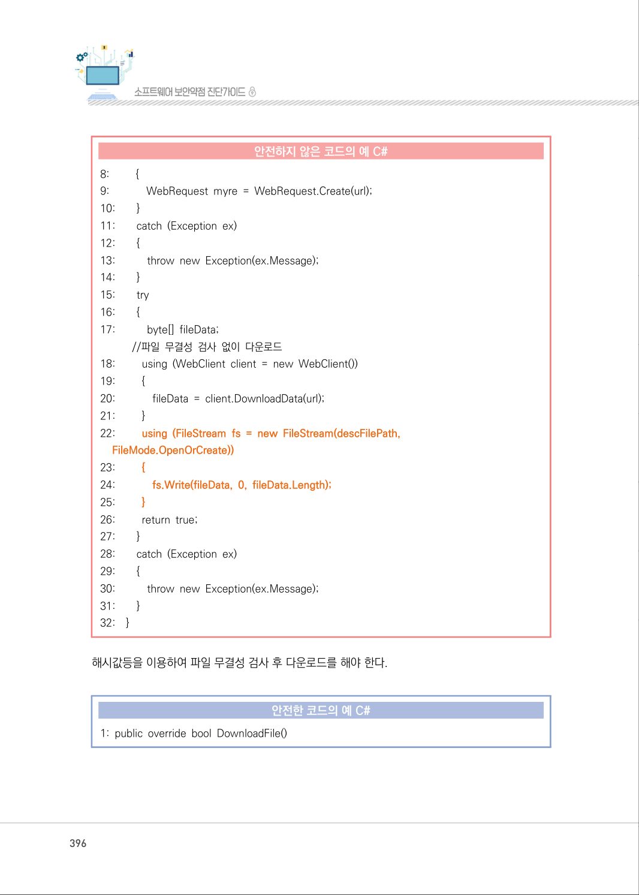
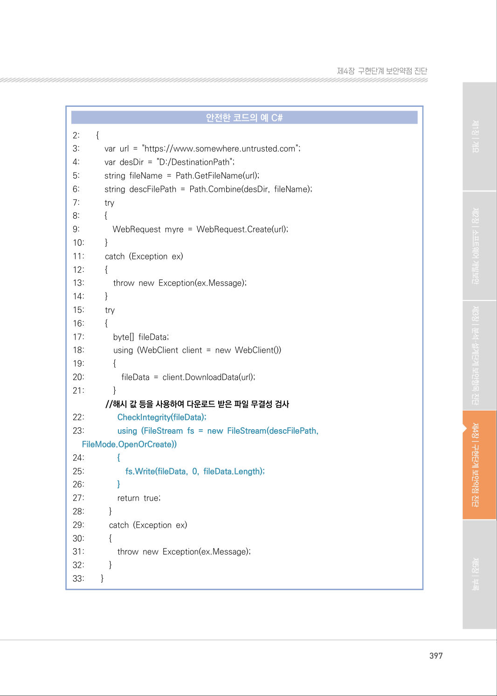
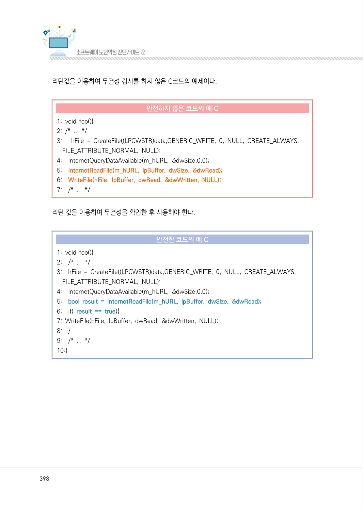
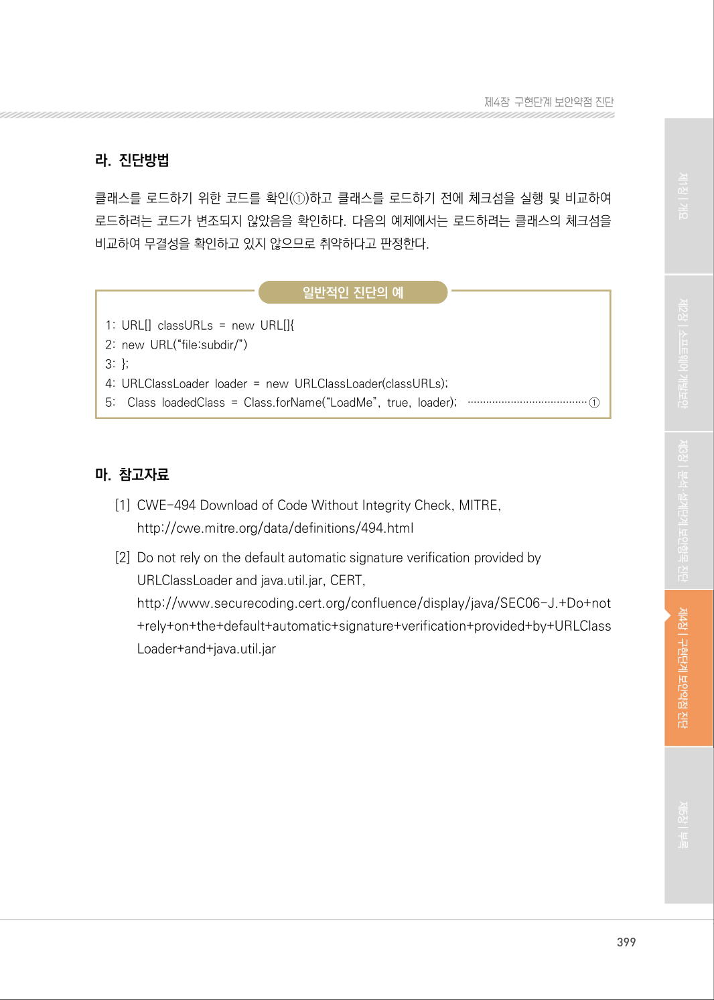

# 15. 무결성 검사 없는 코드 다운로드

> 변환 안내(원문 외): 아래 본문은 PDF 텍스트를 추출한 전사입니다. 코드 줄번호·특수 공백·원문 오류를 유지했습니다. 실행용 코드가 아닙니다. 표·그림·들여쓰기는 연결된 페이지 이미지와 대조하세요. 페이지 경계의 줄바꿈을 보존하며, 동일 페이지가 여러 항목에 나뉘면 각 항목의 본문은 해당 구간만 포함합니다.

### PDF 394페이지 / 인쇄 394페이지

<!-- source-page:SW-Diagnosis-2021:394; source-lines:0,1,2,3,4,5,6,7,8,9,10,11,12,13,14,15,16,17,18,19,20,21,22 -->

394

#### 15. 무결성 검사 없는 코드 다운로드

#### 가. 개요

원격으로부터 소스코드 또는 실행파일을 무결성 검사 없이 다운로드 받고, 이를 실행하는 제품들이 
종종 존재한다. 이는 호스트 서버의 변조, DNS 스푸핑 (Spoofing) 또는 전송시의 코드 변조 등의 
방법을 이용하여 공격자가 악의적인 코드를 실행할 수 있도록 한다.

#### 나. 보안대책

DNS 스푸핑(Spoofing)을 방어할 수 있는 DNS lookup을 수행하고 코드 전송시 신뢰할 수 있는 
암호 기법을 이용하여 코드를 암호화한다. 또한 다운로드한 코드는 작업 수행을 위해 필요한 최소한의 
권한으로 실행하도록 한다.

#### 다. 코드예제

이 예제는 URLClassLoader()로 원격에서 파일을 다운로드한 뒤 로드하면서, 대상 파일에 대한 무결
성 검사를 수행하지 않아 파일변조 등으로 인한 피해가 발생할 수 있는 경우이다. 이러한 경우 공격
자는 악의적인 실행코드로 클래스의 내용을 수정할 수 있다.

#### 안전하지 않은 코드의 예 JAVA

```java
1: URL[] classURLs = new URL[] { new URL("file:subdir/") }; 
2: URLClassLoader loader = new URLClassLoader(classURLs);
3: Class loadedClass = Class.forName("LoadMe", true, loader);
```

이를 안전한 코드로 변환하면 다음과 같다. 클래스를 로드하기 전 클래스의 체크섬(Checksum)을 
실행하여 로드하는 코드가 변조되지 않았음을 확인한다.

#### 안전한 코드의 예 JAVA

```java
// 공개키 방식의 암호화 알고리즘과 메커니즘을 이용하여 전송파일에 대한 시그니처를 생성하고 파일의 
변조유무를 판단한다. 서버에서는 Private Key를 가지고 MyClass를 암호화한다.
```

<details><summary>원본 페이지 이미지 (변환 외 보존 자료)</summary>



</details>

### PDF 395페이지 / 인쇄 395페이지

<!-- source-page:SW-Diagnosis-2021:395; source-lines:0,1,2,3,4,5,6,7,8,9,10,11,12,13,14,15,16,17,18,19,20,21,22,23,24,25,26,27,28,29,30,31,32,33,34,35,36,37 -->

395

제4장구현단계 보안약점 진단

#### 안전한 코드의 예 JAVA

```java
1: String jarFile = "./download/util.jar"; 
2: byte[] loadFile = FileManager.getBytes(jarFile); 
3: loadFile = encrypt(loadFile, privateKey);
// jarFileName으로 암호화된 파일을 생성한다.
4: FileManager.createFile(loadFile, jarFileName);
// 클라이언트에서는 파일을 다운로드 받을 경우 Public Key로 복호화한다.
```

```text
5: URL[] classURLs = new URL[] { new URL("http://filesave.com/download/util.jar") };
6: URLConnection conn = classURLs.openConnection(); 
7: InputStream is = conn.getInputStream(); 
// 입력 스트림을 jarFile명으로 파일을 출력한다.
8: FileOutputStream fos = new FileOutputStream(new File(jarFile));
9: While (is.read(buf) != -1) {
10: ......
11:} 
12:byte[] loadFile = FileManager.getBytes(jarFile); 
13:loadFile = decrypt(loadFile, publicKey);
// 복호화된 파일을 생성한다.
14:FileManager.createFile(loadFile, jarFile);
15:URLClassLoader loader = new URLClassLoader(classURLs);
16:Class loadedClass = Class.forName("MyClass", true, loader);
```

파일 무결성 검사를 하지 않고 파일을 다운로드하는 C#코드 예제이다.

#### 안전하지 않은 코드의 예 C#

```csharp
1: public override bool DownloadFile() 
2:         {
3:               var url = "https://www.somewhere.untrusted.com";
4:               var desDir = "D:/DestinationPath"; 
5:               string fileName = Path.GetFileName(url); 
6:               string descFilePath = Path.Combine(desDir, fileName); 
7:               try
```

<details><summary>원본 페이지 이미지 (변환 외 보존 자료)</summary>



</details>

### PDF 396페이지 / 인쇄 396페이지

<!-- source-page:SW-Diagnosis-2021:396; source-lines:0,1,2,3,4,5,6,7,8,9,10,11,12,13,14,15,16,17,18,19,20,21,22,23,24,25,26,27,28,29,30,31,32,33,34,35,36,37,38,39,40,41,42,43,44,45,46,47,48,49,50,51,52,53,54,55,56 -->

396

#### 안전하지 않은 코드의 예 C#

```csharp
8:         {
9:             WebRequest myre = WebRequest.Create(url);
10:        }
11:        catch (Exception ex) 
12:        {
13:           throw new Exception(ex.Message);
14:        }
15:        try
16:        {
17:           byte[] fileData; 
//파일 무결성 검사 없이 다운로드 
18:         using (WebClient client = new WebClient())
19:         {
20:             fileData = client.DownloadData(url); 
21:         }
22:         using (FileStream fs = new FileStream(descFilePath,
FileMode.OpenOrCreate))
23:         {
24:             fs.Write(fileData, 0, fileData.Length);
25:         }
26:         return true;
27:        }
28:        catch (Exception ex) 
29:        {
30:           throw new Exception(ex.Message); 
31:        }
32:    }
```

해시값등을 이용하여 파일 무결성 검사 후 다운로드를 해야 한다.

#### 안전한 코드의 예 C#

```csharp
1: public override bool DownloadFile()
```

<details><summary>원본 페이지 이미지 (변환 외 보존 자료)</summary>



</details>

### PDF 397페이지 / 인쇄 397페이지

<!-- source-page:SW-Diagnosis-2021:397; source-lines:0,1,2,3,4,5,6,7,8,9,10,11,12,13,14,15,16,17,18,19,20,21,22,23,24,25,26,27,28,29,30,31,32,33,34,35,36,37,38,39,40,41,42,43,44,45,46,47,48,49,50,51,52,53,54,55,56,57,58,59,60,61,62,63,64,65,66,67,68 -->

397

제4장구현단계 보안약점 진단

#### 안전한 코드의 예 C#

```csharp
2:        {
3:           var url = "https://www.somewhere.untrusted.com";
4:           var desDir = "D:/DestinationPath"; 
5:           string fileName = Path.GetFileName(url);
6:           string descFilePath = Path.Combine(desDir, fileName);
7:           try 
8:           { 
9:               WebRequest myre = WebRequest.Create(url);
10:         }
11:         catch (Exception ex) 
12:         {
13:             throw new Exception(ex.Message); 
14:         }
15:         try
16:         {
17:             byte[] fileData;
18:             using (WebClient client = new WebClient())
19:             {
20:                 fileData = client.DownloadData(url);
21:             }
//해시 값 등을 사용하여 다운로드 받은 파일 무결성 검사
22:               CheckIntegrity(fileData);
23:               using (FileStream fs = new FileStream(descFilePath, 
FileMode.OpenOrCreate))
24:               {
25:                   fs.Write(fileData, 0, fileData.Length);
26:               }
27:               return true;
28:           }
29:           catch (Exception ex) 
30:           {
31:               throw new Exception(ex.Message); 
32:           }
33:        }
```

<details><summary>원본 페이지 이미지 (변환 외 보존 자료)</summary>



</details>

### PDF 398페이지 / 인쇄 398페이지

<!-- source-page:SW-Diagnosis-2021:398; source-lines:0,1,2,3,4,5,6,7,8,9,10,11,12,13,14,15,16,17,18,19,20,21,22,23,24,25,26,27,28,29,30,31,32,33,34,35 -->

398

리턴값을 이용하여 무결성 검사를 하지 않은 C코드의 예제이다.

#### 안전하지 않은 코드의 예 C

```c
1: void foo(){ 
2: /* ... */ 
3:      hFile = CreateFile((LPCWSTR)data,GENERIC_WRITE, 0, NULL, CREATE_ALWAYS, 
FILE_ATTRIBUTE_NORMAL, NULL); 
4:    InternetQueryDataAvailable(m_hURL, &dwSize,0,0); 
5:    InternetReadFile(m_hURL, lpBuffer, dwSize, &dwRead);
6:    WriteFile(hFile, lpBuffer, dwRead, &dwWritten, NULL);
7:    /* ... */
```

리턴 값을 이용하여 무결성을 확인한 후 사용해야 한다.

#### 안전한 코드의 예 C

```c
1: void foo(){
2:    /* ... */
3:    hFile = CreateFile((LPCWSTR)data,GENERIC_WRITE, 0, NULL, CREATE_ALWAYS, 
FILE_ATTRIBUTE_NORMAL, NULL); 
4:    InternetQueryDataAvailable(m_hURL, &dwSize,0,0); 
5:    bool result = InternetReadFile(m_hURL, lpBuffer, dwSize, &dwRead);
6:    if( result == true){
7: WriteFile(hFile, lpBuffer, dwRead, &dwWritten, NULL); 
8:    } 
9:    /* ... */ 
10:}
```

<details><summary>원본 페이지 이미지 (변환 외 보존 자료)</summary>



</details>

### PDF 399페이지 / 인쇄 399페이지

<!-- source-page:SW-Diagnosis-2021:399; source-lines:0,1,2,3,4,5,6,7,8,9,10,11,12,13,14,15,16,17,18,19 -->

399

제4장구현단계 보안약점 진단

#### 라. 진단방법

클래스를 로드하기 위한 코드를 확인(①)하고 클래스를 로드하기 전에 체크섬을 실행 및 비교하여 
로드하려는 코드가 변조되지 않았음을 확인하다. 다음의 예제에서는 로드하려는 클래스의 체크섬을 
비교하여 무결성을 확인하고 있지 않으므로 취약하다고 판정한다.

일반적인 진단의 예

```text
1: URL[] classURLs = new URL[]{ 
2: new URL(“file:subdir/”) 
3: }; 
4: URLClassLoader loader = new URLClassLoader(classURLs); 
5: Class loadedClass = Class.forName(“LoadMe”, true, loader); ·······································①
```

#### 마. 참고자료

[1] CWE-494 Download of Code Without Integrity Check, MITRE,

http://cwe.mitre.org/data/definitions/494.html
[2] Do not rely on the default automatic signature verification provided by

URLClassLoader and java.util.jar, CERT,
http://www.securecoding.cert.org/confluence/display/java/SEC06-J.+Do+not
+rely+on+the+default+automatic+signature+verification+provided+by+URLClass
Loader+and+java.util.jar

<details><summary>원본 페이지 이미지 (변환 외 보존 자료)</summary>



</details>

---

## 탐색 링크 (원문 외)

[통합 인덱스](../../../INDEX.md)

