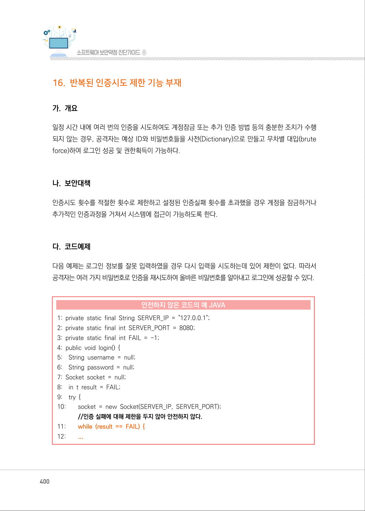
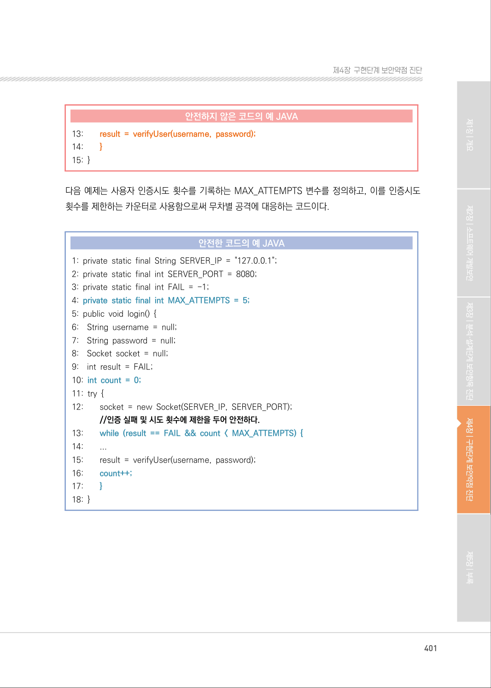
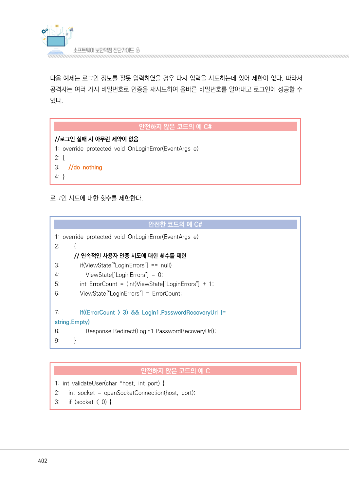
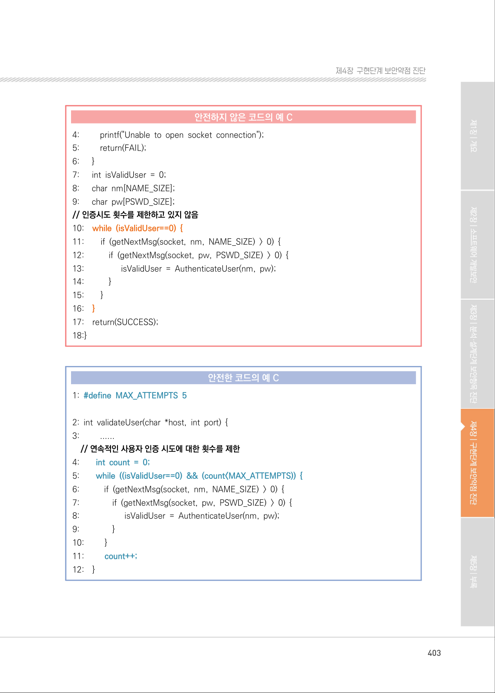
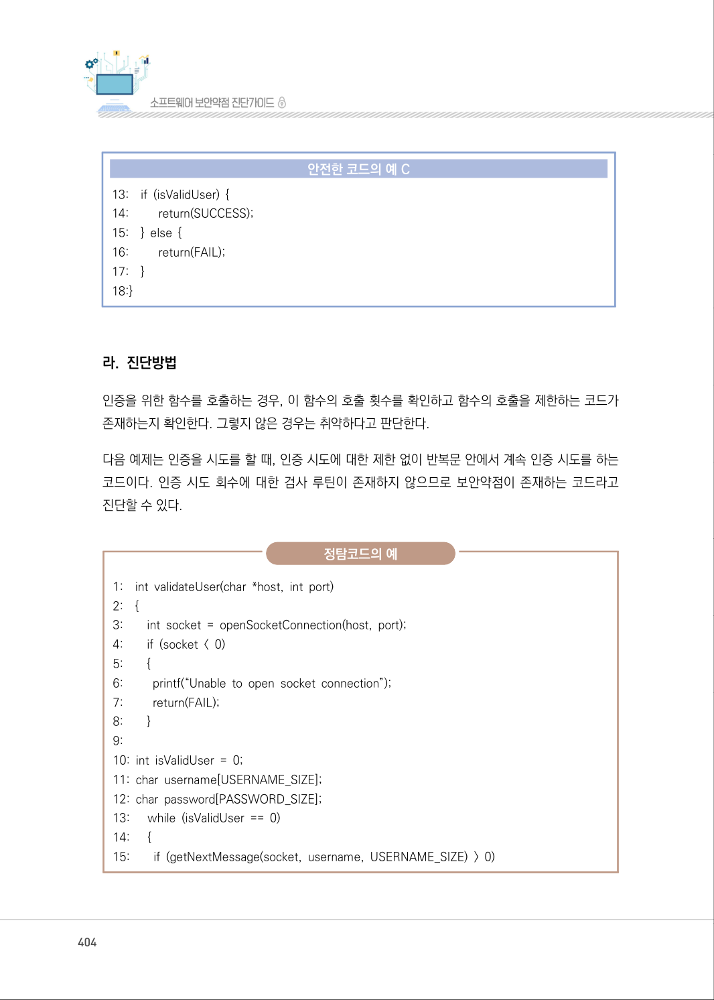
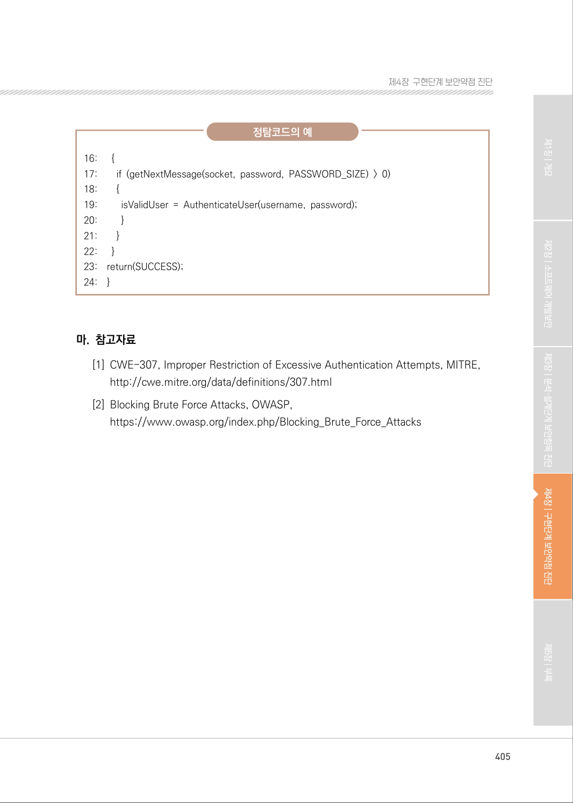

# 16. 반복된 인증시도 제한 기능 부재

> 변환 안내(원문 외): 아래 본문은 PDF 텍스트를 추출한 전사입니다. 코드 줄번호·특수 공백·원문 오류를 유지했습니다. 실행용 코드가 아닙니다. 표·그림·들여쓰기는 연결된 페이지 이미지와 대조하세요. 페이지 경계의 줄바꿈을 보존하며, 동일 페이지가 여러 항목에 나뉘면 각 항목의 본문은 해당 구간만 포함합니다.

### PDF 400페이지 / 인쇄 400페이지

<!-- source-page:SW-Diagnosis-2021:400; source-lines:0,1,2,3,4,5,6,7,8,9,10,11,12,13,14,15,16,17,18,19,20,21,22,23,24,25,26,27,28,29,30,31,32 -->

400

#### 16. 반복된 인증시도 제한 기능 부재

#### 가. 개요

일정 시간 내에 여러 번의 인증을 시도하여도 계정잠금 또는 추가 인증 방법 등의 충분한 조치가 수행
되지 않는 경우, 공격자는 예상 ID와 비밀번호들을 사전(Dictionary)으로 만들고 무차별 대입(brute 
force)하여 로그인 성공 및 권한획득이 가능하다.

#### 나. 보안대책

인증시도 횟수를 적절한 횟수로 제한하고 설정된 인증실패 횟수를 초과했을 경우 계정을 잠금하거나 
추가적인 인증과정을 거쳐서 시스템에 접근이 가능하도록 한다.

#### 다. 코드예제

다음 예제는 로그인 정보를 잘못 입력하였을 경우 다시 입력을 시도하는데 있어 제한이 없다. 따라서 
공격자는 여러 가지 비밀번호로 인증을 재시도하여 올바른 비밀번호를 알아내고 로그인에 성공할 수 있다.

#### 안전하지 않은 코드의 예 JAVA

```java
1: private static final String SERVER_IP = "127.0.0.1"; 
2: private static final int SERVER_PORT = 8080; 
3: private static final int FAIL = -1; 
4: public void login() { 
5:    String username = null; 
6:    String password = null; 
7: Socket socket = null; 
8:    in t result = FAIL; 
9:    try { 
10:        socket = new Socket(SERVER_IP, SERVER_PORT); 
//인증 실패에 대해 제한을 두지 않아 안전하지 않다.
11:        while (result == FAIL) {
12:        ...
```

<details><summary>원본 페이지 이미지 (변환 외 보존 자료)</summary>



</details>

### PDF 401페이지 / 인쇄 401페이지

<!-- source-page:SW-Diagnosis-2021:401; source-lines:0,1,2,3,4,5,6,7,8,9,10,11,12,13,14,15,16,17,18,19,20,21,22,23,24,25,26,27,28,29,30,31,32,33,34,35,36,37,38,39 -->

401

제4장구현단계 보안약점 진단

#### 안전하지 않은 코드의 예 JAVA

```java
13:        result = verifyUser(username, password);
14:        }
15: }
```

다음 예제는 사용자 인증시도 횟수를 기록하는 MAX_ATTEMPTS 변수를 정의하고, 이를 인증시도 
횟수를 제한하는 카운터로 사용함으로써 무차별 공격에 대응하는 코드이다.

#### 안전한 코드의 예 JAVA

```java
1: private static final String SERVER_IP = "127.0.0.1"; 
2: private static final int SERVER_PORT = 8080; 
3: private static final int FAIL = -1; 
4: private static final int MAX_ATTEMPTS = 5;
5: public void login() {
6:    String username = null; 
7:    String password = null; 
8:    Socket socket = null; 
9:    int result = FAIL; 
10: int count = 0;
11: try {
12:        socket = new Socket(SERVER_IP, SERVER_PORT); 
//인증 실패 및 시도 횟수에 제한을 두어 안전하다.
13:        while (result == FAIL && count < MAX_ATTEMPTS) {
14:        ...
15:        result = verifyUser(username, password);
16:        count++;
17:        }
18: }
```

<details><summary>원본 페이지 이미지 (변환 외 보존 자료)</summary>



</details>

### PDF 402페이지 / 인쇄 402페이지

<!-- source-page:SW-Diagnosis-2021:402; source-lines:0,1,2,3,4,5,6,7,8,9,10,11,12,13,14,15,16,17,18,19,20,21,22,23,24,25,26,27,28,29,30,31,32,33,34,35,36,37 -->

402

다음 예제는 로그인 정보를 잘못 입력하였을 경우 다시 입력을 시도하는데 있어 제한이 없다. 따라서 
공격자는 여러 가지 비밀번호로 인증을 재시도하여 올바른 비밀번호를 알아내고 로그인에 성공할 수 
있다.

#### 안전하지 않은 코드의 예 C#

```csharp
//로그인 실패 시 아무런 제약이 없음
1: override protected void OnLoginError(EventArgs e)
2: {
3:      //do nothing
4: }
```

로그인 시도에 대한 횟수를 제한한다.

#### 안전한 코드의 예 C#

```csharp
1: override protected void OnLoginError(EventArgs e) 
2:         {
// 연속적인 사용자 인증 시도에 대한 횟수를 제한
3:             if(ViewState["LoginErrors"] == null)
4:                 ViewState["LoginErrors"] = 0; 
5:             int ErrorCount = (int)ViewState["LoginErrors"] + 1; 
6:             ViewState["LoginErrors"] = ErrorCount; 
7:             if((ErrorCount > 3) && Login1.PasswordRecoveryUrl != 
string.Empty)
8:                 Response.Redirect(Login1.PasswordRecoveryUrl); 
9:         }
```

#### 안전하지 않은 코드의 예 C

```c
1: int validateUser(char *host, int port) { 
2:      int socket = openSocketConnection(host, port); 
3:      if (socket < 0) {
```

<details><summary>원본 페이지 이미지 (변환 외 보존 자료)</summary>



</details>

### PDF 403페이지 / 인쇄 403페이지

<!-- source-page:SW-Diagnosis-2021:403; source-lines:0,1,2,3,4,5,6,7,8,9,10,11,12,13,14,15,16,17,18,19,20,21,22,23,24,25,26,27,28,29,30,31,32,33,34,35,36,37,38,39,40,41,42,43,44,45,46,47,48,49,50,51,52,53,54,55,56 -->

403

제4장구현단계 보안약점 진단

#### 안전하지 않은 코드의 예 C

```c
4:         printf("Unable to open socket connection");
5:         return(FAIL); 
6:      }
7:      int isValidUser = 0; 
8:      char nm[NAME_SIZE]; 
9:      char pw[PSWD_SIZE]; 
// 인증시도 횟수를 제한하고 있지 않음
10:    while (isValidUser==0) {
11:        if (getNextMsg(socket, nm, NAME_SIZE) > 0) {
12:           if (getNextMsg(socket, pw, PSWD_SIZE) > 0) {
13:                 isValidUser = AuthenticateUser(nm, pw);
14:           }
15:        }
16:    }
17:    return(SUCCESS);
18:}
```

#### 안전한 코드의 예 C

```c
1: #define MAX_ATTEMPTS 5
2: int validateUser(char *host, int port) {
3:         ......
// 연속적인 사용자 인증 시도에 대한 횟수를 제한
4:        int count = 0;
5:        while ((isValidUser==0) && (count<MAX_ATTEMPTS)) {
6:           if (getNextMsg(socket, nm, NAME_SIZE) > 0) {
7:               if (getNextMsg(socket, pw, PSWD_SIZE) > 0) {
8:                     isValidUser = AuthenticateUser(nm, pw);
9:               }
10:         }
11:         count++;
12:    }
```

<details><summary>원본 페이지 이미지 (변환 외 보존 자료)</summary>



</details>

### PDF 404페이지 / 인쇄 404페이지

<!-- source-page:SW-Diagnosis-2021:404; source-lines:0,1,2,3,4,5,6,7,8,9,10,11,12,13,14,15,16,17,18,19,20,21,22,23,24,25,26,27,28,29,30,31,32,33,34,35,36,37,38,39,40,41,42,43,44,45 -->

404

#### 안전한 코드의 예 C

```c
13:    if (isValidUser) {
14:         return(SUCCESS);
15:    } else {
16:         return(FAIL);
17:    }
18:}
```

#### 라. 진단방법

인증을 위한 함수를 호출하는 경우, 이 함수의 호출 횟수를 확인하고 함수의 호출을 제한하는 코드가 
존재하는지 확인한다. 그렇지 않은 경우는 취약하다고 판단한다.

다음 예제는 인증을 시도를 할 때, 인증 시도에 대한 제한 없이 반복문 안에서 계속 인증 시도를 하는 
코드이다. 인증 시도 회수에 대한 검사 루틴이 존재하지 않으므로 보안약점이 존재하는 코드라고 
진단할 수 있다.

정탐코드의 예

```text
1:    int validateUser(char *host, int port) 
2:    { 
3:        int socket = openSocketConnection(host, port); 
4:        if (socket < 0) 
5:        {
6:         printf(“Unable to open socket connection”); 
7:         return(FAIL); 
8:        }
9:
10: int isValidUser = 0; 
11: char username[USERNAME_SIZE]; 
12: char password[PASSWORD_SIZE]; 
13:      while (isValidUser == 0) 
14:      {
15:        if (getNextMessage(socket, username, USERNAME_SIZE) > 0)
```

<details><summary>원본 페이지 이미지 (변환 외 보존 자료)</summary>



</details>

### PDF 405페이지 / 인쇄 405페이지

<!-- source-page:SW-Diagnosis-2021:405; source-lines:0,1,2,3,4,5,6,7,8,9,10,11,12,13,14,15,16,17,18,19,20,21,22,23,24,25 -->

405

제4장구현단계 보안약점 진단

정탐코드의 예

```text
16:      {
17:        if (getNextMessage(socket, password, PASSWORD_SIZE) > 0)
18:        {
19:         isValidUser = AuthenticateUser(username, password);
20:         }
21:        }
22:      }
23:    return(SUCCESS);
24:    }
```

#### 마. 참고자료

[1] CWE-307, Improper Restriction of Excessive Authentication Attempts, MITRE,

http://cwe.mitre.org/data/definitions/307.html
[2] Blocking Brute Force Attacks, OWASP,

https://www.owasp.org/index.php/Blocking_Brute_Force_Attacks

<details><summary>원본 페이지 이미지 (변환 외 보존 자료)</summary>



</details>

---

## 탐색 링크 (원문 외)

[통합 인덱스](../../../INDEX.md)

