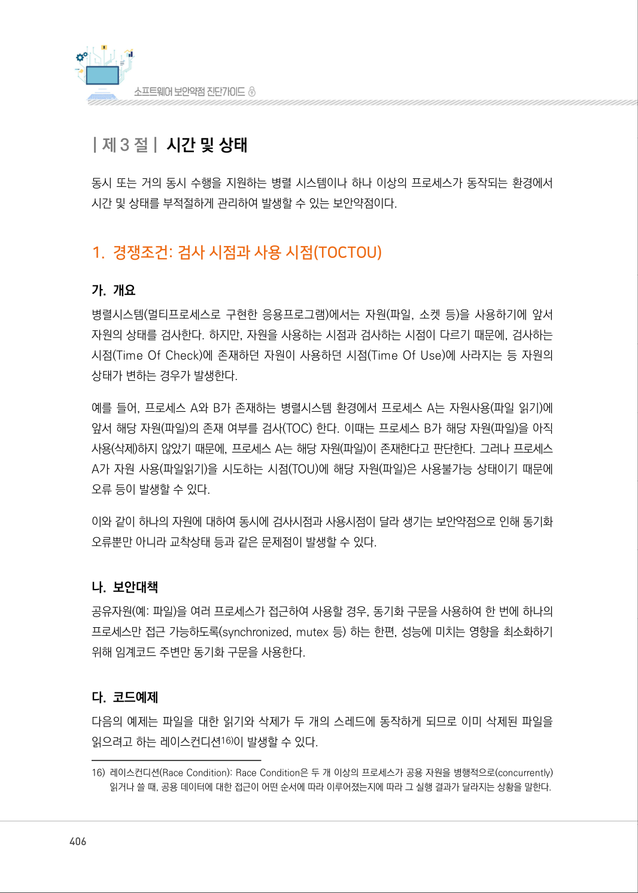
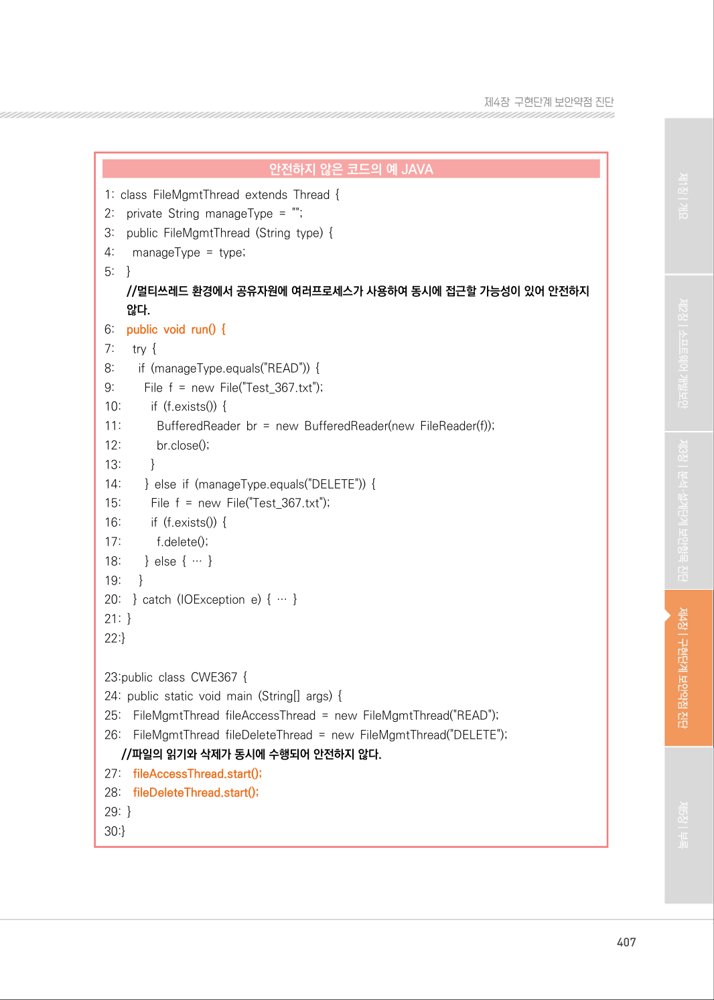
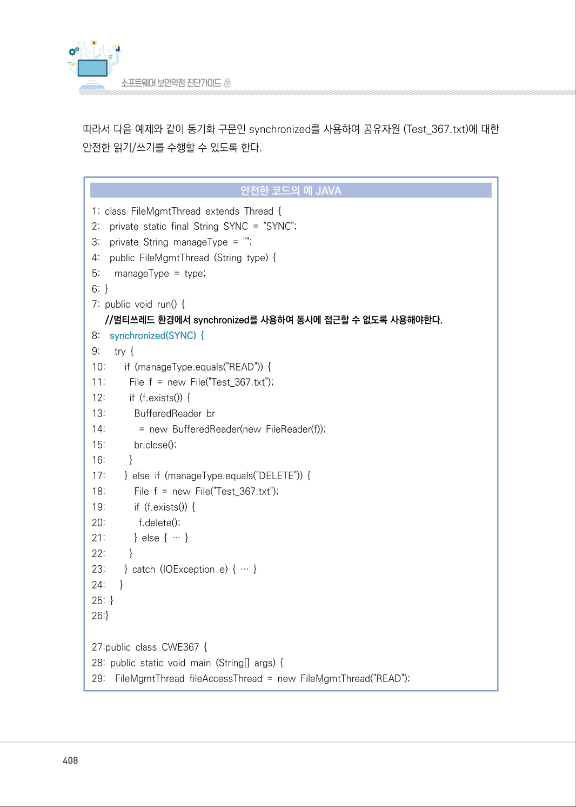
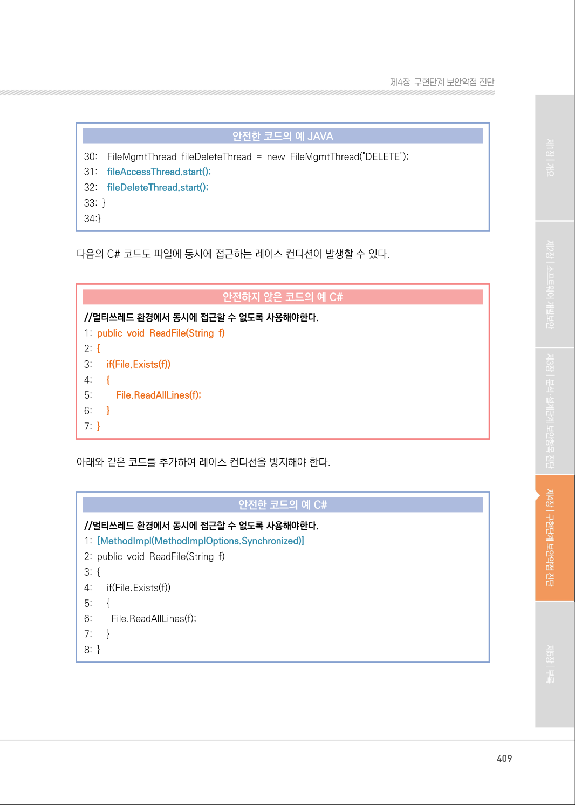
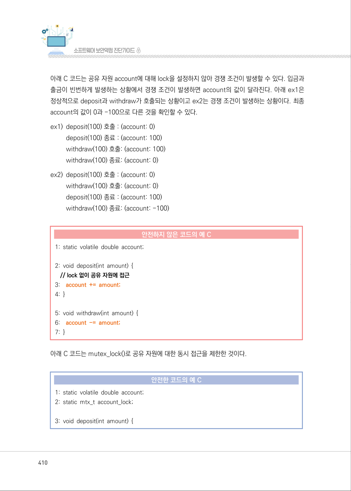
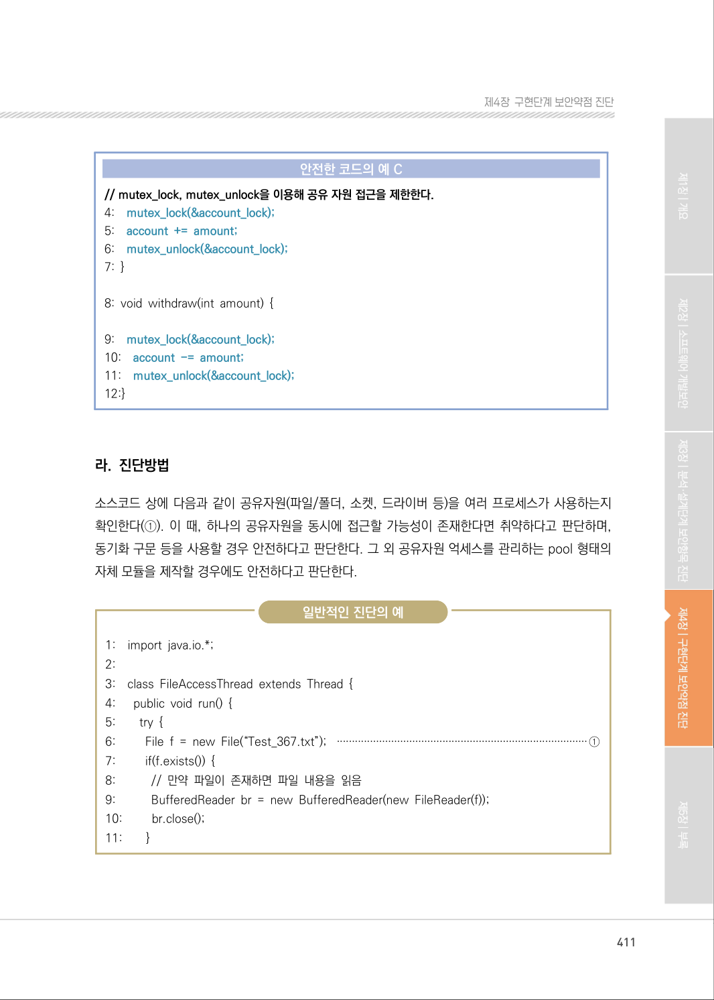
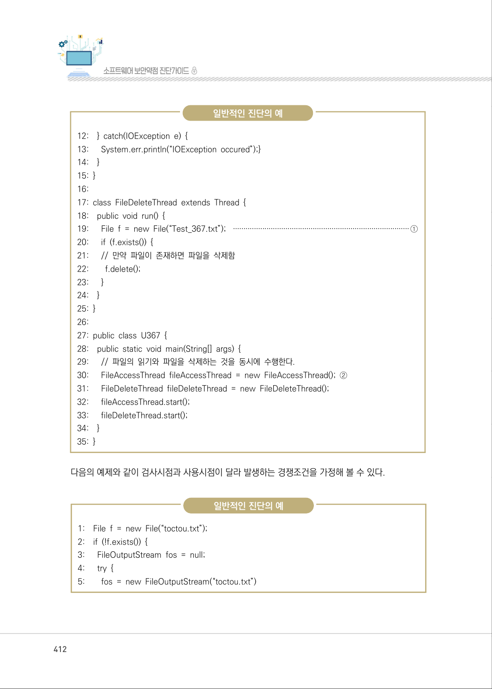
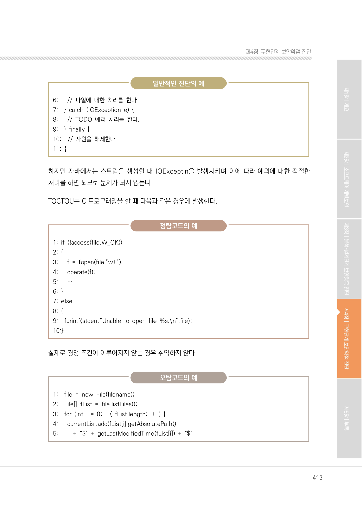
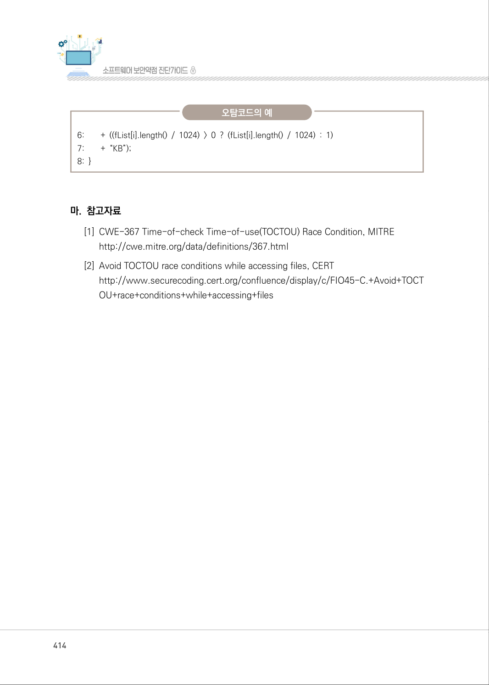
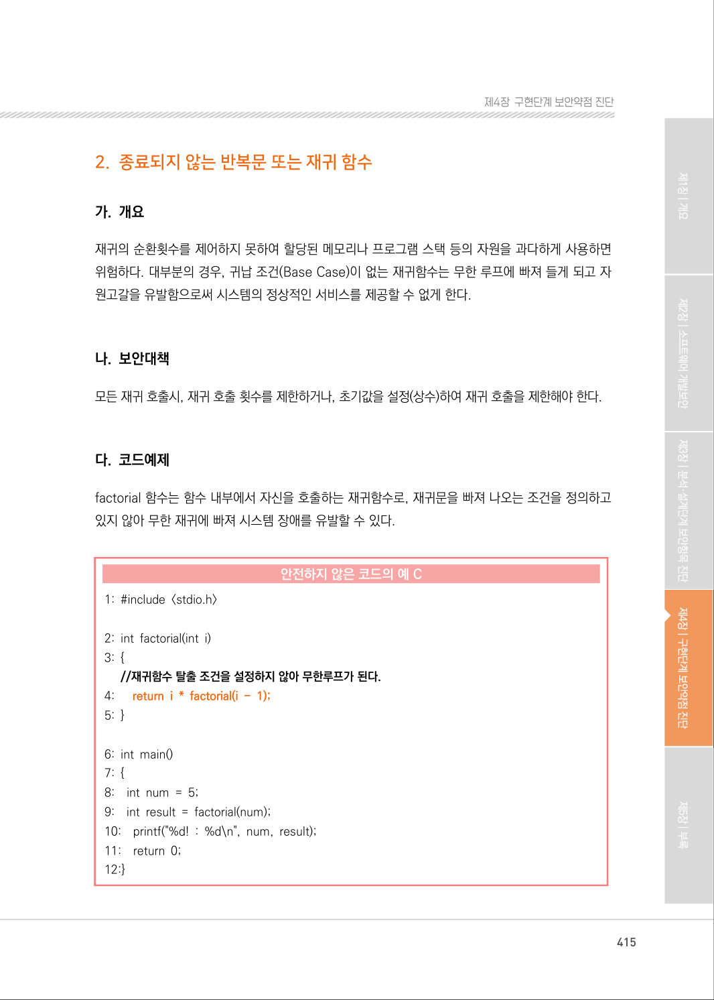

# 1. 경쟁조건: 검사 시점과 사용 시점(TOCTOU)

> 변환 안내(원문 외): 아래 본문은 PDF 텍스트를 추출한 전사입니다. 코드 줄번호·특수 공백·원문 오류를 유지했습니다. 실행용 코드가 아닙니다. 표·그림·들여쓰기는 연결된 페이지 이미지와 대조하세요. 페이지 경계의 줄바꿈을 보존하며, 동일 페이지가 여러 항목에 나뉘면 각 항목의 본문은 해당 구간만 포함합니다.

### PDF 406페이지 / 인쇄 406페이지

<!-- source-page:SW-Diagnosis-2021:406; source-lines:0,4,5,6,7,8,9,10,11,12,13,14,15,16,17,18,19,20,21,22,23,24,25 -->

406

#### 1. 경쟁조건: 검사 시점과 사용 시점(TOCTOU)

#### 가. 개요

병렬시스템(멀티프로세스로 구현한 응용프로그램)에서는 자원(파일, 소켓 등)을 사용하기에 앞서 
자원의 상태를 검사한다. 하지만, 자원을 사용하는 시점과 검사하는 시점이 다르기 때문에, 검사하는 
시점(Time Of Check)에 존재하던 자원이 사용하던 시점(Time Of Use)에 사라지는 등 자원의 
상태가 변하는 경우가 발생한다.

예를 들어, 프로세스 A와 B가 존재하는 병렬시스템 환경에서 프로세스 A는 자원사용(파일 읽기)에 
앞서 해당 자원(파일)의 존재 여부를 검사(TOC) 한다. 이때는 프로세스 B가 해당 자원(파일)을 아직 
사용(삭제)하지 않았기 때문에, 프로세스 A는 해당 자원(파일)이 존재한다고 판단한다. 그러나 프로세스 
A가 자원 사용(파일읽기)을 시도하는 시점(TOU)에 해당 자원(파일)은 사용불가능 상태이기 때문에 
오류 등이 발생할 수 있다.

이와 같이 하나의 자원에 대하여 동시에 검사시점과 사용시점이 달라 생기는 보안약점으로 인해 동기화 
오류뿐만 아니라 교착상태 등과 같은 문제점이 발생할 수 있다.

#### 나. 보안대책

공유자원(예: 파일)을 여러 프로세스가 접근하여 사용할 경우, 동기화 구문을 사용하여 한 번에 하나의 
프로세스만 접근 가능하도록(synchronized, mutex 등) 하는 한편, 성능에 미치는 영향을 최소화하기 
위해 임계코드 주변만 동기화 구문을 사용한다.

#### 다. 코드예제

다음의 예제는 파일을 대한 읽기와 삭제가 두 개의 스레드에 동작하게 되므로 이미 삭제된 파일을 
읽으려고 하는 레이스컨디션16)이 발생할 수 있다.

16) 레이스컨디션(Race Condition): Race Condition은 두 개 이상의 프로세스가 공용 자원을 병행적으로(concurrently) 

읽거나 쓸 때, 공용 데이터에 대한 접근이 어떤 순서에 따라 이루어졌는지에 따라 그 실행 결과가 달라지는 상황을 말한다.

<details><summary>원본 페이지 이미지 (변환 외 보존 자료)</summary>



</details>

### PDF 407페이지 / 인쇄 407페이지

<!-- source-page:SW-Diagnosis-2021:407; source-lines:0,1,2,3,4,5,6,7,8,9,10,11,12,13,14,15,16,17,18,19,20,21,22,23,24,25,26,27,28,29,30,31,32,33,34,35,36,37,38,39,40,41,42,43,44,45,46,47,48,49,50,51,52,53,54,55,56,57,58 -->

407

제4장구현단계 보안약점 진단

#### 안전하지 않은 코드의 예 JAVA

```java
1: class FileMgmtThread extends Thread { 
2:    private String manageType = ""; 
3:    public FileMgmtThread (String type) { 
4:      manageType = type; 
5:    }
//멀티쓰레드 환경에서 공유자원에 여러프로세스가 사용하여 동시에 접근할 가능성이 있어 안전하지 
않다.
```

```text
6:    public void run() {
7:      try {
8:        if (manageType.equals("READ")) { 
9:         File f = new File("Test_367.txt"); 
10:         if (f.exists()) { 
11:           BufferedReader br = new BufferedReader(new FileReader(f));
12:           br.close();
13:         }
14:        } else if (manageType.equals("DELETE")) {
15:         File f = new File("Test_367.txt"); 
16:         if (f.exists()) { 
17:           f.delete(); 
18:        } else { … } 
19:      }
20:    } catch (IOException e) { … } 
21: }
22:}
23:public class CWE367 {
24: public static void main (String[] args) { 
25:    FileMgmtThread fileAccessThread = new FileMgmtThread("READ");
26:    FileMgmtThread fileDeleteThread = new FileMgmtThread("DELETE");
//파일의 읽기와 삭제가 동시에 수행되어 안전하지 않다.
27:    fileAccessThread.start();
28:    fileDeleteThread.start();
29: }
30:}
```

<details><summary>원본 페이지 이미지 (변환 외 보존 자료)</summary>



</details>

### PDF 408페이지 / 인쇄 408페이지

<!-- source-page:SW-Diagnosis-2021:408; source-lines:0,1,2,3,4,5,6,7,8,9,10,11,12,13,14,15,16,17,18,19,20,21,22,23,24,25,26,27,28,29,30,31,32,33,34,35,36,37,38,39,40,41,42,43,44,45,46,47,48,49,50,51,52,53,54,55 -->

408

따라서 다음 예제와 같이 동기화 구문인 synchronized를 사용하여 공유자원 (Test_367.txt)에 대한 
안전한 읽기/쓰기를 수행할 수 있도록 한다.

#### 안전한 코드의 예 JAVA

```java
1: class FileMgmtThread extends Thread { 
2:    private static final String SYNC = "SYNC"; 
3:    private String manageType = ""; 
4:    public FileMgmtThread (String type) { 
5:      manageType = type; 
6: }
7: public void run() { 
//멀티쓰레드 환경에서 synchronized를 사용하여 동시에 접근할 수 없도록 사용해야한다.
8:    synchronized(SYNC) {
9:      try {
10:        if (manageType.equals("READ")) { 
11:         File f = new File("Test_367.txt"); 
12:         if (f.exists()) { 
13:           BufferedReader br 
14:             = new BufferedReader(new FileReader(f)); 
15:           br.close();
16:         }
17:        } else if (manageType.equals("DELETE")) { 
18:           File f = new File("Test_367.txt"); 
19:           if (f.exists()) { 
20:             f.delete(); 
21:           } else { … } 
22:         }
23:        } catch (IOException e) { … } 
24:      }
25: }
26:}
27:public class CWE367 { 
28: public static void main (String[] args) { 
29:    FileMgmtThread fileAccessThread = new FileMgmtThread("READ");
```

<details><summary>원본 페이지 이미지 (변환 외 보존 자료)</summary>



</details>

### PDF 409페이지 / 인쇄 409페이지

<!-- source-page:SW-Diagnosis-2021:409; source-lines:0,1,2,3,4,5,6,7,8,9,10,11,12,13,14,15,16,17,18,19,20,21,22,23,24,25,26,27,28,29,30,31,32,33,34,35,36,37,38,39 -->

409

제4장구현단계 보안약점 진단

#### 안전한 코드의 예 JAVA

```java
30:    FileMgmtThread fileDeleteThread = new FileMgmtThread("DELETE");
31:    fileAccessThread.start();
32:    fileDeleteThread.start();
33: }
34:}
```

다음의 C# 코드도 파일에 동시에 접근하는 레이스 컨디션이 발생할 수 있다.

#### 안전하지 않은 코드의 예 C#

```csharp
//멀티쓰레드 환경에서 동시에 접근할 수 없도록 사용해야한다.
1: public void ReadFile(String f)
2: {
3:      if(File.Exists(f))
4:      {
5:         File.ReadAllLines(f);
6:      }
7: }
```

아래와 같은 코드를 추가하여 레이스 컨디션을 방지해야 한다.

#### 안전한 코드의 예 C#

```csharp
//멀티쓰레드 환경에서 동시에 접근할 수 없도록 사용해야한다.
1: [MethodImpl(MethodImplOptions.Synchronized)]
2: public void ReadFile(String f) 
3: { 
4:      if(File.Exists(f)) 
5:      { 
6:        File.ReadAllLines(f); 
7:      }
8: }
```

<details><summary>원본 페이지 이미지 (변환 외 보존 자료)</summary>



</details>

### PDF 410페이지 / 인쇄 410페이지

<!-- source-page:SW-Diagnosis-2021:410; source-lines:0,1,2,3,4,5,6,7,8,9,10,11,12,13,14,15,16,17,18,19,20,21,22,23,24,25,26,27,28 -->

410

아래 C 코드는 공유 자원 account에 대해 lock을 설정하지 않아 경쟁 조건이 발생할 수 있다. 입금과 
출금이 빈번하게 발생하는 상황에서 경쟁 조건이 발생하면 account의 값이 달라진다. 아래 ex1은 
정상적으로 deposit과 withdraw가 호출되는 상황이고 ex2는 경쟁 조건이 발생하는 상황이다. 최종 
account의 값이 0과 -100으로 다른 것을 확인할 수 있다.
ex1) deposit(100) 호출 : (account: 0)

deposit(100) 종료 : (account: 100)
withdraw(100) 호출: (account: 100)
withdraw(100) 종료: (account: 0) 
ex2) deposit(100) 호출 : (account: 0)

withdraw(100) 호출: (account: 0)
deposit(100) 종료 : (account: 100)
withdraw(100) 종료: (account: -100)

#### 안전하지 않은 코드의 예 C

```c
1: static volatile double account;
2: void deposit(int amount) {
// lock 없이 공유 자원에 접근
3:    account += amount;
4: }
5: void withdraw(int amount) {
6:    account -= amount;
7: }
```

아래 C 코드는 mutex_lock()로 공유 자원에 대한 동시 접근을 제한한 것이다.

#### 안전한 코드의 예 C

```c
1: static volatile double account; 
2: static mtx_t account_lock;
3: void deposit(int amount) {
```

<details><summary>원본 페이지 이미지 (변환 외 보존 자료)</summary>



</details>

### PDF 411페이지 / 인쇄 411페이지

<!-- source-page:SW-Diagnosis-2021:411; source-lines:0,1,2,3,4,5,6,7,8,9,10,11,12,13,14,15,16,17,18,19,20,21,22,23,24,25,26,27,28,29,30,31,32,33,34,35,36,37,38,39,40,41,42,43,44,45 -->

411

제4장구현단계 보안약점 진단

#### 안전한 코드의 예 C

```c
// mutex_lock, mutex_unlock을 이용해 공유 자원 접근을 제한한다.
4:    mutex_lock(&account_lock);
5:    account += amount; 
6:    mutex_unlock(&account_lock);
7: }
8: void withdraw(int amount) { 
9:    mutex_lock(&account_lock);
10:    account -= amount;
11:    mutex_unlock(&account_lock);
12:}
```

#### 라. 진단방법

소스코드 상에 다음과 같이 공유자원(파일/폴더, 소켓, 드라이버 등)을 여러 프로세스가 사용하는지 
확인한다(①). 이 때, 하나의 공유자원을 동시에 접근할 가능성이 존재한다면 취약하다고 판단하며, 
동기화 구문 등을 사용할 경우 안전하다고 판단한다. 그 외 공유자원 억세스를 관리하는 pool 형태의 
자체 모듈을 제작할 경우에도 안전하다고 판단한다.

일반적인 진단의 예

```text
1:    import java.io.*; 
2:
3:    class FileAccessThread extends Thread { 
4:      public void run() { 
5:        try { 
6:         File f = new File(“Test_367.txt”); ···················································································①
7:         if(f.exists()) { 
8:           // 만약 파일이 존재하면 파일 내용을 읽음 
9:           BufferedReader br = new BufferedReader(new FileReader(f));
10:         br.close();
11:        }
```

<details><summary>원본 페이지 이미지 (변환 외 보존 자료)</summary>



</details>

### PDF 412페이지 / 인쇄 412페이지

<!-- source-page:SW-Diagnosis-2021:412; source-lines:0,1,2,3,4,5,6,7,8,9,10,11,12,13,14,15,16,17,18,19,20,21,22,23,24,25,26,27,28,29,30,31,32,33,34,35,36,37,38,39,40,41,42,43,44,45,46,47,48,49,50,51,52,53,54 -->

412

일반적인 진단의 예

```text
12:    } catch(IOException e) {
13:      System.err.println(“IOException occured”);}
14:    }
15: }
16: 
17: class FileDeleteThread extends Thread { 
18:    public void run() { 
19:      File f = new File(“Test_367.txt”); ····················································································①
20:      if (f.exists()) { 
21:      // 만약 파일이 존재하면 파일을 삭제함 
22:        f.delete();
23:      }
24:    }
25: }
26: 
27: public class U367 { 
28:    public static void main(String[] args) { 
29:      // 파일의 읽기와 파일을 삭제하는 것을 동시에 수행한다. 
30:      FileAccessThread fileAccessThread = new FileAccessThread(); ②
31:      FileDeleteThread fileDeleteThread = new FileDeleteThread();
32:      fileAccessThread.start();
33:      fileDeleteThread.start();
34:    }
35: }
```

다음의 예제와 같이 검사시점과 사용시점이 달라 발생하는 경쟁조건을 가정해 볼 수 있다.

일반적인 진단의 예

```text
1:    File f = new File(“toctou.txt”);
2:    if (!f.exists()) {
3:      FileOutputStream fos = null;
4:      try {
5:        fos = new FileOutputStream(“toctou.txt”)
```

<details><summary>원본 페이지 이미지 (변환 외 보존 자료)</summary>



</details>

### PDF 413페이지 / 인쇄 413페이지

<!-- source-page:SW-Diagnosis-2021:413; source-lines:0,1,2,3,4,5,6,7,8,9,10,11,12,13,14,15,16,17,18,19,20,21,22,23,24,25,26,27,28,29,30,31,32,33,34,35,36,37,38,39,40,41,42,43 -->

413

제4장구현단계 보안약점 진단

일반적인 진단의 예

```text
6:      // 파일에 대한 처리를 한다. 
7:    } catch (IOException e) { 
8:      // TODO 에러 처리를 한다. 
9:    } finally { 
10:    // 자원을 해제한다. 
11: }
```

하지만 자바에서는 스트림을 생성할 때 IOExceptin을 발생시키며 이에 따라 예외에 대한 적절한 
처리를 하면 되므로 문제가 되지 않는다.

TOCTOU는 C 프로그래밍을 할 때 다음과 같은 경우에 발생한다.

정탐코드의 예

```text
1: if (!access(file,W_OK)) 
2: { 
3:      f = fopen(file,”w+”); 
4:      operate(f); 
5:      … 
6: }
7: else
8: {
9:    fprintf(stderr,”Unable to open file %s.\n”,file);
10:}
```

실제로 경쟁 조건이 이루어지지 않는 경우 취약하지 않다.

오탐코드의 예

```text
1:    file = new File(filename); 
2:    File[] fList = file.listFiles(); 
3:    for (int i = 0; i < fList.length; i++) { 
4:      currentList.add(fList[i].getAbsolutePath() 
5:         + “$” + getLastModifiedTime(fList[i]) + “$”
```

<details><summary>원본 페이지 이미지 (변환 외 보존 자료)</summary>



</details>

### PDF 414페이지 / 인쇄 414페이지

<!-- source-page:SW-Diagnosis-2021:414; source-lines:0,1,2,3,4,5,6,7,8,9,10,11,12 -->

414

오탐코드의 예

```text
6:        + ((fList[i].length() / 1024) > 0 ? (fList[i].length() / 1024) : 1) 
7:        + “KB”);
8: }
```

#### 마. 참고자료

[1] CWE-367 Time-of-check Time-of-use(TOCTOU) Race Condition, MITRE

http://cwe.mitre.org/data/definitions/367.html
[2] Avoid TOCTOU race conditions while accessing files, CERT

http://www.securecoding.cert.org/confluence/display/c/FIO45-C.+Avoid+TOCT
OU+race+conditions+while+accessing+files

<details><summary>원본 페이지 이미지 (변환 외 보존 자료)</summary>



</details>

### PDF 415페이지 / 인쇄 415페이지

<!-- source-page:SW-Diagnosis-2021:415; source-lines:1 -->

제4장구현단계 보안약점 진단

<details><summary>원본 페이지 이미지 (변환 외 보존 자료)</summary>



</details>

---

## 탐색 링크 (원문 외)

[통합 인덱스](../../../INDEX.md)

