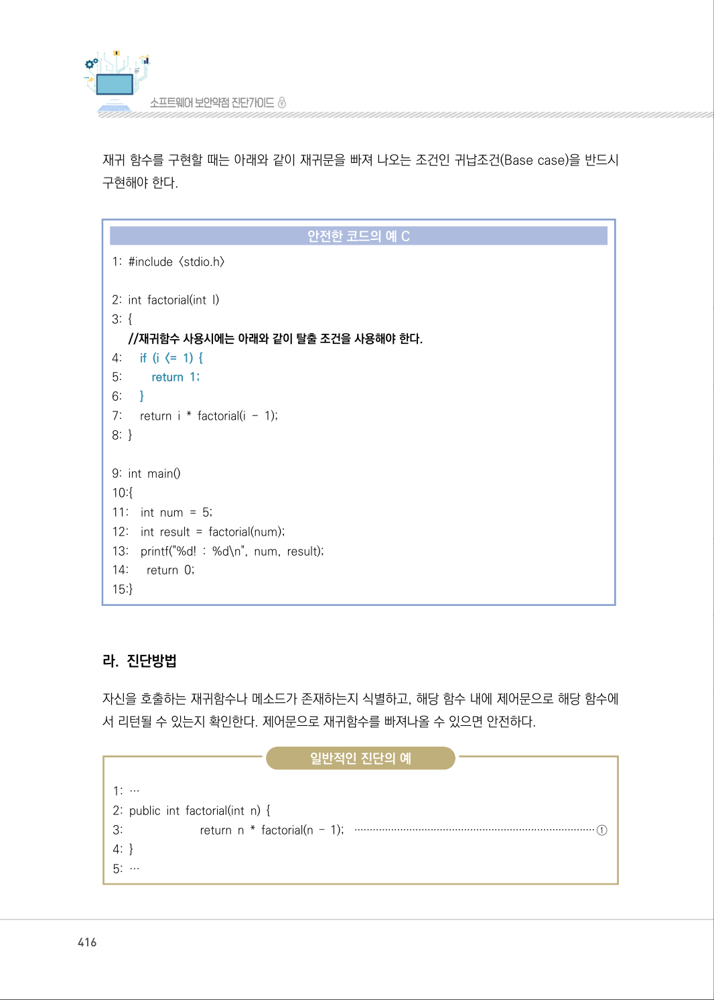
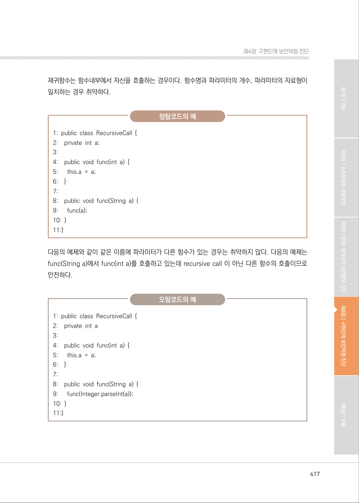
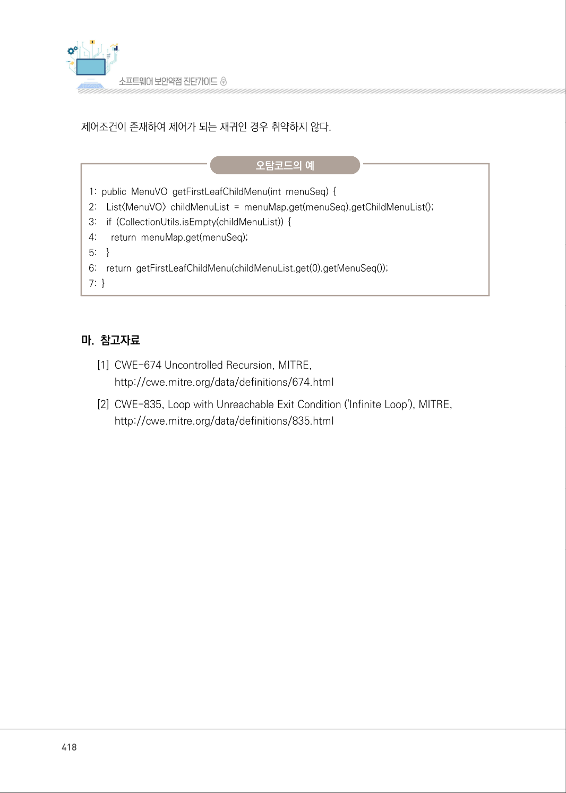
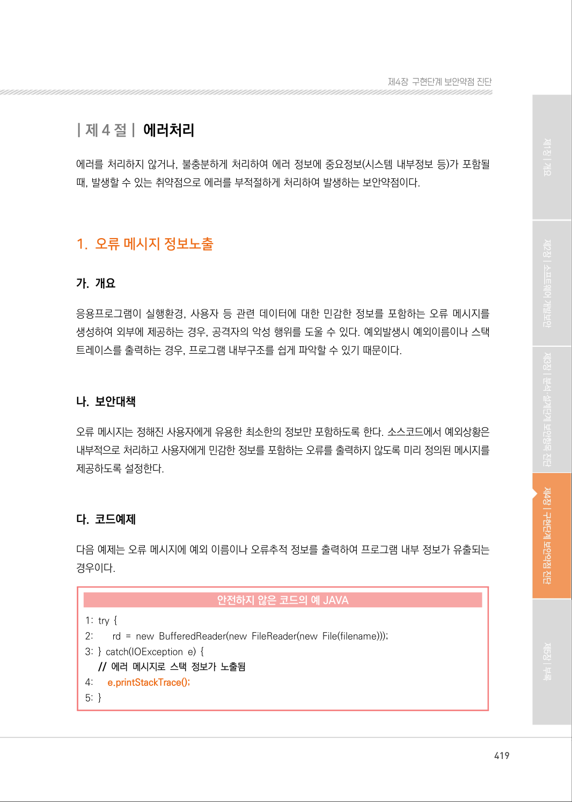

# 2. 종료되지 않는 반복문 또는 재귀 함수

> 변환 안내(원문 외): 아래 본문은 PDF 텍스트를 추출한 전사입니다. 코드 줄번호·특수 공백·원문 오류를 유지했습니다. 실행용 코드가 아닙니다. 표·그림·들여쓰기는 연결된 페이지 이미지와 대조하세요. 페이지 경계의 줄바꿈을 보존하며, 동일 페이지가 여러 항목에 나뉘면 각 항목의 본문은 해당 구간만 포함합니다.

### PDF 415페이지 / 인쇄 415페이지

<!-- source-page:SW-Diagnosis-2021:415; source-lines:0,2,3,4,5,6,7,8,9,10,11,12,13,14,15,16,17,18,19,20,21,22,23,24,25,26,27,28,29,30 -->

415

#### 2. 종료되지 않는 반복문 또는 재귀 함수

#### 가. 개요

재귀의 순환횟수를 제어하지 못하여 할당된 메모리나 프로그램 스택 등의 자원을 과다하게 사용하면 
위험하다. 대부분의 경우, 귀납 조건(Base Case)이 없는 재귀함수는 무한 루프에 빠져 들게 되고 자
원고갈을 유발함으로써 시스템의 정상적인 서비스를 제공할 수 없게 한다.

#### 나. 보안대책

모든 재귀 호출시, 재귀 호출 횟수를 제한하거나, 초기값을 설정(상수)하여 재귀 호출을 제한해야 한다.

#### 다. 코드예제

factorial 함수는 함수 내부에서 자신을 호출하는 재귀함수로, 재귀문을 빠져 나오는 조건을 정의하고 
있지 않아 무한 재귀에 빠져 시스템 장애를 유발할 수 있다.

#### 안전하지 않은 코드의 예 C

```c
1: #include <stdio.h>
2: int factorial(int i) 
3: { 
//재귀함수 탈출 조건을 설정하지 않아 무한루프가 된다.
4:      return i * factorial(i - 1);
5: }
6: int main() 
7: { 
8:    int num = 5; 
9:    int result = factorial(num); 
10:    printf("%d! : %d\n", num, result); 
11:    return 0; 
12:}
```

<details><summary>원본 페이지 이미지 (변환 외 보존 자료)</summary>


</details>

### PDF 416페이지 / 인쇄 416페이지

<!-- source-page:SW-Diagnosis-2021:416; source-lines:0,1,2,3,4,5,6,7,8,9,10,11,12,13,14,15,16,17,18,19,20,21,22,23,24,25,26,27,28,29,30,31,32,33,34,35,36,37 -->

416

재귀 함수를 구현할 때는 아래와 같이 재귀문을 빠져 나오는 조건인 귀납조건(Base case)을 반드시 
구현해야 한다.

#### 안전한 코드의 예 C

```c
1: #include <stdio.h> 
2: int factorial(int I) 
3: {
//재귀함수 사용시에는 아래와 같이 탈출 조건을 사용해야 한다.
4:      if (i <= 1) {
5:         return 1;
6:      }
7:      return i * factorial(i - 1); 
8: }
9: int main() 
10:{
11:    int num = 5; 
12:    int result = factorial(num); 
13:    printf("%d! : %d\n", num, result); 
14:      return 0; 
15:}
```

#### 라. 진단방법

자신을 호출하는 재귀함수나 메소드가 존재하는지 식별하고, 해당 함수 내에 제어문으로 해당 함수에
서 리턴될 수 있는지 확인한다. 제어문으로 재귀함수를 빠져나올 수 있으면 안전하다.

일반적인 진단의 예

```text
1: …
2: public int factorial(int n) { 
3:                         return n * factorial(n – 1); ···············································································①
4: }
5: …
```

<details><summary>원본 페이지 이미지 (변환 외 보존 자료)</summary>



</details>

### PDF 417페이지 / 인쇄 417페이지

<!-- source-page:SW-Diagnosis-2021:417; source-lines:0,1,2,3,4,5,6,7,8,9,10,11,12,13,14,15,16,17,18,19,20,21,22,23,24,25,26,27,28,29,30,31,32,33,34,35,36,37,38,39,40,41,42 -->

417

제4장구현단계 보안약점 진단

재귀함수는 함수내부에서 자신을 호출하는 경우이다. 함수명과 파라미터의 개수, 파라미터의 자료형이 
일치하는 경우 취약하다.

정탐코드의 예

```text
1: public class RecursiveCall { 
2:    private int a; 
3:
4:    public void func(int a) { 
5:      this.a = a; 
6:    }
7:
8:    public void func(String a) { 
9:      func(a); 
10: }
11:}
```

다음의 예제와 같이 같은 이름에 파라미터가 다른 함수가 있는 경우는 취약하지 않다. 다음의 예제는 
func(String a)에서 func(int a)를 호출하고 있는데 recursive call 이 아닌 다른 함수의 호출이므로 
안전하다.

오탐코드의 예

```text
1: public class RecursiveCall { 
2:    private int a 
3: 
4:    public void func(int a) { 
5:      this.a = a; 
6:    }
7: 
8:    public void func(String a) { 
9:      func(Integer.parseInt(a)); 
10: }
11:}
```

<details><summary>원본 페이지 이미지 (변환 외 보존 자료)</summary>



</details>

### PDF 418페이지 / 인쇄 418페이지

<!-- source-page:SW-Diagnosis-2021:418; source-lines:0,1,2,3,4,5,6,7,8,9,10,11,12,13,14,15,16,17,18,19 -->

418

제어조건이 존재하여 제어가 되는 재귀인 경우 취약하지 않다.

오탐코드의 예

```text
1: public MenuVO getFirstLeafChildMenu(int menuSeq) { 
2:    List<MenuVO> childMenuList = menuMap.get(menuSeq).getChildMenuList();
3:    if (CollectionUtils.isEmpty(childMenuList)) {
4:      return menuMap.get(menuSeq);
5:    }
6:    return getFirstLeafChildMenu(childMenuList.get(0).getMenuSeq());
7: }
```

#### 마. 참고자료

[1] CWE-674 Uncontrolled Recursion, MITRE,

http://cwe.mitre.org/data/definitions/674.html
[2] CWE-835, Loop with Unreachable Exit Condition ('Infinite Loop'), MITRE,

http://cwe.mitre.org/data/definitions/835.html

<details><summary>원본 페이지 이미지 (변환 외 보존 자료)</summary>



</details>

### PDF 419페이지 / 인쇄 419페이지

<!-- source-page:SW-Diagnosis-2021:419; source-lines:1 -->

제4장구현단계 보안약점 진단

<details><summary>원본 페이지 이미지 (변환 외 보존 자료)</summary>



</details>

---

## 탐색 링크 (원문 외)

[통합 인덱스](../../../INDEX.md)

