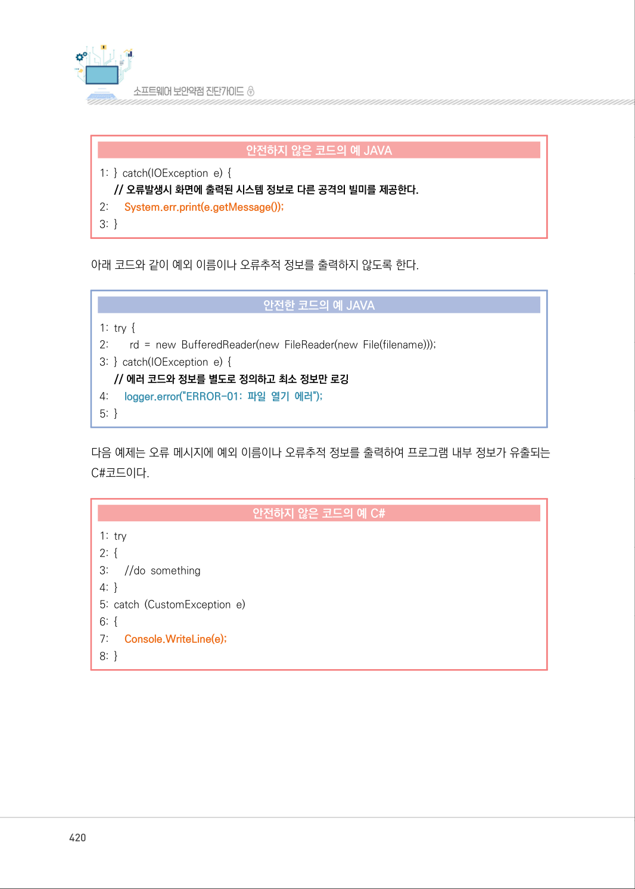
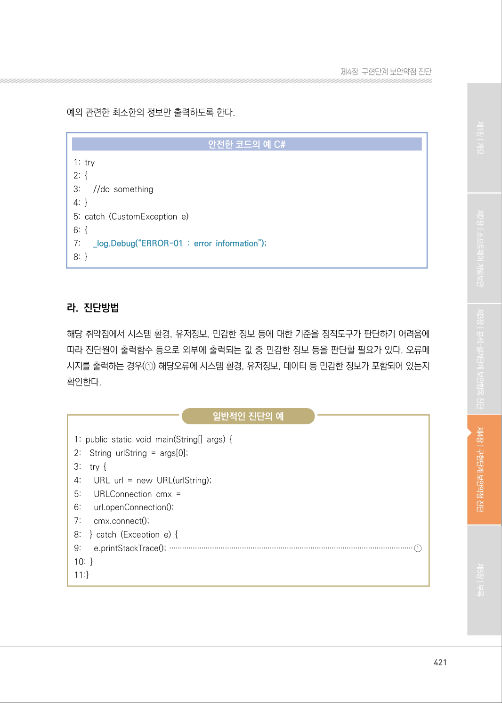
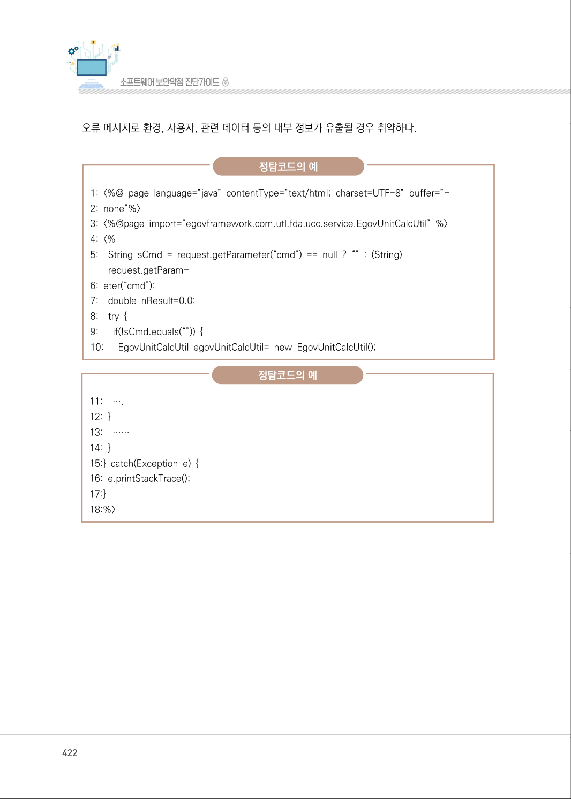
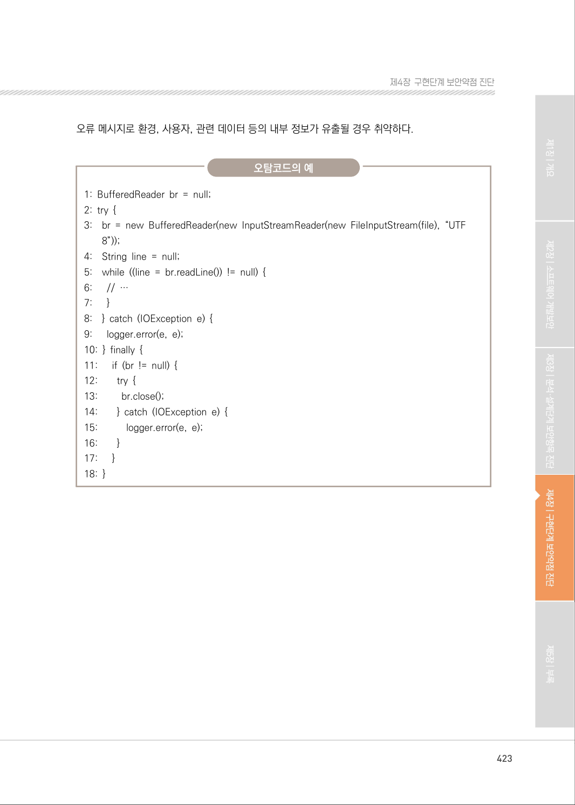
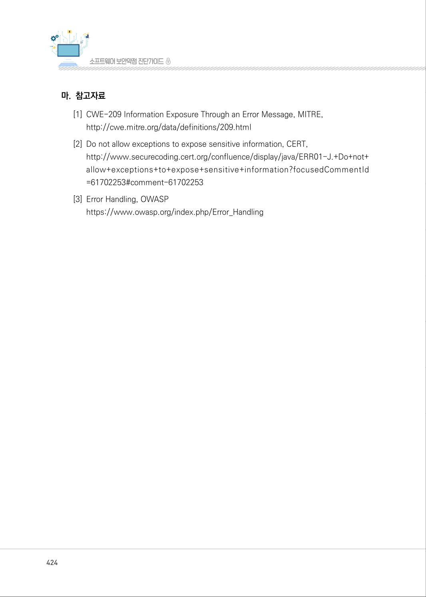

# 1. 오류 메시지 정보노출

> 변환 안내(원문 외): 아래 본문은 PDF 텍스트를 추출한 전사입니다. 코드 줄번호·특수 공백·원문 오류를 유지했습니다. 실행용 코드가 아닙니다. 표·그림·들여쓰기는 연결된 페이지 이미지와 대조하세요. 페이지 경계의 줄바꿈을 보존하며, 동일 페이지가 여러 항목에 나뉘면 각 항목의 본문은 해당 구간만 포함합니다.

### PDF 419페이지 / 인쇄 419페이지

<!-- source-page:SW-Diagnosis-2021:419; source-lines:0,5,6,7,8,9,10,11,12,13,14,15,16,17,18,19,20,21,22,23,24,25 -->

419

#### 1. 오류 메시지 정보노출

#### 가. 개요

응용프로그램이 실행환경, 사용자 등 관련 데이터에 대한 민감한 정보를 포함하는 오류 메시지를 
생성하여 외부에 제공하는 경우, 공격자의 악성 행위를 도울 수 있다. 예외발생시 예외이름이나 스택 
트레이스를 출력하는 경우, 프로그램 내부구조를 쉽게 파악할 수 있기 때문이다.

#### 나. 보안대책

오류 메시지는 정해진 사용자에게 유용한 최소한의 정보만 포함하도록 한다. 소스코드에서 예외상황은 
내부적으로 처리하고 사용자에게 민감한 정보를 포함하는 오류를 출력하지 않도록 미리 정의된 메시지를 
제공하도록 설정한다.

#### 다. 코드예제

다음 예제는 오류 메시지에 예외 이름이나 오류추적 정보를 출력하여 프로그램 내부 정보가 유출되는 
경우이다.

#### 안전하지 않은 코드의 예 JAVA

```java
1: try {
2:        rd = new BufferedReader(new FileReader(new File(filename))); 
3: } catch(IOException e) { 
// 에러 메시지로 스택 정보가 노출됨 
4:      e.printStackTrace(); 
5: }
```

<details><summary>원본 페이지 이미지 (변환 외 보존 자료)</summary>


</details>

### PDF 420페이지 / 인쇄 420페이지

<!-- source-page:SW-Diagnosis-2021:420; source-lines:0,1,2,3,4,5,6,7,8,9,10,11,12,13,14,15,16,17,18,19,20,21,22,23,24,25,26,27,28,29 -->

420

#### 안전하지 않은 코드의 예 JAVA

```java
1: } catch(IOException e) { 
// 오류발생시 화면에 출력된 시스템 정보로 다른 공격의 빌미를 제공한다.
2:      System.err.print(e.getMessage()); 
3: }
```

아래 코드와 같이 예외 이름이나 오류추적 정보를 출력하지 않도록 한다.

#### 안전한 코드의 예 JAVA

```java
1: try { 
2:        rd = new BufferedReader(new FileReader(new File(filename))); 
3: } catch(IOException e) { 
// 에러 코드와 정보를 별도로 정의하고 최소 정보만 로깅
4:      logger.error("ERROR-01: 파일 열기 에러");
5: }
```

다음 예제는 오류 메시지에 예외 이름이나 오류추적 정보를 출력하여 프로그램 내부 정보가 유출되는 
C#코드이다.

#### 안전하지 않은 코드의 예 C#

```csharp
1: try 
2: { 
3:      //do something 
4: }
5: catch (CustomException e) 
6: {
7:      Console.WriteLine(e);
8: }
```

<details><summary>원본 페이지 이미지 (변환 외 보존 자료)</summary>



</details>

### PDF 421페이지 / 인쇄 421페이지

<!-- source-page:SW-Diagnosis-2021:421; source-lines:0,1,2,3,4,5,6,7,8,9,10,11,12,13,14,15,16,17,18,19,20,21,22,23,24,25,26,27,28,29,30,31,32,33,34,35,36,37,38 -->

421

제4장구현단계 보안약점 진단

예외 관련한 최소한의 정보만 출력하도록 한다.

#### 안전한 코드의 예 C#

```csharp
1: try
2: {
3:      //do something
4: }
5: catch (CustomException e)
6: {
7:      _log.Debug(“ERROR-01 : error information”);
8: }
```

#### 라. 진단방법

해당 취약점에서 시스템 환경, 유저정보, 민감한 정보 등에 대한 기준을 정적도구가 판단하기 어려움에 
따라 진단원이 출력함수 등으로 외부에 출력되는 값 중 민감한 정보 등을 판단할 필요가 있다. 오류메
시지를 출력하는 경우(①) 해당오류에 시스템 환경, 유저정보, 데이터 등 민감한 정보가 포함되어 있는지 
확인한다.

일반적인 진단의 예

```text
1: public static void main(String[] args) { 
2:    String urlString = args[0]; 
3:    try { 
4:      URL url = new URL(urlString); 
5:      URLConnection cmx = 
6:      url.openConnection(); 
7:      cmx.connect(); 
8:    } catch (Exception e) { 
9:      e.printStackTrace(); ··················································································································①
10: }
11:}
```

<details><summary>원본 페이지 이미지 (변환 외 보존 자료)</summary>



</details>

### PDF 422페이지 / 인쇄 422페이지

<!-- source-page:SW-Diagnosis-2021:422; source-lines:0,1,2,3,4,5,6,7,8,9,10,11,12,13,14,15,16,17,18,19,20,21,22,23,24,25,26,27,28,29 -->

422

오류 메시지로 환경, 사용자, 관련 데이터 등의 내부 정보가 유출될 경우 취약하다.

정탐코드의 예

```text
1: <%@ page language=”java” contentType=”text/html; charset=UTF-8” buffer=”-
2: none”%> 
3: <%@page import=”egovframework.com.utl.fda.ucc.service.EgovUnitCalcUtil” %>
4: <%
5:    String sCmd = request.getParameter(“cmd”) == null ? “” : (String)
request.getParam-
6: eter(“cmd”);
7:    double nResult=0.0; 
8:    try {
9:      if(!sCmd.equals(“”)) {
10:      EgovUnitCalcUtil egovUnitCalcUtil= new EgovUnitCalcUtil();
```

정탐코드의 예

```text
11:    ….
12: }
13:    …… 
14: }
15:} catch(Exception e) { 
16: e.printStackTrace(); 
17:} 
18:%>
```

<details><summary>원본 페이지 이미지 (변환 외 보존 자료)</summary>



</details>

### PDF 423페이지 / 인쇄 423페이지

<!-- source-page:SW-Diagnosis-2021:423; source-lines:0,1,2,3,4,5,6,7,8,9,10,11,12,13,14,15,16,17,18,19,20,21,22,23,24,25,26,27,28,29,30,31,32,33,34,35,36 -->

423

제4장구현단계 보안약점 진단

오류 메시지로 환경, 사용자, 관련 데이터 등의 내부 정보가 유출될 경우 취약하다.

오탐코드의 예

```text
1: BufferedReader br = null; 
2: try { 
3:    br = new BufferedReader(new InputStreamReader(new FileInputStream(file), “UTF 
8”)); 
4:    String line = null; 
5:    while ((line = br.readLine()) != null) { 
6:      // … 
7:      }
8:    } catch (IOException e) { 
9:      logger.error(e, e); 
10: } finally { 
11:      if (br != null) { 
12:        try { 
13:         br.close(); 
14:        } catch (IOException e) { 
15:           logger.error(e, e); 
16:        }
17:      }
18: }
```

<details><summary>원본 페이지 이미지 (변환 외 보존 자료)</summary>



</details>

### PDF 424페이지 / 인쇄 424페이지

<!-- source-page:SW-Diagnosis-2021:424; source-lines:0,1,2,3,4,5,6,7,8,9 -->

424

#### 마. 참고자료

[1] CWE-209 Information Exposure Through an Error Message, MITRE,

http://cwe.mitre.org/data/definitions/209.html
[2] Do not allow exceptions to expose sensitive information, CERT,

http://www.securecoding.cert.org/confluence/display/java/ERR01-J.+Do+not+
allow+exceptions+to+expose+sensitive+information?focusedCommentId 
=61702253#comment-61702253
[3] Error Handling, OWASP

https://www.owasp.org/index.php/Error_Handling

<details><summary>원본 페이지 이미지 (변환 외 보존 자료)</summary>



</details>

### PDF 425페이지 / 인쇄 425페이지

<!-- source-page:SW-Diagnosis-2021:425; source-lines:1 -->

제4장구현단계 보안약점 진단

<details><summary>원본 페이지 이미지 (변환 외 보존 자료)</summary>


</details>

---

## 탐색 링크 (원문 외)

[통합 인덱스](../../../INDEX.md)

