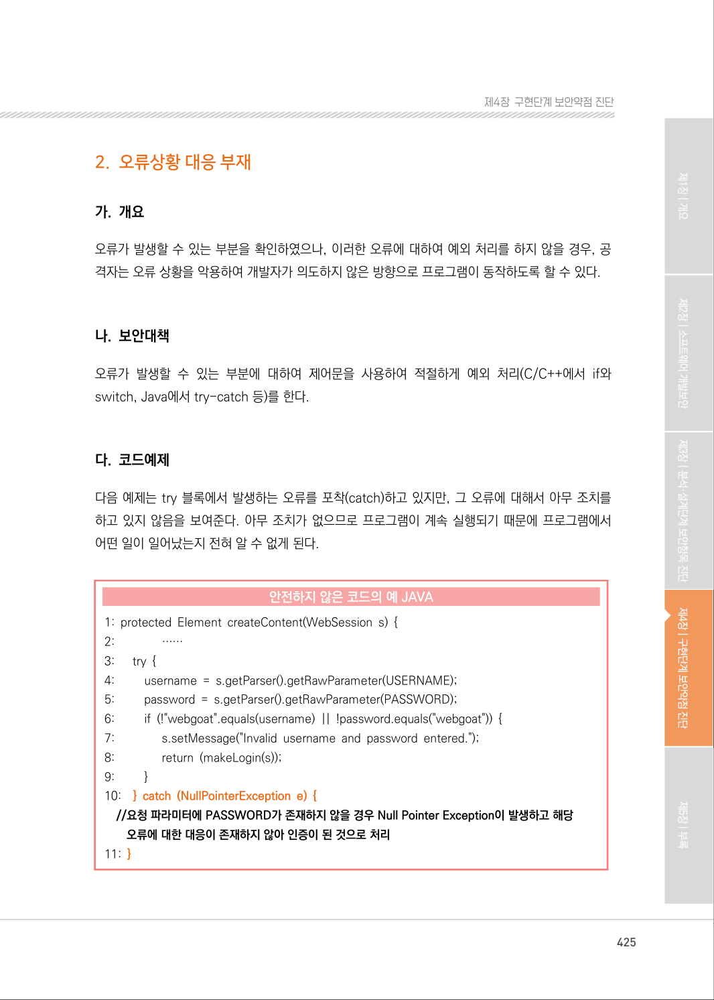
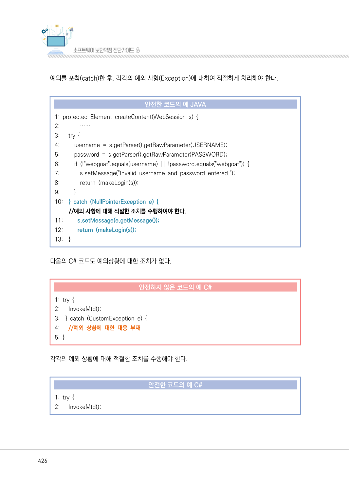
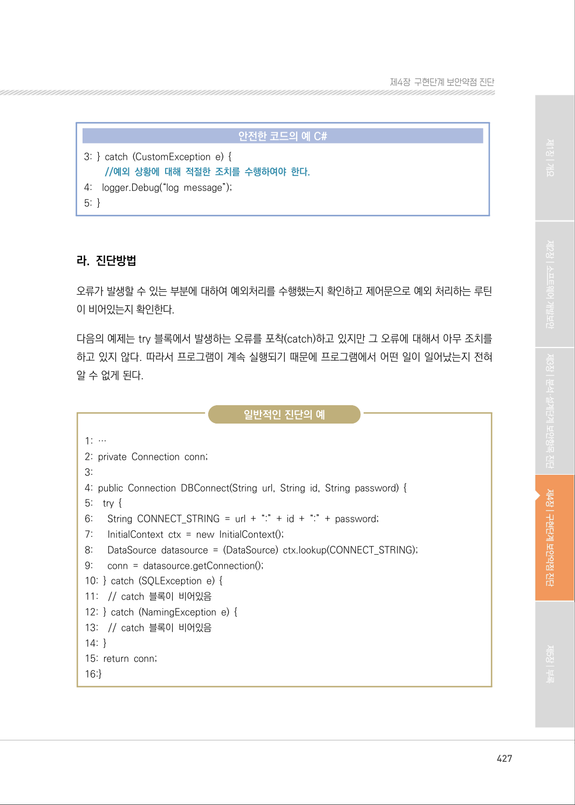
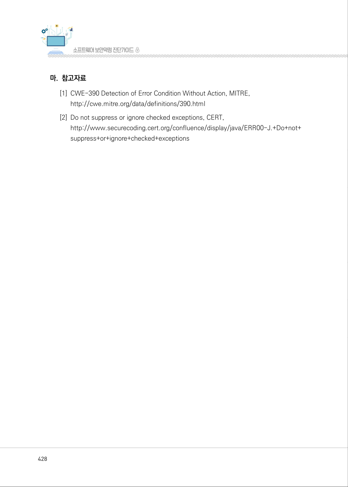
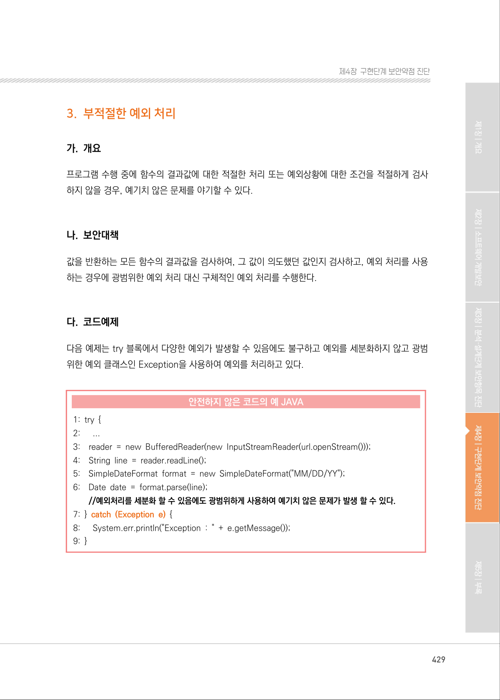

# 2. 오류상황 대응 부재

> 변환 안내(원문 외): 아래 본문은 PDF 텍스트를 추출한 전사입니다. 코드 줄번호·특수 공백·원문 오류를 유지했습니다. 실행용 코드가 아닙니다. 표·그림·들여쓰기는 연결된 페이지 이미지와 대조하세요. 페이지 경계의 줄바꿈을 보존하며, 동일 페이지가 여러 항목에 나뉘면 각 항목의 본문은 해당 구간만 포함합니다.

### PDF 425페이지 / 인쇄 425페이지

<!-- source-page:SW-Diagnosis-2021:425; source-lines:0,2,3,4,5,6,7,8,9,10,11,12,13,14,15,16,17,18,19,20,21,22,23,24,25,26,27,28,29,30,31,32,33,34,35 -->

425

#### 2. 오류상황 대응 부재

#### 가. 개요

오류가 발생할 수 있는 부분을 확인하였으나, 이러한 오류에 대하여 예외 처리를 하지 않을 경우, 공
격자는 오류 상황을 악용하여 개발자가 의도하지 않은 방향으로 프로그램이 동작하도록 할 수 있다.

#### 나. 보안대책

오류가 발생할 수 있는 부분에 대하여 제어문을 사용하여 적절하게 예외 처리(C/C++에서 if와 
switch, Java에서 try-catch 등)를 한다.

#### 다. 코드예제

다음 예제는 try 블록에서 발생하는 오류를 포착(catch)하고 있지만, 그 오류에 대해서 아무 조치를 
하고 있지 않음을 보여준다. 아무 조치가 없으므로 프로그램이 계속 실행되기 때문에 프로그램에서 
어떤 일이 일어났는지 전혀 알 수 없게 된다.

#### 안전하지 않은 코드의 예 JAVA

```java
1: protected Element createContent(WebSession s) { 
2:               ……
3:      try {
4:         username = s.getParser().getRawParameter(USERNAME); 
5:         password = s.getParser().getRawParameter(PASSWORD); 
6:         if (!"webgoat".equals(username) || !password.equals("webgoat")) {
7:               s.setMessage("Invalid username and password entered."); 
8:               return (makeLogin(s)); 
9:         }
10:    } catch (NullPointerException e) {
//요청 파라미터에 PASSWORD가 존재하지 않을 경우 Null Pointer Exception이 발생하고 해당 
오류에 대한 대응이 존재하지 않아 인증이 된 것으로 처리
```

11: }

<details><summary>원본 페이지 이미지 (변환 외 보존 자료)</summary>



</details>

### PDF 426페이지 / 인쇄 426페이지

<!-- source-page:SW-Diagnosis-2021:426; source-lines:0,1,2,3,4,5,6,7,8,9,10,11,12,13,14,15,16,17,18,19,20,21,22,23,24,25,26,27,28,29,30,31,32,33,34,35,36,37,38,39,40,41,42,43 -->

426

예외를 포착(catch)한 후, 각각의 예외 사항(Exception)에 대하여 적절하게 처리해야 한다.

#### 안전한 코드의 예 JAVA

```java
1: protected Element createContent(WebSession s) { 
2:             ……
3:      try {
4:         username = s.getParser().getRawParameter(USERNAME);
5:         password = s.getParser().getRawParameter(PASSWORD);
6:         if (!"webgoat".equals(username) || !password.equals("webgoat")) {
7:             s.setMessage("Invalid username and password entered.");
8:             return (makeLogin(s));
9:         }
10:    } catch (NullPointerException e) {
//예외 사항에 대해 적절한 조치를 수행하여야 한다.
11:         s.setMessage(e.getMessage());
12:         return (makeLogin(s));
13:    }
```

다음의 C# 코드도 예외상황에 대한 조치가 없다.

#### 안전하지 않은 코드의 예 C#

```csharp
1: try {
2:      InvokeMtd(); 
3:    } catch (CustomException e) { 
4:      //예외 상황에 대한 대응 부재
5: }
```

각각의 예외 상황에 대해 적절한 조치를 수행해야 한다.

#### 안전한 코드의 예 C#

```csharp
1: try { 
2:      InvokeMtd();
```

<details><summary>원본 페이지 이미지 (변환 외 보존 자료)</summary>



</details>

### PDF 427페이지 / 인쇄 427페이지

<!-- source-page:SW-Diagnosis-2021:427; source-lines:0,1,2,3,4,5,6,7,8,9,10,11,12,13,14,15,16,17,18,19,20,21,22,23,24,25,26,27,28,29,30,31,32,33,34,35,36,37 -->

427

제4장구현단계 보안약점 진단

#### 안전한 코드의 예 C#

```csharp
3: } catch (CustomException e) { 
//예외 상황에 대해 적절한 조치를 수행하여야 한다.
4:    logger.Debug(“log message”);
5: }
```

#### 라. 진단방법

오류가 발생할 수 있는 부분에 대하여 예외처리를 수행했는지 확인하고 제어문으로 예외 처리하는 루틴
이 비어있는지 확인한다.

다음의 예제는 try 블록에서 발생하는 오류를 포착(catch)하고 있지만 그 오류에 대해서 아무 조치를 
하고 있지 않다. 따라서 프로그램이 계속 실행되기 때문에 프로그램에서 어떤 일이 일어났는지 전혀 
알 수 없게 된다.

일반적인 진단의 예

```text
1: …
2: private Connection conn; 
3:
4: public Connection DBConnect(String url, String id, String password) { 
5:    try { 
6:      String CONNECT_STRING = url + “:” + id + “:” + password; 
7:      InitialContext ctx = new InitialContext(); 
8:      DataSource datasource = (DataSource) ctx.lookup(CONNECT_STRING);
9:      conn = datasource.getConnection(); 
10: } catch (SQLException e) { 
11:    // catch 블록이 비어있음 
12: } catch (NamingException e) { 
13:    // catch 블록이 비어있음 
14: } 
15: return conn; 
16:}
```

<details><summary>원본 페이지 이미지 (변환 외 보존 자료)</summary>



</details>

### PDF 428페이지 / 인쇄 428페이지

<!-- source-page:SW-Diagnosis-2021:428; source-lines:0,1,2,3,4,5,6 -->

428

#### 마. 참고자료

[1] CWE-390 Detection of Error Condition Without Action, MITRE,

http://cwe.mitre.org/data/definitions/390.html
[2] Do not suppress or ignore checked exceptions, CERT,

http://www.securecoding.cert.org/confluence/display/java/ERR00-J.+Do+not+
suppress+or+ignore+checked+exceptions

<details><summary>원본 페이지 이미지 (변환 외 보존 자료)</summary>



</details>

### PDF 429페이지 / 인쇄 429페이지

<!-- source-page:SW-Diagnosis-2021:429; source-lines:1 -->

제4장구현단계 보안약점 진단

<details><summary>원본 페이지 이미지 (변환 외 보존 자료)</summary>



</details>

---

## 탐색 링크 (원문 외)

[통합 인덱스](../../../INDEX.md)

