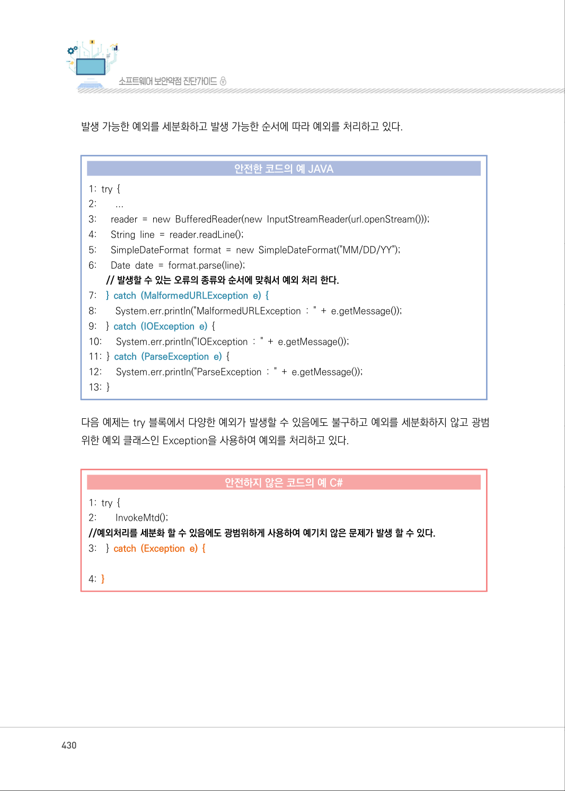
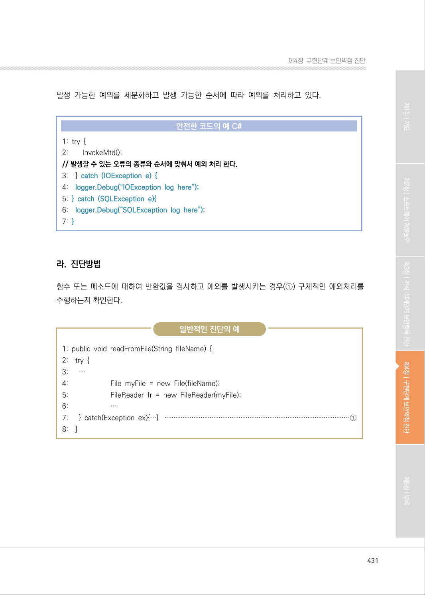
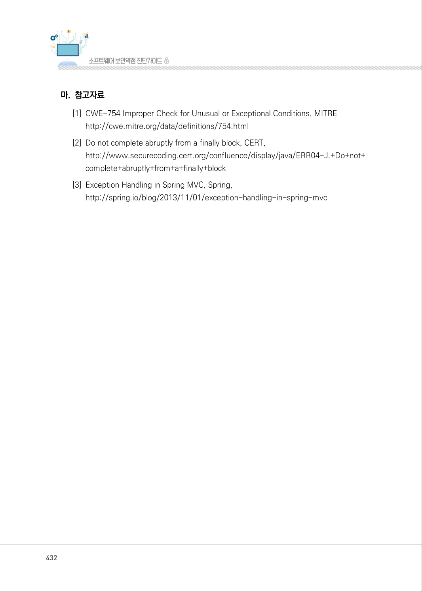

# 3. 부적절한 예외 처리

> 변환 안내(원문 외): 아래 본문은 PDF 텍스트를 추출한 전사입니다. 코드 줄번호·특수 공백·원문 오류를 유지했습니다. 실행용 코드가 아닙니다. 표·그림·들여쓰기는 연결된 페이지 이미지와 대조하세요. 페이지 경계의 줄바꿈을 보존하며, 동일 페이지가 여러 항목에 나뉘면 각 항목의 본문은 해당 구간만 포함합니다.

### PDF 429페이지 / 인쇄 429페이지

<!-- source-page:SW-Diagnosis-2021:429; source-lines:0,2,3,4,5,6,7,8,9,10,11,12,13,14,15,16,17,18,19,20,21,22,23,24,25,26,27,28 -->

429

#### 3. 부적절한 예외 처리

#### 가. 개요

프로그램 수행 중에 함수의 결과값에 대한 적절한 처리 또는 예외상황에 대한 조건을 적절하게 검사
하지 않을 경우, 예기치 않은 문제를 야기할 수 있다.

#### 나. 보안대책

값을 반환하는 모든 함수의 결과값을 검사하여, 그 값이 의도했던 값인지 검사하고, 예외 처리를 사용 
하는 경우에 광범위한 예외 처리 대신 구체적인 예외 처리를 수행한다.

#### 다. 코드예제

다음 예제는 try 블록에서 다양한 예외가 발생할 수 있음에도 불구하고 예외를 세분화하지 않고 광범
위한 예외 클래스인 Exception을 사용하여 예외를 처리하고 있다.

#### 안전하지 않은 코드의 예 JAVA

```java
1: try {
2:      ...
3:    reader = new BufferedReader(new InputStreamReader(url.openStream()));
4:    String line = reader.readLine(); 
5:    SimpleDateFormat format = new SimpleDateFormat("MM/DD/YY"); 
6:    Date date = format.parse(line);
//예외처리를 세분화 할 수 있음에도 광범위하게 사용하여 예기치 않은 문제가 발생 할 수 있다.
7: } catch (Exception e) {
8:      System.err.println("Exception : " + e.getMessage());
9: }
```

<details><summary>원본 페이지 이미지 (변환 외 보존 자료)</summary>


</details>

### PDF 430페이지 / 인쇄 430페이지

<!-- source-page:SW-Diagnosis-2021:430; source-lines:0,1,2,3,4,5,6,7,8,9,10,11,12,13,14,15,16,17,18,19,20,21,22,23,24,25,26,27,28,29,30,31,32,33,34,35,36 -->

430

발생 가능한 예외를 세분화하고 발생 가능한 순서에 따라 예외를 처리하고 있다.

#### 안전한 코드의 예 JAVA

```java
1: try {
2:        ...
3:      reader = new BufferedReader(new InputStreamReader(url.openStream()));
4:      String line = reader.readLine(); 
5:      SimpleDateFormat format = new SimpleDateFormat("MM/DD/YY");
6:      Date date = format.parse(line);
// 발생할 수 있는 오류의 종류와 순서에 맞춰서 예외 처리 한다.
7:    } catch (MalformedURLException e) {
8:        System.err.println("MalformedURLException : " + e.getMessage());
9:    } catch (IOException e) {
10:      System.err.println("IOException : " + e.getMessage());
11: } catch (ParseException e) {
12:      System.err.println("ParseException : " + e.getMessage());
13: }
```

다음 예제는 try 블록에서 다양한 예외가 발생할 수 있음에도 불구하고 예외를 세분화하지 않고 광범
위한 예외 클래스인 Exception을 사용하여 예외를 처리하고 있다.

#### 안전하지 않은 코드의 예 C#

```csharp
1: try {
2:        InvokeMtd(); 
//예외처리를 세분화 할 수 있음에도 광범위하게 사용하여 예기치 않은 문제가 발생 할 수 있다.
3:    } catch (Exception e) {
4: }
```

<details><summary>원본 페이지 이미지 (변환 외 보존 자료)</summary>



</details>

### PDF 431페이지 / 인쇄 431페이지

<!-- source-page:SW-Diagnosis-2021:431; source-lines:0,1,2,3,4,5,6,7,8,9,10,11,12,13,14,15,16,17,18,19,20,21,22,23,24,25,26,27,28,29,30,31,32,33,34 -->

431

제4장구현단계 보안약점 진단

발생 가능한 예외를 세분화하고 발생 가능한 순서에 따라 예외를 처리하고 있다.

#### 안전한 코드의 예 C#

```csharp
1: try { 
2:        InvokeMtd(); 
// 발생할 수 있는 오류의 종류와 순서에 맞춰서 예외 처리 한다.
3:    } catch (IOException e) {
4:    logger.Debug(“IOException log here”); 
5: } catch (SQLException e){
6:    logger.Debug(“SQLException log here”);
7: }
```

#### 라. 진단방법

함수 또는 메소드에 대하여 반환값을 검사하고 예외를 발생시키는 경우(①) 구체적인 예외처리를 
수행하는지 확인한다.

일반적인 진단의 예

```text
1: public void readFromFile(String fileName) { 
2:    try { 
3:      … 
4:                       File myFile = new File(fileName); 
5:                       FileReader fr = new FileReader(myFile); 
6:                       …
7:      } catch(Exception ex){…} ······································································································①
8:    }
```

<details><summary>원본 페이지 이미지 (변환 외 보존 자료)</summary>



</details>

### PDF 432페이지 / 인쇄 432페이지

<!-- source-page:SW-Diagnosis-2021:432; source-lines:0,1,2,3,4,5,6,7,8 -->

432

#### 마. 참고자료

[1] CWE-754 Improper Check for Unusual or Exceptional Conditions, MITRE

http://cwe.mitre.org/data/definitions/754.html 
[2] Do not complete abruptly from a finally block, CERT,

http://www.securecoding.cert.org/confluence/display/java/ERR04-J.+Do+not+
complete+abruptly+from+a+finally+block 
[3] Exception Handling in Spring MVC, Spring,

http://spring.io/blog/2013/11/01/exception-handling-in-spring-mvc

<details><summary>원본 페이지 이미지 (변환 외 보존 자료)</summary>



</details>

### PDF 433페이지 / 인쇄 433페이지

<!-- source-page:SW-Diagnosis-2021:433; source-lines:1 -->

제4장구현단계 보안약점 진단

<details><summary>원본 페이지 이미지 (변환 외 보존 자료)</summary>


</details>

---

## 탐색 링크 (원문 외)

[통합 인덱스](../../../INDEX.md)

