# 1. Null Pointer 역참조

> 변환 안내(원문 외): 아래 본문은 PDF 텍스트를 추출한 전사입니다. 코드 줄번호·특수 공백·원문 오류를 유지했습니다. 실행용 코드가 아닙니다. 표·그림·들여쓰기는 연결된 페이지 이미지와 대조하세요. 페이지 경계의 줄바꿈을 보존하며, 동일 페이지가 여러 항목에 나뉘면 각 항목의 본문은 해당 구간만 포함합니다.

### PDF 433페이지 / 인쇄 433페이지

<!-- source-page:SW-Diagnosis-2021:433; source-lines:0,5,6,7,8,9,10,11,12,13,14,15,16,17,18,19,20,21,22,23,24,25,26,27,28,29,30 -->

433

#### 1. Null Pointer 역참조

#### 가. 개요

널 포인터(Null Pointer) 역참조는 ‘일반적으로 그 객체가 널(Null)이 될 수 없다’라고 하는 가정을 
위반했을 때 발생한다. 공격자가 의도적으로 널 포인터 역참조를 발생시키는 경우, 그 결과 발생하는 
예외 상황을 이용하여 추후의 공격을 계획하는 데 사용될 수 있다.

#### 나. 보안대책

널이 될 수 있는 레퍼런스(Reference)는 참조하기 전에 널 값인지를 검사하여 안전한 경우에만 사용
한다.

#### 다. 코드예제

다음의 예제의 경우 obj가 null이고, elt가 null이 아닌 경우 널(Null) 포인터 역참조가 발생한다.

#### 안전하지 않은 코드의 예 JAVA

```java
1: public static int cardinality (Object obj, final Collection col) { 
2:      int count = 0; 
3:      if (col == null) { 
4:           return count; 
5:      }
6:      Iterator it = col.iterator();
7:      while (it.hasNext()) { 
8:         Object elt = it.next();
```

<details><summary>원본 페이지 이미지 (변환 외 보존 자료)</summary>

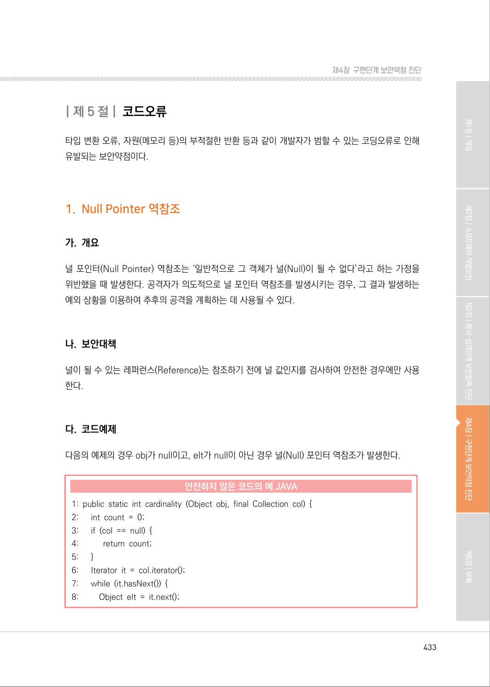

</details>

### PDF 434페이지 / 인쇄 434페이지

<!-- source-page:SW-Diagnosis-2021:434; source-lines:0,1,2,3,4,5,6,7,8,9,10,11,12,13,14,15,16,17,18,19,20,21,22,23,24,25,26,27,28,29,30,31,32,33,34,35,36,37,38,39,40,41,42,43,44,45,46,47,48 -->

434

#### 안전하지 않은 코드의 예 JAVA

```java
//obj가 null이고 elt가 null이 아닐 경우, Null.equals 가 되어 널(Null) 포인터 역참조가 발생한다.
9:           if ((null == obj && null == elt) || obj.equals(elt)) { 
10:             count++; 
11:         }
12:      }
13:      return count;
14: }
```

obj가 null인지 검사 후 참조해야 한다.

#### 안전한 코드의 예 JAVA

```java
1: public static int cardinality (Object obj, final Collection col) { 
2:      int count = 0; 
3:      if (col == null) { 
4:           return count; 
5:      }
6:      Iterator it = col.iterator();
7:      while (it.hasNext()) { 
8:         Object elt = it.next();
//obj가 null이 아닌 경우에만 obj.equal를 실행한다.
9:         if ((null == obj && null == elt) || (null != obj && obj.equals(elt))) {
10:             count++; 
11:        }
12:    }
13:    return count; 
14:}
```

다음 예제의 경우 request.getParameter에 의해 null이 들어오게 되면 널(Null) 포인터 역참조가 
발생한다.

#### 안전하지 않은 코드의 예 JAVA

```java
1: String url = reuqest.getParamter("url");
2: //url 에 null이 들어오면 널(Null) 포인터 역참조가 발생한다.
3: if (url.equals(""))
```

<details><summary>원본 페이지 이미지 (변환 외 보존 자료)</summary>

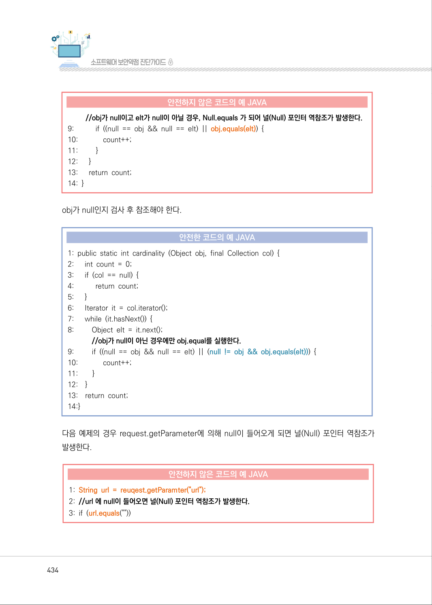

</details>

### PDF 435페이지 / 인쇄 435페이지

<!-- source-page:SW-Diagnosis-2021:435; source-lines:0,1,2,3,4,5,6,7,8,9,10,11,12,13,14,15,16,17,18,19,20,21,22,23,24,25,26,27,28,29,30,31,32,33,34,35,36,37,38,39,40,41,42 -->

435

제4장구현단계 보안약점 진단

null을 가질 수 있는 참조 변수를 사용해 객체의 속성이나 메소드를 사용하는 경우 null 검사를 수행 
하고 사용한다.

#### 안전한 코드의 예 JAVA

```java
1: String url = reuqest.getParamter("url");
2: //null값을 가지는 참조 변수를 사용할 경우, null 검사를 수행하고 사용한다.
3: if ( url != null || url.equals("") )
```

다음 예제의 경우 Request 객체에서 QeuryString을 사용하여 url의 파라미터 중 name에 해당하는 
값을 가져오는 코드이다. url의 파라미터에 name이 없으면 QueryString[“name”]은 null을 리턴
하게 되고, username은 null 값을 가지게 되어 널(Null) 포인터 역참조가 발생한다.

#### 안전하지 않은 코드의 예 C#

```csharp
1: protected void Page_Load(object sender, EventArgs e) { 
2:    // url 파라미터에 name이 없으면 username은 null 값을 가지게 된다.
3:    string username = Request.QueryString[“name”];
4:    // null 값을 가지는 username을 참조하여 널(Null) 포인터 역참조가 발생한다.
5:    if (username.Length > 20) { 
6:        // length error 
7:    }
8: }
```

null을 가질 수 있는 참조 변수를 사용해 객체의 속성이나 메소드를 사용하는 경우 null 검사를 수행
하고 사용한다.

#### 안전한 코드의 예 C#

```csharp
1: protected void Page_Load(object sender, EventArgs e) { 
2:    // url 파라미터에 name 이 없으면 username은 null 값을 가지게 된다.
3:    string username = Request.QueryString[“name”];
4:    // null 값을 가지는 username을 참조하기 전에 null 검사를 수행하므로 안전하다.
5:    if ( username != null && username > 20) {
6:      // length error
7:    }
8: }
```

<details><summary>원본 페이지 이미지 (변환 외 보존 자료)</summary>

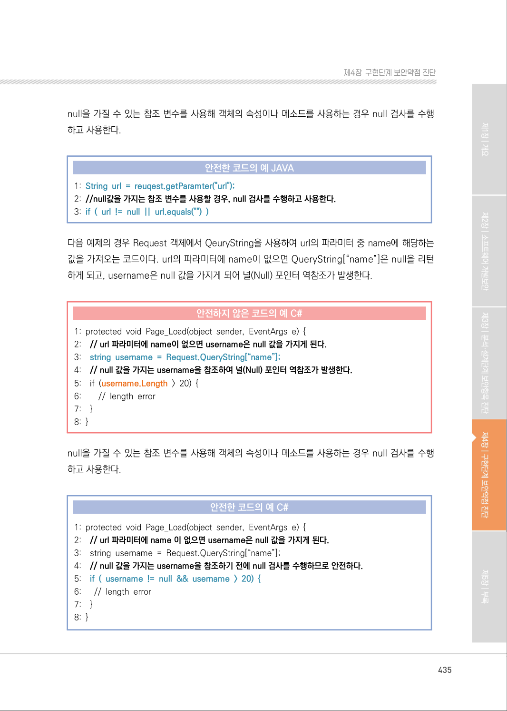

</details>

### PDF 436페이지 / 인쇄 436페이지

<!-- source-page:SW-Diagnosis-2021:436; source-lines:0,1,2,3,4,5,6,7,8,9,10,11,12,13,14,15,16,17,18,19,20,21,22,23,24,25,26,27,28,29,30,31,32,33,34 -->

436

아래 C 코드는 null 값을 반환할 수 있는 함수 IntegerAddressReturn()을 호출한다. P가 null인 
상태에서 p 값을 참조하면 널 포인터 역참조가 발생한다.

#### 안전하지 않은 코드의 예 C

```c
1: void NullPointerDereference(int count) { 
// IntegerAddressReturn()이 0을 return 하면 p는 null 값을 가지게 된다.
2: int *p = IntegerAddressReturn();
// null 값을 가지는 p 값을 참조하여 널(Null) 포인터 역참조가 발생한다.
3:    *p = count;
4: }
```

아래 C 코드는 null 값을 가질 수 있는 p를 참조하기 전에 null 검사를 진행하므로 안전한다.

#### 안전한 코드의 예 C

```c
1: void NullPointerDereference(int count) { 
// IntegerAddressReturn()이 0을 return 하면 p는 null 값을 가지게 된다. 
2:    int *p = IntegerAddressReturn(); 
// 참조하기전에 null 검사를 수행하므로 안전하다. 
3:    If(p != 0) *p = count;
```

#### 라. 진단방법

표현된 객체가 널(Null) 값이 될 수 있는지 확인한다. 만약 널(Null) 값이 될 수 있는지 체크하여 예외 
처리를 한 경우 안전으로 판단하고 널(Null) 체크를 하지 않은 경우 취약한 것으로 판단한다. (①)

일반적인 진단의 예

```text
1: … 
2: public void f() { 
3:    String cmd = System.getProperty(“cmd”); 
4:    // cmd가 널(null)인지 체크하지 않았다. 
5:    cmd = cmd.trim(); 
6:    System.out.println(cmd); ·········································································································①
7: …
```

<details><summary>원본 페이지 이미지 (변환 외 보존 자료)</summary>

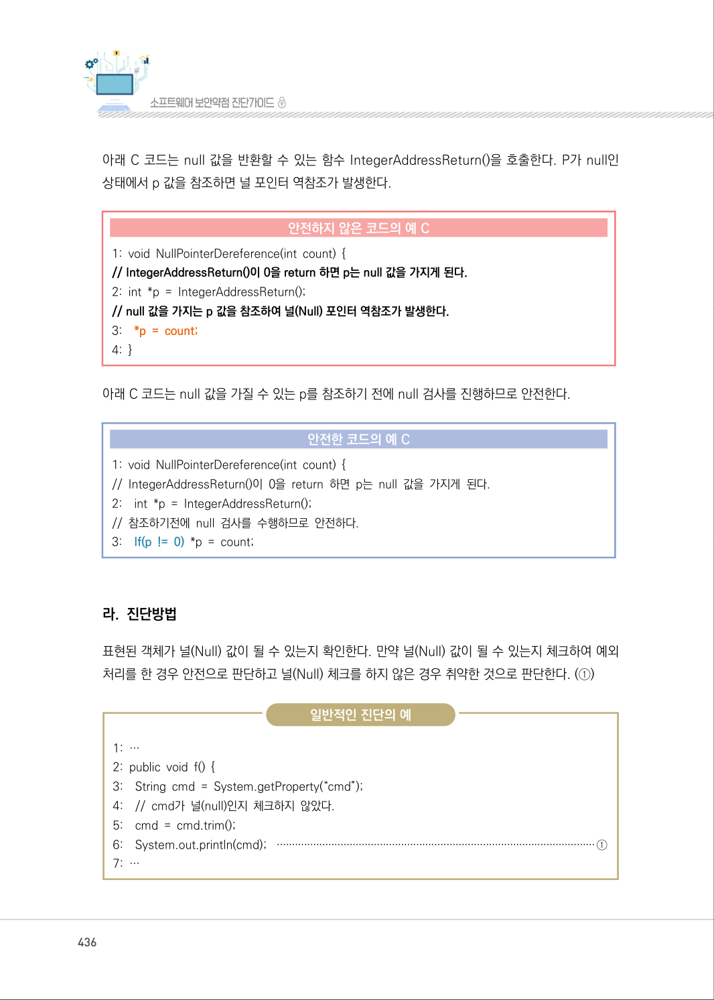

</details>

### PDF 437페이지 / 인쇄 437페이지

<!-- source-page:SW-Diagnosis-2021:437; source-lines:0,1,2,3,4,5,6,7,8,9,10,11,12,13,14,15,16,17,18,19,20,21,22,23,24,25,26,27,28,29,30,31,32,33,34,35,36 -->

437

제4장구현단계 보안약점 진단

※ (참고) 널(Null) 값이 될 가능성은 다음의 기준으로 확인

- 초기값이 널(Null)로 할당된 값은 널(Null)이 될 수 있음 
- 선언이 된 후 객체가 생성되지 않은 값은 널(Null)이 될 수 있음 
- 널(Null)인 객체로 필드 접근을 하거나/널(Null)인 객체에 메소드 호출을 할 경우 결과 값은 

널(Null)이 될 수 있음
- 문자열 등 ‘널(Null)이 될 수 있는(Nullable)’ 객체들의 연산 결과 값은 널(Null)이 될 수 있음

변수를 널(Null)로 초기화 한 후 값을 대입하지 못하는 경우에 해당 변수를 참조하면 널(Null) 포인터 
역참조가 발생한다.

다음의 예제는 3번째 라인에서 널(Null)로 초기화 한 이후에 14번째 라인에서 널(Null)값인 vmrs 값을 
참조하고 있다. 이 경우는 조건문 등에 의해 분기가 이루어지면서 널(Null)로 초기화된 변수가 초기화 
되지 않는 경우이다.

정탐코드의 예

```text
1: public Hashtable deleteAll(Connection con, GenericModel model) throws Exception {
2:    Hashtable<String, Object> m = new Hashtable<String, Object>();
3:    VMResultSet vmrs = null;
4: int rValue = 0;
5: try {
6: ArrayList grid =null ; 
7: ….
8: con.commit(); 
9: con.setAutoCommit(true); 
10:if(rValue > 0) { 
11:vmrs = dao.listGoodKnowQuestion(con, model); 
12:vmrs.setMessage(UtilMsg.getInstance().getMsg(“SUC003”)); 
13:} else { 
14:vmrs.setMessage(UtilMsg.getInstance().getMsg(“ERR000”)); 
15:} 
16:m.put(“result”, vmrs); 17: } catch (Exception e) { 18: …. 
19:} finally { 
20:….
21:}
22:return m;
23:}
```

<details><summary>원본 페이지 이미지 (변환 외 보존 자료)</summary>

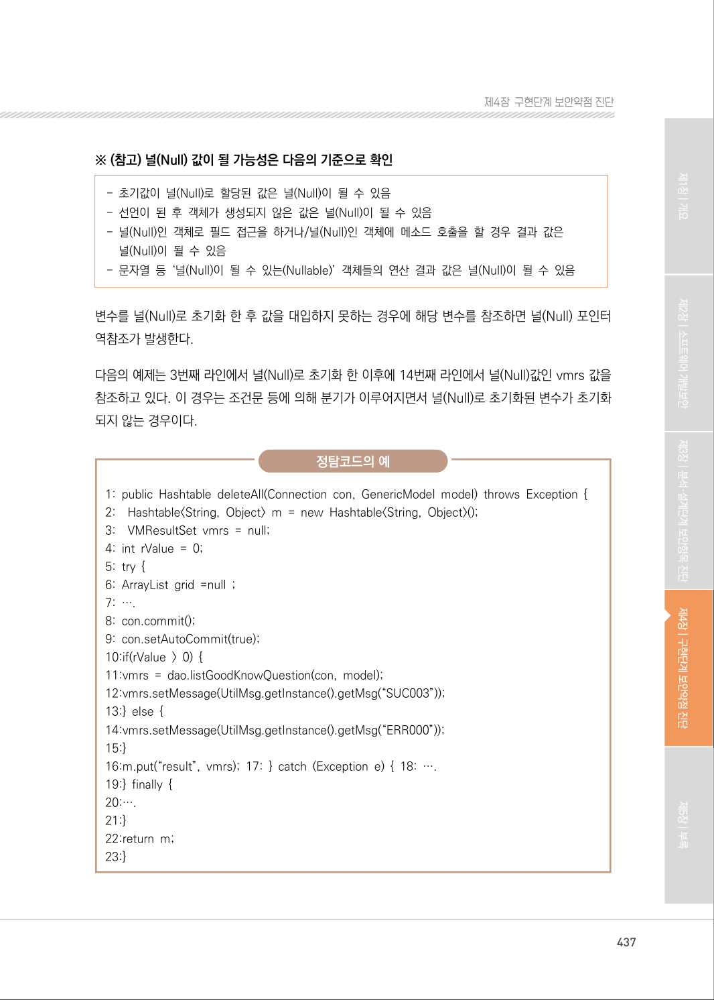

</details>

### PDF 438페이지 / 인쇄 438페이지

<!-- source-page:SW-Diagnosis-2021:438; source-lines:0,1,2,3,4,5,6,7,8,9,10,11,12,13,14,15,16,17,18,19,20,21,22,23,24,25,26,27,28,29,30,31,32,33,34,35,36,37,38,39,40,41,42,43,44,45,46,47,48,49,50,51,52,53,54,55,56,57,58,59 -->

438

다른 유형으로 자주 발생하는 경우는 database의 Connection, Statement 등의 자원을 사용한 
후에 해제하는 과정에서 해당 자원이 널(Null) 인지 확인하지 않는 경우이다.

다음의 예제에서는 4번째 라인에서 Statement를 널(Null)로 초기화하고 있고 85번째 라인에서 
예외가 발생하면 10번 라인의 Statement의 값을 대입하지 못하고 20번의 finally 문으로 분기한 후 
25번 라인이 실행되면서 널(Null) 값을 참조하게 된다.

정탐코드의 예

```text
1: private static void makeList() {
2:    Connection con = null; 
3:    StringBuffer sql = new StringBuffer(); 
4:        PreparedStatement statement = null; 
5:        ResultSet rs = null; 
6:        list.clear(); 
7:        try { 
8:           con = GenericDAO.getDataSource().getConnection();
9:        ……..
10:      statement = con.prepareStatement(sql.toString());
11:      rs = statement.executeQuery();
12:      while (rs.next()) {
13:        String authGrp = rs.getString(“AUTHORITY_GROUP”);
14:        …….
15:      }
16:    } catch (Exception e) {
17:      if (verbose) {
18:        ………..
19:      }
20:    } finally {
21:      try {
22:        rs.close();
23:      } catch (Exception e1) {}
24:      try {
25:        statement.close();
26:      } catch (Exception e1) {}
27:        if (con != null) {
```

<details><summary>원본 페이지 이미지 (변환 외 보존 자료)</summary>

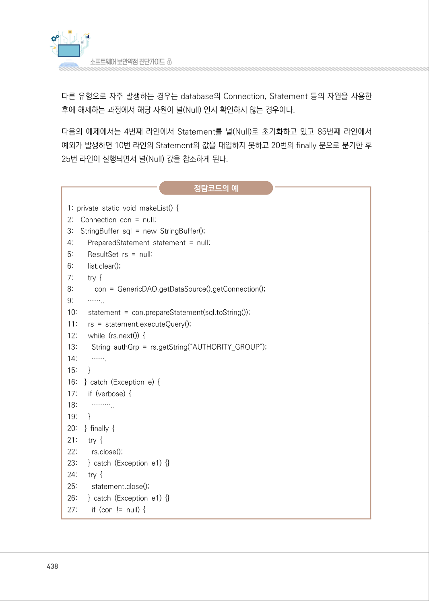

</details>

### PDF 439페이지 / 인쇄 439페이지

<!-- source-page:SW-Diagnosis-2021:439; source-lines:0,1,2,3,4,5,6,7,8,9,10,11,12,13,14,15,16,17,18,19,20,21,22,23,24,25,26,27,28,29,30,31,32,33,34 -->

439

제4장구현단계 보안약점 진단

정탐코드의 예

```text
28:        try {
29:         con.close();
30:        } catch (SQLException e) {
31:         e.printStackTrace();
32:      }
33:    }
34: }
35:}
```

enter2br()에서 data가 널(Null)일 경우 널(Null)을 리턴하기 때문에 strContent가 널(Null) 값을 
가질 가능성이 존재한다. 따라서 5번 라인에서 널(Null) Pointer 역참조가 발생할 수 있기 때문에 
취약하다고 판정한다.

정탐코드의 예

```text
1: [program_view.jsp] 
2: …
3: String strContent = UTIL.enter2br((String)hsROW.get(“content”)); 
4: String linkPage= “”; 
5: if (!strContent.equals(“”)) { 
6: linkPage = strContent.replaceAll(“상세보기”, “<summary>원본 페이지 이미지 (변환 외 보존 자료)</summary>

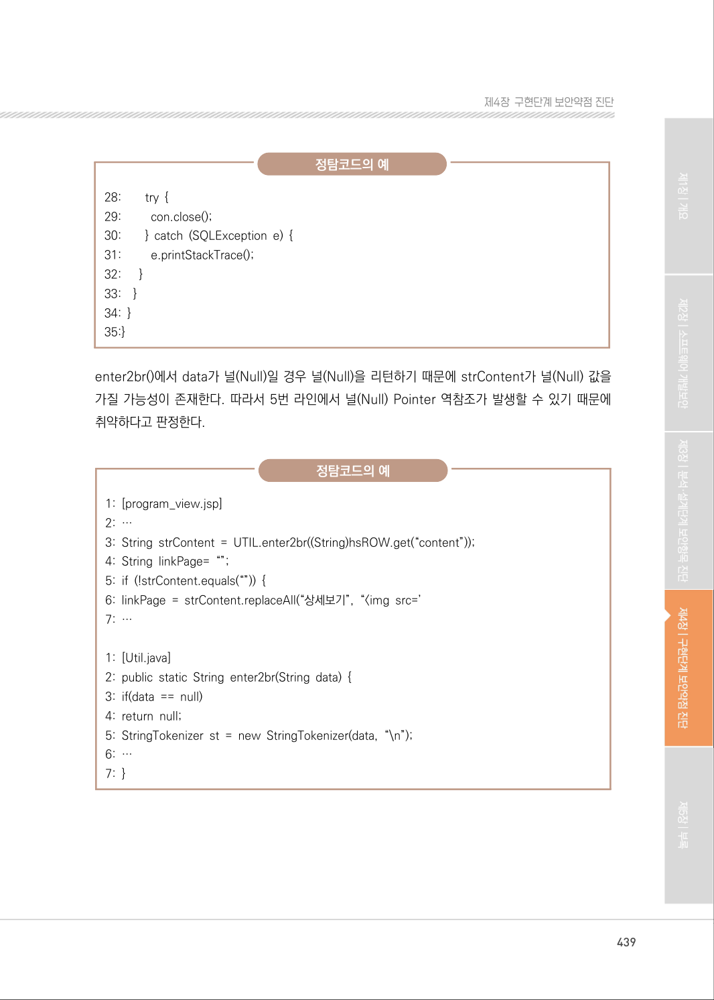

</details>

### PDF 440페이지 / 인쇄 440페이지

<!-- source-page:SW-Diagnosis-2021:440; source-lines:0,1,2,3,4,5,6,7,8,9,10,11,12,13,14,15,16,17,18,19,20,21,22,23,24,25,26,27,28,29,30,31,32,33,34,35,36 -->

440

널(Null) 검사를 수행하였으나, 조건문에서 널(Null) 객체를 참조하는 구문을 먼저 비교하여 널(Null) 
Pointer 역참조가 발생하여 취약하다고 판정한다.

정탐코드의 예

1:

1: if ( str.length() == 0 || str == null )

Interface Iteration은 널(Null)을 리턴하지 않는데 널(Null) 포인터 역참조를 탐지 해 내는 경우나, 
함수의 설계상 널(Null)을 리턴 하지 않도록 정의되어 있는 함수의 리턴 값을 참조할 경우에는 
널(Null) 포이터 역참조가 발생하지 않는다. 이를 확인하기 위해서는 함수의 Java document를 
유의 깊게 살펴보아야 한다. 함수의 리턴 값에 대한 기술되어 있는 Javadoc을 참조해서 코드를 검토 
하여야 한다.

오탐코드의 예

```text
1:    String Tokenizer st = new String Tokenizer(info_url,”?”); 
2:    int sti=0;
3:    while (st.hasMoreTokens()) {
4:      if(sti==0)
5:      jsonUrl=st.nextToken(); 
6:      if(sti==1) 
7:      jsparam=st.nextToken(); 
8:      sti++; 
9: }
10:String [] jsonParams = jsparam.split(“&”); 
11:jsparam=””; 
12:for (int i=0;i<jsonParams.length;i++) { 
13: jsparam=jsparam+jsonParams[i].split(“=”)[0]+”: ‘”+jsonParams[i].split(“=”)[1]+”’”;
14: if(i!=jsonParams.length-1)jsparam=jsparam+”,”; 
15:} 
```

try ~ catch 문에서 throw를 하는 경우 catch 절 이후는 실행되지 않음으로 널(Null) 포인터 역참조가 
발생하지 않는다.

<details><summary>원본 페이지 이미지 (변환 외 보존 자료)</summary>

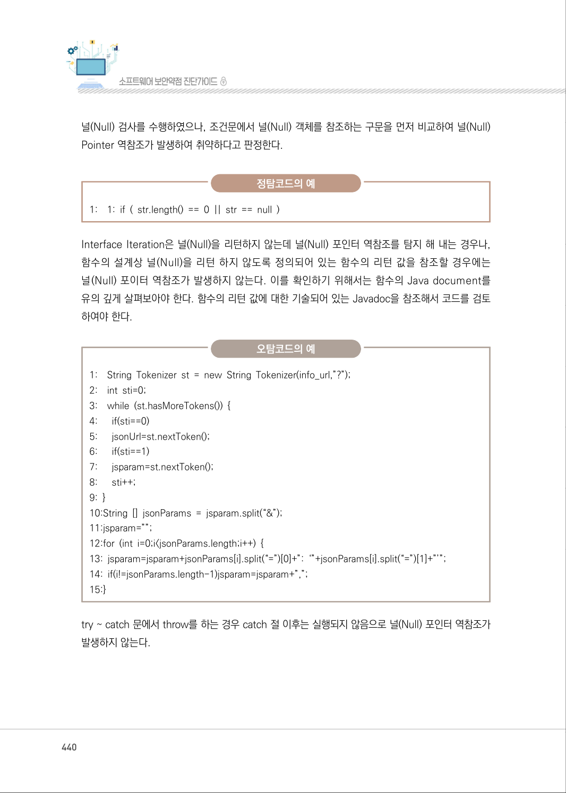

</details>

### PDF 441페이지 / 인쇄 441페이지

<!-- source-page:SW-Diagnosis-2021:441; source-lines:0,1,2,3,4,5,6,7,8,9,10,11,12,13,14,15,16,17,18,19,20,21,22,23,24,25,26,27,28,29,30,31,32,33,34,35,36,37,38,39,40,41,42,43,44,45,46,47,48,49 -->

441

제4장구현단계 보안약점 진단

다음의 예제에서 System.out.println(“After Throw 1”);은 실행되지 않는다.

오탐코드의 예

```text
1: public static void testFunction(String dateStr1) throws Exception { 
2:    SimpleDateFormat sdf = new SimpleDateFormat(“yyyyMMdd”,Locale.getDefault());
3:    Date date1 = null;
4:    try {
5:      date1 = sdf.parse(dateStr1);
6:    } catch (ParseException e) {
7:      System.err.println(“Inner Function”);
8:      e.printStackTrace();
9:      thrownew Exception(e);
10:    }
11:    System.out.println(“After Throw 1”);
12:    int days1 = (int)((date1.getTime()/100000)/24);
13:    System.out.println(“After Throw 2”);
14:    }
```

다음의 예제에서 intdays1 = (int)((date1.getTime()/100000)/24);에서 data1이 널(Null)일 경우, 
널 (Null) 포인터 역참조가 발생하고 다음 단계로 진행되지 않게 된다. 이러한 이유로 intdays2 = (int) 
((date1.getTime()/100000)/24); 문은 실행되지 않으며 널(Null)을 참조하지 않게 된다.

오탐코드의 예

```text
1:SimpleDateFormat sdf = new SimpleDateFormat(“yyyyMMdd”,Locale.getDefault());
2:Date date1 = null; 
3:try { 
4:date1 = sdf.parse(dateStr1); 
5:} catch (ParseException e) { 
6:System.err.println(“Inner Function”); 
7:e.printStackTrace(); 
8:} 
9:    System.out.println(“After Throw 1”); 
10:intdays1 = 
(int)((date1.getTime()/100000)/24);
11: intdays2
= (int)((date1.getTime()/100000)/24); 12:
System.out.println(“After Throw 2”); 
```

<details><summary>원본 페이지 이미지 (변환 외 보존 자료)</summary>

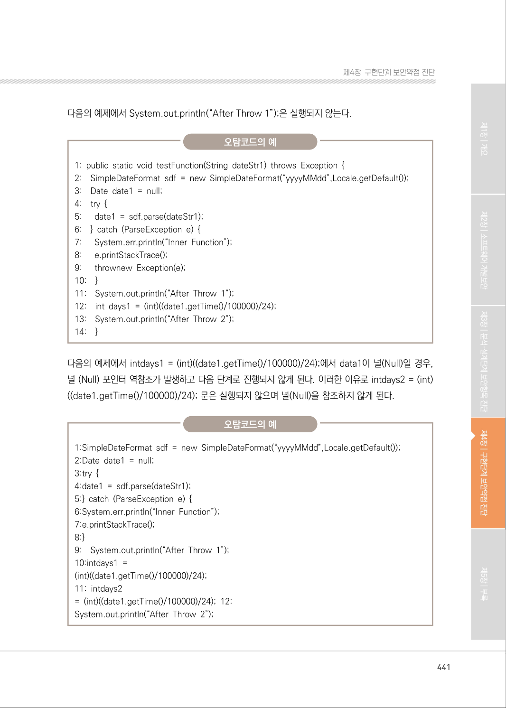

</details>

### PDF 442페이지 / 인쇄 442페이지

<!-- source-page:SW-Diagnosis-2021:442; source-lines:0,1,2,3,4,5,6,7,8,9,10,11,12,13,14,15,16,17,18,19,20,21,22,23,24,25,26,27,28,29,30,31 -->

442

다음과 같은 조건은 앞의 널(Null) 체크 조건이 참이면 뒤의 OR 조건은 판단하지 않는다. 그러므로 
뒤의 문장에서 널(Null) 포이터 역참조는 발생하지 않는다.

오탐코드의 예

```text
1: if (a == null || a.length() == 0) { 
2:                                                             // 처리한다.
3: }
```

다음의 예제에서는 catch 절안에서 return 하고 있으므로 예외가 발생하여 f에 값을 넣지 못하더라도 
f.write0는 실행되지 않는다.

오탐코드의 예

```text
1:    FileOutputStream f = null; 
2:    try {
3:      f = new FileOutputStream(“toctou”); 
4:      f.write(); 
5: } catch (FileNotFoundException e) { 
6:      // TODO Auto-generated catch block 
7:      e.printStackTrace();
8: }
```

다음의 예제에서는 JSP 내장 객체를 참조하고 있다. 이 경우에는 널(Null) 포인터 역참조가 발생하지 
않는다.

오탐코드의 예

1:

&lt;td align=”center” colspan=’2’&gt;&lt;input type=’button’ value=’다시로그인’ 
onclick=”loca-
tion.href=’${pageContext.request.contextPath}/utl/sec/certLogin.do’”&gt;&lt;/td&gt;

<details><summary>원본 페이지 이미지 (변환 외 보존 자료)</summary>

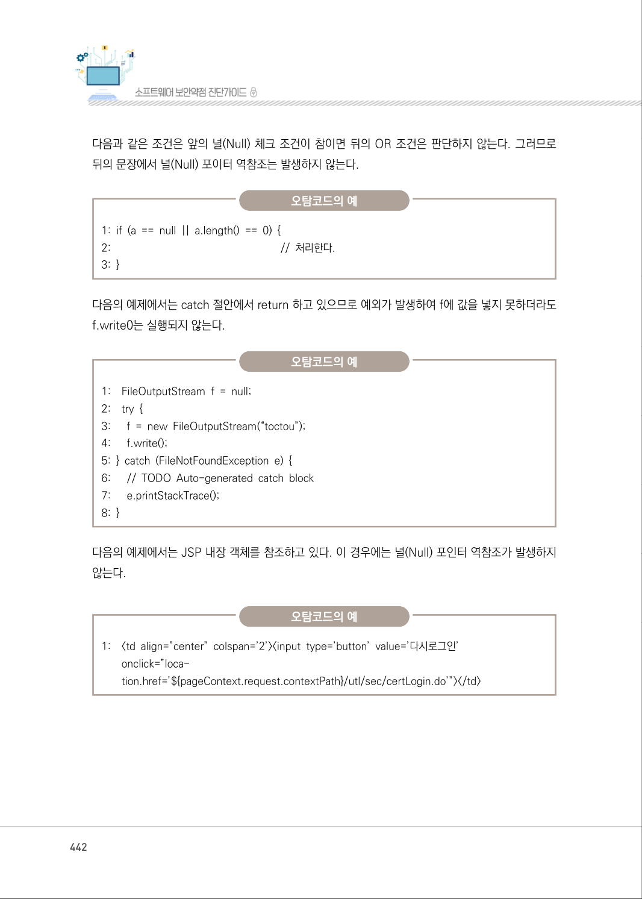

</details>

### PDF 443페이지 / 인쇄 443페이지

<!-- source-page:SW-Diagnosis-2021:443; source-lines:0,1,2,3,4,5,6,7,8,9,10,11,12,13,14,15,16,17,18,19,20,21,22,23,24,25,26,27,28,29,30,31,32,33,34,35,36,37,38,39,40,41,42,43,44,45,46 -->

443

제4장구현단계 보안약점 진단

다음과 같은 Integer 클래스의 static 함수호출은 Integer가 객체가 아니므로 널(Null)값을 참조하지 
않는다.

오탐코드의 예

1:

1: Integer.parseInt(stringValue); 

다음과 같이 Data Flow 상이 아닌 단일 함수에서 파라미터가 널(Null)일 경우는 취약하지 않은 것으로 
판단한다. 해당 함수를 호출할 때 널(Null) 체크를 하도록 해야 한다.

오탐코드의 예

```text
1: …
2:      public SmsConnection sendRequsest(SmsConnection smsConn) throws
Exception
3:      // SMS 전송 요청 
4:      SmsSender sender = null; 
5:      SmsConnection result = null;
6:    try {
7:        sender = new SmsSender(smeConfigPath);
8:        sender.open();
9:        result = sendRequsest(smsConn, sender);
10:    } finally {
11:        if (sender != null) {
12:        sender.close();
13:        }
14:      }
15:    }
16:    smsConn.setResult(result.getResult());
17:    smsConn.setResultMessage(result.getResultMessage());
18:    return smsConn;
19:}
```

<details><summary>원본 페이지 이미지 (변환 외 보존 자료)</summary>

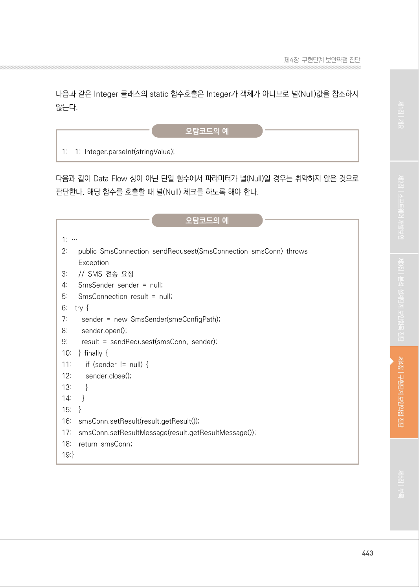

</details>

### PDF 444페이지 / 인쇄 444페이지

<!-- source-page:SW-Diagnosis-2021:444; source-lines:0,1,2,3,4,5,6,7,8,9,10,11,12,13,14,15,16,17,18,19,20,21,22,23,24,25,26,27,28 -->

444

JRE 기본 패키지 클래스의 생성자의 경우, 널(Null) 을 반환 할 수 있다고 명시되어 있지 않은한 널
(Null)을 리턴 한다고 판단하지 않는다.

오탐코드의 예

```text
1:    if(infoList == null) infoList = new ArrayList(); 
2:    for(int i=0; containers != null && i < containers.length; i++) { 
3:    hm = new HashMap(); 
4:    for(int j=0; j < paramRecvData.length; j++) { 
5:      hm.put(paramRecvData[j], containers[i].getField(paramRecvData[j]).getValueAs-
String()); 
6:    }
7:    infoList.add(hm); 
8:    }
```

#### 마. 참고자료

[1] CWE-476 NULL Pointer Dereference, MITRE,

http://cwe.mitre.org/data/definitions/476.html
[2] Do not dereference null pointers, CERT,

http://www.securecoding.cert.org/confluence/display/c/EXP34-C.+Do+not+der
eference+null+pointers
[3] Null Dereference, OWASP,

https://www.owasp.org/index.php/Null_Dereference

<details><summary>원본 페이지 이미지 (변환 외 보존 자료)</summary>

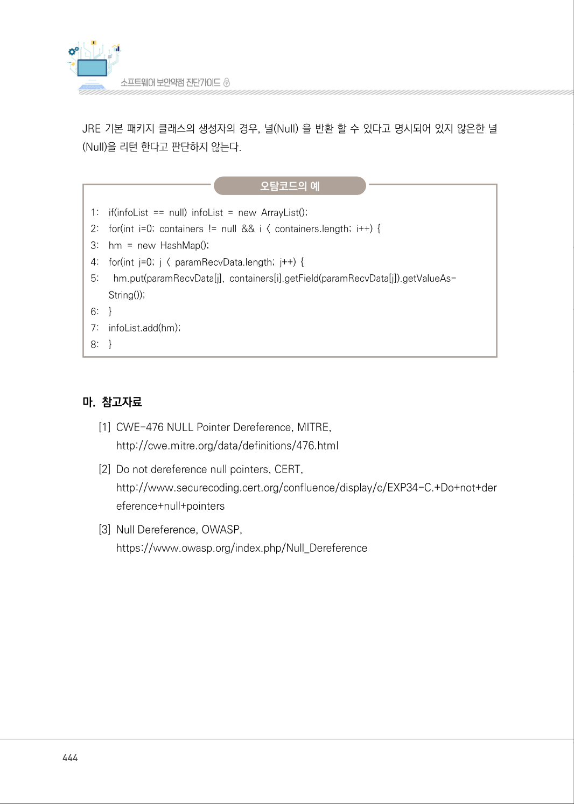

</details>

### PDF 445페이지 / 인쇄 445페이지

<!-- source-page:SW-Diagnosis-2021:445; source-lines:1 -->

제4장구현단계 보안약점 진단

<details><summary>원본 페이지 이미지 (변환 외 보존 자료)</summary>


</details>

---

## 탐색 링크 (원문 외)

[통합 인덱스](../../../INDEX.md)

