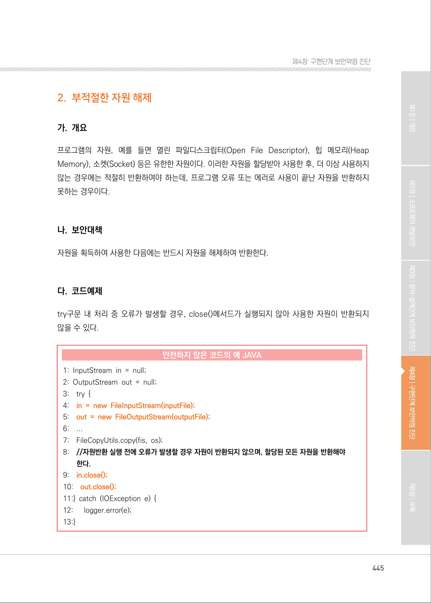
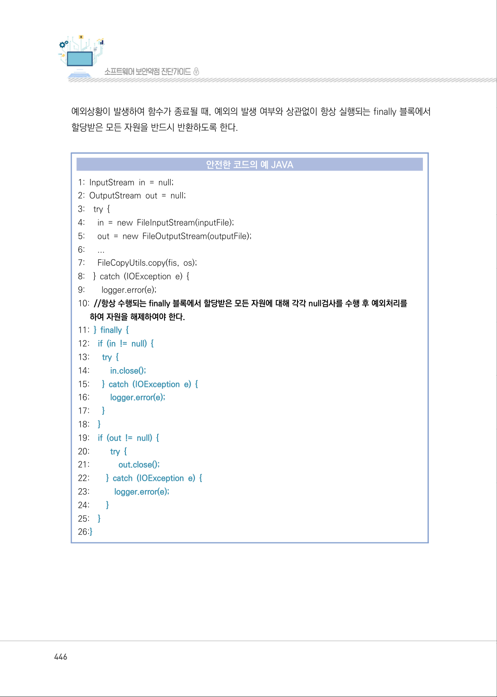
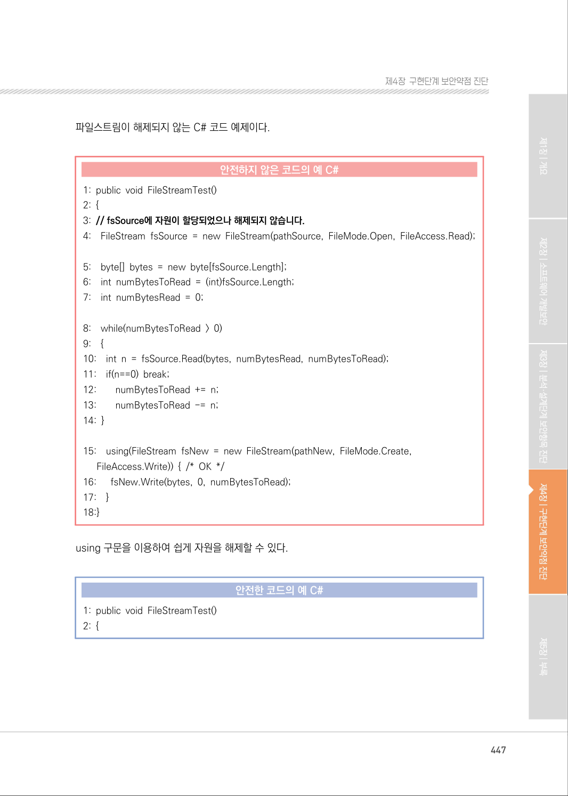
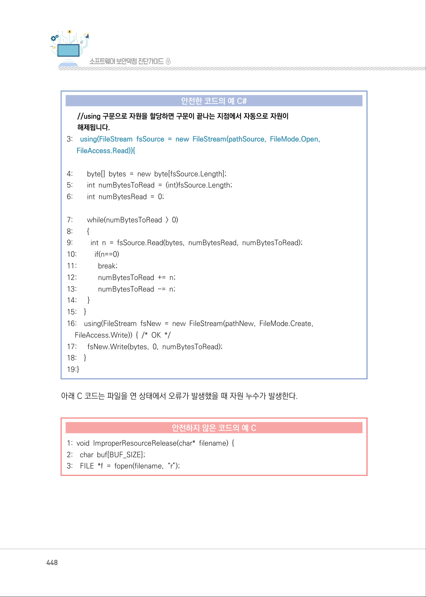
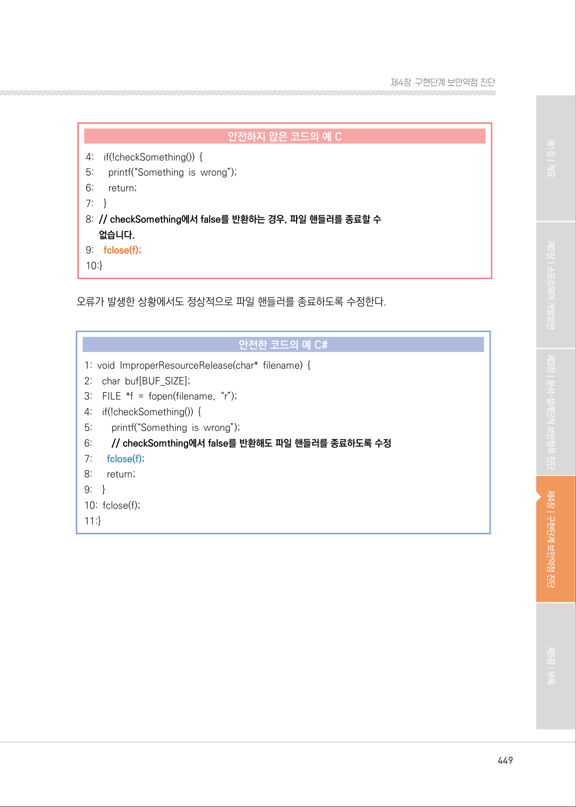
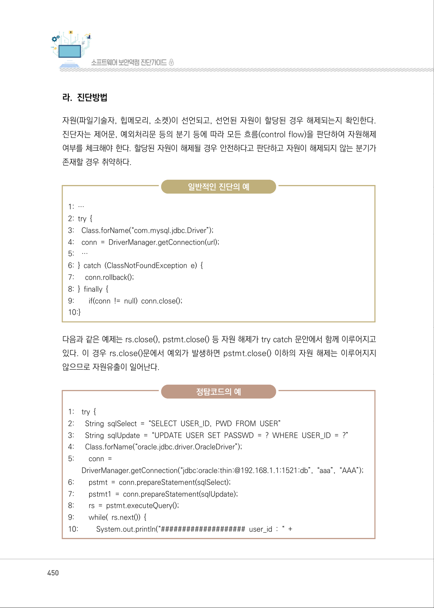
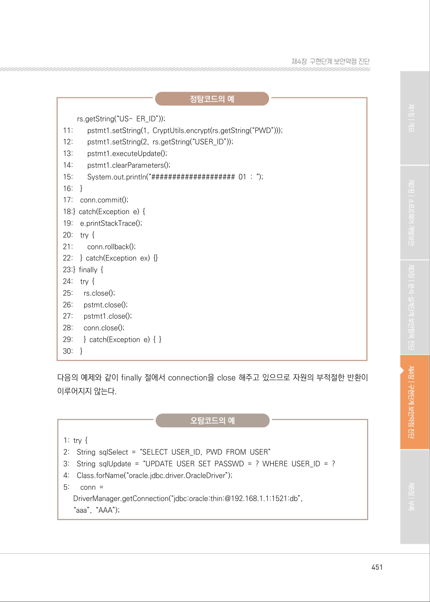
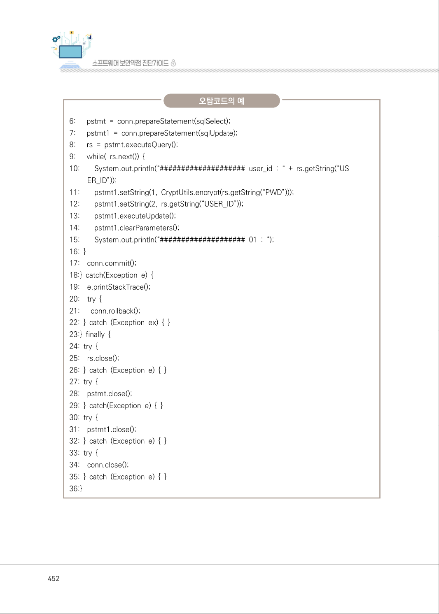
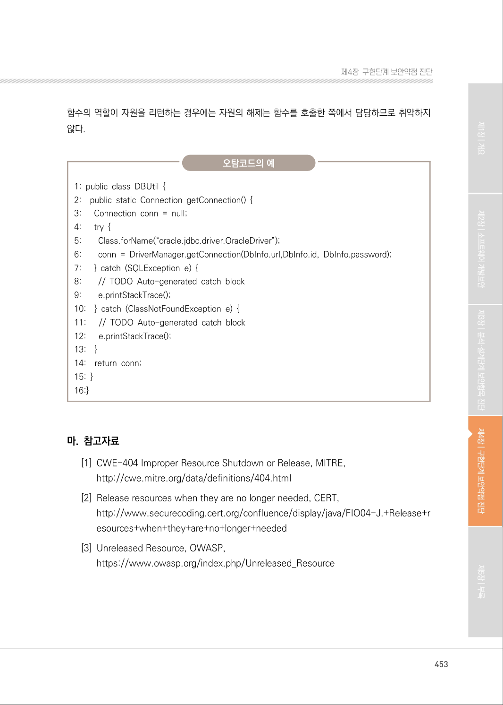

# 2. 부적절한 자원 해제

> 변환 안내(원문 외): 아래 본문은 PDF 텍스트를 추출한 전사입니다. 코드 줄번호·특수 공백·원문 오류를 유지했습니다. 실행용 코드가 아닙니다. 표·그림·들여쓰기는 연결된 페이지 이미지와 대조하세요. 페이지 경계의 줄바꿈을 보존하며, 동일 페이지가 여러 항목에 나뉘면 각 항목의 본문은 해당 구간만 포함합니다.

### PDF 445페이지 / 인쇄 445페이지

<!-- source-page:SW-Diagnosis-2021:445; source-lines:0,2,3,4,5,6,7,8,9,10,11,12,13,14,15,16,17,18,19,20,21,22,23,24,25,26,27,28,29,30,31,32,33,34,35,36 -->

445

#### 2. 부적절한 자원 해제

#### 가. 개요

프로그램의 자원, 예를 들면 열린 파일디스크립터(Open File Descriptor), 힙 메모리(Heap 
Memory), 소켓(Socket) 등은 유한한 자원이다. 이러한 자원을 할당받아 사용한 후, 더 이상 사용하지 
않는 경우에는 적절히 반환하여야 하는데, 프로그램 오류 또는 에러로 사용이 끝난 자원을 반환하지 
못하는 경우이다.

#### 나. 보안대책

자원을 획득하여 사용한 다음에는 반드시 자원을 해제하여 반환한다.

#### 다. 코드예제

try구문 내 처리 중 오류가 발생할 경우, close()메서드가 실행되지 않아 사용한 자원이 반환되지 
않을 수 있다.

#### 안전하지 않은 코드의 예 JAVA

```java
1: InputStream in = null;
2: OutputStream out = null; 
3:    try { 
4:    in = new FileInputStream(inputFile);
5:    out = new FileOutputStream(outputFile);
6:    ...
7:    FileCopyUtils.copy(fis, os); 
8:    //자원반환 실행 전에 오류가 발생할 경우 자원이 반환되지 않으며, 할당된 모든 자원을 반환해야 
한다.
9:    in.close();
10:    out.close();
11:} catch (IOException e) { 
12:      logger.error(e); 
13:}
```

<details><summary>원본 페이지 이미지 (변환 외 보존 자료)</summary>



</details>

### PDF 446페이지 / 인쇄 446페이지

<!-- source-page:SW-Diagnosis-2021:446; source-lines:0,1,2,3,4,5,6,7,8,9,10,11,12,13,14,15,16,17,18,19,20,21,22,23,24,25,26,27,28,29,30,31,32,33,34,35,36,37,38,39,40,41,42,43,44,45,46,47,48,49,50,51 -->

446

예외상황이 발생하여 함수가 종료될 때, 예외의 발생 여부와 상관없이 항상 실행되는 finally 블록에서 
할당받은 모든 자원을 반드시 반환하도록 한다.

#### 안전한 코드의 예 JAVA

```java
1: InputStream in = null; 
2: OutputStream out = null; 
3:    try { 
4:      in = new FileInputStream(inputFile);
5:      out = new FileOutputStream(outputFile); 
6:      ...
7:      FileCopyUtils.copy(fis, os); 
8:    } catch (IOException e) { 
9:        logger.error(e); 
10: //항상 수행되는 finally 블록에서 할당받은 모든 자원에 대해 각각 null검사를 수행 후 예외처리를 
하여 자원을 해제하여야 한다.
11: } finally {
12:    if (in != null) {
13:      try {
14:         in.close();
15:      } catch (IOException e) {
16:         logger.error(e);
17:      }
18:    }
19:    if (out != null) {
20:         try {
21:             out.close();
22:        } catch (IOException e) {
23:           logger.error(e);
24:        }
25:    }
26:}
```

<details><summary>원본 페이지 이미지 (변환 외 보존 자료)</summary>



</details>

### PDF 447페이지 / 인쇄 447페이지

<!-- source-page:SW-Diagnosis-2021:447; source-lines:0,1,2,3,4,5,6,7,8,9,10,11,12,13,14,15,16,17,18,19,20,21,22,23,24,25,26,27,28,29,30,31,32,33,34,35,36,37,38,39 -->

447

제4장구현단계 보안약점 진단

파일스트림이 해제되지 않는 C# 코드 예제이다.

#### 안전하지 않은 코드의 예 C#

```csharp
1: public void FileStreamTest() 
2: { 
3: // fsSource에 자원이 할당되었으나 해제되지 않습니다.
4:    FileStream fsSource = new FileStream(pathSource, FileMode.Open, FileAccess.Read);
5:    byte[] bytes = new byte[fsSource.Length]; 
6:    int numBytesToRead = (int)fsSource.Length; 
7:    int numBytesRead = 0; 
8:    while(numBytesToRead > 0) 
9:    {
10:    int n = fsSource.Read(bytes, numBytesRead, numBytesToRead);
11:    if(n==0) break;
12:        numBytesToRead += n;
13:        numBytesToRead -= n;
14: }
15:    using(FileStream fsNew = new FileStream(pathNew, FileMode.Create, 
FileAccess.Write)) { /* OK */ 
16:      fsNew.Write(bytes, 0, numBytesToRead);
17:    }
18:}
```

using 구문을 이용하여 쉽게 자원을 해제할 수 있다.

#### 안전한 코드의 예 C#

```csharp
1: public void FileStreamTest()
2: {
```

<details><summary>원본 페이지 이미지 (변환 외 보존 자료)</summary>



</details>

### PDF 448페이지 / 인쇄 448페이지

<!-- source-page:SW-Diagnosis-2021:448; source-lines:0,1,2,3,4,5,6,7,8,9,10,11,12,13,14,15,16,17,18,19,20,21,22,23,24,25,26,27,28,29,30,31,32,33,34,35,36,37,38,39,40,41,42,43,44,45 -->

448

#### 안전한 코드의 예 C#

```csharp
//using 구문으로 자원을 할당하면 구문이 끝나는 지점에서 자동으로 자원이
해제됩니다.
3:    using(FileStream fsSource = new FileStream(pathSource, FileMode.Open, 
FileAccess.Read)){
```

```text
4:        byte[] bytes = new byte[fsSource.Length]; 
5:        int numBytesToRead = (int)fsSource.Length; 
6:        int numBytesRead = 0; 
7:        while(numBytesToRead > 0) 
8:        {
9:         int n = fsSource.Read(bytes, numBytesRead, numBytesToRead);
10:         if(n==0)
11:           break;
12:           numBytesToRead += n; 
13:           numBytesToRead -= n; 
14:      }
15:    }
16:    using(FileStream fsNew = new FileStream(pathNew, FileMode.Create, 
FileAccess.Write)) { /* OK */ 
17:      fsNew.Write(bytes, 0, numBytesToRead); 
18:    }
19:}
```

아래 C 코드는 파일을 연 상태에서 오류가 발생했을 때 자원 누수가 발생한다.

#### 안전하지 않은 코드의 예 C

```c
1: void ImproperResourceRelease(char* filename) { 
2:    char buf[BUF_SIZE]; 
3:    FILE *f = fopen(filename, “r”);
```

<details><summary>원본 페이지 이미지 (변환 외 보존 자료)</summary>



</details>

### PDF 449페이지 / 인쇄 449페이지

<!-- source-page:SW-Diagnosis-2021:449; source-lines:0,1,2,3,4,5,6,7,8,9,10,11,12,13,14,15,16,17,18,19,20,21,22,23,24,25,26,27,28,29,30,31,32,33,34,35,36 -->

449

제4장구현단계 보안약점 진단

#### 안전하지 않은 코드의 예 C

```c
4:    if(!checkSomething()) { 
5:      printf(“Something is wrong”); 
6:      return; 
7:    }
8: // checkSomething에서 false를 반환하는 경우, 파일 핸들러를 종료할 수
없습니다.
9:    fclose(f);
10:}
```

오류가 발생한 상황에서도 정상적으로 파일 핸들러를 종료하도록 수정한다.

#### 안전한 코드의 예 C#

```csharp
1: void ImproperResourceRelease(char* filename) { 
2:    char buf[BUF_SIZE]; 
3:    FILE *f = fopen(filename, “r”); 
4:    if(!checkSomething()) { 
5:        printf(“Something is wrong”); 
6:        // checkSomthing에서 false를 반환해도 파일 핸들러를 종료하도록 수정
7:      fclose(f);
8:      return;
9:    }
10: fclose(f); 
11:}
```

<details><summary>원본 페이지 이미지 (변환 외 보존 자료)</summary>



</details>

### PDF 450페이지 / 인쇄 450페이지

<!-- source-page:SW-Diagnosis-2021:450; source-lines:0,1,2,3,4,5,6,7,8,9,10,11,12,13,14,15,16,17,18,19,20,21,22,23,24,25,26,27,28,29,30,31,32,33,34,35,36,37,38,39,40,41,42,43,44,45,46 -->

450

#### 라. 진단방법

자원(파일기술자, 힙메모리, 소켓)이 선언되고, 선언된 자원이 할당된 경우 해제되는지 확인한다. 
진단자는 제어문, 예외처리문 등의 분기 등에 따라 모든 흐름(control flow)을 판단하여 자원해제 
여부를 체크해야 한다. 할당된 자원이 해제될 경우 안전하다고 판단하고 자원이 해제되지 않는 분기가 
존재할 경우 취약하다.

일반적인 진단의 예

```text
1: … 
2: try { 
3:    Class.forName(“com.mysql.jdbc.Driver”); 
4:    conn = DriverManager.getConnection(url); 
5:    …
6: } catch (ClassNotFoundException e) { 
7:      conn.rollback(); 
8: } finally { 
9:        if(conn != null) conn.close(); 
10:}
```

다음과 같은 예제는 rs.close(), pstmt.close() 등 자원 해제가 try catch 문안에서 함께 이루어지고 
있다. 이 경우 rs.close()문에서 예외가 발생하면 pstmt.close() 이하의 자원 해제는 이루어지지 
않으므로 자원유출이 일어난다.

정탐코드의 예

```text
1:    try {
2:      String sqlSelect = “SELECT USER_ID, PWD FROM USER” 
3:      String sqlUpdate = “UPDATE USER SET PASSWD = ? WHERE USER_ID = ?”
4:      Class.forName(“oracle.jdbc.driver.OracleDriver”);
5:        conn =
DriverManager.getConnection(“jdbc:oracle:thin:@192.168.1.1:1521:db”, “aaa”, “AAA”);
6:        pstmt = conn.prepareStatement(sqlSelect); 
7:        pstmt1 = conn.prepareStatement(sqlUpdate); 
8:        rs = pstmt.executeQuery(); 
9:        while( rs.next()) { 
10:         System.out.println(“#################### user_id : “ +
```

<details><summary>원본 페이지 이미지 (변환 외 보존 자료)</summary>



</details>

### PDF 451페이지 / 인쇄 451페이지

<!-- source-page:SW-Diagnosis-2021:451; source-lines:0,1,2,3,4,5,6,7,8,9,10,11,12,13,14,15,16,17,18,19,20,21,22,23,24,25,26,27,28,29,30,31,32,33,34,35,36,37,38,39,40,41,42,43,44,45,46,47,48,49,50,51,52,53,54,55 -->

451

제4장구현단계 보안약점 진단

정탐코드의 예

rs.getString(“US- ER_ID”)); 

```text
11:        pstmt1.setString(1, CryptUtils.encrypt(rs.getString(“PWD”))); 
12:        pstmt1.setString(2, rs.getString(“USER_ID”)); 
13:        pstmt1.executeUpdate(); 
14:        pstmt1.clearParameters(); 
15:        System.out.println(“#################### 01 : “); 
16:    }
17:    conn.commit(); 
18:} catch(Exception e) { 
19:    e.printStackTrace(); 
20:    try { 
21:        conn.rollback(); 
22:    } catch(Exception ex) {} 
23:} finally { 
24:    try { 
25:      rs.close(); 
26:      pstmt.close(); 
27:      pstmt1.close(); 
28:      conn.close(); 
29:      } catch(Exception e) { } 
30:    }
```

다음의 예제와 같이 finally 절에서 connection을 close 해주고 있으므로 자원의 부적절한 반환이 
이루어지지 않는다.

오탐코드의 예

```text
1: try {
2:    String sqlSelect = “SELECT USER_ID, PWD FROM USER” 
3:    String sqlUpdate = “UPDATE USER SET PASSWD = ? WHERE USER_ID = ?
4:    Class.forName(“oracle.jdbc.driver.OracleDriver”); 
5:      conn =
DriverManager.getConnection(“jdbc:oracle:thin:@192.168.1.1:1521:db”,
“aaa”, “AAA”);
```

<details><summary>원본 페이지 이미지 (변환 외 보존 자료)</summary>



</details>

### PDF 452페이지 / 인쇄 452페이지

<!-- source-page:SW-Diagnosis-2021:452; source-lines:0,1,2,3,4,5,6,7,8,9,10,11,12,13,14,15,16,17,18,19,20,21,22,23,24,25,26,27,28,29,30,31,32,33,34,35,36,37,38,39,40,41,42,43,44,45,46,47,48,49,50,51 -->

452

오탐코드의 예

```text
6:      pstmt = conn.prepareStatement(sqlSelect); 
7:      pstmt1 = conn.prepareStatement(sqlUpdate); 
8:      rs = pstmt.executeQuery(); 
9:      while( rs.next()) { 
10:        System.out.println(“#################### user_id : “ + rs.getString(“US 
ER_ID”)); 
11:        pstmt1.setString(1, CryptUtils.encrypt(rs.getString(“PWD”)));
12:        pstmt1.setString(2, rs.getString(“USER_ID”));
13:        pstmt1.executeUpdate();
14:        pstmt1.clearParameters();
15:        System.out.println(“#################### 01 : “); 
16: }
17:    conn.commit(); 
18:} catch(Exception e) { 
19:    e.printStackTrace(); 
20:    try { 
21:      conn.rollback(); 
22: } catch (Exception ex) { } 
23:} finally { 
24: try { 
25:    rs.close(); 
26: } catch (Exception e) { } 
27: try { 
28:    pstmt.close(); 
29: } catch(Exception e) { } 
30: try { 
31:    pstmt1.close(); 
32: } catch (Exception e) { } 
33: try { 
34:    conn.close(); 
35: } catch (Exception e) { } 
36:}
```

<details><summary>원본 페이지 이미지 (변환 외 보존 자료)</summary>



</details>

### PDF 453페이지 / 인쇄 453페이지

<!-- source-page:SW-Diagnosis-2021:453; source-lines:0,1,2,3,4,5,6,7,8,9,10,11,12,13,14,15,16,17,18,19,20,21,22,23,24,25,26,27,28,29,30,31,32,33,34,35,36,37,38,39,40,41 -->

453

제4장구현단계 보안약점 진단

함수의 역할이 자원을 리턴하는 경우에는 자원의 해제는 함수를 호출한 쪽에서 담당하므로 취약하지 
않다.

오탐코드의 예

```text
1: public class DBUtil { 
2:    public static Connection getConnection() { 
3:      Connection conn = null; 
4:      try { 
5:        Class.forName(“oracle.jdbc.driver.OracleDriver”); 
6:        conn = DriverManager.getConnection(DbInfo.url,DbInfo.id, DbInfo.password);
7:      } catch (SQLException e) { 
8:        // TODO Auto-generated catch block 
9:        e.printStackTrace(); 
10:    } catch (ClassNotFoundException e) { 
11:      // TODO Auto-generated catch block 
12:      e.printStackTrace(); 
13:    }
14:    return conn;
15: }
16:}
```

#### 마. 참고자료

[1] CWE-404 Improper Resource Shutdown or Release, MITRE,

http://cwe.mitre.org/data/definitions/404.html
[2] Release resources when they are no longer needed, CERT,

http://www.securecoding.cert.org/confluence/display/java/FIO04-J.+Release+r
esources+when+they+are+no+longer+needed
[3] Unreleased Resource, OWASP,

https://www.owasp.org/index.php/Unreleased_Resource

<details><summary>원본 페이지 이미지 (변환 외 보존 자료)</summary>



</details>

---

## 탐색 링크 (원문 외)

[통합 인덱스](../../../INDEX.md)

