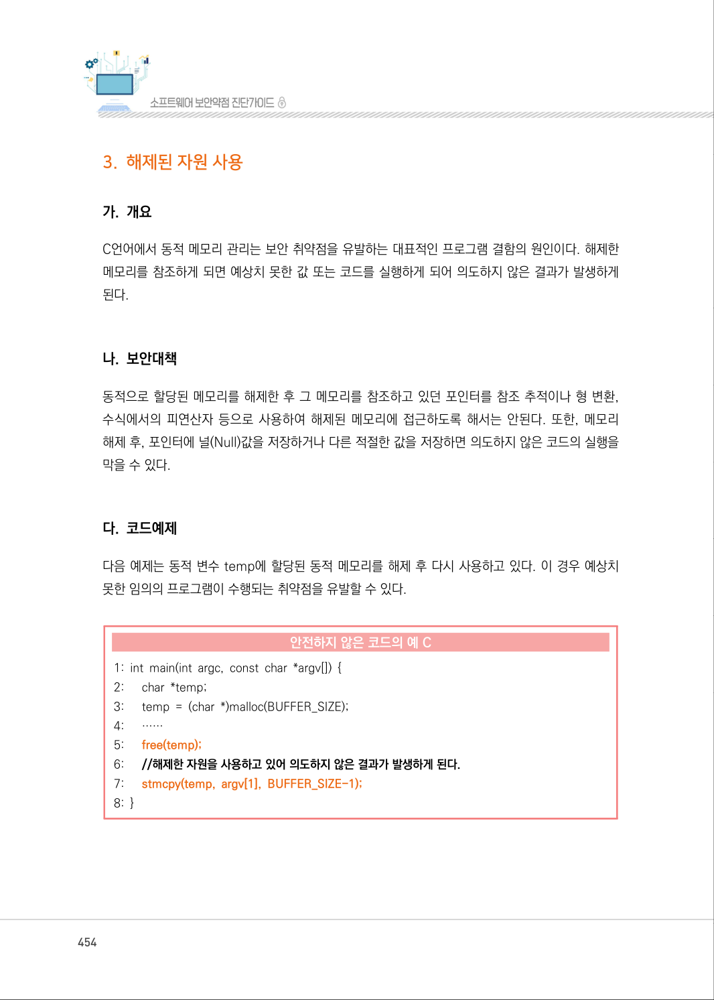
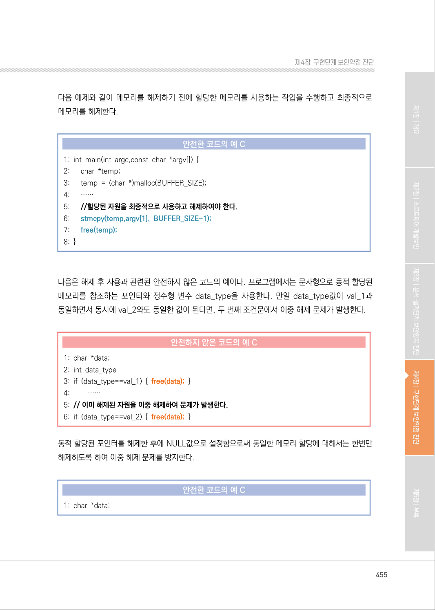
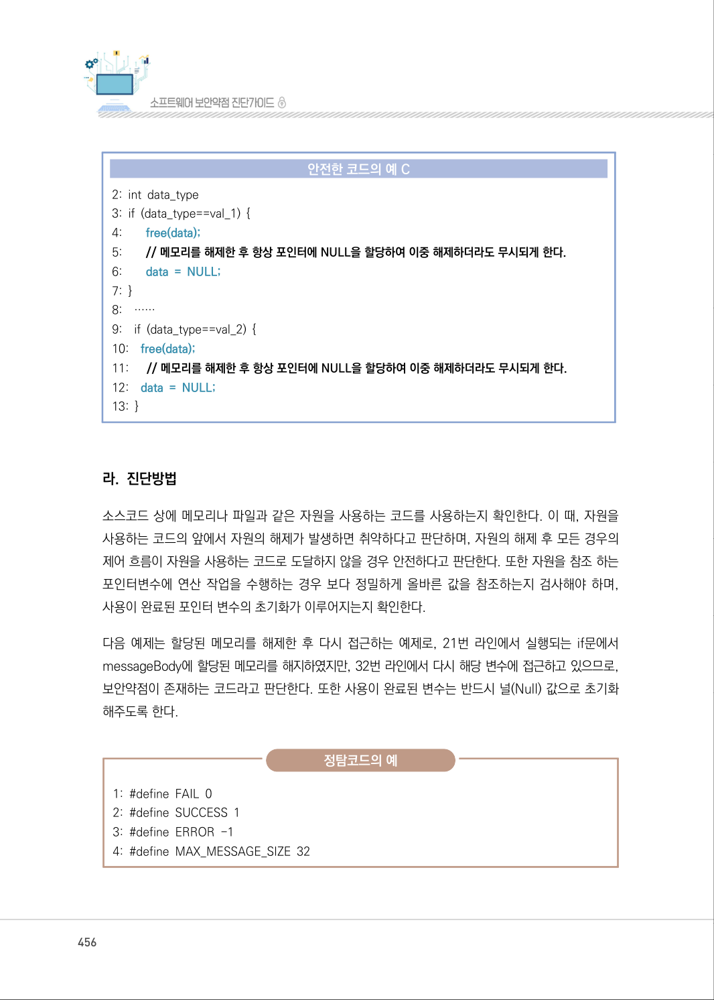
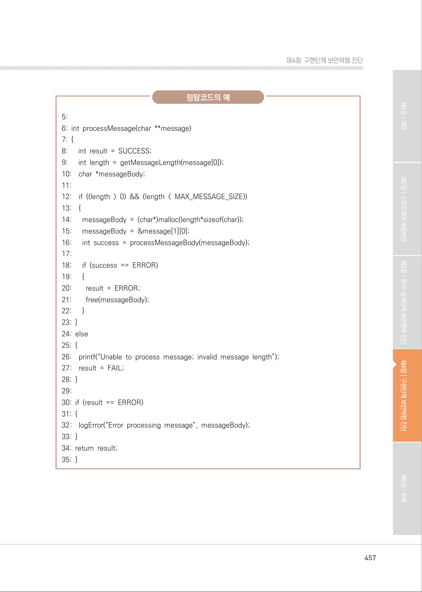
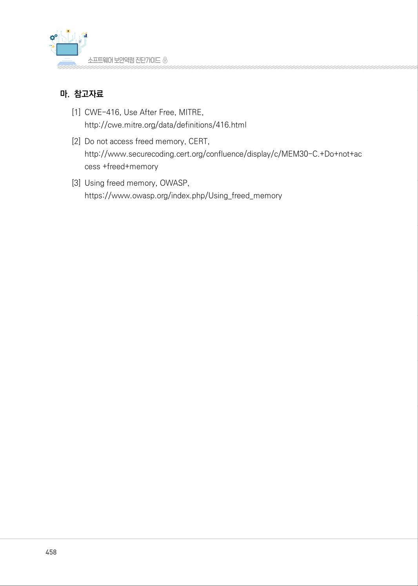
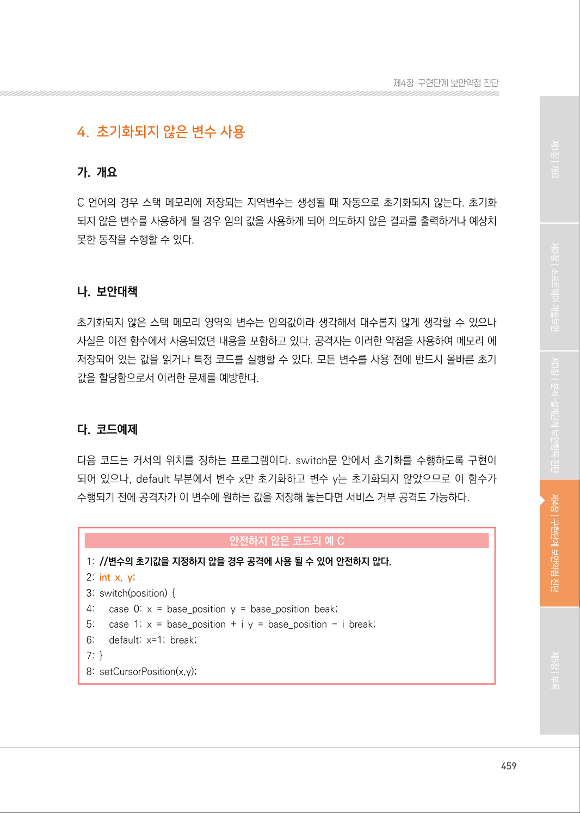

# 3. 해제된 자원 사용

> 변환 안내(원문 외): 아래 본문은 PDF 텍스트를 추출한 전사입니다. 코드 줄번호·특수 공백·원문 오류를 유지했습니다. 실행용 코드가 아닙니다. 표·그림·들여쓰기는 연결된 페이지 이미지와 대조하세요. 페이지 경계의 줄바꿈을 보존하며, 동일 페이지가 여러 항목에 나뉘면 각 항목의 본문은 해당 구간만 포함합니다.

### PDF 454페이지 / 인쇄 454페이지

<!-- source-page:SW-Diagnosis-2021:454; source-lines:0,1,2,3,4,5,6,7,8,9,10,11,12,13,14,15,16,17,18,19,20,21,22,23,24,25,26,27,28 -->

454

#### 3. 해제된 자원 사용

#### 가. 개요

C언어에서 동적 메모리 관리는 보안 취약점을 유발하는 대표적인 프로그램 결함의 원인이다. 해제한 
메모리를 참조하게 되면 예상치 못한 값 또는 코드를 실행하게 되어 의도하지 않은 결과가 발생하게 
된다.

#### 나. 보안대책

동적으로 할당된 메모리를 해제한 후 그 메모리를 참조하고 있던 포인터를 참조 추적이나 형 변환, 
수식에서의 피연산자 등으로 사용하여 해제된 메모리에 접근하도록 해서는 안된다. 또한, 메모리 
해제 후, 포인터에 널(Null)값을 저장하거나 다른 적절한 값을 저장하면 의도하지 않은 코드의 실행을 
막을 수 있다.

#### 다. 코드예제

다음 예제는 동적 변수 temp에 할당된 동적 메모리를 해제 후 다시 사용하고 있다. 이 경우 예상치 
못한 임의의 프로그램이 수행되는 취약점을 유발할 수 있다.

#### 안전하지 않은 코드의 예 C

```c
1: int main(int argc, const char *argv[]) { 
2:      char *temp; 
3:      temp = (char *)malloc(BUFFER_SIZE); 
4:      ……
5:      free(temp);
6:      //해제한 자원을 사용하고 있어 의도하지 않은 결과가 발생하게 된다.
7:      stmcpy(temp, argv[1], BUFFER_SIZE-1);
8: }
```

<details><summary>원본 페이지 이미지 (변환 외 보존 자료)</summary>



</details>

### PDF 455페이지 / 인쇄 455페이지

<!-- source-page:SW-Diagnosis-2021:455; source-lines:0,1,2,3,4,5,6,7,8,9,10,11,12,13,14,15,16,17,18,19,20,21,22,23,24,25,26,27,28,29,30,31,32,33 -->

455

제4장구현단계 보안약점 진단

다음 예제와 같이 메모리를 해제하기 전에 할당한 메모리를 사용하는 작업을 수행하고 최종적으로 
메모리를 해제한다.

#### 안전한 코드의 예 C

```c
1: int main(int argc,const char *argv[]) { 
2:      char *temp;
3:      temp = (char *)malloc(BUFFER_SIZE); 
4:      ……
5:      //할당된 자원을 최종적으로 사용하고 해제하여야 한다.
6:      stmcpy(temp,argv[1], BUFFER_SIZE-1);
7:      free(temp);
8: }
```

다음은 해제 후 사용과 관련된 안전하지 않은 코드의 예이다. 프로그램에서는 문자형으로 동적 할당된 
메모리를 참조하는 포인터와 정수형 변수 data_type을 사용한다. 만일 data_type값이 val_1과 
동일하면서 동시에 val_2와도 동일한 값이 된다면, 두 번째 조건문에서 이중 해제 문제가 발생한다.

#### 안전하지 않은 코드의 예 C

```c
1: char *data;
2: int data_type 
3: if (data_type==val_1) { free(data); }
4:         ……
5: // 이미 해제된 자원을 이중 해제하여 문제가 발생한다.
6: if (data_type==val_2) { free(data); }
```

동적 할당된 포인터를 해제한 후에 NULL값으로 설정함으로써 동일한 메모리 할당에 대해서는 한번만 
해제하도록 하여 이중 해제 문제를 방지한다.

#### 안전한 코드의 예 C

```c
1: char *data;
```

<details><summary>원본 페이지 이미지 (변환 외 보존 자료)</summary>



</details>

### PDF 456페이지 / 인쇄 456페이지

<!-- source-page:SW-Diagnosis-2021:456; source-lines:0,1,2,3,4,5,6,7,8,9,10,11,12,13,14,15,16,17,18,19,20,21,22,23,24,25,26,27,28,29,30,31,32,33,34,35,36 -->

456

#### 안전한 코드의 예 C

```c
2: int data_type
3: if (data_type==val_1) { 
4:        free(data);
5:        // 메모리를 해제한 후 항상 포인터에 NULL을 할당하여 이중 해제하더라도 무시되게 한다.
6:        data = NULL;
7: }
8:    ……
9:    if (data_type==val_2) { 
10:    free(data);
11:      // 메모리를 해제한 후 항상 포인터에 NULL을 할당하여 이중 해제하더라도 무시되게 한다.
12:    data = NULL;
13: }
```

#### 라. 진단방법

소스코드 상에 메모리나 파일과 같은 자원을 사용하는 코드를 사용하는지 확인한다. 이 때, 자원을 
사용하는 코드의 앞에서 자원의 해제가 발생하면 취약하다고 판단하며, 자원의 해제 후 모든 경우의 
제어 흐름이 자원을 사용하는 코드로 도달하지 않을 경우 안전하다고 판단한다. 또한 자원을 참조 하는 
포인터변수에 연산 작업을 수행하는 경우 보다 정밀하게 올바른 값을 참조하는지 검사해야 하며, 
사용이 완료된 포인터 변수의 초기화가 이루어지는지 확인한다.

다음 예제는 할당된 메모리를 해제한 후 다시 접근하는 예제로, 21번 라인에서 실행되는 if문에서 
messageBody에 할당된 메모리를 해지하였지만, 32번 라인에서 다시 해당 변수에 접근하고 있으므로, 
보안약점이 존재하는 코드라고 판단한다. 또한 사용이 완료된 변수는 반드시 널(Null) 값으로 초기화 
해주도록 한다.

정탐코드의 예

```text
1: #define FAIL 0
2: #define SUCCESS 1
3: #define ERROR -1
4: #define MAX_MESSAGE_SIZE 32
```

<details><summary>원본 페이지 이미지 (변환 외 보존 자료)</summary>



</details>

### PDF 457페이지 / 인쇄 457페이지

<!-- source-page:SW-Diagnosis-2021:457; source-lines:0,1,2,3,4,5,6,7,8,9,10,11,12,13,14,15,16,17,18,19,20,21,22,23,24,25,26,27,28,29,30,31,32,33,34,35,36,37,38,39,40,41,42,43,44,45,46,47,48,49 -->

457

제4장구현단계 보안약점 진단

정탐코드의 예

```text
5:
6: int processMessage(char **message) 
7: {
8:      int result = SUCCESS; 
9:      int length = getMessageLength(message[0]); 
10:    char *messageBody; 
11:
12:    if ((length > 0) && (length < MAX_MESSAGE_SIZE))
13:    {
14:      messageBody = (char*)malloc(length*sizeof(char));
15:      messageBody = &message[1][0]; 
16:      int success = processMessageBody(messageBody);
17:
18:      if (success == ERROR) 
19:      {
20:        result = ERROR; 
21:        free(messageBody); 
22:      }
23: }
24: else
25: {
26:    printf(“Unable to process message; invalid message length”);
27:    result = FAIL; 
28: }
29:
30: if (result == ERROR) 
31: {
32:    logError(“Error processing message”, messageBody);
33: }
34: return result;
35: }
```

<details><summary>원본 페이지 이미지 (변환 외 보존 자료)</summary>



</details>

### PDF 458페이지 / 인쇄 458페이지

<!-- source-page:SW-Diagnosis-2021:458; source-lines:0,1,2,3,4,5,6,7,8 -->

458

#### 마. 참고자료

[1] CWE-416, Use After Free, MITRE,

http://cwe.mitre.org/data/definitions/416.html
[2] Do not access freed memory, CERT,

http://www.securecoding.cert.org/confluence/display/c/MEM30-C.+Do+not+ac
cess +freed+memory
[3] Using freed memory, OWASP,

https://www.owasp.org/index.php/Using_freed_memory

<details><summary>원본 페이지 이미지 (변환 외 보존 자료)</summary>



</details>

### PDF 459페이지 / 인쇄 459페이지

<!-- source-page:SW-Diagnosis-2021:459; source-lines:1 -->

제4장구현단계 보안약점 진단

<details><summary>원본 페이지 이미지 (변환 외 보존 자료)</summary>



</details>

---

## 탐색 링크 (원문 외)

[통합 인덱스](../../../INDEX.md)

