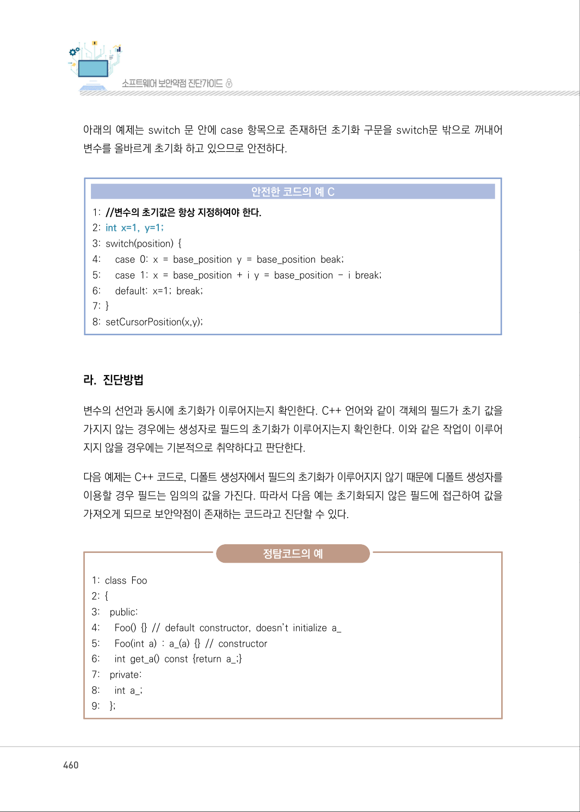
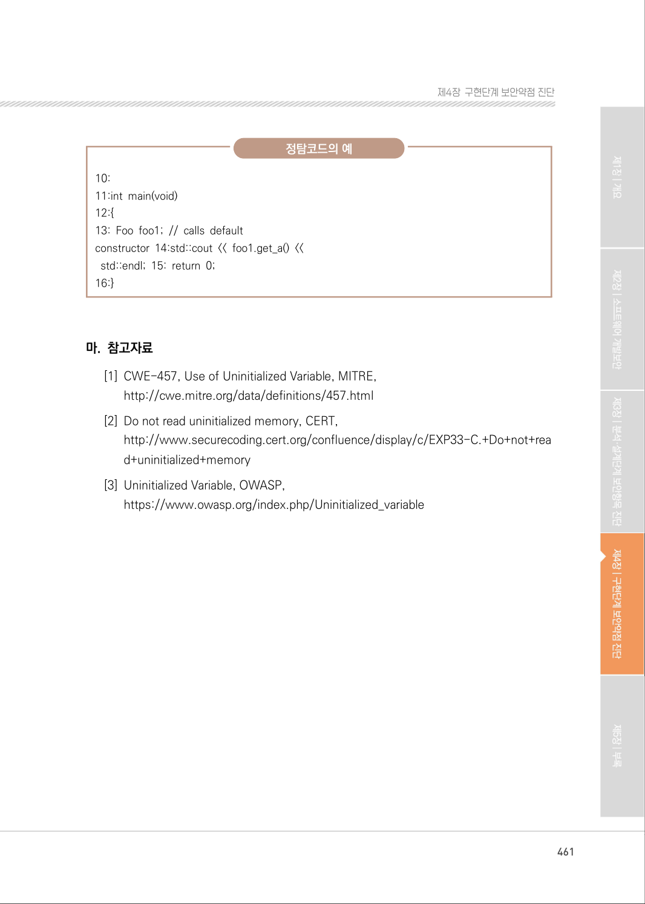

# 4. 초기화되지 않은 변수 사용

> 변환 안내(원문 외): 아래 본문은 PDF 텍스트를 추출한 전사입니다. 코드 줄번호·특수 공백·원문 오류를 유지했습니다. 실행용 코드가 아닙니다. 표·그림·들여쓰기는 연결된 페이지 이미지와 대조하세요. 페이지 경계의 줄바꿈을 보존하며, 동일 페이지가 여러 항목에 나뉘면 각 항목의 본문은 해당 구간만 포함합니다.

### PDF 459페이지 / 인쇄 459페이지

<!-- source-page:SW-Diagnosis-2021:459; source-lines:0,2,3,4,5,6,7,8,9,10,11,12,13,14,15,16,17,18,19,20,21,22,23,24,25,26,27 -->

459

#### 4. 초기화되지 않은 변수 사용

#### 가. 개요

C 언어의 경우 스택 메모리에 저장되는 지역변수는 생성될 때 자동으로 초기화되지 않는다. 초기화 
되지 않은 변수를 사용하게 될 경우 임의 값을 사용하게 되어 의도하지 않은 결과를 출력하거나 예상치 
못한 동작을 수행할 수 있다.

#### 나. 보안대책

초기화되지 않은 스택 메모리 영역의 변수는 임의값이라 생각해서 대수롭지 않게 생각할 수 있으나 
사실은 이전 함수에서 사용되었던 내용을 포함하고 있다. 공격자는 이러한 약점을 사용하여 메모리 에 
저장되어 있는 값을 읽거나 특정 코드를 실행할 수 있다. 모든 변수를 사용 전에 반드시 올바른 초기
값을 할당함으로서 이러한 문제를 예방한다.

#### 다. 코드예제

다음 코드는 커서의 위치를 정하는 프로그램이다. switch문 안에서 초기화를 수행하도록 구현이 
되어 있으나, default 부분에서 변수 x만 초기화하고 변수 y는 초기화되지 않았으므로 이 함수가 
수행되기 전에 공격자가 이 변수에 원하는 값을 저장해 놓는다면 서비스 거부 공격도 가능하다.

#### 안전하지 않은 코드의 예 C

```c
1: //변수의 초기값을 지정하지 않을 경우 공격에 사용 될 수 있어 안전하지 않다. 
2: int x, y;
3: switch(position) { 
4:      case 0: x = base_position y = base_position beak; 
5:      case 1: x = base_position + i y = base_position - i break; 
6:      default: x=1; break; 
7: }
8: setCursorPosition(x,y);
```

<details><summary>원본 페이지 이미지 (변환 외 보존 자료)</summary>


</details>

### PDF 460페이지 / 인쇄 460페이지

<!-- source-page:SW-Diagnosis-2021:460; source-lines:0,1,2,3,4,5,6,7,8,9,10,11,12,13,14,15,16,17,18,19,20,21,22,23,24,25,26,27,28,29,30,31,32,33,34,35,36,37,38 -->

460

아래의 예제는 switch 문 안에 case 항목으로 존재하던 초기화 구문을 switch문 밖으로 꺼내어 
변수를 올바르게 초기화 하고 있으므로 안전하다.

#### 안전한 코드의 예 C

```c
1: //변수의 초기값은 항상 지정하여야 한다.
2: int x=1, y=1;
3: switch(position) { 
4:      case 0: x = base_position y = base_position beak; 
5:      case 1: x = base_position + i y = base_position - i break; 
6:      default: x=1; break; 
7: }
8: setCursorPosition(x,y);
```

#### 라. 진단방법

변수의 선언과 동시에 초기화가 이루어지는지 확인한다. C++ 언어와 같이 객체의 필드가 초기 값을 
가지지 않는 경우에는 생성자로 필드의 초기화가 이루어지는지 확인한다. 이와 같은 작업이 이루어
지지 않을 경우에는 기본적으로 취약하다고 판단한다.

다음 예제는 C++ 코드로, 디폴트 생성자에서 필드의 초기화가 이루어지지 않기 때문에 디폴트 생성자를 
이용할 경우 필드는 임의의 값을 가진다. 따라서 다음 예는 초기화되지 않은 필드에 접근하여 값을 
가져오게 되므로 보안약점이 존재하는 코드라고 진단할 수 있다.

정탐코드의 예

```text
1: class Foo
2: { 
3:    public: 
4:      Foo() {} // default constructor, doesn’t initialize a_ 
5:      Foo(int a) : a_(a) {} // constructor 
6:      int get_a() const {return a_;} 
7:    private:
8:      int a_;
9:    };
```

<details><summary>원본 페이지 이미지 (변환 외 보존 자료)</summary>



</details>

### PDF 461페이지 / 인쇄 461페이지

<!-- source-page:SW-Diagnosis-2021:461; source-lines:0,1,2,3,4,5,6,7,8,9,10,11,12,13,14,15,16,17 -->

461

제4장구현단계 보안약점 진단

정탐코드의 예

```text
10:
11:int main(void) 
12:{ 
13: Foo foo1; // calls default 
constructor 14:std::cout << foo1.get_a() << 
std::endl; 15: return 0; 
```

16:}

#### 마. 참고자료

[1] CWE-457, Use of Uninitialized Variable, MITRE,

http://cwe.mitre.org/data/definitions/457.html
[2] Do not read uninitialized memory, CERT,

http://www.securecoding.cert.org/confluence/display/c/EXP33-C.+Do+not+rea
d+uninitialized+memory
[3] Uninitialized Variable, OWASP,

https://www.owasp.org/index.php/Uninitialized_variable

<details><summary>원본 페이지 이미지 (변환 외 보존 자료)</summary>



</details>

---

## 탐색 링크 (원문 외)

[통합 인덱스](../../../INDEX.md)

