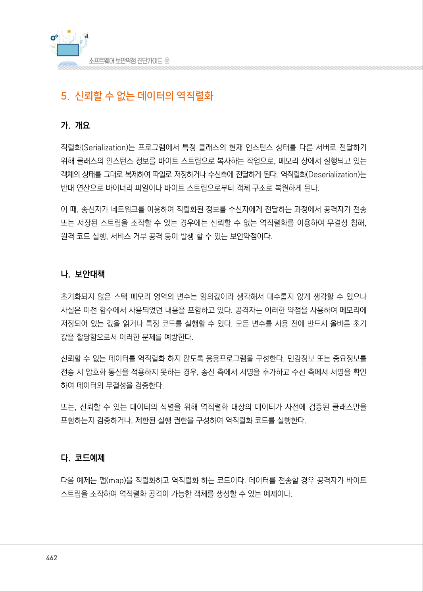
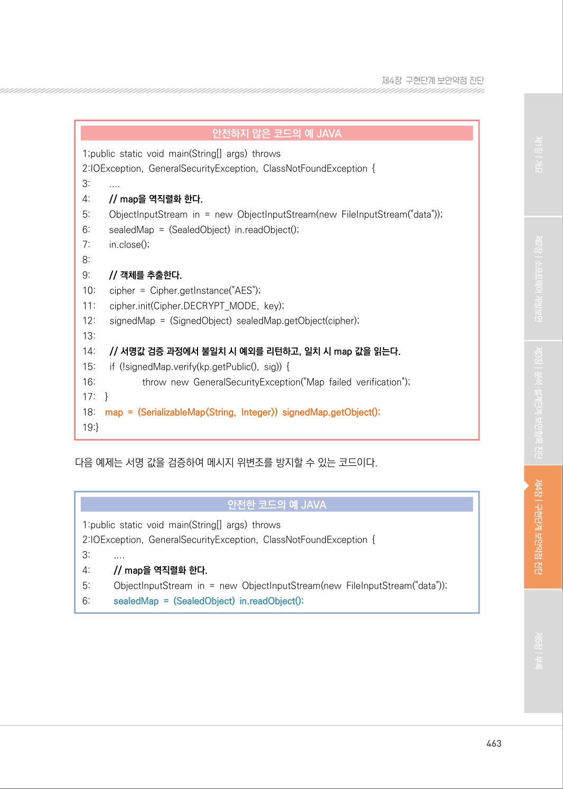
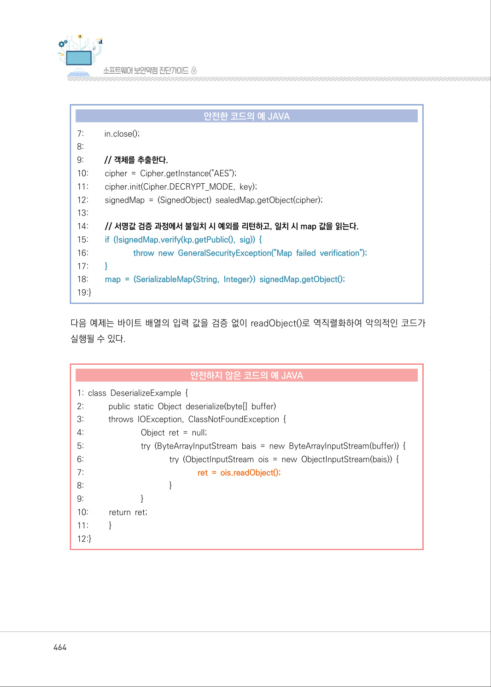
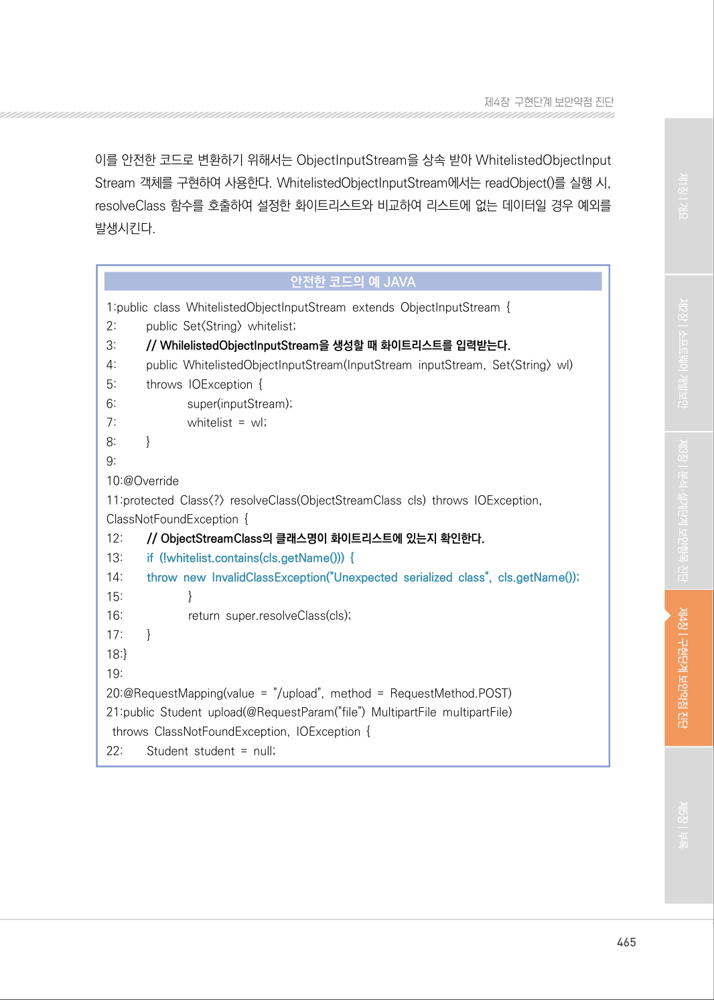
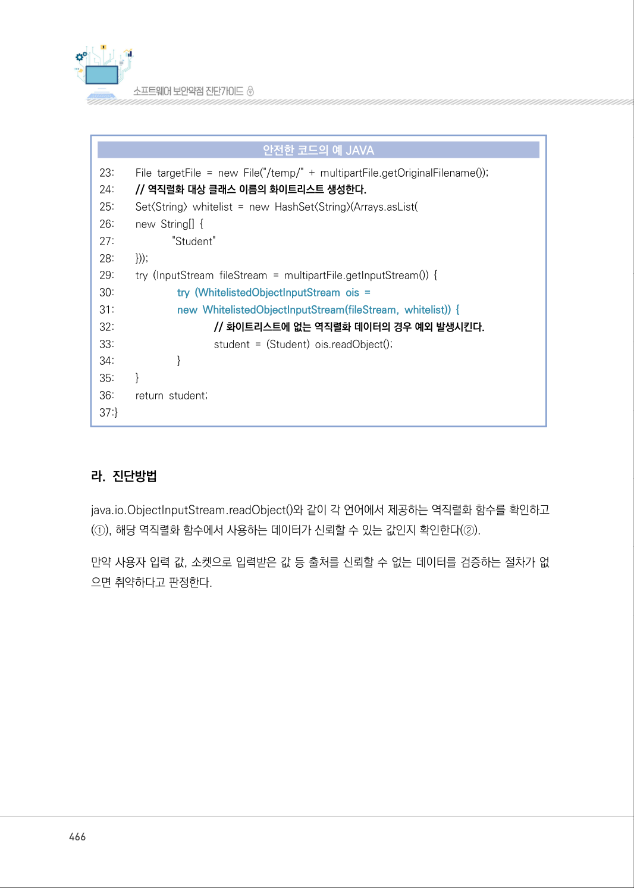
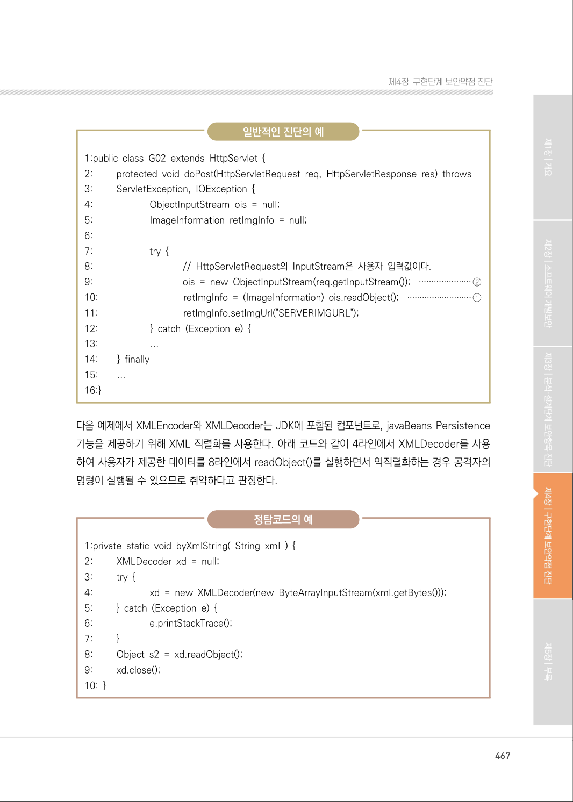
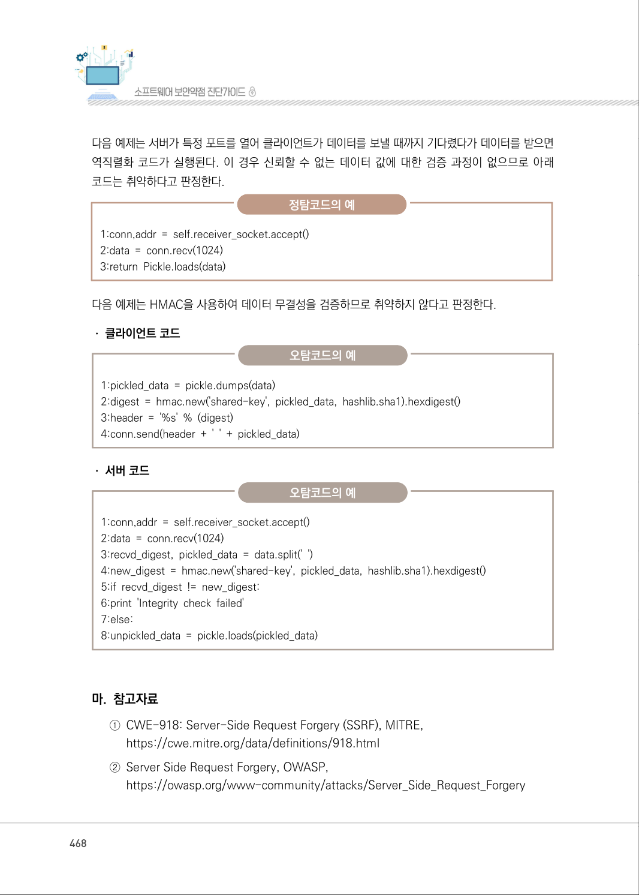

# 5. 신뢰할 수 없는 데이터의 역직렬화

> 변환 안내(원문 외): 아래 본문은 PDF 텍스트를 추출한 전사입니다. 코드 줄번호·특수 공백·원문 오류를 유지했습니다. 실행용 코드가 아닙니다. 표·그림·들여쓰기는 연결된 페이지 이미지와 대조하세요. 페이지 경계의 줄바꿈을 보존하며, 동일 페이지가 여러 항목에 나뉘면 각 항목의 본문은 해당 구간만 포함합니다.

### PDF 462페이지 / 인쇄 462페이지

<!-- source-page:SW-Diagnosis-2021:462; source-lines:0,1,2,3,4,5,6,7,8,9,10,11,12,13,14,15,16,17,18,19,20,21,22 -->

462

#### 5. 신뢰할 수 없는 데이터의 역직렬화

#### 가. 개요

직렬화(Serialization)는 프로그램에서 특정 클래스의 현재 인스턴스 상태를 다른 서버로 전달하기 
위해 클래스의 인스턴스 정보를 바이트 스트림으로 복사하는 작업으로, 메모리 상에서 실행되고 있는 
객체의 상태를 그대로 복제하여 파일로 저장하거나 수신측에 전달하게 된다. 역직렬화(Deserialization)는 
반대 연산으로 바이너리 파일이나 바이트 스트림으로부터 객체 구조로 복원하게 된다.

이 때, 송신자가 네트워크를 이용하여 직렬화된 정보를 수신자에게 전달하는 과정에서 공격자가 전송 
또는 저장된 스트림을 조작할 수 있는 경우에는 신뢰할 수 없는 역직렬화를 이용하여 무결성 침해, 
원격 코드 실행, 서비스 거부 공격 등이 발생 할 수 있는 보안약점이다.

#### 나. 보안대책

초기화되지 않은 스택 메모리 영역의 변수는 임의값이라 생각해서 대수롭지 않게 생각할 수 있으나 
사실은 이전 함수에서 사용되었던 내용을 포함하고 있다. 공격자는 이러한 약점을 사용하여 메모리에 
저장되어 있는 값을 읽거나 특정 코드를 실행할 수 있다. 모든 변수를 사용 전에 반드시 올바른 초기 
값을 할당함으로서 이러한 문제를 예방한다.

신뢰할 수 없는 데이터를 역직렬화 하지 않도록 응용프로그램을 구성한다. 민감정보 또는 중요정보를 
전송 시 암호화 통신을 적용하지 못하는 경우, 송신 측에서 서명을 추가하고 수신 측에서 서명을 확인 
하여 데이터의 무결성을 검증한다.

또는, 신뢰할 수 있는 데이터의 식별을 위해 역직렬화 대상의 데이터가 사전에 검증된 클래스만을 
포함하는지 검증하거나, 제한된 실행 권한을 구성하여 역직렬화 코드를 실행한다.

#### 다. 코드예제

다음 예제는 맵(map)을 직렬화하고 역직렬화 하는 코드이다. 데이터를 전송할 경우 공격자가 바이트 
스트림을 조작하여 역직렬화 공격이 가능한 객체를 생성할 수 있는 예제이다.

<details><summary>원본 페이지 이미지 (변환 외 보존 자료)</summary>



</details>

### PDF 463페이지 / 인쇄 463페이지

<!-- source-page:SW-Diagnosis-2021:463; source-lines:0,1,2,3,4,5,6,7,8,9,10,11,12,13,14,15,16,17,18,19,20,21,22,23,24,25,26,27,28,29,30,31,32,33,34,35,36,37,38,39,40,41,42,43,44,45,46,47 -->

463

제4장구현단계 보안약점 진단

#### 안전하지 않은 코드의 예 JAVA

```java
1;public static void main(String[] args) throws
2:IOException, GeneralSecurityException, ClassNotFoundException {
3:        ....
4:        // map을 역직렬화 한다.
5:        ObjectInputStream in = new ObjectInputStream(new FileInputStream("data"));
6:        sealedMap = (SealedObject) in.readObject(); 
7:        in.close(); 
8:
9:        // 객체를 추출한다.
10:      cipher = Cipher.getInstance("AES");
11:      cipher.init(Cipher.DECRYPT_MODE, key);
12:      signedMap = (SignedObject) sealedMap.getObject(cipher);
13:
14:      // 서명값 검증 과정에서 불일치 시 예외를 리턴하고, 일치 시 map 값을 읽는다.
15:      if (!signedMap.verify(kp.getPublic(), sig)) {
16:                   throw new GeneralSecurityException("Map failed verification");
17:    }
18:    map = (SerializableMap<String, Integer>) signedMap.getObject();
19:}
```

다음 예제는 서명 값을 검증하여 메시지 위변조를 방지할 수 있는 코드이다.

#### 안전한 코드의 예 JAVA

```java
1:public static void main(String[] args) throws 
2:IOException, GeneralSecurityException, ClassNotFoundException {
3:         ....
4:         // map을 역직렬화 한다.
5:         ObjectInputStream in = new ObjectInputStream(new FileInputStream("data"));
6:         sealedMap = (SealedObject) in.readObject();
```

<details><summary>원본 페이지 이미지 (변환 외 보존 자료)</summary>



</details>

### PDF 464페이지 / 인쇄 464페이지

<!-- source-page:SW-Diagnosis-2021:464; source-lines:0,1,2,3,4,5,6,7,8,9,10,11,12,13,14,15,16,17,18,19,20,21,22,23,24,25,26,27,28,29,30,31,32,33,34,35,36,37,38,39,40,41,42,43,44,45,46,47,48,49 -->

464

#### 안전한 코드의 예 JAVA

```java
7:         in.close();
8:
9:         // 객체를 추출한다.
10:        cipher = Cipher.getInstance("AES");
11:        cipher.init(Cipher.DECRYPT_MODE, key);
12:        signedMap = (SignedObject) sealedMap.getObject(cipher);
13:
14:        // 서명값 검증 과정에서 불일치 시 예외를 리턴하고, 일치 시 map 값을 읽는다.
15:        if (!signedMap.verify(kp.getPublic(), sig)) {
16:                     throw new GeneralSecurityException("Map failed verification");
17:        }
18:        map = (SerializableMap<String, Integer>) signedMap.getObject();
19:}
```

다음 예제는 바이트 배열의 입력 값을 검증 없이 readObject()로 역직렬화하여 악의적인 코드가 
실행될 수 있다.

#### 안전하지 않은 코드의 예 JAVA

```java
1: class DeserializeExample { 
2:           public static Object deserialize(byte[] buffer) 
3:           throws IOException, ClassNotFoundException { 
4:                           Object ret = null; 
5:                           try (ByteArrayInputStream bais = new ByteArrayInputStream(buffer)) {
6:                                        try (ObjectInputStream ois = new ObjectInputStream(bais)) {
7:                                                     ret = ois.readObject();
8:                                        }
9:                           }
10:         return ret;
11:         }
12:}
```

<details><summary>원본 페이지 이미지 (변환 외 보존 자료)</summary>



</details>

### PDF 465페이지 / 인쇄 465페이지

<!-- source-page:SW-Diagnosis-2021:465; source-lines:0,1,2,3,4,5,6,7,8,9,10,11,12,13,14,15,16,17,18,19,20,21,22,23,24,25,26,27,28,29,30,31,32,33,34,35,36,37,38,39,40,41,42,43,44 -->

465

제4장구현단계 보안약점 진단

이를 안전한 코드로 변환하기 위해서는 ObjectInputStream을 상속 받아 WhitelistedObjectInput
Stream 객체를 구현하여 사용한다. WhitelistedObjectInputStream에서는 readObject()를 실행 시, 
resolveClass 함수를 호출하여 설정한 화이트리스트와 비교하여 리스트에 없는 데이터일 경우 예외를 
발생시킨다.

#### 안전한 코드의 예 JAVA

```java
1:public class WhitelistedObjectInputStream extends ObjectInputStream {
2:         public Set<String> whitelist;
3:         // WhilelistedObjectInputStream을 생성할 때 화이트리스트를 입력받는다.
4:         public WhitelistedObjectInputStream(InputStream inputStream, Set<String> wl)
5:         throws IOException {
6:                       super(inputStream);
7:                       whitelist = wl;
8:         }
9:
10:@Override
11:protected Class<?> resolveClass(ObjectStreamClass cls) throws IOException, 
ClassNotFoundException {
12:        // ObjectStreamClass의 클래스명이 화이트리스트에 있는지 확인한다.
13:        if (!whitelist.contains(cls.getName())) {
14:        throw new InvalidClassException("Unexpected serialized class", cls.getName());
15:                     }
16:                     return super.resolveClass(cls);
17:        }
18:}
19:
20:@RequestMapping(value = "/upload", method = RequestMethod.POST)
21:public Student upload(@RequestParam("file") MultipartFile multipartFile)
 throws ClassNotFoundException, IOException { 
22:        Student student = null;
```

<details><summary>원본 페이지 이미지 (변환 외 보존 자료)</summary>



</details>

### PDF 466페이지 / 인쇄 466페이지

<!-- source-page:SW-Diagnosis-2021:466; source-lines:0,1,2,3,4,5,6,7,8,9,10,11,12,13,14,15,16,17,18,19,20,21,22,23,24,25,26,27,28,29,30,31,32,33,34,35 -->

466

#### 안전한 코드의 예 JAVA

```java
23:        File targetFile = new File("/temp/" + multipartFile.getOriginalFilename());
24:        // 역직렬화 대상 클래스 이름의 화이트리스트 생성한다.
25:        Set<String> whitelist = new HashSet<String>(Arrays.asList(
26:        new String[] {
27:                     "Student"
28:        }));
29:        try (InputStream fileStream = multipartFile.getInputStream()) {
30:                       try (WhitelistedObjectInputStream ois =
31:                       new WhitelistedObjectInputStream(fileStream, whitelist)) {
32:                                    // 화이트리스트에 없는 역직렬화 데이터의 경우 예외 발생시킨다.
33:                                    student = (Student) ois.readObject(); 
34:                       }
35:        }
36:        return student;
37:}
```

#### 라. 진단방법

java.io.ObjectInputStream.readObject()와 같이 각 언어에서 제공하는 역직렬화 함수를 확인하고 
(①), 해당 역직렬화 함수에서 사용하는 데이터가 신뢰할 수 있는 값인지 확인한다(②).

만약 사용자 입력 값, 소켓으로 입력받은 값 등 출처를 신뢰할 수 없는 데이터를 검증하는 절차가 없
으면 취약하다고 판정한다.

<details><summary>원본 페이지 이미지 (변환 외 보존 자료)</summary>



</details>

### PDF 467페이지 / 인쇄 467페이지

<!-- source-page:SW-Diagnosis-2021:467; source-lines:0,1,2,3,4,5,6,7,8,9,10,11,12,13,14,15,16,17,18,19,20,21,22,23,24,25,26,27,28,29,30,31,32,33,34,35,36,37,38,39,40,41,42,43,44,45,46,47,48,49,50,51,52,53,54 -->

467

제4장구현단계 보안약점 진단

일반적인 진단의 예

```text
1:public class G02 extends HttpServlet { 
2:         protected void doPost(HttpServletRequest req, HttpServletResponse res) throws
3:         ServletException, IOException {
4:                       ObjectInputStream ois = null;
5:                       ImageInformation retImgInfo = null;
6:
7:                       try {
8:                                    // HttpServletRequest의 InputStream은 사용자 입력값이다.
9:                                    ois = new ObjectInputStream(req.getInputStream()); ·····················②
10:                                  retImgInfo = (ImageInformation) ois.readObject(); ··························①
11:                                  retImgInfo.setImgUrl("SERVERIMGURL");
12:                     } catch (Exception e) {
13:                     ...
14:        } finally 
15:        ...
16:}
```

다음 예제에서 XMLEncoder와 XMLDecoder는 JDK에 포함된 컴포넌트로, javaBeans Persistence 
기능을 제공하기 위해 XML 직렬화를 사용한다. 아래 코드와 같이 4라인에서 XMLDecoder를 사용
하여 사용자가 제공한 데이터를 8라인에서 readObject()를 실행하면서 역직렬화하는 경우 공격자의 
명령이 실행될 수 있으므로 취약하다고 판정한다.

정탐코드의 예

```text
1:private static void byXmlString( String xml ) { 
2:         XMLDecoder xd = null; 
3:         try { 
4:                       xd = new XMLDecoder(new ByteArrayInputStream(xml.getBytes()));
5:         } catch (Exception e) { 
6:                       e.printStackTrace();
7:         }
8:         Object s2 = xd.readObject(); 
9:         xd.close();
10: }
```

<details><summary>원본 페이지 이미지 (변환 외 보존 자료)</summary>



</details>

### PDF 468페이지 / 인쇄 468페이지

<!-- source-page:SW-Diagnosis-2021:468; source-lines:0,1,2,3,4,5,6,7,8,9,10,11,12,13,14,15,16,17,18,19,20,21,22,23,24,25,26,27,28,29 -->

468

다음 예제는 서버가 특정 포트를 열어 클라이언트가 데이터를 보낼 때까지 기다렸다가 데이터를 받으면 
역직렬화 코드가 실행된다. 이 경우 신뢰할 수 없는 데이터 값에 대한 검증 과정이 없으므로 아래 
코드는 취약하다고 판정한다.

정탐코드의 예

```text
1:conn,addr = self.receiver_socket.accept()
2:data = conn.recv(1024)
3:return Pickle.loads(data)
```

다음 예제는 HMAC을 사용하여 데이터 무결성을 검증하므로 취약하지 않다고 판정한다.
ㆍ클라이언트 코드

오탐코드의 예

```text
1:pickled_data = pickle.dumps(data) 
2:digest = hmac.new('shared-key', pickled_data, hashlib.sha1).hexdigest()
3:header = '%s' % (digest)
4:conn.send(header + ' ' + pickled_data)
```

ㆍ서버 코드

오탐코드의 예

```text
1:conn,addr = self.receiver_socket.accept() 
2:data = conn.recv(1024) 
3:recvd_digest, pickled_data = data.split(' ') 
4:new_digest = hmac.new('shared-key', pickled_data, hashlib.sha1).hexdigest()
5:if recvd_digest != new_digest:
6:print 'Integrity check failed'
7:else:
8:unpickled_data = pickle.loads(pickled_data)
```

#### 마. 참고자료

①CWE-918: Server-Side Request Forgery (SSRF), MITRE,

https://cwe.mitre.org/data/definitions/918.html
②Server Side Request Forgery, OWASP,

https://owasp.org/www-community/attacks/Server_Side_Request_Forgery

<details><summary>원본 페이지 이미지 (변환 외 보존 자료)</summary>



</details>

### PDF 469페이지 / 인쇄 469페이지

<!-- source-page:SW-Diagnosis-2021:469; source-lines:1 -->

제4장구현단계 보안약점 진단

<details><summary>원본 페이지 이미지 (변환 외 보존 자료)</summary>


</details>

---

## 탐색 링크 (원문 외)

[통합 인덱스](../../../INDEX.md)

