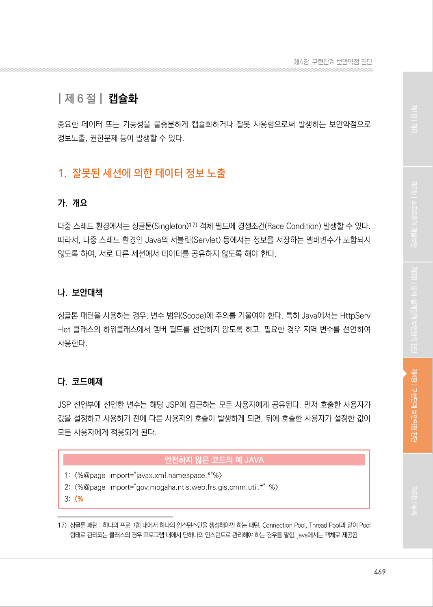

# 제6절 캡슐화

> 변환 안내(원문 외): 아래 본문은 PDF 텍스트를 추출한 전사입니다. 코드 줄번호·특수 공백·원문 오류를 유지했습니다. 실행용 코드가 아닙니다. 표·그림·들여쓰기는 연결된 페이지 이미지와 대조하세요. 페이지 경계의 줄바꿈을 보존하며, 동일 페이지가 여러 항목에 나뉘면 각 항목의 본문은 해당 구간만 포함합니다.

### PDF 469페이지 / 인쇄 469페이지

<!-- source-page:SW-Diagnosis-2021:469; source-lines:2,3,4 -->

| 제6 절| 캡슐화
중요한 데이터 또는 기능성을 불충분하게 캡슐화하거나 잘못 사용함으로써 발생하는 보안약점으로 
정보노출, 권한문제 등이 발생할 수 있다.

원본 페이지 이미지 (변환 외 보존 자료)

---

## 탐색 링크 (원문 외)

[통합 인덱스](../../../INDEX.md)

