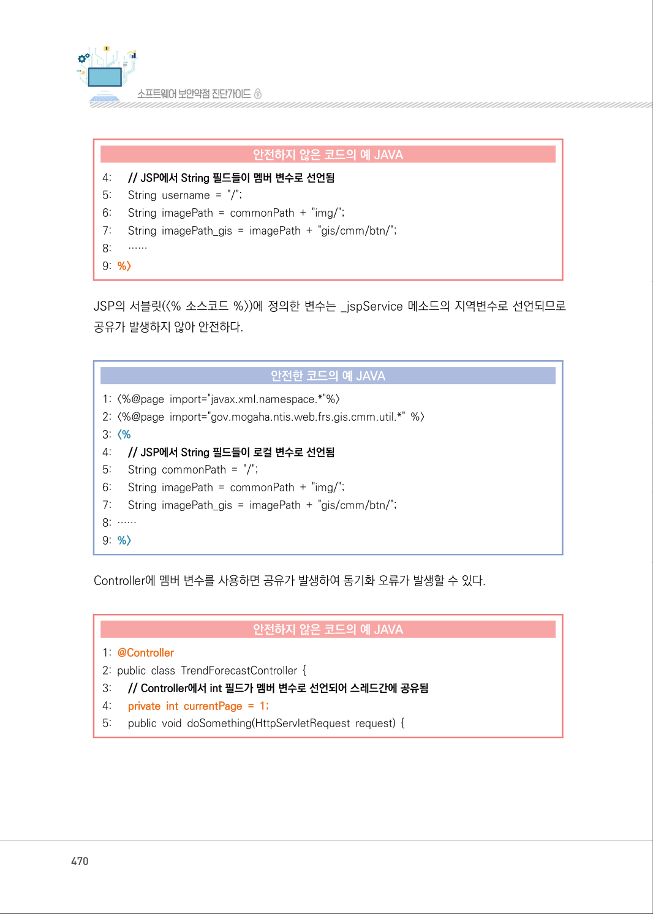
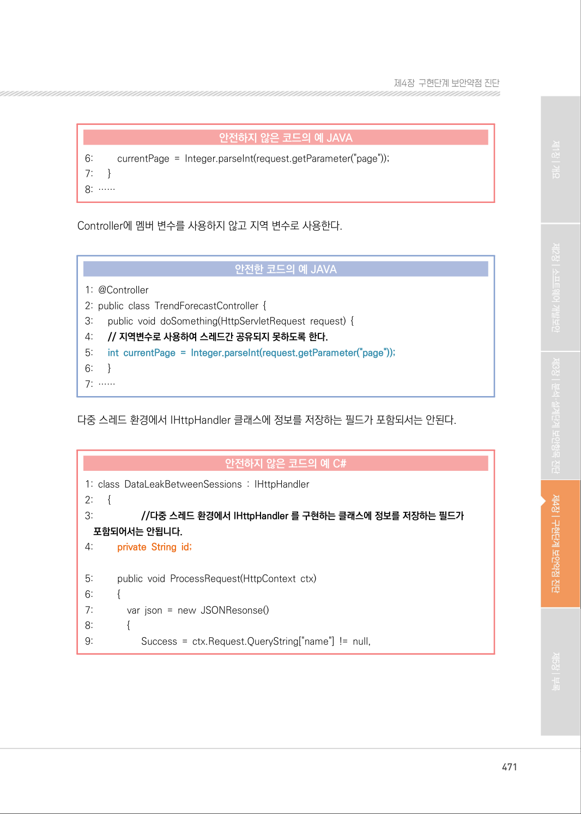
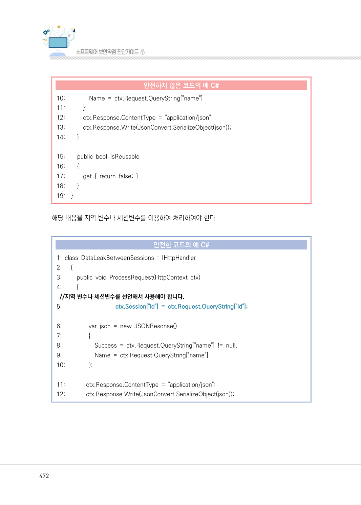
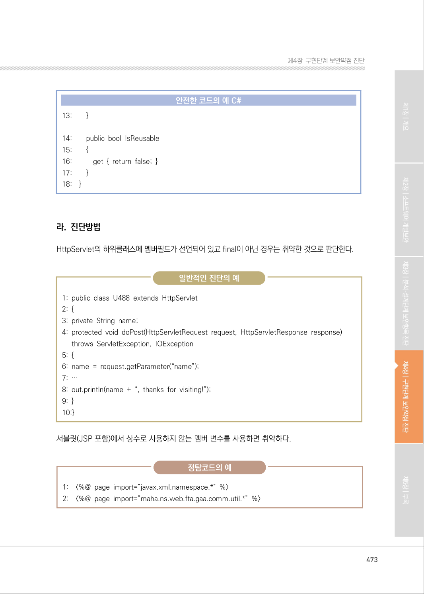
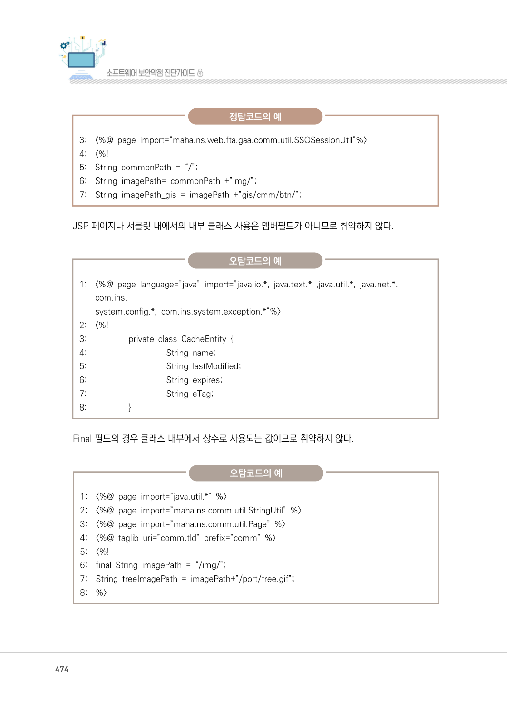
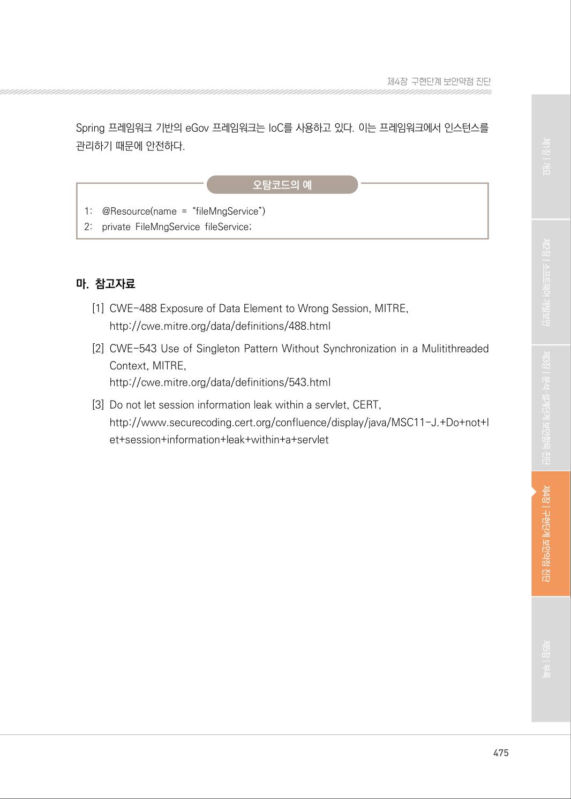

# 1. 잘못된 세션에 의한 데이터 정보 노출

> 변환 안내(원문 외): 아래 본문은 PDF 텍스트를 추출한 전사입니다. 코드 줄번호·특수 공백·원문 오류를 유지했습니다. 실행용 코드가 아닙니다. 표·그림·들여쓰기는 연결된 페이지 이미지와 대조하세요. 페이지 경계의 줄바꿈을 보존하며, 동일 페이지가 여러 항목에 나뉘면 각 항목의 본문은 해당 구간만 포함합니다.

### PDF 469페이지 / 인쇄 469페이지

<!-- source-page:SW-Diagnosis-2021:469; source-lines:0,5,6,7,8,9,10,11,12,13,14,15,16,17,18,19,20,21,22,23 -->

469

#### 1. 잘못된 세션에 의한 데이터 정보 노출

#### 가. 개요

다중 스레드 환경에서는 싱글톤(Singleton)17) 객체 필드에 경쟁조건(Race Condition) 발생할 수 있다. 
따라서, 다중 스레드 환경인 Java의 서블릿(Servlet) 등에서는 정보를 저장하는 멤버변수가 포함되지 
않도록 하여, 서로 다른 세션에서 데이터를 공유하지 않도록 해야 한다.

#### 나. 보안대책

싱글톤 패턴을 사용하는 경우, 변수 범위(Scope)에 주의를 기울여야 한다. 특히 Java에서는 HttpServ 
-let 클래스의 하위클래스에서 멤버 필드를 선언하지 않도록 하고, 필요한 경우 지역 변수를 선언하여 
사용한다.

#### 다. 코드예제

JSP 선언부에 선언한 변수는 해당 JSP에 접근하는 모든 사용자에게 공유된다. 먼저 호출한 사용자가 
값을 설정하고 사용하기 전에 다른 사용자의 호출이 발생하게 되면, 뒤에 호출한 사용자가 설정한 값이 
모든 사용자에게 적용되게 된다.

#### 안전하지 않은 코드의 예 JAVA

```java
1: <%@page import="javax.xml.namespace.*"%> 
2: <%@page import="gov.mogaha.ntis.web.frs.gis.cmm.util.*" %> 
3: <%
형태로 관리되는 클래스의 경우 프로그램 내에서 단하나의 인스턴트로 관리해야 하는 경우를 말함. java에서는 객체로 제공됨
```

17) 싱글톤 패턴 : 하나의 프로그램 내에서 하나의 인스턴스만을 생성해야만 하는 패턴. Connection Pool, Thread Pool과 같이 Pool 

<details><summary>원본 페이지 이미지 (변환 외 보존 자료)</summary>


</details>

### PDF 470페이지 / 인쇄 470페이지

<!-- source-page:SW-Diagnosis-2021:470; source-lines:0,1,2,3,4,5,6,7,8,9,10,11,12,13,14,15,16,17,18,19,20,21,22,23,24,25,26,27,28,29,30,31,32,33,34,35,36,37,38 -->

470

#### 안전하지 않은 코드의 예 JAVA

```java
4:      // JSP에서 String 필드들이 멤버 변수로 선언됨
5:      String username = "/";
6:      String imagePath = commonPath + "img/";
7:      String imagePath_gis = imagePath + "gis/cmm/btn/";
8:      ……
9: %>
```

JSP의 서블릿(&lt;% 소스코드 %&gt;)에 정의한 변수는 _jspService 메소드의 지역변수로 선언되므로 
공유가 발생하지 않아 안전하다.

#### 안전한 코드의 예 JAVA

```java
1: <%@page import="javax.xml.namespace.*"%>
2: <%@page import="gov.mogaha.ntis.web.frs.gis.cmm.util.*" %> 
3: <%
4:      // JSP에서 String 필드들이 로컬 변수로 선언됨
5:      String commonPath = "/";
6:      String imagePath = commonPath + "img/";
7:      String imagePath_gis = imagePath + "gis/cmm/btn/"; 
8: ……
9: %>
```

Controller에 멤버 변수를 사용하면 공유가 발생하여 동기화 오류가 발생할 수 있다.

#### 안전하지 않은 코드의 예 JAVA

```java
1: @Controller
2: public class TrendForecastController { 
3:      // Controller에서 int 필드가 멤버 변수로 선언되어 스레드간에 공유됨 
4:      private int currentPage = 1;
5:      public void doSomething(HttpServletRequest request) {
```

<details><summary>원본 페이지 이미지 (변환 외 보존 자료)</summary>



</details>

### PDF 471페이지 / 인쇄 471페이지

<!-- source-page:SW-Diagnosis-2021:471; source-lines:0,1,2,3,4,5,6,7,8,9,10,11,12,13,14,15,16,17,18,19,20,21,22,23,24,25,26,27,28,29,30,31,32,33,34,35,36,37,38,39,40 -->

471

제4장구현단계 보안약점 진단

#### 안전하지 않은 코드의 예 JAVA

```java
6:         currentPage = Integer.parseInt(request.getParameter("page")); 
7:      }
8: ……
```

Controller에 멤버 변수를 사용하지 않고 지역 변수로 사용한다.

#### 안전한 코드의 예 JAVA

```java
1: @Controller
2: public class TrendForecastController { 
3:      public void doSomething(HttpServletRequest request) { 
4:      // 지역변수로 사용하여 스레드간 공유되지 못하도록 한다.
5:      int currentPage = Integer.parseInt(request.getParameter("page"));
6:      }
7: ……
```

다중 스레드 환경에서 IHttpHandler 클래스에 정보를 저장하는 필드가 포함되서는 안된다.

#### 안전하지 않은 코드의 예 C#

```csharp
1: class DataLeakBetweenSessions : IHttpHandler 
2:      {
3:                   //다중 스레드 환경에서 IHttpHandler 를 구현하는 클래스에 정보를 저장하는 필드가 
포함되어서는 안됩니다.
4:         private String id;
5:         public void ProcessRequest(HttpContext ctx)
6:         {
7:             var json = new JSONResonse()
8:             {
9:                   Success = ctx.Request.QueryString["name"] != null,
```

<details><summary>원본 페이지 이미지 (변환 외 보존 자료)</summary>



</details>

### PDF 472페이지 / 인쇄 472페이지

<!-- source-page:SW-Diagnosis-2021:472; source-lines:0,1,2,3,4,5,6,7,8,9,10,11,12,13,14,15,16,17,18,19,20,21,22,23,24,25,26,27,28,29,30,31,32,33,34,35,36,37,38,39,40,41,42,43,44,45,46,47 -->

472

#### 안전하지 않은 코드의 예 C#

```csharp
10:               Name = ctx.Request.QueryString["name"]
11:           }; 
12:           ctx.Response.ContentType = "application/json";
13:           ctx.Response.Write(JsonConvert.SerializeObject(json));
14:        }
15:        public bool IsReusable
16:        {
17:           get { return false; }
18:        }
19:    }
```

해당 내용을 지역 변수나 세션변수를 이용하여 처리하여야 한다.

#### 안전한 코드의 예 C#

```csharp
1: class DataLeakBetweenSessions : IHttpHandler 
2:      {
3:         public void ProcessRequest(HttpContext ctx) 
4:         {
//지역 변수나 세션변수를 선언해서 사용해야 합니다.
5:                                  ctx.Session["id"] = ctx.Request.QueryString["id"];
6:                 var json = new JSONResonse() 
7:                 {
8:                     Success = ctx.Request.QueryString["name"] != null,
9:                     Name = ctx.Request.QueryString["name"]
10:               };
11:             ctx.Response.ContentType = "application/json";
12:             ctx.Response.Write(JsonConvert.SerializeObject(json));
```

<details><summary>원본 페이지 이미지 (변환 외 보존 자료)</summary>



</details>

### PDF 473페이지 / 인쇄 473페이지

<!-- source-page:SW-Diagnosis-2021:473; source-lines:0,1,2,3,4,5,6,7,8,9,10,11,12,13,14,15,16,17,18,19,20,21,22,23,24,25,26,27,28,29,30,31,32,33,34 -->

473

제4장구현단계 보안약점 진단

#### 안전한 코드의 예 C#

```csharp
13:        }
14:        public bool IsReusable
15:        {
16:           get { return false; } 
17:        }
18:    }
```

#### 라. 진단방법

HttpServlet의 하위클래스에 멤버필드가 선언되어 있고 final이 아닌 경우는 취약한 것으로 판단한다.

일반적인 진단의 예

```text
1: public class U488 extends HttpServlet 
2: {
3: private String name; 
4: protected void doPost(HttpServletRequest request, HttpServletResponse response) 
throws ServletException, IOException 
5: {
6: name = request.getParameter(“name”); 
7: …
8: out.println(name + “, thanks for visiting!”); 
9: }
10:}
```

서블릿(JSP 포함)에서 상수로 사용하지 않는 멤버 변수를 사용하면 취약하다.

정탐코드의 예

```text
1:    <%@ page import=”javax.xml.namespace.*” %>
2:    <%@ page import=”maha.ns.web.fta.gaa.comm.util.*” %>
```

<details><summary>원본 페이지 이미지 (변환 외 보존 자료)</summary>



</details>

### PDF 474페이지 / 인쇄 474페이지

<!-- source-page:SW-Diagnosis-2021:474; source-lines:0,1,2,3,4,5,6,7,8,9,10,11,12,13,14,15,16,17,18,19,20,21,22,23,24,25,26,27,28,29,30,31,32,33,34,35,36,37,38,39,40,41,42,43,44,45,46,47,48,49 -->

474

정탐코드의 예

```text
3:    <%@ page import=”maha.ns.web.fta.gaa.comm.util.SSOSessionUtil”%>
4:    <%! 
5:    String commonPath = “/”; 
6:    String imagePath= commonPath +”img/”; 
7:    String imagePath_gis = imagePath +”gis/cmm/btn/”; 
```

JSP 페이지나 서블릿 내에서의 내부 클래스 사용은 멤버필드가 아니므로 취약하지 않다. 

오탐코드의 예

1:

&lt;%@ page language=”java” import=”java.io.*, java.text.* ,java.util.*, java.net.*, 
com.ins. 
system.config.*, com.ins.system.exception.*”%&gt; 

```text
2:    <%! 
3:                   private class CacheEntity { 
4:                                    String name; 
5:                                    String lastModified; 
6:                                    String expires; 
7:                                    String eTag;
8:                   }
```

Final 필드의 경우 클래스 내부에서 상수로 사용되는 값이므로 취약하지 않다.

오탐코드의 예

```text
1:    <%@ page import=”java.util.*” %> 
2:    <%@ page import=”maha.ns.comm.util.StringUtil” %> 
3:    <%@ page import=”maha.ns.comm.util.Page” %> 
4:    <%@ taglib uri=”comm.tld” prefix=”comm” %> 
5:    <%! 
6:    final String imagePath = “/img/”; 
7:    String treeImagePath = imagePath+”/port/tree.gif”; 
8:    %>
```

<details><summary>원본 페이지 이미지 (변환 외 보존 자료)</summary>



</details>

### PDF 475페이지 / 인쇄 475페이지

<!-- source-page:SW-Diagnosis-2021:475; source-lines:0,1,2,3,4,5,6,7,8,9,10,11,12,13,14,15,16,17 -->

475

제4장구현단계 보안약점 진단

Spring 프레임워크 기반의 eGov 프레임워크는 IoC를 사용하고 있다. 이는 프레임워크에서 인스턴스를 
관리하기 때문에 안전하다.

오탐코드의 예

```text
1:    @Resource(name = “fileMngService”) 
2:    private FileMngService fileService; 
```

#### 마. 참고자료

[1] CWE-488 Exposure of Data Element to Wrong Session, MITRE,

http://cwe.mitre.org/data/definitions/488.html 
[2] CWE-543 Use of Singleton Pattern Without Synchronization in a Mulitithreaded 

Context, MITRE,
http://cwe.mitre.org/data/definitions/543.html
[3] Do not let session information leak within a servlet, CERT,

http://www.securecoding.cert.org/confluence/display/java/MSC11-J.+Do+not+l
et+session+information+leak+within+a+servlet

<details><summary>원본 페이지 이미지 (변환 외 보존 자료)</summary>



</details>

---

## 탐색 링크 (원문 외)

[통합 인덱스](../../../INDEX.md)

