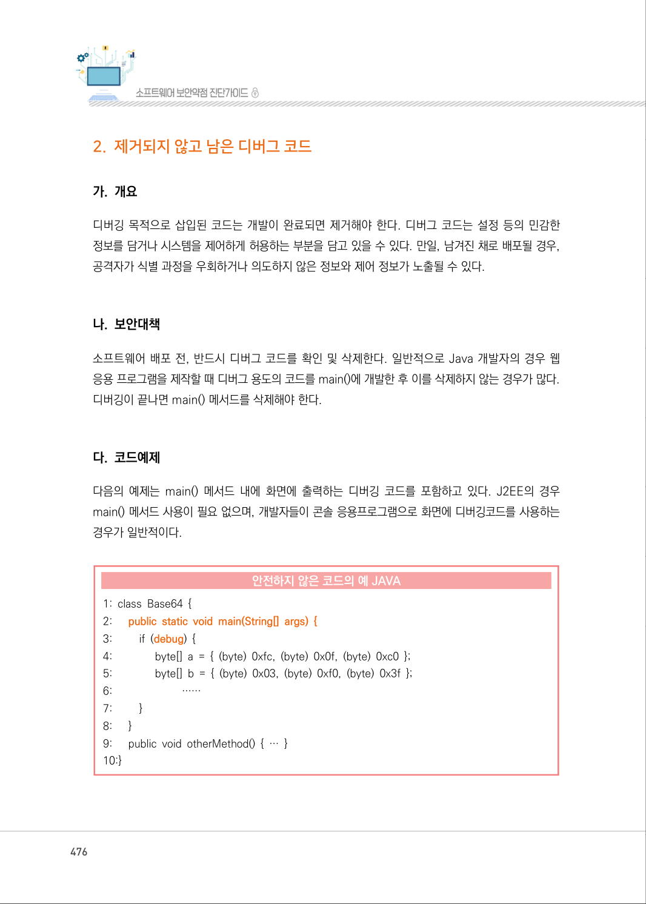
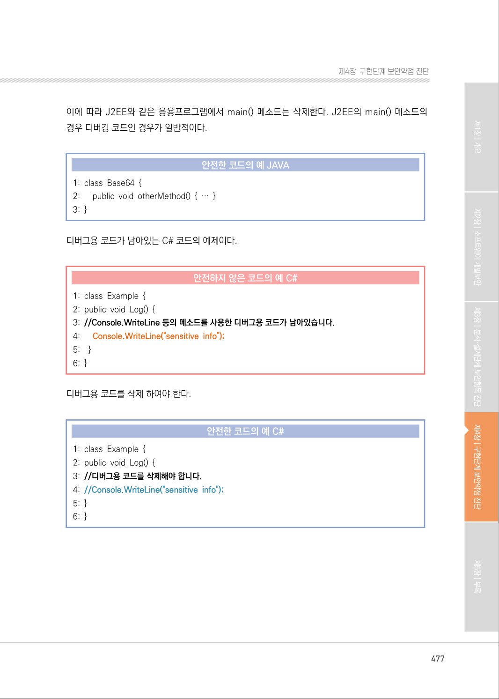
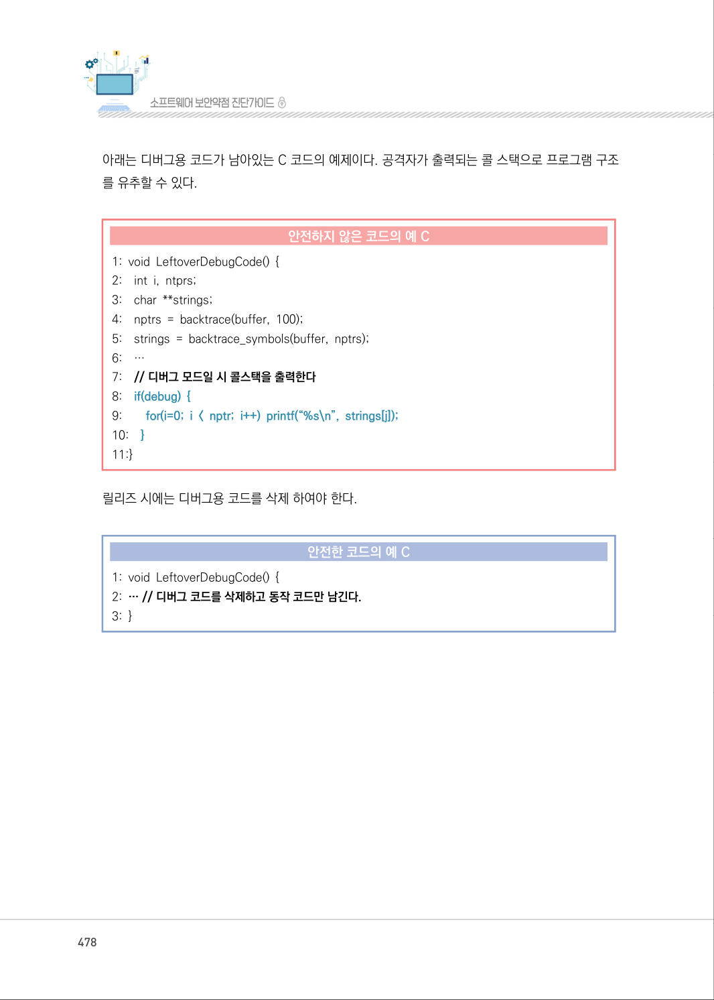
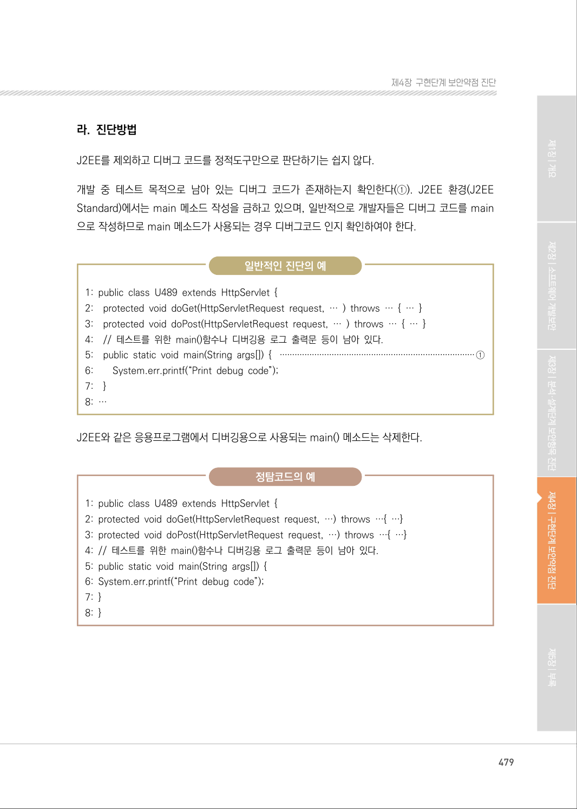
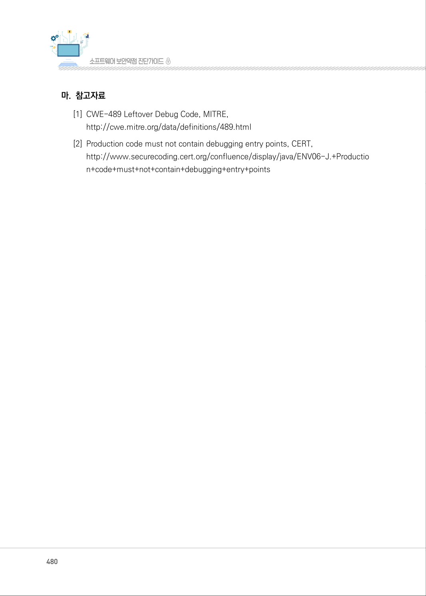

# 2. 제거되지 않고 남은 디버그 코드

> 변환 안내(원문 외): 아래 본문은 PDF 텍스트를 추출한 전사입니다. 코드 줄번호·특수 공백·원문 오류를 유지했습니다. 실행용 코드가 아닙니다. 표·그림·들여쓰기는 연결된 페이지 이미지와 대조하세요. 페이지 경계의 줄바꿈을 보존하며, 동일 페이지가 여러 항목에 나뉘면 각 항목의 본문은 해당 구간만 포함합니다.

### PDF 476페이지 / 인쇄 476페이지

<!-- source-page:SW-Diagnosis-2021:476; source-lines:0,1,2,3,4,5,6,7,8,9,10,11,12,13,14,15,16,17,18,19,20,21,22,23,24,25,26,27,28,29,30,31,32 -->

476

#### 2. 제거되지 않고 남은 디버그 코드

#### 가. 개요

디버깅 목적으로 삽입된 코드는 개발이 완료되면 제거해야 한다. 디버그 코드는 설정 등의 민감한 
정보를 담거나 시스템을 제어하게 허용하는 부분을 담고 있을 수 있다. 만일, 남겨진 채로 배포될 경우, 
공격자가 식별 과정을 우회하거나 의도하지 않은 정보와 제어 정보가 노출될 수 있다.

#### 나. 보안대책

소프트웨어 배포 전, 반드시 디버그 코드를 확인 및 삭제한다. 일반적으로 Java 개발자의 경우 웹 
응용 프로그램을 제작할 때 디버그 용도의 코드를 main()에 개발한 후 이를 삭제하지 않는 경우가 많다. 
디버깅이 끝나면 main() 메서드를 삭제해야 한다.

#### 다. 코드예제

다음의 예제는 main() 메서드 내에 화면에 출력하는 디버깅 코드를 포함하고 있다. J2EE의 경우 
main() 메서드 사용이 필요 없으며, 개발자들이 콘솔 응용프로그램으로 화면에 디버깅코드를 사용하는 
경우가 일반적이다.

#### 안전하지 않은 코드의 예 JAVA

```java
1: class Base64 { 
2:      public static void main(String[] args) {
3:         if (debug) {
4:               byte[] a = { (byte) 0xfc, (byte) 0x0f, (byte) 0xc0 };
5:               byte[] b = { (byte) 0x03, (byte) 0xf0, (byte) 0x3f };
6:                         ……
7:         }
8:      }
9:      public void otherMethod() { … } 
10:}
```

<details><summary>원본 페이지 이미지 (변환 외 보존 자료)</summary>



</details>

### PDF 477페이지 / 인쇄 477페이지

<!-- source-page:SW-Diagnosis-2021:477; source-lines:0,1,2,3,4,5,6,7,8,9,10,11,12,13,14,15,16,17,18,19,20,21,22,23,24,25,26 -->

477

제4장구현단계 보안약점 진단

이에 따라 J2EE와 같은 응용프로그램에서 main() 메소드는 삭제한다. J2EE의 main() 메소드의 
경우 디버깅 코드인 경우가 일반적이다.

#### 안전한 코드의 예 JAVA

```java
1: class Base64 { 
2:      public void otherMethod() { … } 
3: }
```

디버그용 코드가 남아있는 C# 코드의 예제이다.

#### 안전하지 않은 코드의 예 C#

```csharp
1: class Example {
2: public void Log() { 
3: //Console.WriteLine 등의 메소드를 사용한 디버그용 코드가 남아있습니다.
4:      Console.WriteLine("sensitive info");
5:    }
6: }
```

디버그용 코드를 삭제 하여야 한다.

#### 안전한 코드의 예 C#

```csharp
1: class Example { 
2: public void Log() { 
3: //디버그용 코드를 삭제해야 합니다.
4: //Console.WriteLine("sensitive info");
5: }
6: }
```

<details><summary>원본 페이지 이미지 (변환 외 보존 자료)</summary>



</details>

### PDF 478페이지 / 인쇄 478페이지

<!-- source-page:SW-Diagnosis-2021:478; source-lines:0,1,2,3,4,5,6,7,8,9,10,11,12,13,14,15,16,17,18,19,20,21,22,23,24,25,26,27,28 -->

478

아래는 디버그용 코드가 남아있는 C 코드의 예제이다. 공격자가 출력되는 콜 스택으로 프로그램 구조
를 유추할 수 있다.

#### 안전하지 않은 코드의 예 C

```c
1: void LeftoverDebugCode() { 
2:    int i, ntprs; 
3:    char **strings; 
4:    nptrs = backtrace(buffer, 100); 
5:    strings = backtrace_symbols(buffer, nptrs); 
6:    … 
7:    // 디버그 모드일 시 콜스택을 출력한다
8:    if(debug) {
9:        for(i=0; i < nptr; i++) printf(“%s\n”, strings[j]);
10:    }
11:}
```

릴리즈 시에는 디버그용 코드를 삭제 하여야 한다.

#### 안전한 코드의 예 C

```c
1: void LeftoverDebugCode() { 
2: … // 디버그 코드를 삭제하고 동작 코드만 남긴다.
3: }
```

<details><summary>원본 페이지 이미지 (변환 외 보존 자료)</summary>



</details>

### PDF 479페이지 / 인쇄 479페이지

<!-- source-page:SW-Diagnosis-2021:479; source-lines:0,1,2,3,4,5,6,7,8,9,10,11,12,13,14,15,16,17,18,19,20,21,22,23,24,25,26,27,28,29,30,31 -->

479

제4장구현단계 보안약점 진단

#### 라. 진단방법

J2EE를 제외하고 디버그 코드를 정적도구만으로 판단하기는 쉽지 않다.

개발 중 테스트 목적으로 남아 있는 디버그 코드가 존재하는지 확인한다(①). J2EE 환경(J2EE 
Standard)에서는 main 메소드 작성을 금하고 있으며, 일반적으로 개발자들은 디버그 코드를 main
으로 작성하므로 main 메소드가 사용되는 경우 디버그코드 인지 확인하여야 한다.

일반적인 진단의 예

```text
1: public class U489 extends HttpServlet { 
2:    protected void doGet(HttpServletRequest request, … ) throws … { … }
3:    protected void doPost(HttpServletRequest request, … ) throws … { … }
4:    // 테스트를 위한 main()함수나 디버깅용 로그 출력문 등이 남아 있다.
5:    public static void main(String args[]) { ···············································································①
6:        System.err.printf(“Print debug code”);
7:    }
8: …
```

J2EE와 같은 응용프로그램에서 디버깅용으로 사용되는 main() 메소드는 삭제한다.

정탐코드의 예

```text
1: public class U489 extends HttpServlet { 
2: protected void doGet(HttpServletRequest request, …) throws …{ …} 
3: protected void doPost(HttpServletRequest request, …) throws …{ …}
4: // 테스트를 위한 main()함수나 디버깅용 로그 출력문 등이 남아 있다.
5: public static void main(String args[]) { 
6: System.err.printf(“Print debug code”); 
7: } 
8: }
```

<details><summary>원본 페이지 이미지 (변환 외 보존 자료)</summary>



</details>

### PDF 480페이지 / 인쇄 480페이지

<!-- source-page:SW-Diagnosis-2021:480; source-lines:0,1,2,3,4,5,6 -->

480

#### 마. 참고자료

[1] CWE-489 Leftover Debug Code, MITRE,

http://cwe.mitre.org/data/definitions/489.html
[2] Production code must not contain debugging entry points, CERT,

http://www.securecoding.cert.org/confluence/display/java/ENV06-J.+Productio
n+code+must+not+contain+debugging+entry+points

<details><summary>원본 페이지 이미지 (변환 외 보존 자료)</summary>



</details>

### PDF 481페이지 / 인쇄 481페이지

<!-- source-page:SW-Diagnosis-2021:481; source-lines:1 -->

제4장구현단계 보안약점 진단

<details><summary>원본 페이지 이미지 (변환 외 보존 자료)</summary>


</details>

---

## 탐색 링크 (원문 외)

[통합 인덱스](../../../INDEX.md)

