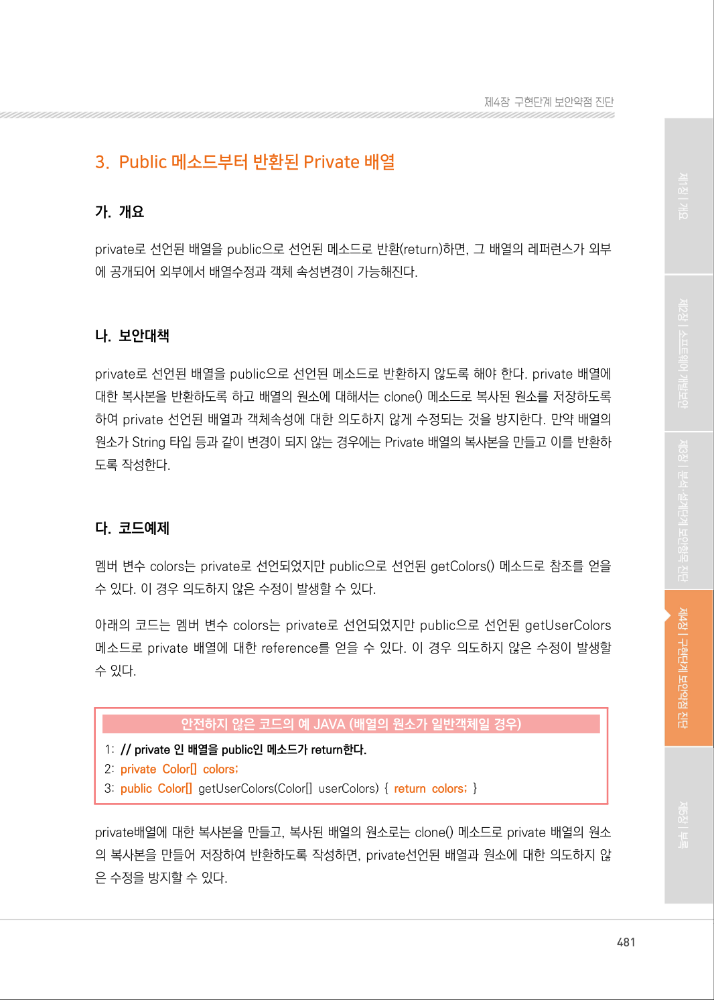
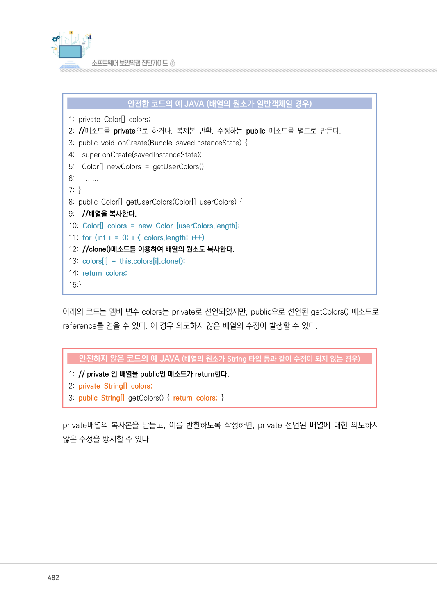
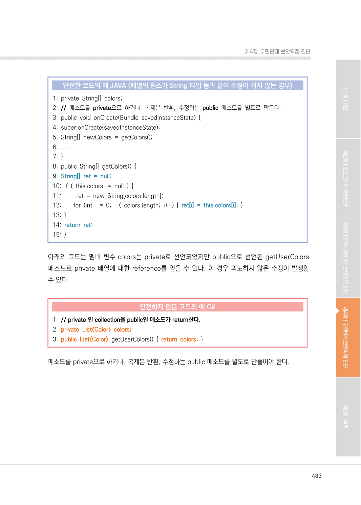
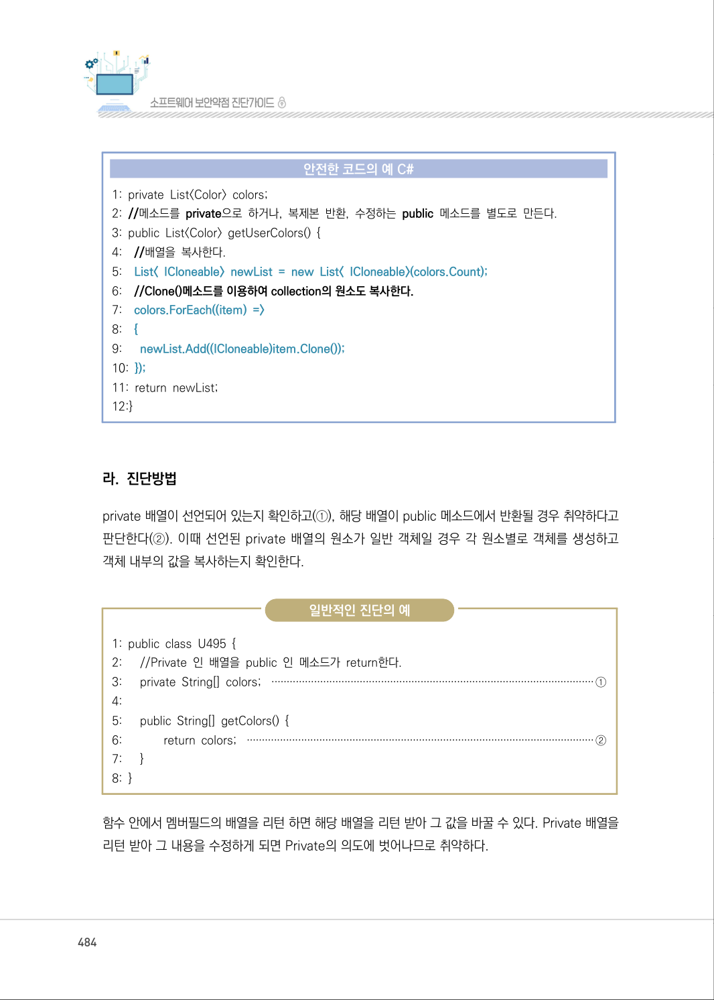
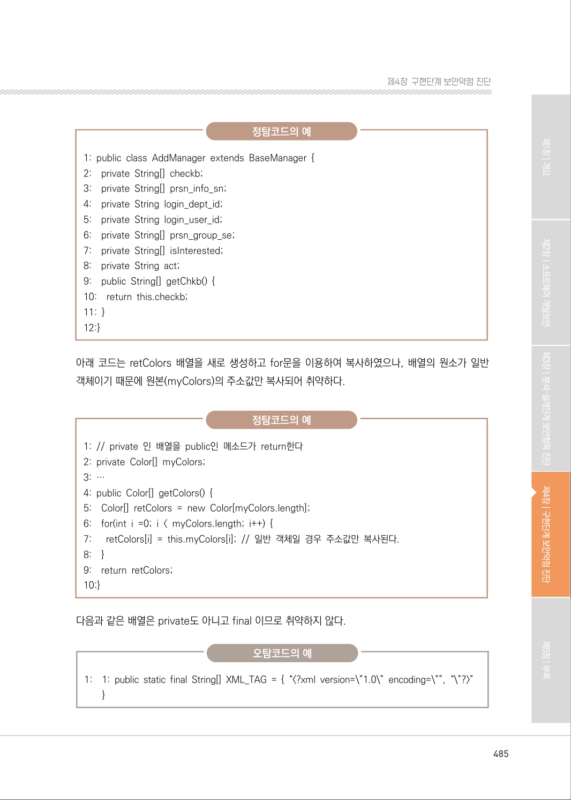
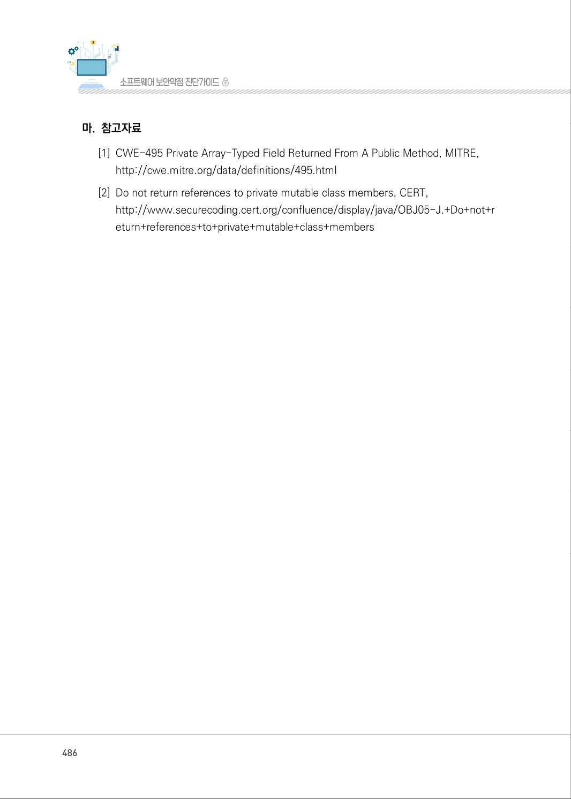
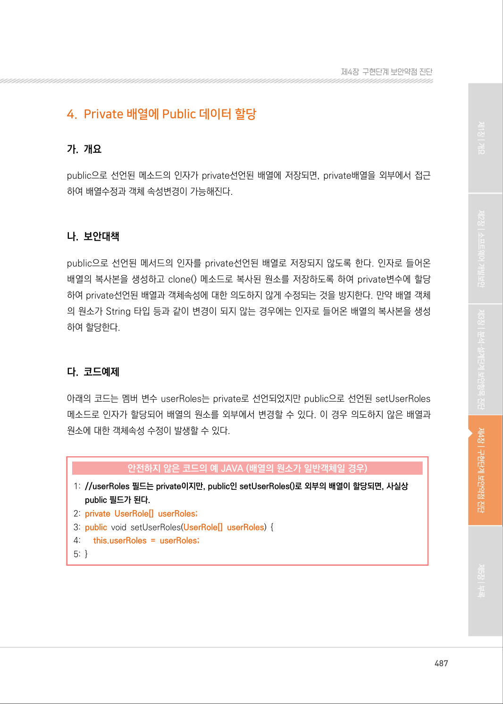

# 3. Public 메소드부터 반환된 Private 배열

> 변환 안내(원문 외): 아래 본문은 PDF 텍스트를 추출한 전사입니다. 코드 줄번호·특수 공백·원문 오류를 유지했습니다. 실행용 코드가 아닙니다. 표·그림·들여쓰기는 연결된 페이지 이미지와 대조하세요. 페이지 경계의 줄바꿈을 보존하며, 동일 페이지가 여러 항목에 나뉘면 각 항목의 본문은 해당 구간만 포함합니다.

### PDF 481페이지 / 인쇄 481페이지

<!-- source-page:SW-Diagnosis-2021:481; source-lines:0,2,3,4,5,6,7,8,9,10,11,12,13,14,15,16,17,18,19,20,21,22,23,24 -->

481

#### 3. Public 메소드부터 반환된 Private 배열

#### 가. 개요

private로 선언된 배열을 public으로 선언된 메소드로 반환(return)하면, 그 배열의 레퍼런스가 외부
에 공개되어 외부에서 배열수정과 객체 속성변경이 가능해진다.

#### 나. 보안대책

private로 선언된 배열을 public으로 선언된 메소드로 반환하지 않도록 해야 한다. private 배열에 
대한 복사본을 반환하도록 하고 배열의 원소에 대해서는 clone() 메소드로 복사된 원소를 저장하도록 
하여 private 선언된 배열과 객체속성에 대한 의도하지 않게 수정되는 것을 방지한다. 만약 배열의 
원소가 String 타입 등과 같이 변경이 되지 않는 경우에는 Private 배열의 복사본을 만들고 이를 반환하
도록 작성한다.

#### 다. 코드예제

멤버 변수 colors는 private로 선언되었지만 public으로 선언된 getColors() 메소드로 참조를 얻을 
수 있다. 이 경우 의도하지 않은 수정이 발생할 수 있다.

아래의 코드는 멤버 변수 colors는 private로 선언되었지만 public으로 선언된 getUserColors 
메소드로 private 배열에 대한 reference를 얻을 수 있다. 이 경우 의도하지 않은 수정이 발생할 
수 있다.

#### 안전하지 않은 코드의 예 JAVA (배열의 원소가 일반객체일 경우)

```java
1: // private 인 배열을 public인 메소드가 return한다.
2: private Color[] colors;
3: public Color[] getUserColors(Color[] userColors) { return colors; }
```

private배열에 대한 복사본을 만들고, 복사된 배열의 원소로는 clone() 메소드로 private 배열의 원소
의 복사본을 만들어 저장하여 반환하도록 작성하면, private선언된 배열과 원소에 대한 의도하지 않
은 수정을 방지할 수 있다.

<details><summary>원본 페이지 이미지 (변환 외 보존 자료)</summary>



</details>

### PDF 482페이지 / 인쇄 482페이지

<!-- source-page:SW-Diagnosis-2021:482; source-lines:0,1,2,3,4,5,6,7,8,9,10,11,12,13,14,15,16,17,18,19,20,21,22,23,24,25,26,27,28 -->

482

#### 안전한 코드의 예 JAVA (배열의 원소가 일반객체일 경우)

```java
1: private Color[] colors;
2: //메소드를 private으로 하거나, 복제본 반환, 수정하는 public 메소드를 별도로 만든다.
3: public void onCreate(Bundle savedInstanceState) { 
4:    super.onCreate(savedInstanceState); 
5:    Color[] newColors = getUserColors(); 
6:      ......
7: }
8: public Color[] getUserColors(Color[] userColors) { 
9:    //배열을 복사한다.
10: Color[] colors = new Color [userColors.length];
11: for (int i = 0; i < colors.length; i++)
12: //clone()메소드를 이용하여 배열의 원소도 복사한다. 
13: colors[i] = this.colors[i].clone();
14: return colors;
15:}
```

아래의 코드는 멤버 변수 colors는 private로 선언되었지만, public으로 선언된 getColors() 메소드로 
reference를 얻을 수 있다. 이 경우 의도하지 않은 배열의 수정이 발생할 수 있다.

#### 안전하지 않은 코드의 예 JAVA (배열의 원소가 String 타입 등과 같이 수정이 되지 않는 경우)

```java
1: // private 인 배열을 public인 메소드가 return한다.
2: private String[] colors;
3: public String[] getColors() { return colors; }
```

private배열의 복사본을 만들고, 이를 반환하도록 작성하면, private 선언된 배열에 대한 의도하지 
않은 수정을 방지할 수 있다.

<details><summary>원본 페이지 이미지 (변환 외 보존 자료)</summary>



</details>

### PDF 483페이지 / 인쇄 483페이지

<!-- source-page:SW-Diagnosis-2021:483; source-lines:0,1,2,3,4,5,6,7,8,9,10,11,12,13,14,15,16,17,18,19,20,21,22,23,24,25,26,27 -->

483

제4장구현단계 보안약점 진단

#### 안전한 코드의 예 JAVA (배열의 원소가 String 타입 등과 같이 수정이 되지 않는 경우)

```java
1: private String[] colors;
2: // 메소드를 private으로 하거나, 복제본 반환, 수정하는 public 메소드를 별도로 만든다.
3: public void onCreate(Bundle savedInstanceState) {
4: super.onCreate(savedInstanceState);
5: String[] newColors = getColors();
6: ......
7: }
8: public String[] getColors() {
9: String[] ret = null;
10: if ( this.colors != null ) {
11:         ret = new String[colors.length];
12:        for (int i = 0; i < colors.length; i++) { ret[i] = this.colors[i]; }
13: }
14: return ret;
15: }
```

아래의 코드는 멤버 변수 colors는 private로 선언되었지만 public으로 선언된 getUserColors 
메소드로 private 배열에 대한 reference를 얻을 수 있다. 이 경우 의도하지 않은 수정이 발생할 
수 있다.

#### 안전하지 않은 코드의 예 C#

```csharp
1: // private 인 collection을 public인 메소드가 return한다.
2: private List<Color> colors;
3: public List<Color> getUserColors() { return colors; }
```

메소드를 private으로 하거나, 복제본 반환, 수정하는 public 메소드를 별도로 만들어야 한다.

<details><summary>원본 페이지 이미지 (변환 외 보존 자료)</summary>



</details>

### PDF 484페이지 / 인쇄 484페이지

<!-- source-page:SW-Diagnosis-2021:484; source-lines:0,1,2,3,4,5,6,7,8,9,10,11,12,13,14,15,16,17,18,19,20,21,22,23,24,25,26,27,28,29,30,31,32,33,34,35,36,37,38,39 -->

484

#### 안전한 코드의 예 C#

```csharp
1: private List<Color> colors; 
2: //메소드를 private으로 하거나, 복제본 반환, 수정하는 public 메소드를 별도로 만든다.
3: public List<Color> getUserColors() { 
4:    //배열을 복사한다. 
5:    List< ICloneable> newList = new List< ICloneable>(colors.Count);
6:    //Clone()메소드를 이용하여 collection의 원소도 복사한다.
7:    colors.ForEach((item) =>
8:    {
9:      newList.Add((ICloneable)item.Clone());
10: });
11: return newList;
12:}
```

#### 라. 진단방법

private 배열이 선언되어 있는지 확인하고(①), 해당 배열이 public 메소드에서 반환될 경우 취약하다고 
판단한다(②). 이때 선언된 private 배열의 원소가 일반 객체일 경우 각 원소별로 객체를 생성하고 
객체 내부의 값을 복사하는지 확인한다.

일반적인 진단의 예

```text
1: public class U495 {
2:      //Private 인 배열을 public 인 메소드가 return한다.
3:      private String[] colors; ··········································································································①
4:
5:      public String[] getColors() {
6:             return colors; ···················································································································②
7:      }
8: }
```

함수 안에서 멤버필드의 배열을 리턴 하면 해당 배열을 리턴 받아 그 값을 바꿀 수 있다. Private 배열을 
리턴 받아 그 내용을 수정하게 되면 Private의 의도에 벗어나므로 취약하다.

<details><summary>원본 페이지 이미지 (변환 외 보존 자료)</summary>



</details>

### PDF 485페이지 / 인쇄 485페이지

<!-- source-page:SW-Diagnosis-2021:485; source-lines:0,1,2,3,4,5,6,7,8,9,10,11,12,13,14,15,16,17,18,19,20,21,22,23,24,25,26,27,28,29,30,31,32,33,34,35,36,37,38,39,40,41,42,43,44,45,46 -->

485

제4장구현단계 보안약점 진단

정탐코드의 예

```text
1: public class AddManager extends BaseManager {
2:    private String[] checkb;
3:    private String[] prsn_info_sn;
4:    private String login_dept_id;
5:    private String login_user_id;
6:    private String[] prsn_group_se;
7:    private String[] isInterested;
8:    private String act;
9:    public String[] getChkb() {
10:    return this.checkb;
11: }
12:}
```

아래 코드는 retColors 배열을 새로 생성하고 for문을 이용하여 복사하였으나, 배열의 원소가 일반 
객체이기 때문에 원본(myColors)의 주소값만 복사되어 취약하다.

정탐코드의 예

```text
1: // private 인 배열을 public인 메소드가 return한다 
2: private Color[] myColors; 
3: … 
4: public Color[] getColors() { 
5:    Color[] retColors = new Color[myColors.length]; 
6:    for(int i =0; i < myColors.length; i++) { 
7:      retColors[i] = this.myColors[i]; // 일반 객체일 경우 주소값만 복사된다. 
8:    }
9:    return retColors;
10:}
```

다음과 같은 배열은 private도 아니고 final 이므로 취약하지 않다.

오탐코드의 예

1:

1: public static final String[] XML_TAG = { “&lt;?xml version=\”1.0\” encoding=\””, “\”?&gt;” 
}

<details><summary>원본 페이지 이미지 (변환 외 보존 자료)</summary>



</details>

### PDF 486페이지 / 인쇄 486페이지

<!-- source-page:SW-Diagnosis-2021:486; source-lines:0,1,2,3,4,5,6 -->

486

#### 마. 참고자료

[1] CWE-495 Private Array-Typed Field Returned From A Public Method, MITRE,

http://cwe.mitre.org/data/definitions/495.html
[2] Do not return references to private mutable class members, CERT,

http://www.securecoding.cert.org/confluence/display/java/OBJ05-J.+Do+not+r
eturn+references+to+private+mutable+class+members

<details><summary>원본 페이지 이미지 (변환 외 보존 자료)</summary>



</details>

### PDF 487페이지 / 인쇄 487페이지

<!-- source-page:SW-Diagnosis-2021:487; source-lines:1 -->

제4장구현단계 보안약점 진단

<details><summary>원본 페이지 이미지 (변환 외 보존 자료)</summary>



</details>

---

## 탐색 링크 (원문 외)

[통합 인덱스](../../../INDEX.md)

