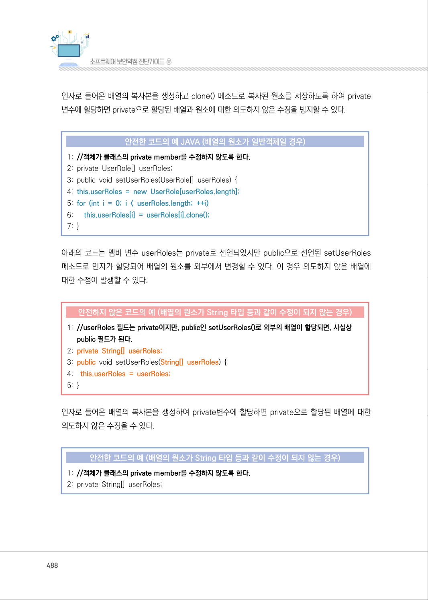
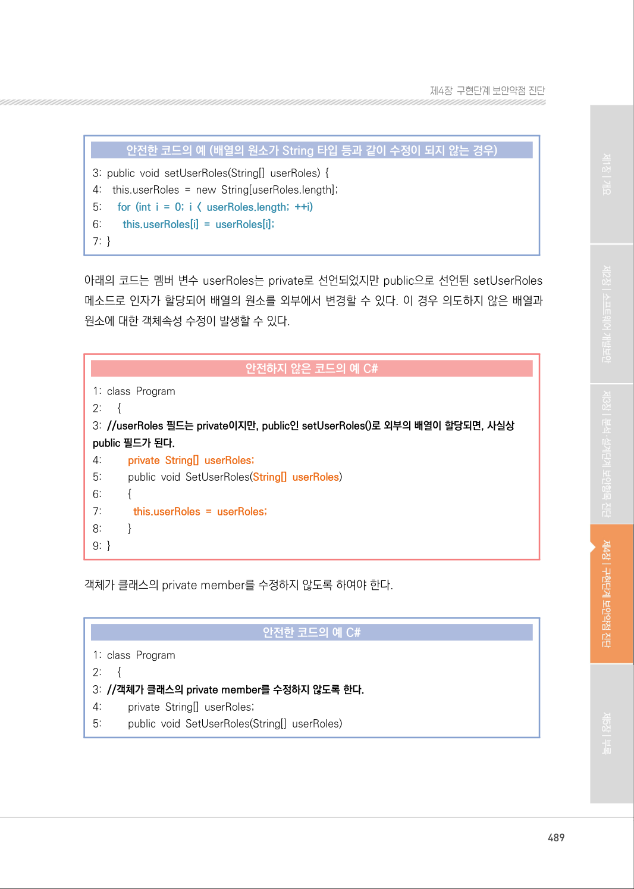
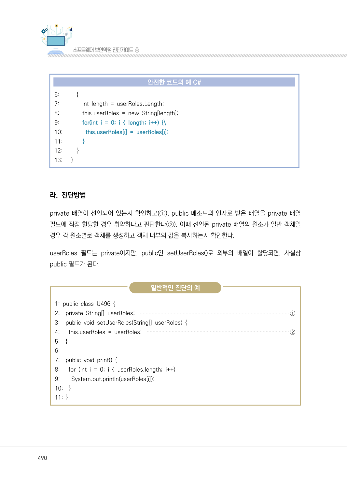
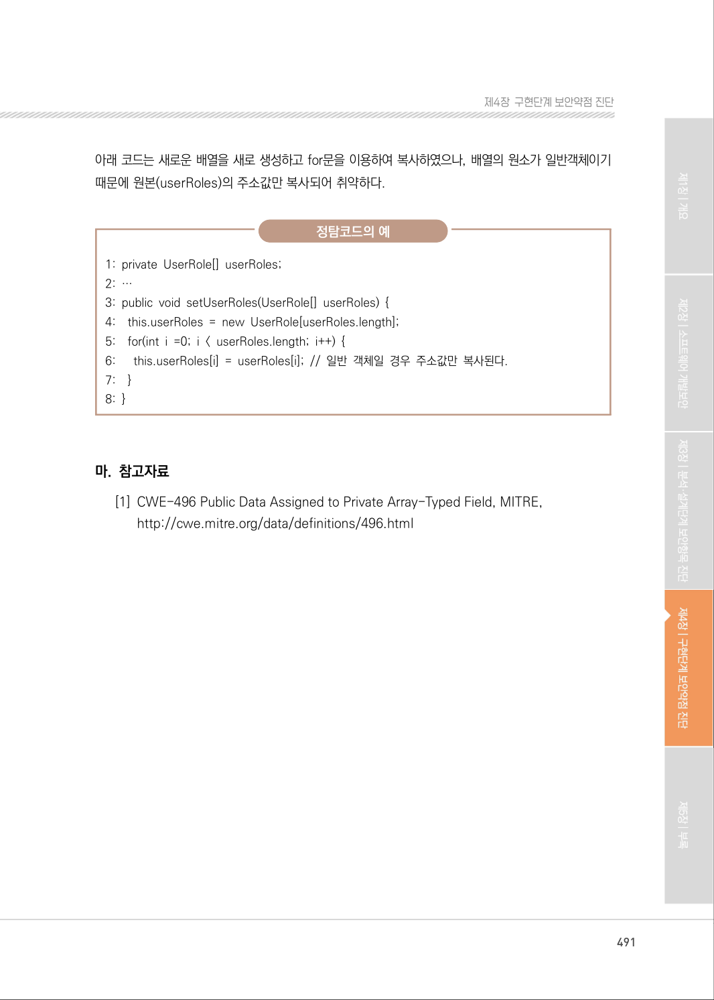

# 4. Private 배열에 Public 데이터 할당

> 변환 안내(원문 외): 아래 본문은 PDF 텍스트를 추출한 전사입니다. 코드 줄번호·특수 공백·원문 오류를 유지했습니다. 실행용 코드가 아닙니다. 표·그림·들여쓰기는 연결된 페이지 이미지와 대조하세요. 페이지 경계의 줄바꿈을 보존하며, 동일 페이지가 여러 항목에 나뉘면 각 항목의 본문은 해당 구간만 포함합니다.

### PDF 487페이지 / 인쇄 487페이지

<!-- source-page:SW-Diagnosis-2021:487; source-lines:0,2,3,4,5,6,7,8,9,10,11,12,13,14,15,16,17,18,19,20,21,22,23 -->

487

#### 4. Private 배열에 Public 데이터 할당

#### 가. 개요

public으로 선언된 메소드의 인자가 private선언된 배열에 저장되면, private배열을 외부에서 접근
하여 배열수정과 객체 속성변경이 가능해진다.

#### 나. 보안대책

public으로 선언된 메서드의 인자를 private선언된 배열로 저장되지 않도록 한다. 인자로 들어온 
배열의 복사본을 생성하고 clone() 메소드로 복사된 원소를 저장하도록 하여 private변수에 할당
하여 private선언된 배열과 객체속성에 대한 의도하지 않게 수정되는 것을 방지한다. 만약 배열 객체
의 원소가 String 타입 등과 같이 변경이 되지 않는 경우에는 인자로 들어온 배열의 복사본을 생성
하여 할당한다.

#### 다. 코드예제

아래의 코드는 멤버 변수 userRoles는 private로 선언되었지만 public으로 선언된 setUserRoles 
메소드로 인자가 할당되어 배열의 원소를 외부에서 변경할 수 있다. 이 경우 의도하지 않은 배열과 
원소에 대한 객체속성 수정이 발생할 수 있다.

#### 안전하지 않은 코드의 예 JAVA (배열의 원소가 일반객체일 경우)

```java
1: //userRoles 필드는 private이지만, public인 setUserRoles()로 외부의 배열이 할당되면, 사실상 
public 필드가 된다.
2: private UserRole[] userRoles;
3: public void setUserRoles(UserRole[] userRoles) {
4:      this.userRoles = userRoles;
5: }
```

<details><summary>원본 페이지 이미지 (변환 외 보존 자료)</summary>


</details>

### PDF 488페이지 / 인쇄 488페이지

<!-- source-page:SW-Diagnosis-2021:488; source-lines:0,1,2,3,4,5,6,7,8,9,10,11,12,13,14,15,16,17,18,19,20,21,22,23,24,25,26,27 -->

488

인자로 들어온 배열의 복사본을 생성하고 clone() 메소드로 복사된 원소를 저장하도록 하여 private
변수에 할당하면 private으로 할당된 배열과 원소에 대한 의도하지 않은 수정을 방지할 수 있다.

#### 안전한 코드의 예 JAVA (배열의 원소가 일반객체일 경우)

```java
1: //객체가 클래스의 private member를 수정하지 않도록 한다.
2: private UserRole[] userRoles;
3: public void setUserRoles(UserRole[] userRoles) { 
4: this.userRoles = new UserRole[userRoles.length];
5: for (int i = 0; i < userRoles.length; ++i)
6:      this.userRoles[i] = userRoles[i].clone();
7: }
```

아래의 코드는 멤버 변수 userRoles는 private로 선언되었지만 public으로 선언된 setUserRoles 
메소드로 인자가 할당되어 배열의 원소를 외부에서 변경할 수 있다. 이 경우 의도하지 않은 배열에 
대한 수정이 발생할 수 있다.

#### 안전하지 않은 코드의 예 (배열의 원소가 String 타입 등과 같이 수정이 되지 않는 경우)

```text
1: //userRoles 필드는 private이지만, public인 setUserRoles()로 외부의 배열이 할당되면, 사실상 
public 필드가 된다.
2: private String[] userRoles;
3: public void setUserRoles(String[] userRoles) {
4:    this.userRoles = userRoles;
5: }
```

인자로 들어온 배열의 복사본을 생성하여 private변수에 할당하면 private으로 할당된 배열에 대한 
의도하지 않은 수정을 수 있다.

#### 안전한 코드의 예 (배열의 원소가 String 타입 등과 같이 수정이 되지 않는 경우)

```text
1: //객체가 클래스의 private member를 수정하지 않도록 한다.
2: private String[] userRoles;
```

<details><summary>원본 페이지 이미지 (변환 외 보존 자료)</summary>



</details>

### PDF 489페이지 / 인쇄 489페이지

<!-- source-page:SW-Diagnosis-2021:489; source-lines:0,1,2,3,4,5,6,7,8,9,10,11,12,13,14,15,16,17,18,19,20,21,22,23,24,25,26,27,28,29,30,31,32,33,34,35,36,37,38,39,40 -->

489

제4장구현단계 보안약점 진단

#### 안전한 코드의 예 (배열의 원소가 String 타입 등과 같이 수정이 되지 않는 경우)

```text
3: public void setUserRoles(String[] userRoles) {
4:    this.userRoles = new String[userRoles.length]; 
5:      for (int i = 0; i < userRoles.length; ++i)
6:        this.userRoles[i] = userRoles[i]; 
7: }
```

아래의 코드는 멤버 변수 userRoles는 private로 선언되었지만 public으로 선언된 setUserRoles 
메소드로 인자가 할당되어 배열의 원소를 외부에서 변경할 수 있다. 이 경우 의도하지 않은 배열과 
원소에 대한 객체속성 수정이 발생할 수 있다.

#### 안전하지 않은 코드의 예 C#

```csharp
1: class Program 
2:      {
3: //userRoles 필드는 private이지만, public인 setUserRoles()로 외부의 배열이 할당되면, 사실상 
public 필드가 된다.
4:         private String[] userRoles;
5:         public void SetUserRoles(String[] userRoles)
6:         {
7:           this.userRoles = userRoles;
8:         }
9: }
```

객체가 클래스의 private member를 수정하지 않도록 하여야 한다.

#### 안전한 코드의 예 C#

```csharp
1: class Program
2:      {
3: //객체가 클래스의 private member를 수정하지 않도록 한다.
4:         private String[] userRoles;
5:         public void SetUserRoles(String[] userRoles)
```

<details><summary>원본 페이지 이미지 (변환 외 보존 자료)</summary>



</details>

### PDF 490페이지 / 인쇄 490페이지

<!-- source-page:SW-Diagnosis-2021:490; source-lines:0,1,2,3,4,5,6,7,8,9,10,11,12,13,14,15,16,17,18,19,20,21,22,23,24,25,26,27,28,29,30,31,32,33,34,35,36,37,38,39,40,41,42,43 -->

490

#### 안전한 코드의 예 C#

```csharp
6:           {
7:               int length = userRoles.Length;
8:               this.userRoles = new String[length];
9:               for(int i = 0; i < length; i++) {\
10:               this.userRoles[i] = userRoles[i];
11:             }
12:         }
13:      }
```

#### 라. 진단방법

private 배열이 선언되어 있는지 확인하고(①), public 메소드의 인자로 받은 배열을 private 배열 
필드에 직접 할당할 경우 취약하다고 판단한다(②). 이때 선언된 private 배열의 원소가 일반 객체일 
경우 각 원소별로 객체를 생성하고 객체 내부의 값을 복사하는지 확인한다.

userRoles 필드는 private이지만, public인 setUserRoles()로 외부의 배열이 할당되면, 사실상 
public 필드가 된다.

일반적인 진단의 예

```text
1: public class U496 { 
2:    private String[] userRoles; ·····································································································①
3:    public void setUserRoles(String[] userRoles) { 
4:      this.userRoles = userRoles; ·································································································②
5:    }
6:
7:    public void print() {
8:      for (int i = 0; i < userRoles.length; i++)
9:        System.out.println(userRoles[i]);
10:    }
11: }
```

<details><summary>원본 페이지 이미지 (변환 외 보존 자료)</summary>



</details>

### PDF 491페이지 / 인쇄 491페이지

<!-- source-page:SW-Diagnosis-2021:491; source-lines:0,1,2,3,4,5,6,7,8,9,10,11,12,13,14,15,16,17,18,19 -->

491

제4장구현단계 보안약점 진단

아래 코드는 새로운 배열을 새로 생성하고 for문을 이용하여 복사하였으나, 배열의 원소가 일반객체이기 
때문에 원본(userRoles)의 주소값만 복사되어 취약하다.

정탐코드의 예

```text
1: private UserRole[] userRoles; 
2: … 
3: public void setUserRoles(UserRole[] userRoles) { 
4:    this.userRoles = new UserRole[userRoles.length]; 
5:    for(int i =0; i < userRoles.length; i++) { 
6:      this.userRoles[i] = userRoles[i]; // 일반 객체일 경우 주소값만 복사된다.
7:    }
8: }
```

#### 마. 참고자료

[1] CWE-496 Public Data Assigned to Private Array-Typed Field, MITRE,

http://cwe.mitre.org/data/definitions/496.html

<details><summary>원본 페이지 이미지 (변환 외 보존 자료)</summary>



</details>

---

## 탐색 링크 (원문 외)

[통합 인덱스](../../../INDEX.md)

