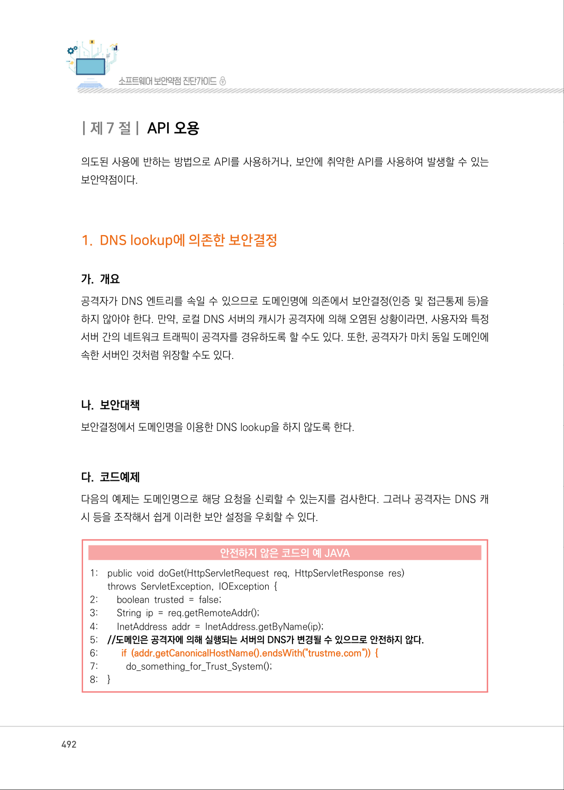
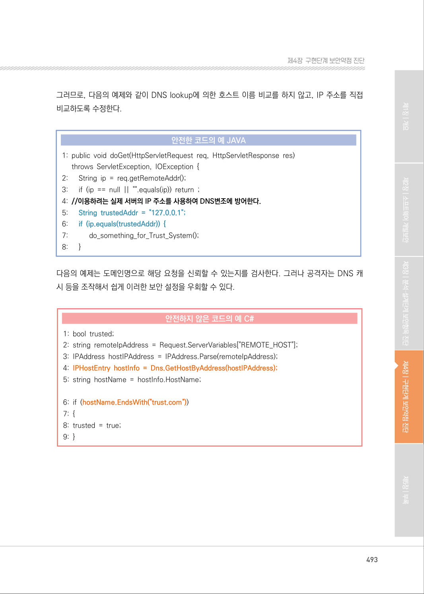
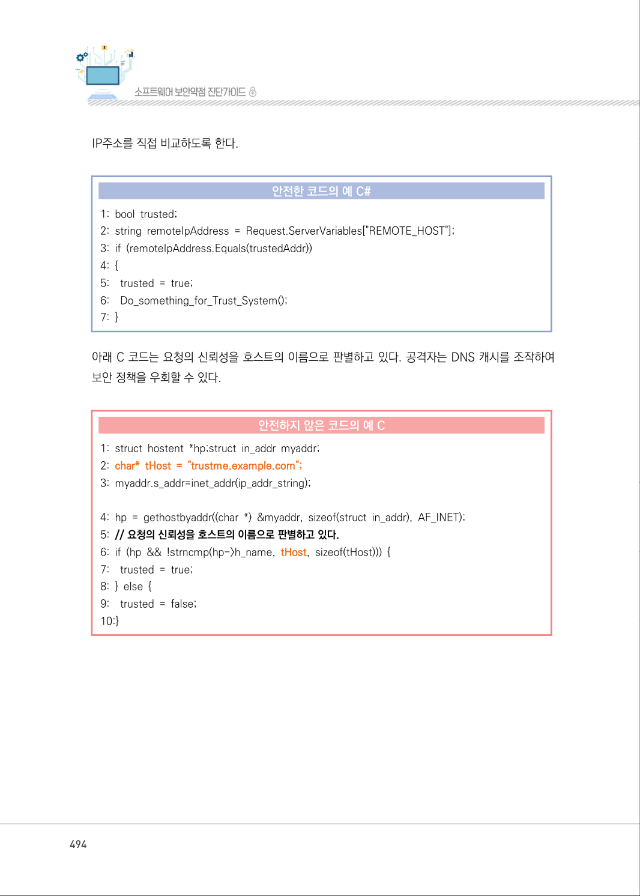
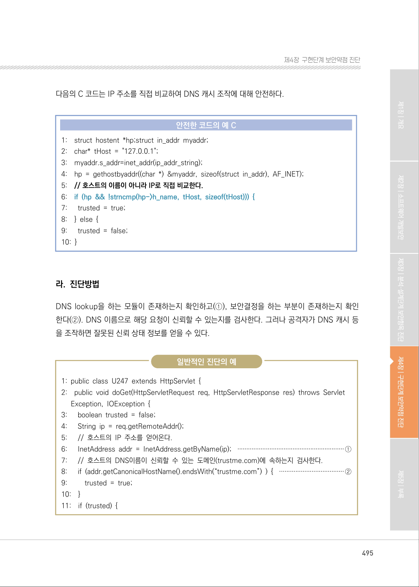
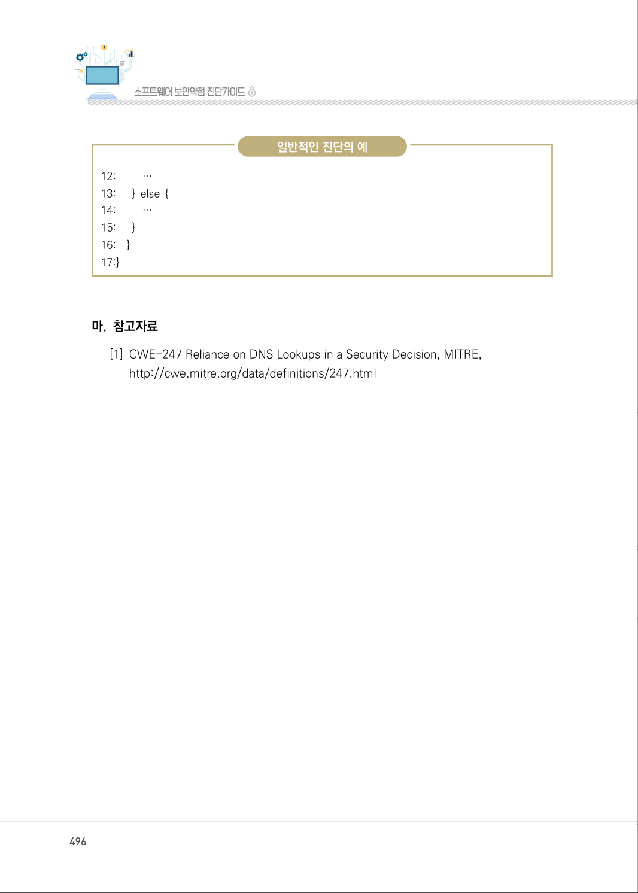
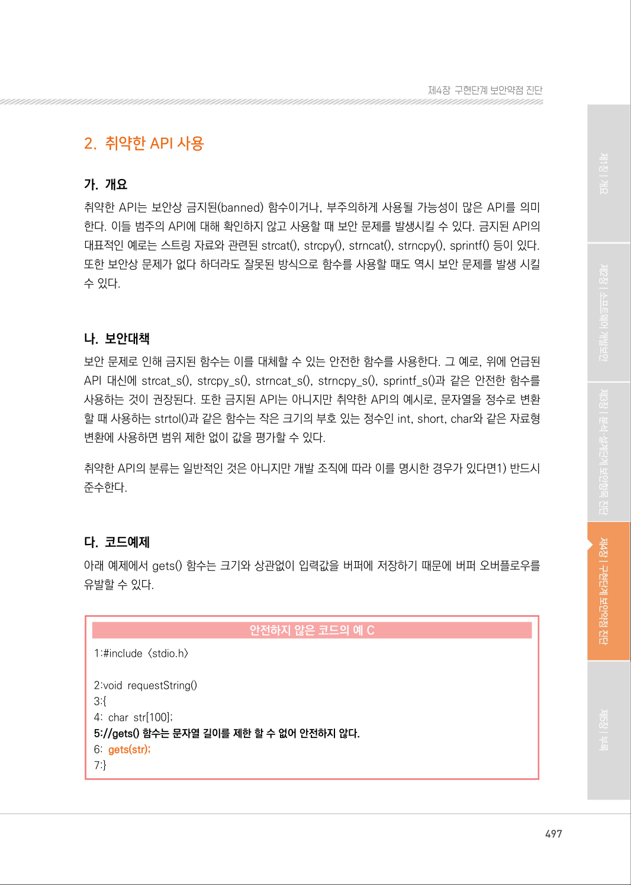

# 1. DNS lookup에 의존한 보안결정

> 변환 안내(원문 외): 아래 본문은 PDF 텍스트를 추출한 전사입니다. 코드 줄번호·특수 공백·원문 오류를 유지했습니다. 실행용 코드가 아닙니다. 표·그림·들여쓰기는 연결된 페이지 이미지와 대조하세요. 페이지 경계의 줄바꿈을 보존하며, 동일 페이지가 여러 항목에 나뉘면 각 항목의 본문은 해당 구간만 포함합니다.

### PDF 492페이지 / 인쇄 492페이지

<!-- source-page:SW-Diagnosis-2021:492; source-lines:0,4,5,6,7,8,9,10,11,12,13,14,15,16,17,18,19,20,21,22,23,24,25,26,27,28,29,30,31,32 -->

492

#### 1. DNS lookup에 의존한 보안결정

#### 가. 개요

공격자가 DNS 엔트리를 속일 수 있으므로 도메인명에 의존에서 보안결정(인증 및 접근통제 등)을 
하지 않아야 한다. 만약, 로컬 DNS 서버의 캐시가 공격자에 의해 오염된 상황이라면, 사용자와 특정 
서버 간의 네트워크 트래픽이 공격자를 경유하도록 할 수도 있다. 또한, 공격자가 마치 동일 도메인에 
속한 서버인 것처럼 위장할 수도 있다.

#### 나. 보안대책

보안결정에서 도메인명을 이용한 DNS lookup을 하지 않도록 한다.

#### 다. 코드예제

다음의 예제는 도메인명으로 해당 요청을 신뢰할 수 있는지를 검사한다. 그러나 공격자는 DNS 캐
시 등을 조작해서 쉽게 이러한 보안 설정을 우회할 수 있다.

#### 안전하지 않은 코드의 예 JAVA

```java
1:    public void doGet(HttpServletRequest req, HttpServletResponse res) 
throws ServletException, IOException { 
2:        boolean trusted = false; 
3:        String ip = req.getRemoteAddr(); 
4:        InetAddress addr = InetAddress.getByName(ip); 
5:    //도메인은 공격자에 의해 실행되는 서버의 DNS가 변경될 수 있으므로 안전하지 않다.
6:         if (addr.getCanonicalHostName().endsWith("trustme.com")) {
7:           do_something_for_Trust_System();
8:    }
```

<details><summary>원본 페이지 이미지 (변환 외 보존 자료)</summary>



</details>

### PDF 493페이지 / 인쇄 493페이지

<!-- source-page:SW-Diagnosis-2021:493; source-lines:0,1,2,3,4,5,6,7,8,9,10,11,12,13,14,15,16,17,18,19,20,21,22,23,24,25,26,27,28,29,30,31 -->

493

제4장구현단계 보안약점 진단

그러므로, 다음의 예제와 같이 DNS lookup에 의한 호스트 이름 비교를 하지 않고, IP 주소를 직접 
비교하도록 수정한다.

#### 안전한 코드의 예 JAVA

```java
1: public void doGet(HttpServletRequest req, HttpServletResponse res) 
throws ServletException, IOException { 
2:      String ip = req.getRemoteAddr(); 
3:      if (ip == null || "".equals(ip)) return ; 
4: //이용하려는 실제 서버의 IP 주소를 사용하여 DNS변조에 방어한다.
5:      String trustedAddr = "127.0.0.1"; 
6:      if (ip.equals(trustedAddr)) {
7:           do_something_for_Trust_System(); 
8:      }
```

다음의 예제는 도메인명으로 해당 요청을 신뢰할 수 있는지를 검사한다. 그러나 공격자는 DNS 캐
시 등을 조작해서 쉽게 이러한 보안 설정을 우회할 수 있다.

#### 안전하지 않은 코드의 예 C#

```csharp
1: bool trusted; 
2: string remoteIpAddress = Request.ServerVariables["REMOTE_HOST"];
3: IPAddress hostIPAddress = IPAddress.Parse(remoteIpAddress);
4: IPHostEntry hostInfo = Dns.GetHostByAddress(hostIPAddress);
5: string hostName = hostInfo.HostName; 
6: if (hostName.EndsWith("trust.com"))
7: {
8: trusted = true; 
9: }
```

<details><summary>원본 페이지 이미지 (변환 외 보존 자료)</summary>



</details>

### PDF 494페이지 / 인쇄 494페이지

<!-- source-page:SW-Diagnosis-2021:494; source-lines:0,1,2,3,4,5,6,7,8,9,10,11,12,13,14,15,16,17,18,19,20,21,22,23,24,25,26 -->

494

IP주소를 직접 비교하도록 한다.

#### 안전한 코드의 예 C#

```csharp
1: bool trusted;
2: string remoteIpAddress = Request.ServerVariables["REMOTE_HOST"];
3: if (remoteIpAddress.Equals(trustedAddr))
4: {
5:    trusted = true;
6:    Do_something_for_Trust_System();
7: }
```

아래 C 코드는 요청의 신뢰성을 호스트의 이름으로 판별하고 있다. 공격자는 DNS 캐시를 조작하여 
보안 정책을 우회할 수 있다.

#### 안전하지 않은 코드의 예 C

```c
1: struct hostent *hp;struct in_addr myaddr; 
2: char* tHost = "trustme.example.com";
3: myaddr.s_addr=inet_addr(ip_addr_string);
4: hp = gethostbyaddr((char *) &myaddr, sizeof(struct in_addr), AF_INET);
5: // 요청의 신뢰성을 호스트의 이름으로 판별하고 있다.
6: if (hp && !strncmp(hp->h_name, tHost, sizeof(tHost))) { 
7:    trusted = true; 
8: } else { 
9:    trusted = false; 
10:}
```

<details><summary>원본 페이지 이미지 (변환 외 보존 자료)</summary>



</details>

### PDF 495페이지 / 인쇄 495페이지

<!-- source-page:SW-Diagnosis-2021:495; source-lines:0,1,2,3,4,5,6,7,8,9,10,11,12,13,14,15,16,17,18,19,20,21,22,23,24,25,26,27,28,29,30,31,32,33,34,35,36,37,38,39,40,41,42,43,44,45,46,47,48,49 -->

495

제4장구현단계 보안약점 진단

다음의 C 코드는 IP 주소를 직접 비교하여 DNS 캐시 조작에 대해 안전하다.

#### 안전한 코드의 예 C

```c
1:    struct hostent *hp;struct in_addr myaddr; 
2:    char* tHost = "127.0.0.1"; 
3:    myaddr.s_addr=inet_addr(ip_addr_string); 
4:    hp = gethostbyaddr((char *) &myaddr, sizeof(struct in_addr), AF_INET);
5:    // 호스트의 이름이 아니라 IP로 직접 비교한다.
6:    if (hp && !strncmp(hp->h_name, tHost, sizeof(tHost))) {
7:      trusted = true;
8:    } else { 
9:      trusted = false; 
10: }
```

#### 라. 진단방법

DNS lookup을 하는 모듈이 존재하는지 확인하고(①), 보안결정을 하는 부분이 존재하는지 확인 
한다(②). DNS 이름으로 해당 요청이 신뢰할 수 있는지를 검사한다. 그러나 공격자가 DNS 캐시 등
을 조작하면 잘못된 신뢰 상태 정보를 얻을 수 있다.

일반적인 진단의 예

```text
1: public class U247 extends HttpServlet { 
2:    public void doGet(HttpServletRequest req, HttpServletResponse res) throws Servlet 
Exception, IOException { 
3:      boolean trusted = false; 
4:      String ip = req.getRemoteAddr(); 
5:      // 호스트의 IP 주소를 얻어온다. 
6:      InetAddress addr = InetAddress.getByName(ip); ····························································①
7:      // 호스트의 DNS이름이 신뢰할 수 있는 도메인(trustme.com)에 속하는지 검사한다.
8:      if (addr.getCanonicalHostName().endsWith(“trustme.com”) ) { ····································②
9:         trusted = true;
10:    }
11:    if (trusted) {
```

<details><summary>원본 페이지 이미지 (변환 외 보존 자료)</summary>



</details>

### PDF 496페이지 / 인쇄 496페이지

<!-- source-page:SW-Diagnosis-2021:496; source-lines:0,1,2,3,4,5,6,7,8,9,10,11,12,13,14,15 -->

496

일반적인 진단의 예

```text
12:         …
13:      } else { 
14:         …
15:      }
16:    }
17:}
```

#### 마. 참고자료

[1] CWE-247 Reliance on DNS Lookups in a Security Decision, MITRE,

http://cwe.mitre.org/data/definitions/247.html

<details><summary>원본 페이지 이미지 (변환 외 보존 자료)</summary>



</details>

### PDF 497페이지 / 인쇄 497페이지

<!-- source-page:SW-Diagnosis-2021:497; source-lines:1 -->

제4장구현단계 보안약점 진단

<details><summary>원본 페이지 이미지 (변환 외 보존 자료)</summary>



</details>

---

## 탐색 링크 (원문 외)

[통합 인덱스](../../../INDEX.md)

