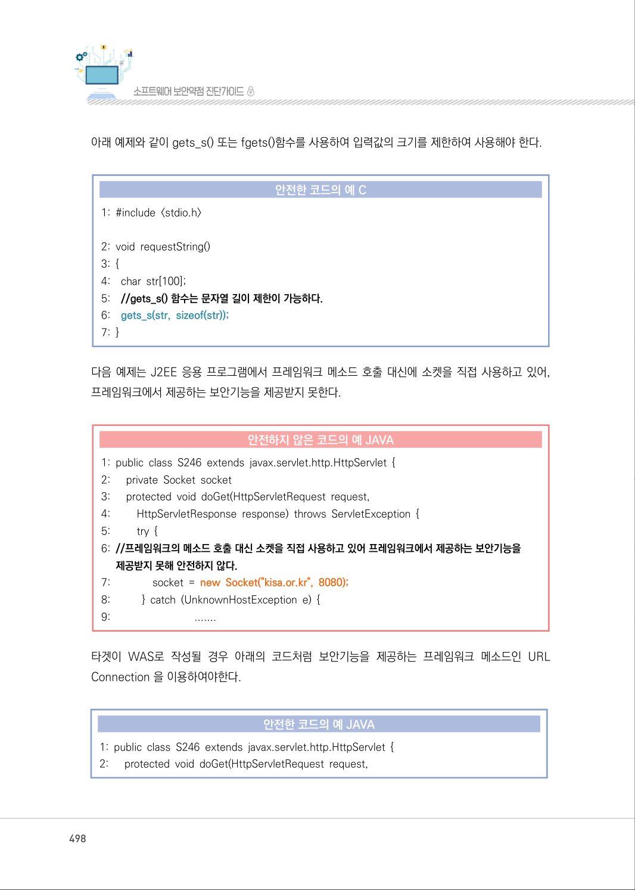
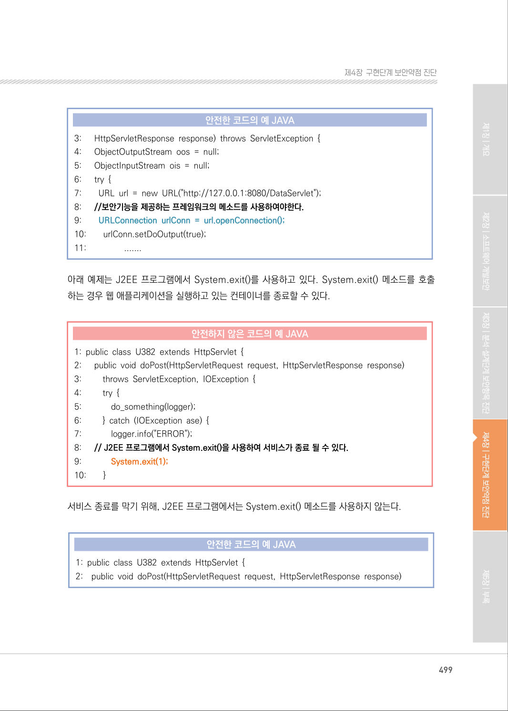
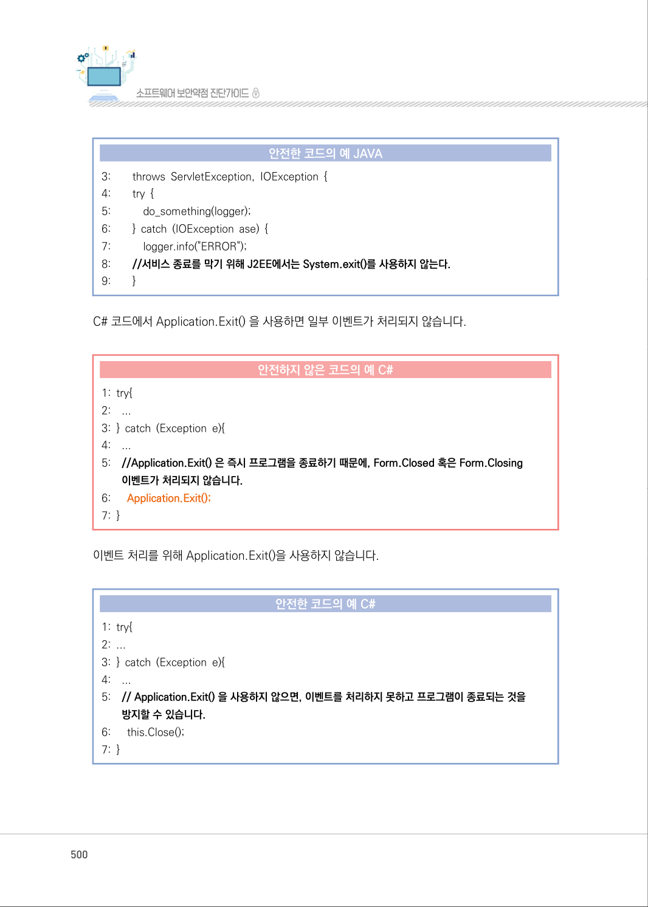
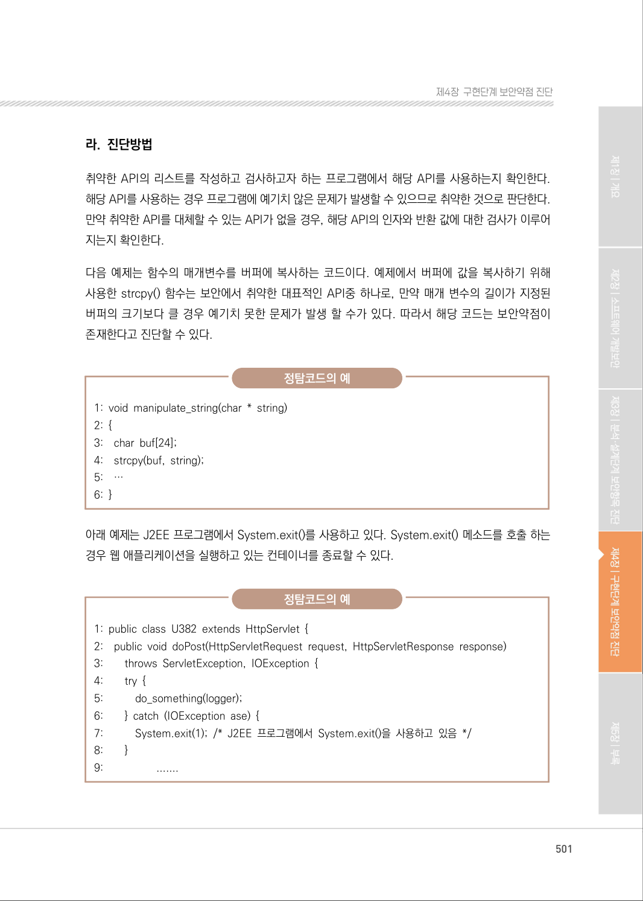
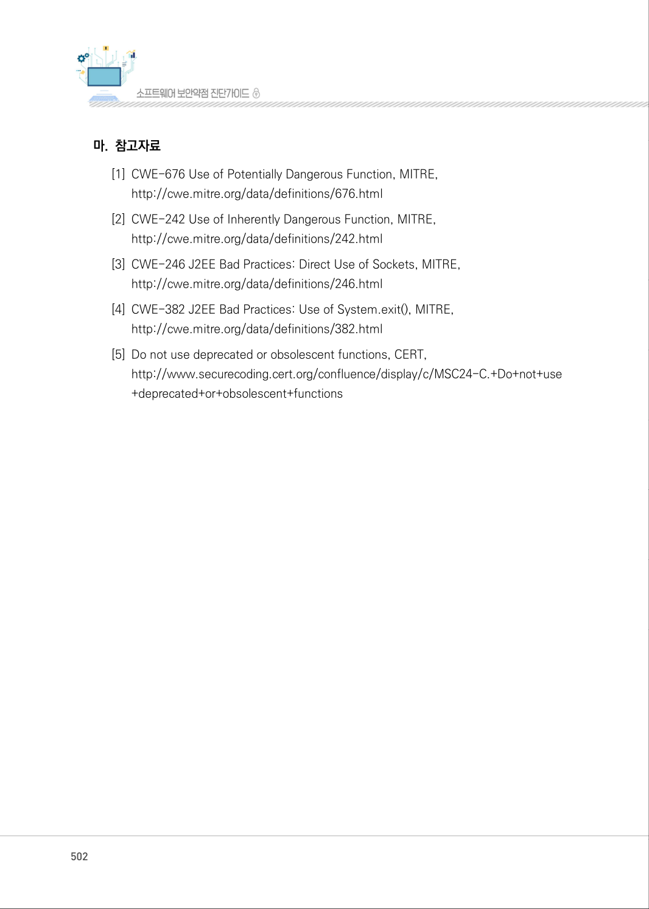
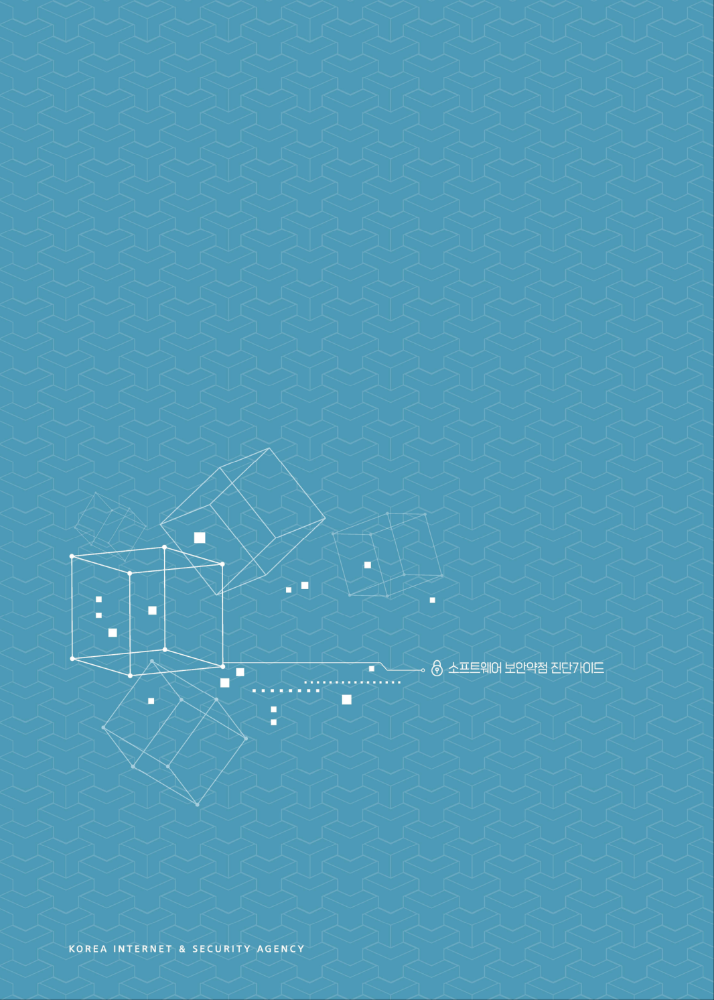

# 2. 취약한 API 사용

> 변환 안내(원문 외): 아래 본문은 PDF 텍스트를 추출한 전사입니다. 코드 줄번호·특수 공백·원문 오류를 유지했습니다. 실행용 코드가 아닙니다. 표·그림·들여쓰기는 연결된 페이지 이미지와 대조하세요. 페이지 경계의 줄바꿈을 보존하며, 동일 페이지가 여러 항목에 나뉘면 각 항목의 본문은 해당 구간만 포함합니다.

### PDF 497페이지 / 인쇄 497페이지

<!-- source-page:SW-Diagnosis-2021:497; source-lines:0,2,3,4,5,6,7,8,9,10,11,12,13,14,15,16,17,18,19,20,21,22,23,24,25,26,27 -->

497

#### 2. 취약한 API 사용

#### 가. 개요

취약한 API는 보안상 금지된(banned) 함수이거나, 부주의하게 사용될 가능성이 많은 API를 의미 
한다. 이들 범주의 API에 대해 확인하지 않고 사용할 때 보안 문제를 발생시킬 수 있다. 금지된 API의 
대표적인 예로는 스트링 자료와 관련된 strcat(), strcpy(), strncat(), strncpy(), sprintf() 등이 있다. 
또한 보안상 문제가 없다 하더라도 잘못된 방식으로 함수를 사용할 때도 역시 보안 문제를 발생 시킬 
수 있다.

#### 나. 보안대책

보안 문제로 인해 금지된 함수는 이를 대체할 수 있는 안전한 함수를 사용한다. 그 예로, 위에 언급된 
API 대신에 strcat_s(), strcpy_s(), strncat_s(), strncpy_s(), sprintf_s()과 같은 안전한 함수를 
사용하는 것이 권장된다. 또한 금지된 API는 아니지만 취약한 API의 예시로, 문자열을 정수로 변환
할 때 사용하는 strtol()과 같은 함수는 작은 크기의 부호 있는 정수인 int, short, char와 같은 자료형 
변환에 사용하면 범위 제한 없이 값을 평가할 수 있다.

취약한 API의 분류는 일반적인 것은 아니지만 개발 조직에 따라 이를 명시한 경우가 있다면1) 반드시 
준수한다.

#### 다. 코드예제

아래 예제에서 gets() 함수는 크기와 상관없이 입력값을 버퍼에 저장하기 때문에 버퍼 오버플로우를 
유발할 수 있다.

#### 안전하지 않은 코드의 예 C

```c
1:#include <stdio.h>
2:void requestString()
3:{ 
4: char str[100]; 
5://gets() 함수는 문자열 길이를 제한 할 수 없어 안전하지 않다.
6: gets(str);
7:}
```

<details><summary>원본 페이지 이미지 (변환 외 보존 자료)</summary>


</details>

### PDF 498페이지 / 인쇄 498페이지

<!-- source-page:SW-Diagnosis-2021:498; source-lines:0,1,2,3,4,5,6,7,8,9,10,11,12,13,14,15,16,17,18,19,20,21,22,23,24,25,26,27,28,29,30,31,32,33,34,35,36,37,38 -->

498

아래 예제와 같이 gets_s() 또는 fgets()함수를 사용하여 입력값의 크기를 제한하여 사용해야 한다.

#### 안전한 코드의 예 C

```c
1: #include <stdio.h>
2: void requestString()
3: {
4:    char str[100];
5:    //gets_s() 함수는 문자열 길이 제한이 가능하다.
6:    gets_s(str, sizeof(str));
7: }
```

다음 예제는 J2EE 응용 프로그램에서 프레임워크 메소드 호출 대신에 소켓을 직접 사용하고 있어, 
프레임워크에서 제공하는 보안기능을 제공받지 못한다.

#### 안전하지 않은 코드의 예 JAVA

```java
1: public class S246 extends javax.servlet.http.HttpServlet { 
2:      private Socket socket 
3:      protected void doGet(HttpServletRequest request, 
4:         HttpServletResponse response) throws ServletException { 
5:         try { 
6: //프레임워크의 메소드 호출 대신 소켓을 직접 사용하고 있어 프레임워크에서 제공하는 보안기능을 
제공받지 못해 안전하지 않다.
7:               socket = new Socket("kisa.or.kr", 8080); 
8:           } catch (UnknownHostException e) {
9:                              .......
```

타겟이 WAS로 작성될 경우 아래의 코드처럼 보안기능을 제공하는 프레임워크 메소드인 URL 
Connection 을 이용하여야한다.

#### 안전한 코드의 예 JAVA

```java
1: public class S246 extends javax.servlet.http.HttpServlet { 
2:      protected void doGet(HttpServletRequest request,
```

<details><summary>원본 페이지 이미지 (변환 외 보존 자료)</summary>



</details>

### PDF 499페이지 / 인쇄 499페이지

<!-- source-page:SW-Diagnosis-2021:499; source-lines:0,1,2,3,4,5,6,7,8,9,10,11,12,13,14,15,16,17,18,19,20,21,22,23,24,25,26,27,28,29,30,31,32,33,34,35,36,37,38,39,40,41,42,43,44,45,46,47 -->

499

제4장구현단계 보안약점 진단

#### 안전한 코드의 예 JAVA

```java
3:      HttpServletResponse response) throws ServletException {
4:      ObjectOutputStream oos = null; 
5:      ObjectInputStream ois = null; 
6:      try { 
7:        URL url = new URL("http://127.0.0.1:8080/DataServlet"); 
8:      //보안기능을 제공하는 프레임워크의 메소드를 사용하여야한다.
9:        URLConnection urlConn = url.openConnection();
10:        urlConn.setDoOutput(true);
11:                 .......
```

아래 예제는 J2EE 프로그램에서 System.exit()를 사용하고 있다. System.exit() 메소드를 호출 
하는 경우 웹 애플리케이션을 실행하고 있는 컨테이너를 종료할 수 있다.

#### 안전하지 않은 코드의 예 JAVA

```java
1: public class U382 extends HttpServlet { 
2:      public void doPost(HttpServletRequest request, HttpServletResponse response)
3:         throws ServletException, IOException {
4:         try { 
5:             do_something(logger); 
6:         } catch (IOException ase) { 
7:             logger.info("ERROR"); 
8:      // J2EE 프로그램에서 System.exit()을 사용하여 서비스가 종료 될 수 있다.
9:             System.exit(1);
10:        }
```

서비스 종료를 막기 위해, J2EE 프로그램에서는 System.exit() 메소드를 사용하지 않는다.

#### 안전한 코드의 예 JAVA

```java
1: public class U382 extends HttpServlet { 
2:    public void doPost(HttpServletRequest request, HttpServletResponse response)
```

<details><summary>원본 페이지 이미지 (변환 외 보존 자료)</summary>



</details>

### PDF 500페이지 / 인쇄 500페이지

<!-- source-page:SW-Diagnosis-2021:500; source-lines:0,1,2,3,4,5,6,7,8,9,10,11,12,13,14,15,16,17,18,19,20,21,22,23,24,25,26,27,28,29,30,31,32,33,34,35,36,37,38,39,40,41,42 -->

500

#### 안전한 코드의 예 JAVA

```java
3:        throws ServletException, IOException { 
4:        try { 
5:           do_something(logger); 
6:        } catch (IOException ase) { 
7:           logger.info("ERROR"); 
8:        //서비스 종료를 막기 위해 J2EE에서는 System.exit()를 사용하지 않는다.
9:        }
```

C# 코드에서 Application.Exit() 을 사용하면 일부 이벤트가 처리되지 않습니다. 

#### 안전하지 않은 코드의 예 C#

```csharp
1: try{ 
2:    ... 
3: } catch (Exception e){ 
4:    ... 
5:    //Application.Exit() 은 즉시 프로그램을 종료하기 때문에, Form.Closed 혹은 Form.Closing 
이벤트가 처리되지 않습니다.
6:      Application.Exit();
7: }
```

이벤트 처리를 위해 Application.Exit()을 사용하지 않습니다.

#### 안전한 코드의 예 C#

```csharp
1: try{ 
2: ... 
3: } catch (Exception e){ 
4:    ...
5:    // Application.Exit() 을 사용하지 않으면, 이벤트를 처리하지 못하고 프로그램이 종료되는 것을 
방지할 수 있습니다.
6:      this.Close();
7: }
```

<details><summary>원본 페이지 이미지 (변환 외 보존 자료)</summary>



</details>

### PDF 501페이지 / 인쇄 501페이지

<!-- source-page:SW-Diagnosis-2021:501; source-lines:0,1,2,3,4,5,6,7,8,9,10,11,12,13,14,15,16,17,18,19,20,21,22,23,24,25,26,27,28,29,30,31,32,33,34,35,36,37,38,39,40 -->

501

제4장구현단계 보안약점 진단

#### 라. 진단방법

취약한 API의 리스트를 작성하고 검사하고자 하는 프로그램에서 해당 API를 사용하는지 확인한다. 
해당 API를 사용하는 경우 프로그램에 예기치 않은 문제가 발생할 수 있으므로 취약한 것으로 판단한다. 
만약 취약한 API를 대체할 수 있는 API가 없을 경우, 해당 API의 인자와 반환 값에 대한 검사가 이루어
지는지 확인한다.

다음 예제는 함수의 매개변수를 버퍼에 복사하는 코드이다. 예제에서 버퍼에 값을 복사하기 위해 
사용한 strcpy() 함수는 보안에서 취약한 대표적인 API중 하나로, 만약 매개 변수의 길이가 지정된 
버퍼의 크기보다 클 경우 예기치 못한 문제가 발생 할 수가 있다. 따라서 해당 코드는 보안약점이 
존재한다고 진단할 수 있다.

정탐코드의 예

```text
1: void manipulate_string(char * string) 
2: { 
3:    char buf[24]; 
4:    strcpy(buf, string); 
5:    … 
6: }
```

아래 예제는 J2EE 프로그램에서 System.exit()를 사용하고 있다. System.exit() 메소드를 호출 하는 
경우 웹 애플리케이션을 실행하고 있는 컨테이너를 종료할 수 있다.

정탐코드의 예

```text
1: public class U382 extends HttpServlet { 
2:    public void doPost(HttpServletRequest request, HttpServletResponse response)
3:        throws ServletException, IOException { 
4:        try { 
5:           do_something(logger); 
6:        } catch (IOException ase) { 
7:           System.exit(1); /* J2EE 프로그램에서 System.exit()을 사용하고 있음 */
8:        }
9:                   .......
```

<details><summary>원본 페이지 이미지 (변환 외 보존 자료)</summary>



</details>

### PDF 502페이지 / 인쇄 502페이지

<!-- source-page:SW-Diagnosis-2021:502; source-lines:0,1,2,3,4,5,6,7,8,9,10,11,12 -->

502

#### 마. 참고자료

[1] CWE-676 Use of Potentially Dangerous Function, MITRE,

http://cwe.mitre.org/data/definitions/676.html
[2] CWE-242 Use of Inherently Dangerous Function, MITRE,

http://cwe.mitre.org/data/definitions/242.html 
[3] CWE-246 J2EE Bad Practices: Direct Use of Sockets, MITRE,

http://cwe.mitre.org/data/definitions/246.html 
[4] CWE-382 J2EE Bad Practices: Use of System.exit(), MITRE,

http://cwe.mitre.org/data/definitions/382.html 
[5] Do not use deprecated or obsolescent functions, CERT,

http://www.securecoding.cert.org/confluence/display/c/MSC24-C.+Do+not+use
+deprecated+or+obsolescent+functions

<details><summary>원본 페이지 이미지 (변환 외 보존 자료)</summary>



</details>

### PDF 503페이지 / 인쇄 503페이지

<!-- source-page:SW-Diagnosis-2021:503; source-lines: -->


<details><summary>원본 페이지 이미지 (변환 외 보존 자료)</summary>


</details>

### PDF 504페이지 / 인쇄 504페이지

<!-- source-page:SW-Diagnosis-2021:504; source-lines: -->


<details><summary>원본 페이지 이미지 (변환 외 보존 자료)</summary>



</details>

### PDF 505페이지 / 인쇄 505페이지

<!-- source-page:SW-Diagnosis-2021:505; source-lines:5 -->

5

<details><summary>원본 페이지 이미지 (변환 외 보존 자료)</summary>


</details>

---

## 탐색 링크 (원문 외)

[통합 인덱스](../../../INDEX.md)

