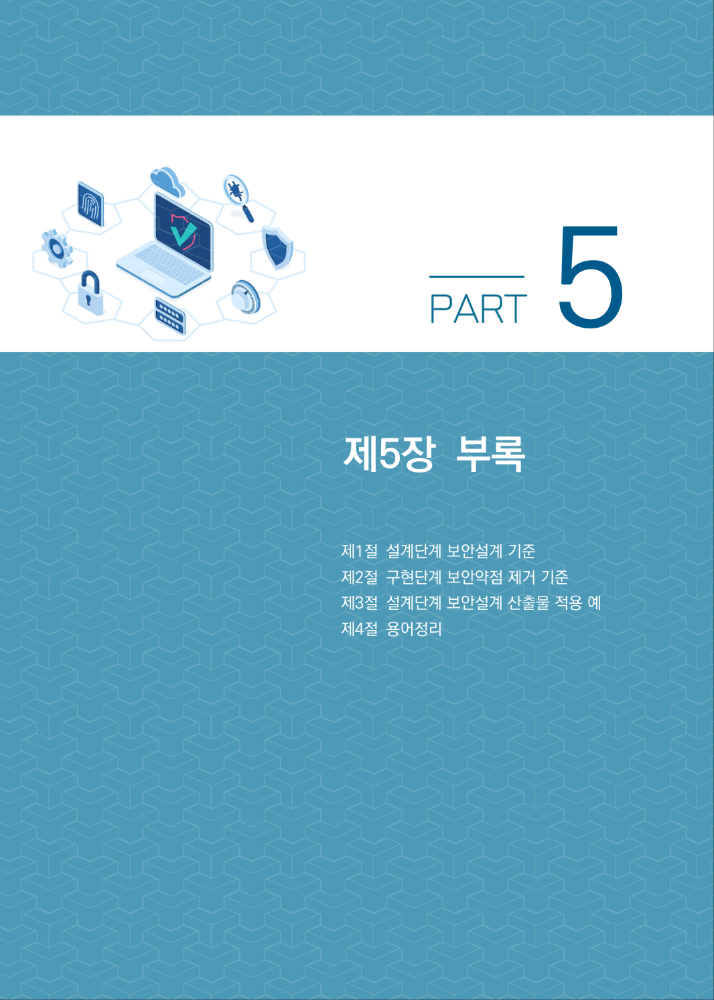
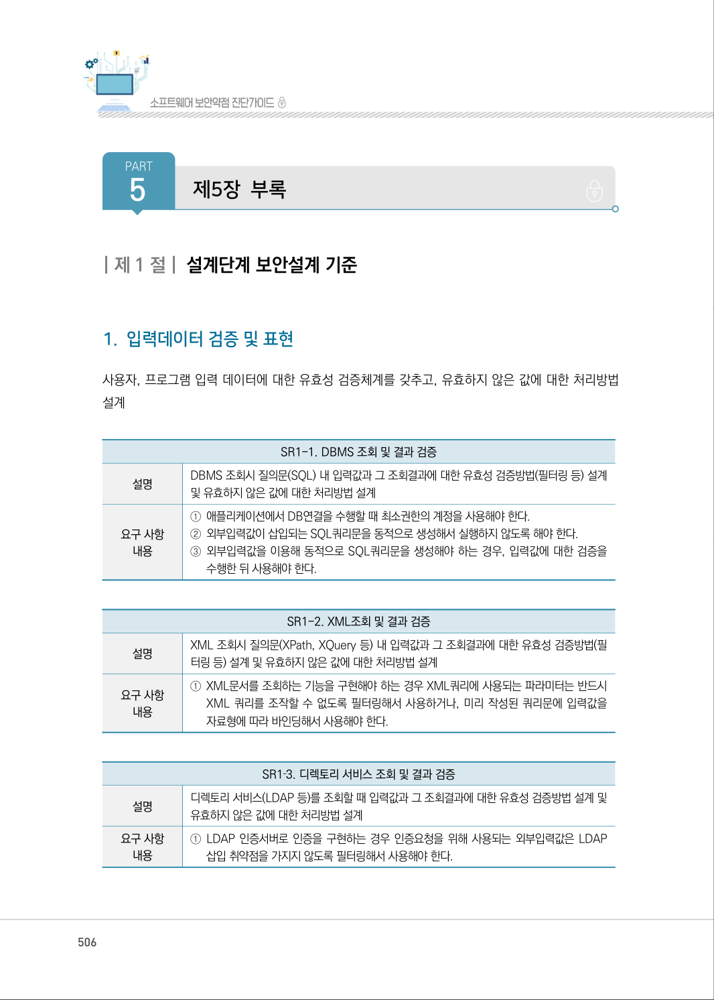

# 제5장 부록

> 변환 안내(원문 외): 아래 본문은 PDF 텍스트를 추출한 전사입니다. 코드 줄번호·특수 공백·원문 오류를 유지했습니다. 실행용 코드가 아닙니다. 표·그림·들여쓰기는 연결된 페이지 이미지와 대조하세요. 페이지 경계의 줄바꿈을 보존하며, 동일 페이지가 여러 항목에 나뉘면 각 항목의 본문은 해당 구간만 포함합니다.

### PDF 505페이지 / 인쇄 505페이지

<!-- source-page:SW-Diagnosis-2021:505; source-lines:0,1,2,3,4 -->

제5장부록

제1절설계단계 보안설계 기준
제2절구현단계 보안약점 제거 기준
제3절설계단계 보안설계 산출물 적용 예
제4절용어정리

원본 페이지 이미지 (변환 외 보존 자료)

### PDF 506페이지 / 인쇄 506페이지

<!-- source-page:SW-Diagnosis-2021:506; source-lines:1,2,3 -->

PART
5

제5장부록

원본 페이지 이미지 (변환 외 보존 자료)

---

## 탐색 링크 (원문 외)

[통합 인덱스](../../INDEX.md)

