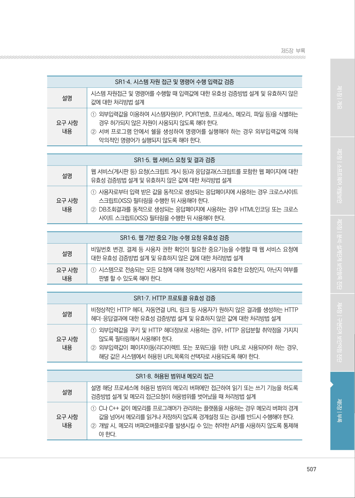
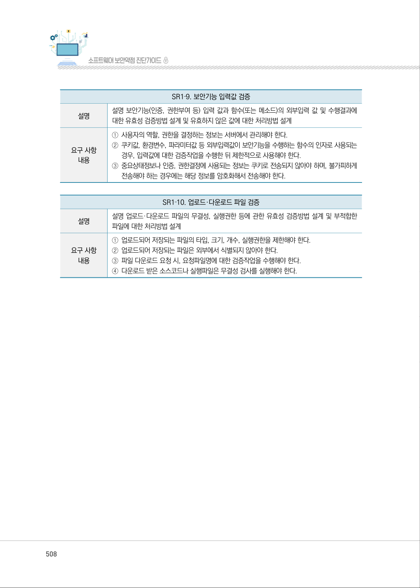
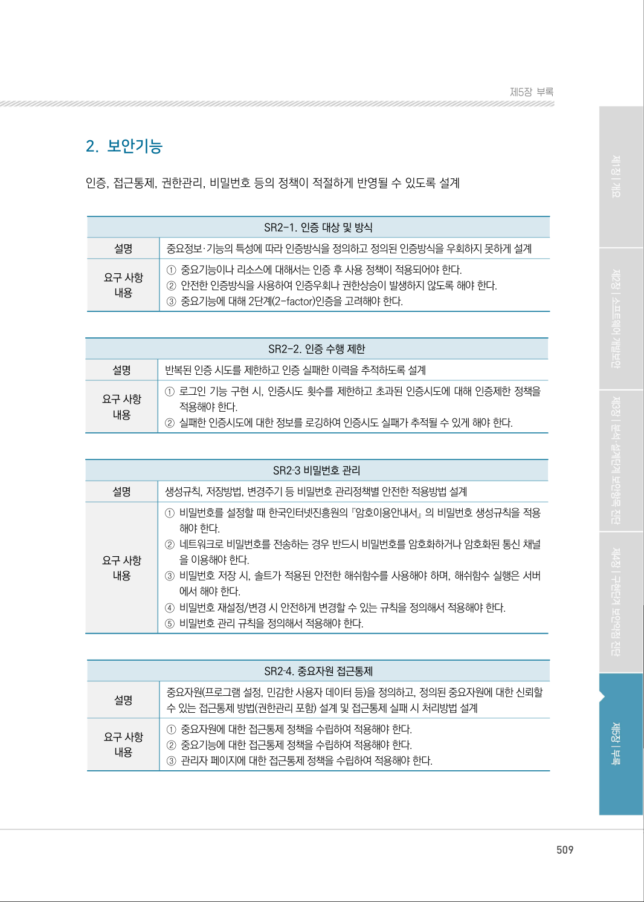
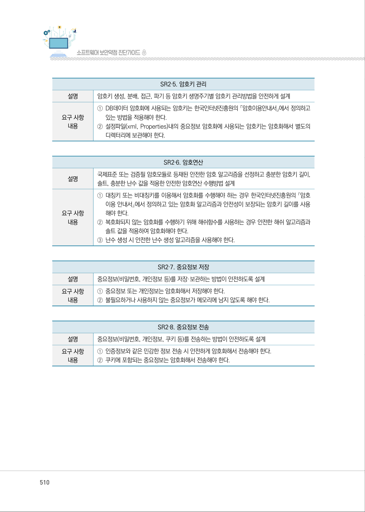
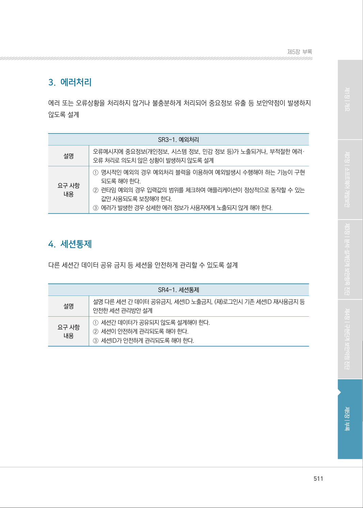

# 제1절 설계단계 보안설계 기준

> 변환 안내(원문 외): 아래 본문은 PDF 텍스트를 추출한 전사입니다. 코드 줄번호·특수 공백·원문 오류를 유지했습니다. 실행용 코드가 아닙니다. 표·그림·들여쓰기는 연결된 페이지 이미지와 대조하세요. 페이지 경계의 줄바꿈을 보존하며, 동일 페이지가 여러 항목에 나뉘면 각 항목의 본문은 해당 구간만 포함합니다.

### PDF 506페이지 / 인쇄 506페이지

<!-- source-page:SW-Diagnosis-2021:506; source-lines:0,4,5,6,7,8,9,10,11,12,13,14,15,16,17,18,19,20,21,22,23,24,25,26,27,28,29,30,31,32,33,34 -->

506

| 제1 절| 설계단계 보안설계 기준

#### 1. 입력데이터 검증 및 표현

사용자, 프로그램 입력 데이터에 대한 유효성 검증체계를 갖추고, 유효하지 않은 값에 대한 처리방법 
설계

SR1-1. DBMS 조회 및 결과 검증

| 설명 | DBMS 조회시 질의문(SQL) 내 입력값과 그 조회결과에 대한 유효성 검증방법(필터링 등) 설계 및 유효하지 않은 값에 대한 처리방법 설계 |
| --- | --- |
| 요구 사항 내용 | ① 애플리케이션에서 DB연결을 수행할 때 최소권한의 계정을 사용해야 한다. ② 외부입력값이 삽입되는 SQL쿼리문을 동적으로 생성해서 실행하지 않도록 해야 한다. ③ 외부입력값을 이용해 동적으로 SQL쿼리문을 생성해야 하는 경우, 입력값에 대한 검증을 수행한 뒤 사용해야 한다. |

SR1-2. XML조회 및 결과 검증

| 설명 | XML 조회시 질의문(XPath, XQuery 등) 내 입력값과 그 조회결과에 대한 유효성 검증방법(필 터링 등) 설계 및 유효하지 않은 값에 대한 처리방법 설계 |
| --- | --- |
| 요구 사항 내용 | ① XML문서를 조회하는 기능을 구현해야 하는 경우 XML쿼리에 사용되는 파라미터는 반드시 XML 쿼리를 조작할 수 없도록 필터링해서 사용하거나, 미리 작성된 쿼리문에 입력값을 자료형에 따라 바인딩해서 사용해야 한다. |

SR1‐3. 디렉토리 서비스 조회 및 결과 검증

| 설명 | 디렉토리 서비스(LDAP 등)를 조회할 때 입력값과 그 조회결과에 대한 유효성 검증방법 설계 및 유효하지 않은 값에 대한 처리방법 설계 |
| --- | --- |
| 요구 사항 내용 | ① LDAP 인증서버로 인증을 구현하는 경우 인증요청을 위해 사용되는 외부입력값은 LDAP 삽입 취약점을 가지지 않도록 필터링해서 사용해야 한다. |

원본 페이지 이미지 (변환 외 보존 자료)

### PDF 507페이지 / 인쇄 507페이지

<!-- source-page:SW-Diagnosis-2021:507; source-lines:0,1,2,3,4,5,6,7,8,9,10,11,12,13,14,15,16,17,18,19,20,21,22,23,24,25,26,27,28,29,30,31,32,33,34,35,36,37,38,39,40,41,42,43,44,45,46,47,48,49 -->

507

제5장부록

SR1‐4. 시스템 자원 접근 및 명령어 수행 입력값 검증

| 설명 | 시스템 자원접근 및 명령어를 수행할 때 입력값에 대한 유효성 검증방법 설계 및 유효하지 않은 값에 대한 처리방법 설계 |
| --- | --- |
| 요구 사항 내용 | ① 외부입력값을 이용하여 시스템자원(IP, PORT번호, 프로세스, 메모리, 파일 등)을 식별하는 경우 허가되지 않은 자원이 사용되지 않도록 해야 한다. ② 서버 프로그램 안에서 쉘을 생성하여 명령어를 실행해야 하는 경우 외부입력값에 의해 악의적인 명령어가 실행되지 않도록 해야 한다. |

SR1‐5. 웹 서비스 요청 및 결과 검증

| 설명 | 웹 서비스(게시판 등) 요청(스크립트 게시 등)과 응답결과(스크립트를 포함한 웹 페이지)에 대한 유효성 검증방법 설계 및 유효하지 않은 값에 대한 처리방법 설계 |
| --- | --- |
| 요구 사항 내용 | ① 사용자로부터 입력 받은 값을 동적으로 생성되는 응답페이지에 사용하는 경우 크로스사이트 스크립트(XSS) 필터링을 수행한 뒤 사용해야 한다. ② DB조회결과를 동적으로 생성되는 응답페이지에 사용하는 경우 HTML인코딩 또는 크로스 사이트 스크립트(XSS) 필터링을 수행한 뒤 사용해야 한다. |

SR1‐6. 웹 기반 중요 기능 수행 요청 유효성 검증

| 설명 | 비밀번호 변경, 결제 등 사용자 권한 확인이 필요한 중요기능을 수행할 때 웹 서비스 요청에 대한 유효성 검증방법 설계 및 유효하지 않은 값에 대한 처리방법 설계 |
| --- | --- |
| 요구 사항 내용 | ① 시스템으로 전송되는 모든 요청에 대해 정상적인 사용자의 유효한 요청인지, 아닌지 여부를 판별 할 수 있도록 해야 한다. |

SR1‐7. HTTP 프로토콜 유효성 검증

| 설명 | 비정상적인 HTTP 헤더, 자동연결 URL 링크 등 사용자가 원하지 않은 결과를 생성하는 HTTP 헤더·응답결과에 대한 유효성 검증방법 설계 및 유효하지 않은 값에 대한 처리방법 설계 |
| --- | --- |
| 요구 사항 내용 | ① 외부입력값을 쿠키 및 HTTP 헤더정보로 사용하는 경우, HTTP 응답분할 취약점을 가지지 않도록 필터링해서 사용해야 한다. ② 외부입력값이 페이지이동(리다이렉트 또는 포워드)을 위한 URL로 사용되어야 하는 경우, 해당 값은 시스템에서 허용된 URL목록의 선택자로 사용되도록 해야 한다. |

SR1‐8. 허용된 범위내 메모리 접근

| 설명 | 설명 해당 프로세스에 허용된 범위의 메모리 버퍼에만 접근하여 읽기 또는 쓰기 기능을 하도록 검증방법 설계 및 메모리 접근요청이 허용범위를 벗어났을 때 처리방법 설계 |
| --- | --- |
| 요구 사항 내용 | ① C나 C++ 같이 메모리를 프로그래머가 관리하는 플랫폼을 사용하는 경우 메모리 버퍼의 경계 값을 넘어서 메모리를 읽거나 저장하지 않도록 경계설정 또는 검사를 반드시 수행해야 한다. ② 개발 시, 메모리 버퍼오버플로우를 발생시킬 수 있는 취약한 API를 사용하지 않도록 통제해 야 한다. |

원본 페이지 이미지 (변환 외 보존 자료)

### PDF 508페이지 / 인쇄 508페이지

<!-- source-page:SW-Diagnosis-2021:508; source-lines:0,1,2,3,4,5,6,7,8,9,10,11,12,13,14,15,16,17,18,19,20,21 -->

508

SR1‐9. 보안기능 입력값 검증

설명

설명 보안기능(인증, 권한부여 등) 입력 값과 함수(또는 메소드)의 외부입력 값 및 수행결과에 
대한 유효성 검증방법 설계 및 유효하지 않은 값에 대한 처리방법 설계

요구 사항 

내용

①사용자의 역할, 권한을 결정하는 정보는 서버에서 관리해야 한다.
②쿠키값, 환경변수, 파라미터값 등 외부입력값이 보안기능을 수행하는 함수의 인자로 사용되는 

경우, 입력값에 대한 검증작업을 수행한 뒤 제한적으로 사용해야 한다.
③중요상태정보나 인증, 권한결정에 사용되는 정보는 쿠키로 전송되지 않아야 하며, 불가피하게 

전송해야 하는 경우에는 해당 정보를 암호화해서 전송해야 한다.

SR1‐10. 업로드·다운로드 파일 검증

설명

설명 업로드·다운로드 파일의 무결성, 실행권한 등에 관한 유효성 검증방법 설계 및 부적합한 
파일에 대한 처리방법 설계

요구 사항 

내용

①업로드되어 저장되는 파일의 타입, 크기, 개수, 실행권한을 제한해야 한다. 
②업로드되어 저장되는 파일은 외부에서 식별되지 않아야 한다.
③파일 다운로드 요청 시, 요청파일명에 대한 검증작업을 수행해야 한다.
④다운로드 받은 소스코드나 실행파일은 무결성 검사를 실행해야 한다.

원본 페이지 이미지 (변환 외 보존 자료)

### PDF 509페이지 / 인쇄 509페이지

<!-- source-page:SW-Diagnosis-2021:509; source-lines:0,1,2,3,4,5,6,7,8,9,10,11,12,13,14,15,16,17,18,19,20,21,22,23,24,25,26,27,28,29,30,31,32,33,34,35,36,37,38,39,40,41 -->

509

제5장부록

#### 2. 보안기능

인증, 접근통제, 권한관리, 비밀번호 등의 정책이 적절하게 반영될 수 있도록 설계

SR2-1. 인증 대상 및 방식

| 설명 | 중요정보·기능의 특성에 따라 인증방식을 정의하고 정의된 인증방식을 우회하지 못하게 설계 |
| --- | --- |
| 요구 사항 내용 | ① 중요기능이나 리소스에 대해서는 인증 후 사용 정책이 적용되어야 한다. ② 안전한 인증방식을 사용하여 인증우회나 권한상승이 발생하지 않도록 해야 한다. ③ 중요기능에 대해 2단계(2-factor)인증을 고려해야 한다. |

SR2-2. 인증 수행 제한

| 설명 | 반복된 인증 시도를 제한하고 인증 실패한 이력을 추적하도록 설계 |
| --- | --- |
| 요구 사항 내용 | ① 로그인 기능 구현 시, 인증시도 횟수를 제한하고 초과된 인증시도에 대해 인증제한 정책을 적용해야 한다. ② 실패한 인증시도에 대한 정보를 로깅하여 인증시도 실패가 추적될 수 있게 해야 한다. |

SR2‐3 비밀번호 관리

| 설명 | 생성규칙, 저장방법, 변경주기 등 비밀번호 관리정책별 안전한 적용방법 설계 |
| --- | --- |
| 요구 사항 내용 | ① 비밀번호를 설정할 때 한국인터넷진흥원의 『암호이용안내서』 의 비밀번호 생성규칙을 적용 해야 한다. ② 네트워크로 비밀번호를 전송하는 경우 반드시 비밀번호를 암호화하거나 암호화된 통신 채널 을 이용해야 한다. ③ 비밀번호 저장 시, 솔트가 적용된 안전한 해쉬함수를 사용해야 하며, 해쉬함수 실행은 서버 에서 해야 한다. ④ 비밀번호 재설정/변경 시 안전하게 변경할 수 있는 규칙을 정의해서 적용해야 한다. ⑤ 비밀번호 관리 규칙을 정의해서 적용해야 한다. |

SR2‐4. 중요자원 접근통제

| 설명 | 중요자원(프로그램 설정, 민감한 사용자 데이터 등)을 정의하고, 정의된 중요자원에 대한 신뢰할 수 있는 접근통제 방법(권한관리 포함) 설계 및 접근통제 실패 시 처리방법 설계 |
| --- | --- |
| 요구 사항 내용 | ① 중요자원에 대한 접근통제 정책을 수립하여 적용해야 한다. ② 중요기능에 대한 접근통제 정책을 수립하여 적용해야 한다. ③ 관리자 페이지에 대한 접근통제 정책을 수립하여 적용해야 한다. |

원본 페이지 이미지 (변환 외 보존 자료)

### PDF 510페이지 / 인쇄 510페이지

<!-- source-page:SW-Diagnosis-2021:510; source-lines:0,1,2,3,4,5,6,7,8,9,10,11,12,13,14,15,16,17,18,19,20,21,22,23,24,25,26,27,28,29,30,31,32,33,34,35 -->

510

SR2‐5. 암호키 관리

설명

암호키 생성, 분배, 접근, 파기 등 암호키 생명주기별 암호키 관리방법을 안전하게 설계

요구 사항 

내용

①DB데이터 암호화에 사용되는 암호키는 한국인터넷진흥원의 「암호이용안내서」에서 정의하고 

있는 방법을 적용해야 한다.
②설정파일(xml, Properties)내의 중요정보 암호화에 사용되는 암호키는 암호화해서 별도의 

디렉터리에 보관해야 한다.

SR2‐6. 암호연산

| 설명 | 국제표준 또는 검증필 암호모듈로 등재된 안전한 암호 알고리즘을 선정하고 충분한 암호키 길이, 솔트, 충분한 난수 값을 적용한 안전한 암호연산 수행방법 설계 |
| --- | --- |
| 요구 사항 내용 | ① 대칭키 또는 비대칭키를 이용해서 암호화를 수행해야 하는 경우 한국인터넷진흥원의 『암호 이용 안내서』에서 정의하고 있는 암호화 알고리즘과 안전성이 보장되는 암호키 길이를 사용 해야 한다. ② 복호화되지 않는 암호화를 수행하기 위해 해쉬함수를 사용하는 경우 안전한 해쉬 알고리즘과 솔트 값을 적용하여 암호화해야 한다. ③ 난수 생성 시 안전한 난수 생성 알고리즘을 사용해야 한다. |

SR2‐7. 중요정보 저장

| 설명 | 중요정보(비밀번호, 개인정보 등)를 저장·보관하는 방법이 안전하도록 설계 |
| --- | --- |
| 요구 사항 내용 | ① 중요정보 또는 개인정보는 암호화해서 저장해야 한다. ② 불필요하거나 사용하지 않는 중요정보가 메모리에 남지 않도록 해야 한다. |

SR2‐8. 중요정보 전송

| 설명 | 중요정보(비밀번호, 개인정보, 쿠키 등)를 전송하는 방법이 안전하도록 설계 |
| --- | --- |
| 요구 사항 내용 | ① 인증정보와 같은 민감한 정보 전송 시 안전하게 암호화해서 전송해야 한다. ② 쿠키에 포함되는 중요정보는 암호화해서 전송해야 한다. |

원본 페이지 이미지 (변환 외 보존 자료)

### PDF 511페이지 / 인쇄 511페이지

<!-- source-page:SW-Diagnosis-2021:511; source-lines:0,1,2,3,4,5,6,7,8,9,10,11,12,13,14,15,16,17,18,19,20,21,22,23,24,25,26 -->

511

제5장부록

#### 3. 에러처리

에러 또는 오류상황을 처리하지 않거나 불충분하게 처리되어 중요정보 유출 등 보안약점이 발생하지 
않도록 설계

SR3-1. 예외처리

| 설명 | 오류메시지에 중요정보(개인정보, 시스템 정보, 민감 정보 등)가 노출되거나, 부적절한 에러· 오류 처리로 의도치 않은 상황이 발생하지 않도록 설계 |
| --- | --- |
| 요구 사항 내용 | ① 명시적인 예외의 경우 예외처리 블럭을 이용하여 예외발생시 수행해야 하는 기능이 구현 되도록 해야 한다. ② 런타임 예외의 경우 입력값의 범위를 체크하여 애플리케이션이 정상적으로 동작할 수 있는 값만 사용되도록 보장해야 한다. ③ 에러가 발생한 경우 상세한 에러 정보가 사용자에게 노출되지 않게 해야 한다. |

#### 4. 세션통제

다른 세션간 데이터 공유 금지 등 세션을 안전하게 관리할 수 있도록 설계

SR4-1. 세션통제

| 설명 | 설명 다른 세션 간 데이터 공유금지, 세션ID 노출금지, (재)로그인시 기존 세션ID 재사용금지 등 안전한 세션 관리방안 설계 |
| --- | --- |
| 요구 사항 내용 | ① 세션간 데이터가 공유되지 않도록 설계해야 한다. ② 세션이 안전하게 관리되도록 해야 한다. ③ 세션ID가 안전하게 관리되도록 해야 한다. |

원본 페이지 이미지 (변환 외 보존 자료)

---

## 탐색 링크 (원문 외)

[통합 인덱스](../../../INDEX.md)

