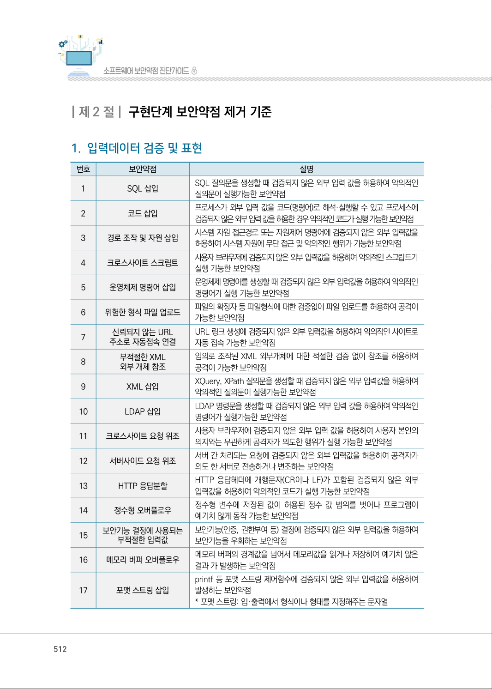
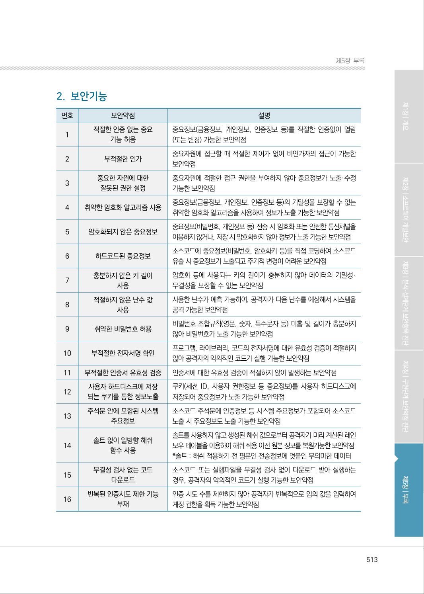
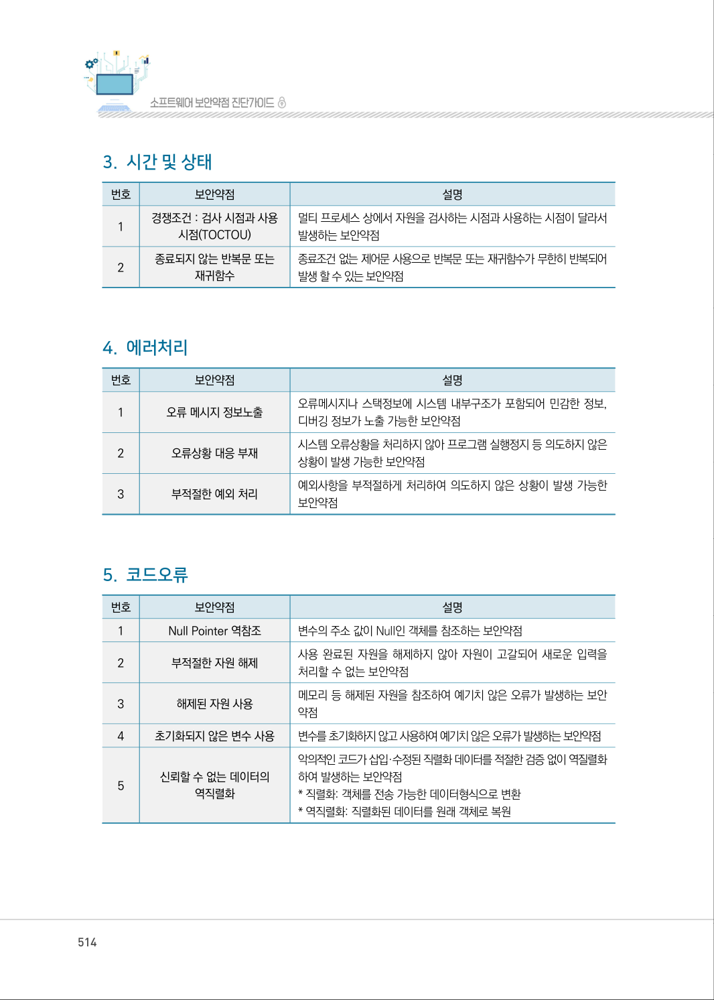
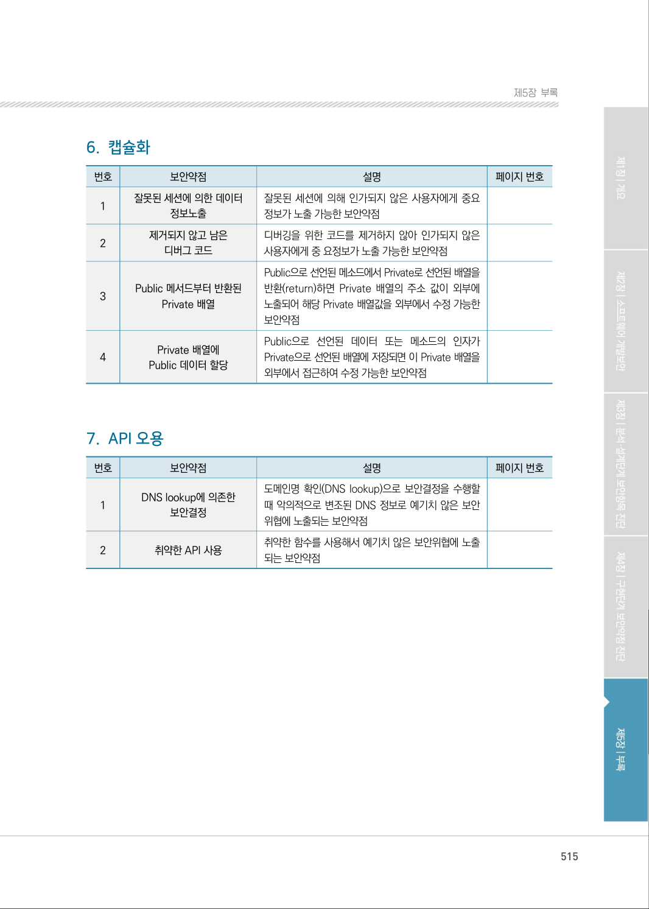

# 제2절 구현단계 보안약점 제거 기준

> 변환 안내(원문 외): 아래 본문은 PDF 텍스트를 추출한 전사입니다. 코드 줄번호·특수 공백·원문 오류를 유지했습니다. 실행용 코드가 아닙니다. 표·그림·들여쓰기는 연결된 페이지 이미지와 대조하세요. 페이지 경계의 줄바꿈을 보존하며, 동일 페이지가 여러 항목에 나뉘면 각 항목의 본문은 해당 구간만 포함합니다.

### PDF 512페이지 / 인쇄 512페이지

<!-- source-page:SW-Diagnosis-2021:512; source-lines:0,1,2,3,4,5,6,7,8,9,10,11,12,13,14,15,16,17,18,19,20,21,22,23,24,25,26,27,28,29,30,31,32,33,34,35,36,37,38,39,40,41,42,43,44,45,46,47,48,49,50,51,52,53,54,55,56,57,58,59,60,61,62,63,64,65,66,67,68,69,70,71,72,73,74,75,76,77 -->

512

| 제2 절| 구현단계 보안약점 제거 기준

#### 1. 입력데이터 검증 및 표현

| 번호 | 보안약점 | 설명 |
| --- | --- | --- |
| 1 | SQL 삽입 | SQL 질의문을 생성할 때 검증되지 않은 외부 입력 값을 허용하여 악의적인 질의문이 실행가능한 보안약점 |
| 2 | 코드 삽입 | 프로세스가 외부 입력 값을 코드(명령어)로 해석·실행할 수 있고 프로세스에 검증되지 않은 외부 입력 값을 허용한 경우 악의적인 코드가 실행 가능한 보안약점 |
| 3 | 경로 조작 및 자원 삽입 | 시스템 자원 접근경로 또는 자원제어 명령어에 검증되지 않은 외부 입력값을 허용하여 시스템 자원에 무단 접근 및 악의적인 행위가 가능한 보안약점 |
| 4 | 크로스사이트 스크립트 | 사용자 브라우저에 검증되지 않은 외부 입력값을 허용하여 악의적인 스크립트가 실행 가능한 보안약점 |
| 5 | 운영체제 명령어 삽입 | 운영체제 명령어를 생성할 때 검증되지 않은 외부 입력값을 허용하여 악의적인 명령어가 실행 가능한 보안약점 |
| 6 | 위험한 형식 파일 업로드 | 파일의 확장자 등 파일형식에 대한 검증없이 파일 업로드를 허용하여 공격이 가능한 보안약점 |
| 7 | 신뢰되지 않는 URL 주소로 자동접속 연결 | URL 링크 생성에 검증되지 않은 외부 입력값을 허용하여 악의적인 사이트로 자동 접속 가능한 보안약점 |
| 8 | 부적절한 XML 외부 개체 참조 | 임의로 조작된 XML 외부개체에 대한 적절한 검증 없이 참조를 허용하여 공격이 가능한 보안약점 |
| 9 | XML 삽입 | XQuery, XPath 질의문을 생성할 때 검증되지 않은 외부 입력값을 허용하여 악의적인 질의문이 실행가능한 보안약점 |
| 10 | LDAP 삽입 | LDAP 명령문을 생성할 때 검증되지 않은 외부 입력 값을 허용하여 악의적인 명령어가 실행가능한 보안약점 |
| 11 | 크로스사이트 요청 위조 | 사용자 브라우저에 검증되지 않은 외부 입력 값을 허용하여 사용자 본인의 의지와는 무관하게 공격자가 의도한 행위가 실행 가능한 보안약점 |
| 12 | 서버사이드 요청 위조 | 서버 간 처리되는 요청에 검증되지 않은 외부 입력값을 허용하여 공격자가 의도 한 서버로 전송하거나 변조하는 보안약점 |
| 13 | HTTP 응답분할 | HTTP 응답헤더에 개행문자(CR이나 LF)가 포함된 검증되지 않은 외부 입력값을 허용하여 악의적인 코드가 실행 가능한 보안약점 |
| 14 | 정수형 오버플로우 | 정수형 변수에 저장된 값이 허용된 정수 값 범위를 벗어나 프로그램이 예기치 않게 동작 가능한 보안약점 |
| 15 | 보안기능 결정에 사용되는 부적절한 입력값 | 보안기능(인증, 권한부여 등) 결정에 검증되지 않은 외부 입력값을 허용하여 보안기능을 우회하는 보안약점 |
| 16 | 메모리 버퍼 오버플로우 | 메모리 버퍼의 경계값을 넘어서 메모리값을 읽거나 저장하여 예기치 않은 결과 가 발생하는 보안약점 |
| 17 | 포맷 스트링 삽입 | printf 등 포맷 스트링 제어함수에 검증되지 않은 외부 입력값을 허용하여 발생하는 보안약점 * 포맷 스트링: 입·출력에서 형식이나 형태를 지정해주는 문자열 |

원본 페이지 이미지 (변환 외 보존 자료)

### PDF 513페이지 / 인쇄 513페이지

<!-- source-page:SW-Diagnosis-2021:513; source-lines:0,1,2,3,4,5,6,7,8,9,10,11,12,13,14,15,16,17,18,19,20,21,22,23,24,25,26,27,28,29,30,31,32,33,34,35,36,37,38,39,40,41,42,43,44,45,46,47,48,49,50,51,52,53,54,55,56,57,58,59,60,61,62,63,64,65,66,67,68,69,70,71,72,73,74,75,76,77,78 -->

513

제5장부록

#### 2. 보안기능

| 번호 | 보안약점 | 설명 |
| --- | --- | --- |
| 1 | 적절한 인증 없는 중요 기능 허용 | 중요정보(금융정보, 개인정보, 인증정보 등)를 적절한 인증없이 열람 (또는 변경) 가능한 보안약점 |
| 2 | 부적절한 인가 | 중요자원에 접근할 때 적절한 제어가 없어 비인가자의 접근이 가능한 보안약점 |
| 3 | 중요한 자원에 대한 잘못된 권한 설정 | 중요자원에 적절한 접근 권한을 부여하지 않아 중요정보가 노출·수정 가능한 보안약점 |
| 4 | 취약한 암호화 알고리즘 사용 | 중요정보(금융정보, 개인정보, 인증정보 등)의 기밀성을 보장할 수 없는 취약한 암호화 알고리즘을 사용하여 정보가 노출 가능한 보안약점 |
| 5 | 암호화되지 않은 중요정보 | 중요정보(비밀번호, 개인정보 등) 전송 시 암호화 또는 안전한 통신채널을 이용하지 않거나, 저장 시 암호화하지 않아 정보가 노출 가능한 보안약점 |
| 6 | 하드코드된 중요정보 | 소스코드에 중요정보(비밀번호, 암호화키 등)를 직접 코딩하여 소스코드 유출 시 중요정보가 노출되고 주기적 변경이 어려운 보안약점 |
| 7 | 충분하지 않은 키 길이 사용 | 암호화 등에 사용되는 키의 길이가 충분하지 않아 데이터의 기밀성· 무결성을 보장할 수 없는 보안약점 |
| 8 | 적절하지 않은 난수 값 사용 | 사용한 난수가 예측 가능하여, 공격자가 다음 난수를 예상해서 시스템을 공격 가능한 보안약점 |
| 9 | 취약한 비밀번호 허용 | 비밀번호 조합규칙(영문, 숫자, 특수문자 등) 미흡 및 길이가 충분하지 않아 비밀번호가 노출 가능한 보안약점 |
| 10 | 부적절한 전자서명 확인 | 프로그램, 라이브러리, 코드의 전자서명에 대한 유효성 검증이 적절하지 않아 공격자의 악의적인 코드가 실행 가능한 보안약점 |
| 11 | 부적절한 인증서 유효성 검증 | 인증서에 대한 유효성 검증이 적절하지 않아 발생하는 보안약점 |
| 12 | 사용자 하드디스크에 저장 되는 쿠키를 통한 정보노출 | 쿠키(세션 ID, 사용자 권한정보 등 중요정보)를 사용자 하드디스크에 저장되어 중요정보가 노출 가능한 보안약점 |
| 13 | 주석문 안에 포함된 시스템 주요정보 | 소스코드 주석문에 인증정보 등 시스템 주요정보가 포함되어 소스코드 노출 시 주요정보도 노출 가능한 보안약점 |
| 14 | 솔트 없이 일방향 해쉬 함수 사용 | 솔트를 사용하지 않고 생성된 해쉬 값으로부터 공격자가 미리 계산된 레인 보우 테이블을 이용하여 해쉬 적용 이전 원본 정보를 복원가능한 보안약점 *솔트 : 해쉬 적용하기 전 평문인 전송정보에 덧붙인 무의미한 데이터 |
| 15 | 무결성 검사 없는 코드 다운로드 | 소스코드 또는 실행파일을 무결성 검사 없이 다운로드 받아 실행하는 경우, 공격자의 악의적인 코드가 실행 가능한 보안약점 |
| 16 | 반복된 인증시도 제한 기능 부재 | 인증 시도 수를 제한하지 않아 공격자가 반복적으로 임의 값을 입력하여 계정 권한을 획득 가능한 보안약점 |

원본 페이지 이미지 (변환 외 보존 자료)

### PDF 514페이지 / 인쇄 514페이지

<!-- source-page:SW-Diagnosis-2021:514; source-lines:0,1,2,3,4,5,6,7,8,9,10,11,12,13,14,15,16,17,18,19,20,21,22,23,24,25,26,27,28,29,30,31,32,33,34,35,36,37,38,39,40,41,42,43,44,45,46,47,48,49,50,51,52,53,54,55 -->

514

#### 3. 시간 및 상태

| 번호 | 보안약점 | 설명 |
| --- | --- | --- |
| 1 | 경쟁조건 : 검사 시점과 사용 시점(TOCTOU) | 멀티 프로세스 상에서 자원을 검사하는 시점과 사용하는 시점이 달라서 발생하는 보안약점 |
| 2 | 종료되지 않는 반복문 또는 재귀함수 | 종료조건 없는 제어문 사용으로 반복문 또는 재귀함수가 무한히 반복되어 발생 할 수 있는 보안약점 |

#### 4. 에러처리

| 번호 | 보안약점 | 설명 |
| --- | --- | --- |
| 1 | 오류 메시지 정보노출 | 오류메시지나 스택정보에 시스템 내부구조가 포함되어 민감한 정보, 디버깅 정보가 노출 가능한 보안약점 |
| 2 | 오류상황 대응 부재 | 시스템 오류상황을 처리하지 않아 프로그램 실행정지 등 의도하지 않은 상황이 발생 가능한 보안약점 |
| 3 | 부적절한 예외 처리 | 예외사항을 부적절하게 처리하여 의도하지 않은 상황이 발생 가능한 보안약점 |

#### 5. 코드오류

| 번호 | 보안약점 | 설명 |
| --- | --- | --- |
| 1 | Null Pointer 역참조 | 변수의 주소 값이 Null인 객체를 참조하는 보안약점 |
| 2 | 부적절한 자원 해제 | 사용 완료된 자원을 해제하지 않아 자원이 고갈되어 새로운 입력을 처리할 수 없는 보안약점 |
| 3 | 해제된 자원 사용 | 메모리 등 해제된 자원을 참조하여 예기치 않은 오류가 발생하는 보안 약점 |
| 4 | 초기화되지 않은 변수 사용 | 변수를 초기화하지 않고 사용하여 예기치 않은 오류가 발생하는 보안약점 |
| 5 | 신뢰할 수 없는 데이터의 역직렬화 | 악의적인 코드가 삽입·수정된 직렬화 데이터를 적절한 검증 없이 역질렬화 하여 발생하는 보안약점 * 직렬화: 객체를 전송 가능한 데이터형식으로 변환 * 역직렬화: 직렬화된 데이터를 원래 객체로 복원 |

원본 페이지 이미지 (변환 외 보존 자료)

### PDF 515페이지 / 인쇄 515페이지

<!-- source-page:SW-Diagnosis-2021:515; source-lines:0,1,2,3,4,5,6,7,8,9,10,11,12,13,14,15,16,17,18,19,20,21,22,23,24,25,26,27,28,29,30,31,32,33,34,35,36,37,38,39,40,41,42,43,44 -->

515

제5장부록

#### 6. 캡슐화

| 번호 | 보안약점 | 설명 | 페이지 번호 |
| --- | --- | --- | --- |
| 1 | 잘못된 세션에 의한 데이터 정보노출 | 잘못된 세션에 의해 인가되지 않은 사용자에게 중요 정보가 노출 가능한 보안약점 |  |
| 2 | 제거되지 않고 남은 디버그 코드 | 디버깅을 위한 코드를 제거하지 않아 인가되지 않은 사용자에게 중 요정보가 노출 가능한 보안약점 |  |
| 3 | Public 메서드부터 반환된 Private 배열 | Public으로 선언된 메소드에서 Private로 선언된 배열을 반환(return)하면 Private 배열의 주소 값이 외부에 노출되어 해당 Private 배열값을 외부에서 수정 가능한 보안약점 |  |
| 4 | Private 배열에 Public 데이터 할당 | Public으로 선언된 데이터 또는 메소드의 인자가 Private으로 선언된 배열에 저장되면 이 Private 배열을 외부에서 접근하여 수정 가능한 보안약점 |  |

#### 7. API 오용

| 번호 | 보안약점 | 설명 | 페이지 번호 |
| --- | --- | --- | --- |
| 1 | DNS lookup에 의존한 보안결정 | 도메인명 확인(DNS lookup)으로 보안결정을 수행할 때 악의적으로 변조된 DNS 정보로 예기치 않은 보안 위협에 노출되는 보안약점 |  |
| 2 | 취약한 API 사용 | 취약한 함수를 사용해서 예기치 않은 보안위협에 노출 되는 보안약점 |  |

원본 페이지 이미지 (변환 외 보존 자료)

---

## 탐색 링크 (원문 외)

[통합 인덱스](../../../INDEX.md)

