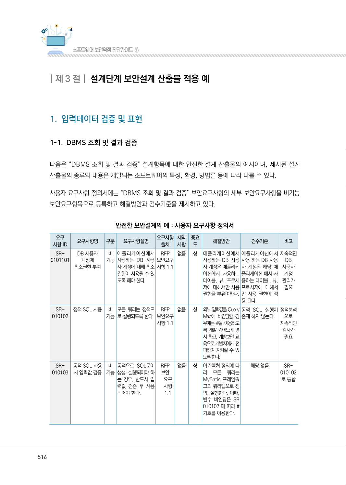
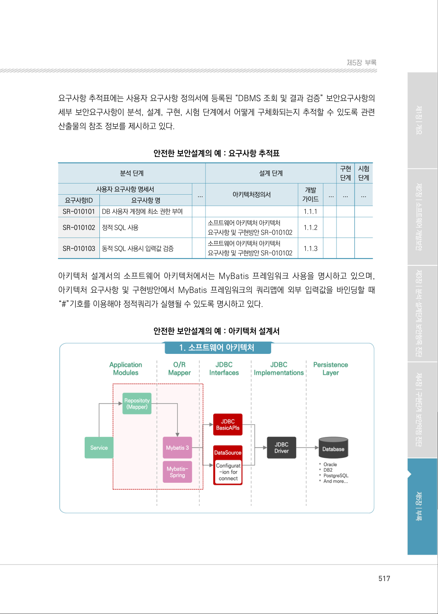
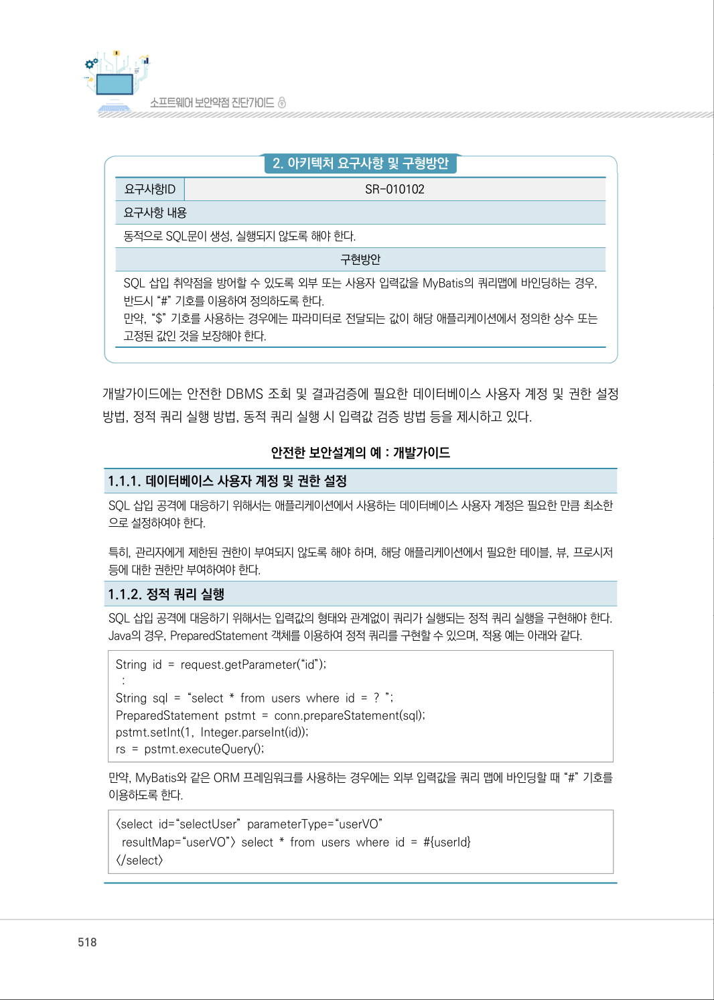

# 1-1. DBMS 조회 및 결과 검증

> 변환 안내(원문 외): 아래 본문은 PDF 텍스트를 추출한 전사입니다. 코드 줄번호·특수 공백·원문 오류를 유지했습니다. 실행용 코드가 아닙니다. 표·그림·들여쓰기는 연결된 페이지 이미지와 대조하세요. 페이지 경계의 줄바꿈을 보존하며, 동일 페이지가 여러 항목에 나뉘면 각 항목의 본문은 해당 구간만 포함합니다.

### PDF 516페이지 / 인쇄 516페이지

<!-- source-page:SW-Diagnosis-2021:516; source-lines:0,3,4,5,6,7,8,9,10,11,12,13,14,15,16,17,18,19,20,21,22,23,24,25,26,27,28,29,30,31,32,33,34,35,36,37,38,39,40,41,42,43,44,45,46,47,48,49,50,51,52,53,54,55,56,57,58,59,60,61,62,63,64,65,66,67,68,69,70,71,72,73,74,75,76,77,78,79,80,81,82,83,84,85,86,87,88,89,90,91,92,93,94,95,96,97,98,99,100,101,102,103,104,105,106,107,108,109,110,111,112,113,114,115,116,117,118,119 -->

516

1-1. DBMS 조회 및 결과 검증

다음은 “DBMS 조회 및 결과 검증” 설계항목에 대한 안전한 설계 산출물의 예시이며, 제시된 설계 
산출물의 종류와 내용은 개발되는 소프트웨어의 특성, 환경, 방법론 등에 따라 다를 수 있다.

사용자 요구사항 정의서에는 “DBMS 조회 및 결과 검증” 보안요구사항의 세부 보안요구사항을 비기능 
보안요구항목으로 등록하고 해결방안과 검수기준을 제시하고 있다.

안전한 보안설계의 예 : 사용자 요구사항 정의서

```text
요구
사항 ID
요구사항명 
구분 
요구사항설명 
요구사항 
출처
제약 
사항
중요 
도
해결방안 
검수기준 
비고
SR-
0101101
DB 사용자
계정에
최소권한 부여
비 
기능
애플리케이션에서 
사용하는 DB 사용
자 계정에 대해 최소 
권한이 사용될 수 있
도록 해야 한다.
RFP 
보안요구 
사항 1.1
없음 
상
애플리케이션에서 
사용하는 DB 사용
자 계정은 애플리케
이션에서 사용하는 
테이블, 뷰, 프로시
저에 대해서만 사용 
권한을 부유여하다.
애플리케이션에서 
사용 하는 DB 사용
자 계정은 해당 애
플리케이션 에서 사
용하는 테이블 , 뷰, 
프로시저에 대해서
만 사용 권한이 적
용 된다.
지속적인 
DB 
사용자 
계정 
관리가 
필요
SR-
010102
정적 SQL 사용 
비 
기능
모든 쿼리는 정적으
로 실행되도록 한다.
RFP 
보안요구 
사항 1.1
없음 
상
외부 입력값을 Query 
Map에 바인딩할 경
우에는 #을 이용하도
록 개발 가이드에 명
시 하고, 개발보안 교
육으로 개발자에게 전
파하여 지켜질 수 있
도록 한다.
동적 SQL 실행이 
존재 하지 않는다.
정적분석
으로 
지속적인 
검사가 
필요
SR-
010103
동적 SQL 사용 
시 입력값 검증
비 
기능
동적으로 SQL문이 
생성, 실행되어야 하
는 경우, 반드시 입 
력값 검증 후 사용 
되어야 한다.
RFP 
보안 
요구 
사항 
1.1
없음 
상
아키텍처 정의에 따
라 
모든 
쿼리는 
MyBatis 프레임워
크의 쿼리맵으로 정
의, 실행한다. 이때, 
변수 바인딩은 SR 
010102 에 따라 # 
기호를 이용한다.
해당 없음
SR-
010102
로 통합
```

<details><summary>원본 페이지 이미지 (변환 외 보존 자료)</summary>



</details>

### PDF 517페이지 / 인쇄 517페이지

<!-- source-page:SW-Diagnosis-2021:517; source-lines:0,1,2,3,4,5,6,7,8,9,10,11,12,13,14,15,16,17,18,19,20,21,22,23,24,25,26,27,28,29,30,31,32,33,34,35,36,37,38,39 -->

517

제5장부록

요구사항 추적표에는 사용자 요구사항 정의서에 등록된 “DBMS 조회 및 결과 검증” 보안요구사항의 
세부 보안요구사항이 분석, 설계, 구현, 시험 단계에서 어떻게 구체화되는지 추적할 수 있도록 관련 
산출물의 참조 정보를 제시하고 있다.

안전한 보안설계의 예 : 요구사항 추적표

```text
분석 단계
설계 단계
구현 
단계
사용자 요구사항 명세서
...
아키텍처정의서
개발 
가이드
...
...
요구사항 명
DB 사용자 계정에 최소 권한 부여 
1.1.1
정적 SQL 사용
소프트웨어 아키텍처 아키텍처 
요구사항 및 구현방안 SR-010102 
1.1.2
동적 SQL 사용시 입력값 검증 
소프트웨어 아키텍처 아키텍처 
요구사항 및 구현방안 SR-010102 
1.1.3
```

시험 
단계

...

요구사항ID

SR-010101

SR-010102

SR-010103

아키텍처 설계서의 소프트웨어 아키텍처에서는 MyBatis 프레임워크 사용을 명시하고 있으며, 
아키텍처 요구사항 및 구현방안에서 MyBatis 프레임워크의 쿼리맵에 외부 입력값을 바인딩할 때 
“#”기호를 이용해야 정적쿼리가 실행될 수 있도록 명시하고 있다.

안전한 보안설계의 예 : 아키텍처 설계서

#### 1. 소프트웨어 아키텍처

<details><summary>원본 페이지 이미지 (변환 외 보존 자료)</summary>



</details>

### PDF 518페이지 / 인쇄 518페이지

<!-- source-page:SW-Diagnosis-2021:518; source-lines:0,1,2,3,4,5,6,7,8,9,10,11,12,13,14,15,16,17,18,19,20,21,22,23,24,25,26,27,28,29,30,31,32 -->

518

#### 2. 아키텍처 요구사항 및 구형방안

요구사항ID

SR-010102

요구사항 내용
동적으로 SQL문이 생성, 실행되지 않도록 해야 한다.

구현방안

SQL 삽입 취약점을 방어할 수 있도록 외부 또는 사용자 입력값을 MyBatis의 쿼리맵에 바인딩하는 경우, 
반드시 “#” 기호를 이용하여 정의하도록 한다.
만약, “$” 기호를 사용하는 경우에는 파라미터로 전달되는 값이 해당 애플리케이션에서 정의한 상수 또는 
고정된 값인 것을 보장해야 한다.

개발가이드에는 안전한 DBMS 조회 및 결과검증에 필요한 데이터베이스 사용자 계정 및 권한 설정 
방법, 정적 쿼리 실행 방법, 동적 쿼리 실행 시 입력값 검증 방법 등을 제시하고 있다.

안전한 보안설계의 예 : 개발가이드

1.1.1. 데이터베이스 사용자 계정 및 권한 설정
SQL 삽입 공격에 대응하기 위해서는 애플리케이션에서 사용하는 데이터베이스 사용자 계정은 필요한 만큼 최소한
으로 설정하여야 한다.
특히, 관리자에게 제한된 권한이 부여되지 않도록 해야 하며, 해당 애플리케이션에서 필요한 테이블, 뷰, 프로시저 
등에 대한 권한만 부여하여야 한다.
1.1.2. 정적 쿼리 실행
SQL 삽입 공격에 대응하기 위해서는 입력값의 형태와 관계없이 쿼리가 실행되는 정적 쿼리 실행을 구현해야 한다. 
Java의 경우, PreparedStatement 객체를 이용하여 정적 쿼리를 구현할 수 있으며, 적용 예는 아래와 같다.
String id = request.getParameter(“id”); 
 : 
String sql = “select * from users where id = ? ”;
PreparedStatement pstmt = conn.prepareStatement(sql);
pstmt.setInt(1, Integer.parseInt(id)); 
rs = pstmt.executeQuery(); 
만약, MyBatis와 같은 ORM 프레임워크를 사용하는 경우에는 외부 입력값을 쿼리 맵에 바인딩할 때 “#” 기호를 
이용하도록 한다.
&lt;select id=“selectUser” parameterType=“userVO”
 resultMap=“userVO”&gt; select * from users where id = #{userId} 
&lt;/select&gt;

<details><summary>원본 페이지 이미지 (변환 외 보존 자료)</summary>



</details>

### PDF 519페이지 / 인쇄 519페이지

<!-- source-page:SW-Diagnosis-2021:519; source-lines:1,2,3,4,5 -->

제5장부록

1.1.3. 동적 쿼리 실행 시 입력값 검증
정적 쿼리를 사용할 수 없는 경우에는 반드시 입력값 검증으로 쿼리 조작 문자열 포함 여부를 확인한 후 사용해야 한

#### 다. 해당 검증 로직은 공통 모듈로 개발하여 검증 규칙이 일관되게 적용될 수 있도록 한다.

st.creatStatement(“select id from table where id=’”+SQLFilter(id)+”’”);

<details><summary>원본 페이지 이미지 (변환 외 보존 자료)</summary>


</details>

---

## 탐색 링크 (원문 외)

[통합 인덱스](../../../INDEX.md)

