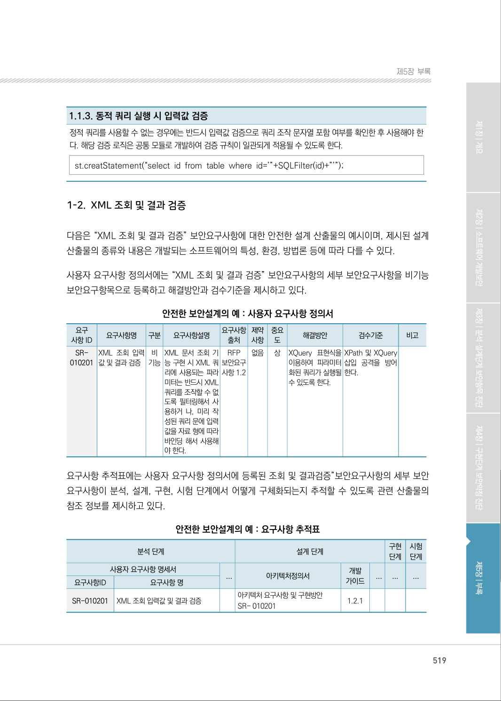
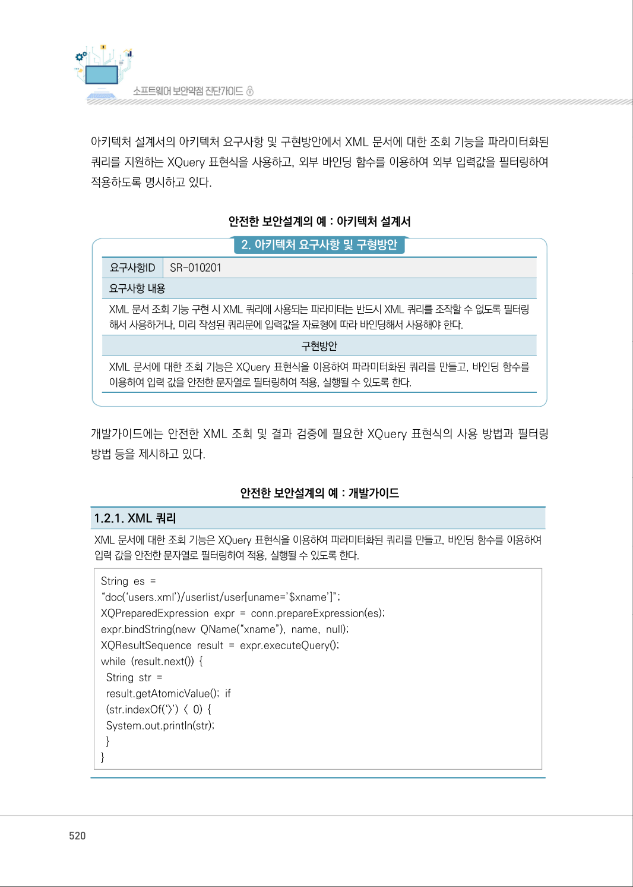

# 1-2. XML 조회 및 결과 검증

> 변환 안내(원문 외): 아래 본문은 PDF 텍스트를 추출한 전사입니다. 코드 줄번호·특수 공백·원문 오류를 유지했습니다. 실행용 코드가 아닙니다. 표·그림·들여쓰기는 연결된 페이지 이미지와 대조하세요. 페이지 경계의 줄바꿈을 보존하며, 동일 페이지가 여러 항목에 나뉘면 각 항목의 본문은 해당 구간만 포함합니다.

### PDF 519페이지 / 인쇄 519페이지

<!-- source-page:SW-Diagnosis-2021:519; source-lines:0,6,7,8,9,10,11,12,13,14,15,16,17,18,19,20,21,22,23,24,25,26,27,28,29,30,31,32,33,34,35,36,37,38,39,40,41,42,43,44,45,46,47,48,49,50,51,52,53,54,55,56,57,58,59,60,61,62,63,64,65,66,67,68,69,70,71,72,73,74,75,76,77,78,79 -->

519

1-2. XML 조회 및 결과 검증

다음은 “XML 조회 및 결과 검증” 보안요구사항에 대한 안전한 설계 산출물의 예시이며, 제시된 설계 
산출물의 종류와 내용은 개발되는 소프트웨어의 특성, 환경, 방법론 등에 따라 다를 수 있다.

사용자 요구사항 정의서에는 “XML 조회 및 결과 검증” 보안요구사항의 세부 보안요구사항을 비기능 
보안요구항목으로 등록하고 해결방안과 검수기준을 제시하고 있다.

안전한 보안설계의 예 : 사용자 요구사항 정의서

```text
요구
사항 ID
요구사항명 
구분 
요구사항설명 
요구사항 
출처
제약 
사항
중요 
도
해결방안
검수기준
비고
SR-
010201
XML 조회 입력 
값 및 결과 검증
비 
기능
XML 문서 조회 기
능 구현 시 XML 쿼
리에 사용되는 파라
미터는 반드시 XML 
쿼리를 조작할 수 없
도록 필터링해서 사
용하거 나, 미리 작
성된 쿼리 문에 입력
값을 자료 형에 따라 
바인딩 해서 사용해
야 한다.
RFP 
보안요구 
사항 1.2
없음 
상
XQuery 표현식을 
이용하여 피라미터
화된 쿼리가 실행될 
수 있도록 한다.
XPath 및 XQuery 
삽입 공격을 방어 
한다.
```

요구사항 추적표에는 사용자 요구사항 정의서에 등록된 조회 및 결과검증”보안요구사항의 세부 보안 
요구사항이 분석, 설계, 구현, 시험 단계에서 어떻게 구체화되는지 추적할 수 있도록 관련 산출물의 
참조 정보를 제시하고 있다.

안전한 보안설계의 예 : 요구사항 추적표

```text
분석 단계
설계 단계
구현 
단계
시험 
단계
사용자 요구사항 명세서
...
아키텍처정의서
개발 
가이드
...
...
...
요구사항ID
요구사항 명
SR-010201
XML 조회 입력값 및 결과 검증 
아키텍처 요구사항 및 구현방안
SR- 010201 
1.2.1
```

<details><summary>원본 페이지 이미지 (변환 외 보존 자료)</summary>



</details>

### PDF 520페이지 / 인쇄 520페이지

<!-- source-page:SW-Diagnosis-2021:520; source-lines:0,1,2,3,4,5,6,7,8,9,10,11,12,13,14,15,16,17,18,19,20,21,22,23,24,25,26,27,28,29,30,31 -->

520

아키텍처 설계서의 아키텍처 요구사항 및 구현방안에서 XML 문서에 대한 조회 기능을 파라미터화된 
쿼리를 지원하는 XQuery 표현식을 사용하고, 외부 바인딩 함수를 이용하여 외부 입력값을 필터링하여 
적용하도록 명시하고 있다.

안전한 보안설계의 예 : 아키텍처 설계서

#### 2. 아키텍처 요구사항 및 구형방안

요구사항ID

SR-010201

요구사항 내용
XML 문서 조회 기능 구현 시 XML 쿼리에 사용되는 파라미터는 반드시 XML 쿼리를 조작할 수 없도록 필터링
해서 사용하거나, 미리 작성된 쿼리문에 입력값을 자료형에 따라 바인딩해서 사용해야 한다.

구현방안

XML 문서에 대한 조회 기능은 XQuery 표현식을 이용하여 파라미터화된 쿼리를 만들고, 바인딩 함수를 
이용하여 입력 값을 안전한 문자열로 필터링하여 적용, 실행될 수 있도록 한다.

개발가이드에는 안전한 XML 조회 및 결과 검증에 필요한 XQuery 표현식의 사용 방법과 필터링 
방법 등을 제시하고 있다.

안전한 보안설계의 예 : 개발가이드

1.2.1. XML 쿼리
XML 문서에 대한 조회 기능은 XQuery 표현식을 이용하여 파라미터화된 쿼리를 만들고, 바인딩 함수를 이용하여 
입력 값을 안전한 문자열로 필터링하여 적용, 실행될 수 있도록 한다.
String es = 
“doc(‘users.xml’)/userlist/user[uname=’$xname’]”;
XQPreparedExpression expr = conn.prepareExpression(es);
expr.bindString(new QName(“xname”), name, null);
XQResultSequence result = expr.executeQuery(); 
while (result.next()) { 
 String str =
 result.getAtomicValue(); if
 (str.indexOf(‘&gt;’) &lt; 0) { 
 System.out.println(str); 
 } 
}

<details><summary>원본 페이지 이미지 (변환 외 보존 자료)</summary>



</details>

### PDF 521페이지 / 인쇄 521페이지

<!-- source-page:SW-Diagnosis-2021:521; source-lines:1,2,3,4,5,6 -->

제5장부록

1.2.1. XML 쿼리
XQuery 표현식을 사용할 수 없는 경우에는 입력값에 쿼리를 조작할 수 있는 특수기호 및 예약어가 포함되었는지를 
확인하고 안전한 문자열로 필터링한 후 사용될 수 있도록 한다.
“ [ ] / = @ 
해당 필터링 로직은 공통 모듈로 개발하여 필터링 규칙이 일관되게 적용될 수 있도록 한다.

<details><summary>원본 페이지 이미지 (변환 외 보존 자료)</summary>


</details>

---

## 탐색 링크 (원문 외)

[통합 인덱스](../../../INDEX.md)

