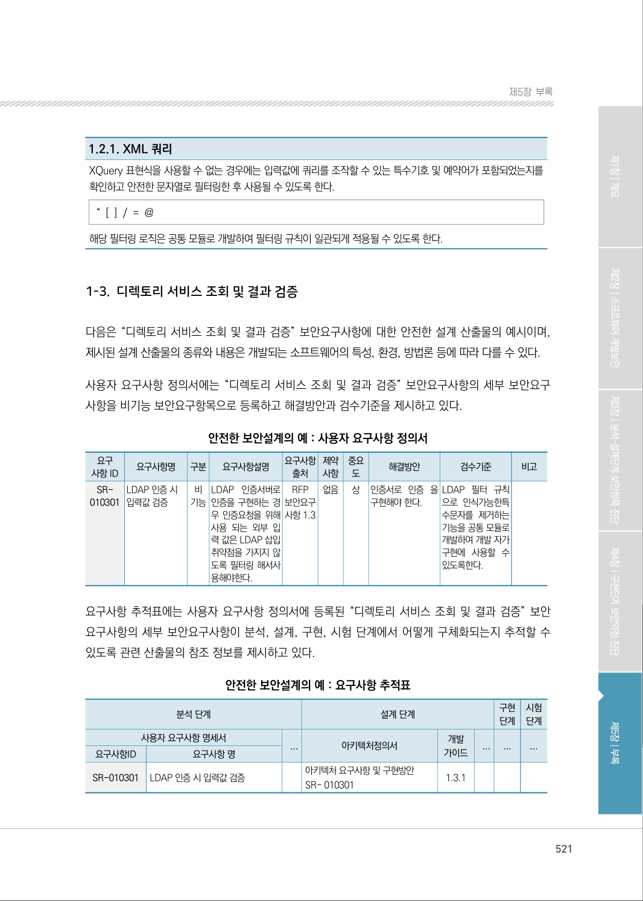
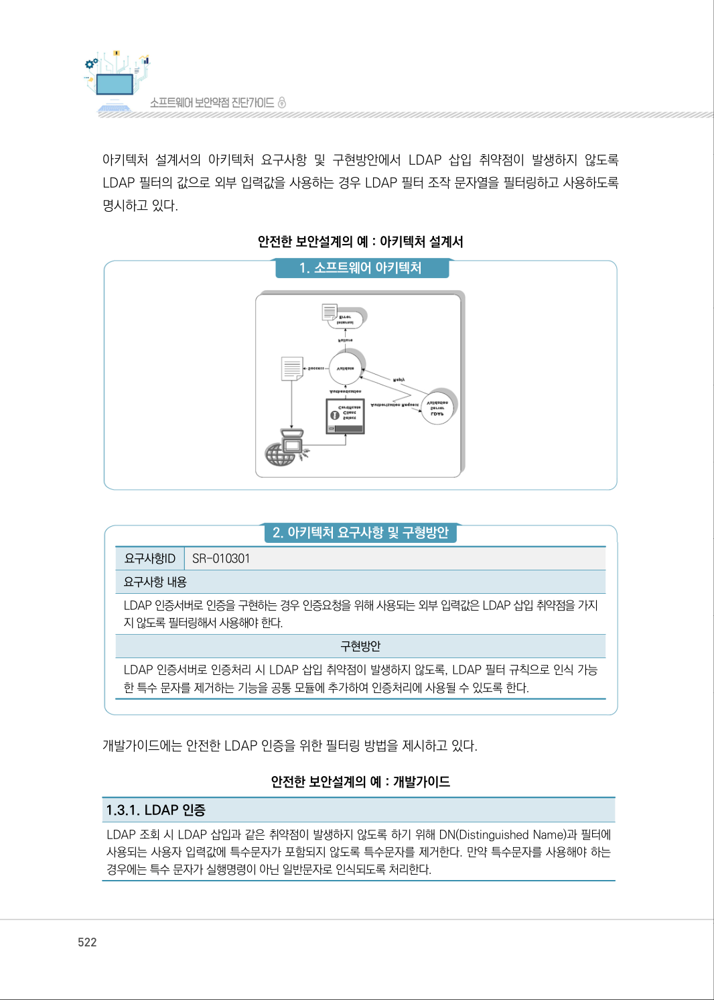

# 1-3. 디렉토리 서비스 조회 및 결과 검증

> 변환 안내(원문 외): 아래 본문은 PDF 텍스트를 추출한 전사입니다. 코드 줄번호·특수 공백·원문 오류를 유지했습니다. 실행용 코드가 아닙니다. 표·그림·들여쓰기는 연결된 페이지 이미지와 대조하세요. 페이지 경계의 줄바꿈을 보존하며, 동일 페이지가 여러 항목에 나뉘면 각 항목의 본문은 해당 구간만 포함합니다.

### PDF 521페이지 / 인쇄 521페이지

<!-- source-page:SW-Diagnosis-2021:521; source-lines:0,7,8,9,10,11,12,13,14,15,16,17,18,19,20,21,22,23,24,25,26,27,28,29,30,31,32,33,34,35,36,37,38,39,40,41,42,43,44,45,46,47,48,49,50,51,52,53,54,55,56,57,58,59,60,61,62,63,64,65,66,67,68,69,70,71,72,73,74,75,76,77,78,79 -->

521

1-3. 디렉토리 서비스 조회 및 결과 검증

다음은 “디렉토리 서비스 조회 및 결과 검증” 보안요구사항에 대한 안전한 설계 산출물의 예시이며, 
제시된 설계 산출물의 종류와 내용은 개발되는 소프트웨어의 특성, 환경, 방법론 등에 따라 다를 수 있다.

사용자 요구사항 정의서에는 “디렉토리 서비스 조회 및 결과 검증” 보안요구사항의 세부 보안요구
사항을 비기능 보안요구항목으로 등록하고 해결방안과 검수기준을 제시하고 있다.

안전한 보안설계의 예 : 사용자 요구사항 정의서

```text
요구
사항 ID
요구사항명 
구분 
요구사항설명 
요구사항 
출처
제약 
사항
중요 
도
해결방안
검수기준
비고
SR-
010301
LDAP 인증 시 
입력값 검증
비 
기능
LDAP 인증서버로 
인증을 구현하는 경
우 인증요청을 위해 
사용 되는 외부 입
력 값은 LDAP 삽입 
취약점을 가지지 않
도록 필터링 해서사
용해야한다.
RFP 
보안요구 
사항 1.3
없음 
상
인증서로 인증 을 
구현해야 한다.
LDAP 필터 규칙 
으로 인식가능한특
수문자를 제거하는 
기능을 공통 모듈로 
개발하여 개발 자가 
구현에 사용할 수 
있도록한다.
```

요구사항 추적표에는 사용자 요구사항 정의서에 등록된 “디렉토리 서비스 조회 및 결과 검증” 보안 
요구사항의 세부 보안요구사항이 분석, 설계, 구현, 시험 단계에서 어떻게 구체화되는지 추적할 수 
있도록 관련 산출물의 참조 정보를 제시하고 있다.

안전한 보안설계의 예 : 요구사항 추적표

```text
분석 단계
설계 단계
구현 
단계
시험 
단계
사용자 요구사항 명세서
...
아키텍처정의서
개발 
가이드
...
...
...
요구사항ID
요구사항 명
SR-010301
LDAP 인증 시 입력값 검증 
아키텍처 요구사항 및 구현방안
SR- 010301 
1.3.1
```

<details><summary>원본 페이지 이미지 (변환 외 보존 자료)</summary>



</details>

### PDF 522페이지 / 인쇄 522페이지

<!-- source-page:SW-Diagnosis-2021:522; source-lines:0,1,2,3,4,5,6,7,8,9,10,11,12,13,14,15,16,17,18,19,20 -->

522

아키텍처 설계서의 아키텍처 요구사항 및 구현방안에서 LDAP 삽입 취약점이 발생하지 않도록 
LDAP 필터의 값으로 외부 입력값을 사용하는 경우 LDAP 필터 조작 문자열을 필터링하고 사용하도록 
명시하고 있다.

안전한 보안설계의 예 : 아키텍처 설계서

#### 1. 소프트웨어 아키텍처

#### 2. 아키텍처 요구사항 및 구형방안

요구사항ID

SR-010301

요구사항 내용
LDAP 인증서버로 인증을 구현하는 경우 인증요청을 위해 사용되는 외부 입력값은 LDAP 삽입 취약점을 가지
지 않도록 필터링해서 사용해야 한다.

구현방안

LDAP 인증서버로 인증처리 시 LDAP 삽입 취약점이 발생하지 않도록, LDAP 필터 규칙으로 인식 가능
한 특수 문자를 제거하는 기능을 공통 모듈에 추가하여 인증처리에 사용될 수 있도록 한다.

개발가이드에는 안전한 LDAP 인증을 위한 필터링 방법을 제시하고 있다.

안전한 보안설계의 예 : 개발가이드

1.3.1. LDAP 인증
LDAP 조회 시 LDAP 삽입과 같은 취약점이 발생하지 않도록 하기 위해 DN(Distinguished Name)과 필터에 
사용되는 사용자 입력값에 특수문자가 포함되지 않도록 특수문자를 제거한다. 만약 특수문자를 사용해야 하는 
경우에는 특수 문자가 실행명령이 아닌 일반문자로 인식되도록 처리한다. 

<details><summary>원본 페이지 이미지 (변환 외 보존 자료)</summary>



</details>

### PDF 523페이지 / 인쇄 523페이지

<!-- source-page:SW-Diagnosis-2021:523; source-lines:1,2,3,4,5,6,7 -->

제5장부록

1.3.1. LDAP 인증

if (!userSN.matches(“[￦￦w￦￦s]*”)
|| !userPassword.matches(“[￦￦w]*”)) { throw new
IllegalArgumentException(“Invalid input”); 
} 
해당 검증 로직은 공통 모듈로 개발하여 검증 규칙이 일관되게 적용될 수 있도록 한다.

<details><summary>원본 페이지 이미지 (변환 외 보존 자료)</summary>


</details>

---

## 탐색 링크 (원문 외)

[통합 인덱스](../../../INDEX.md)

