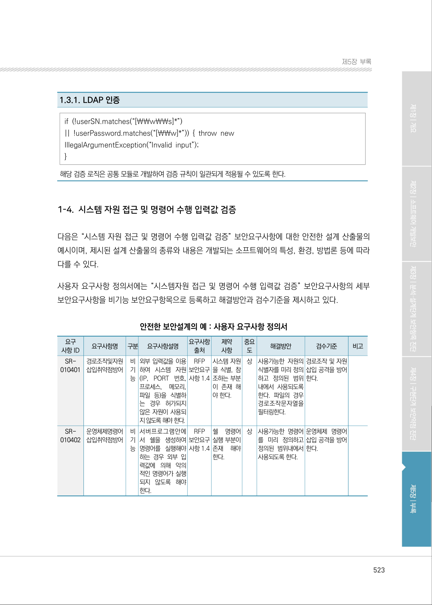
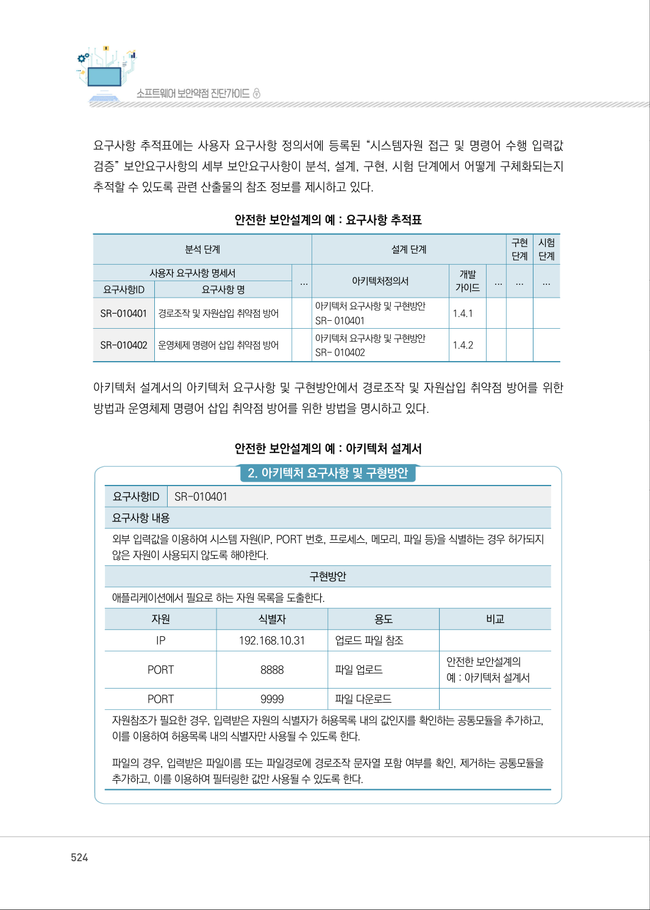
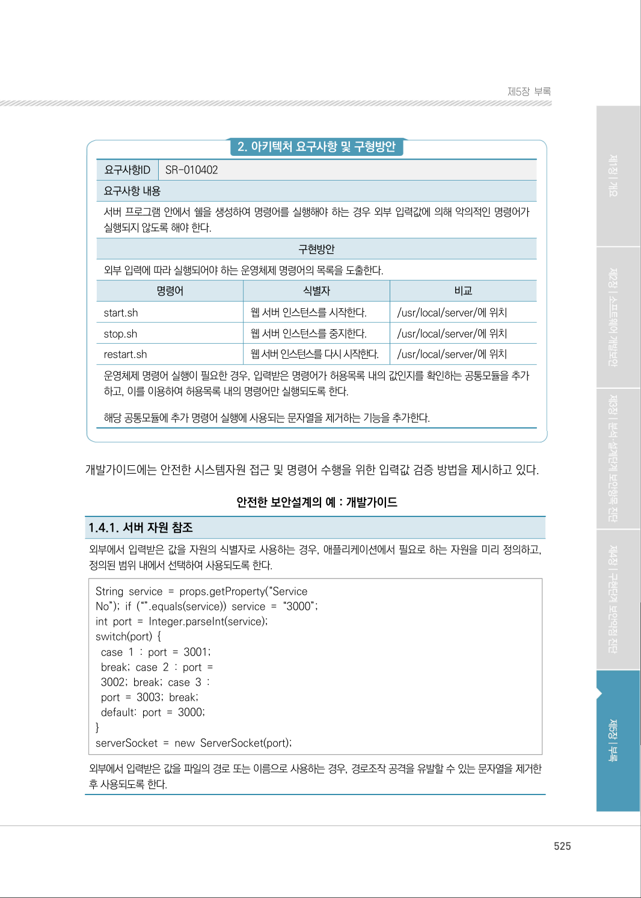
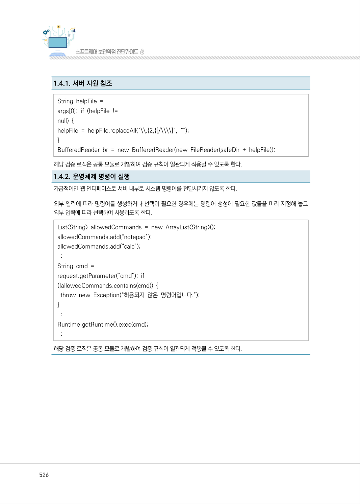
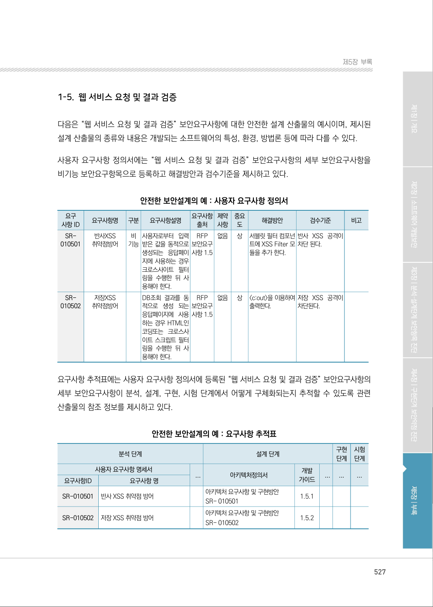

# 1-4. 시스템 자원 접근 및 명령어 수행 입력값 검증

> 변환 안내(원문 외): 아래 본문은 PDF 텍스트를 추출한 전사입니다. 코드 줄번호·특수 공백·원문 오류를 유지했습니다. 실행용 코드가 아닙니다. 표·그림·들여쓰기는 연결된 페이지 이미지와 대조하세요. 페이지 경계의 줄바꿈을 보존하며, 동일 페이지가 여러 항목에 나뉘면 각 항목의 본문은 해당 구간만 포함합니다.

### PDF 523페이지 / 인쇄 523페이지

<!-- source-page:SW-Diagnosis-2021:523; source-lines:0,8,9,10,11,12,13,14,15,16,17,18,19,20,21,22,23,24,25,26,27,28,29,30,31,32,33,34,35,36,37,38,39,40,41,42,43,44,45,46,47,48,49,50,51,52,53,54,55,56,57,58,59,60,61,62,63,64,65,66,67,68,69,70,71,72,73,74,75,76,77,78,79,80,81,82,83,84,85,86,87,88,89,90,91,92,93,94 -->

523

1-4. 시스템 자원 접근 및 명령어 수행 입력값 검증

다음은 “시스템 자원 접근 및 명령어 수행 입력값 검증” 보안요구사항에 대한 안전한 설계 산출물의 
예시이며, 제시된 설계 산출물의 종류와 내용은 개발되는 소프트웨어의 특성, 환경, 방법론 등에 따라 
다를 수 있다.

사용자 요구사항 정의서에는 “시스템자원 접근 및 명령어 수행 입력값 검증” 보안요구사항의 세부 
보안요구사항을 비기능 보안요구항목으로 등록하고 해결방안과 검수기준을 제시하고 있다.

안전한 보안설계의 예 : 사용자 요구사항 정의서

```text
요구
사항 ID
요구사항명 
구분 
요구사항설명 
요구사항 
출처
제약 
사항
중요 
도
해결방안
검수기준
비고
SR-
010401
경로조작및자원 
삽입취약점방어
비 
기 
능
외부 입력값을 이용 
하여 시스템 자원
(IP, PORT 번호, 
프로세스, 메모리, 
파일 등)을 식별하
는 경우 허가되지 
않은 자원이 사용되
지 않도록 해야 한다.
RFP 
보안요구 
사항 1.4
시스템 자원
을 식별, 참
조하는 부분
이 존재 해
야 한다.
상
사용가능한 자원의 
식별자를 미리 정의 
하고 정의된 범위 
내에서 사용되도록 
한다. 파일의 경우 
경로조작문자열을 
필터링한다.
경로조작 및 자원 
삽입 공격을 방어
한다.
SR-
010402
운영체제명령어 
삽입취약점방어
비 
기 
능
서버프로그램안에
서 쉘을 생성하여 
명령어를 실행해야
하는 경우 외부 입
력값에 의해 악의 
적인 명령어가 실행
되지 않도록 해야 
한다.
RFP 
보안요구 
사항 1.4
쉘 
명령어 
실행 부분이 
존재 
해야 
한다.
상
사용가능한 명령어
를 미리 정의하고 
정의된 범위내에서 
사용되도록 한다.
운영체제 명령어 
삽입 공격을 방어
한다.
```

<details><summary>원본 페이지 이미지 (변환 외 보존 자료)</summary>



</details>

### PDF 524페이지 / 인쇄 524페이지

<!-- source-page:SW-Diagnosis-2021:524; source-lines:0,1,2,3,4,5,6,7,8,9,10,11,12,13,14,15,16,17,18,19,20,21,22,23,24,25,26,27,28,29,30,31,32,33,34,35,36,37,38,39,40,41,42,43,44,45,46,47,48,49,50,51,52,53,54,55,56,57,58,59,60 -->

524

요구사항 추적표에는 사용자 요구사항 정의서에 등록된 “시스템자원 접근 및 명령어 수행 입력값 
검증” 보안요구사항의 세부 보안요구사항이 분석, 설계, 구현, 시험 단계에서 어떻게 구체화되는지 
추적할 수 있도록 관련 산출물의 참조 정보를 제시하고 있다.

안전한 보안설계의 예 : 요구사항 추적표

```text
분석 단계
설계 단계
구현 
단계
시험 
단계
사용자 요구사항 명세서
...
아키텍처정의서
개발 
가이드
...
...
...
요구사항ID
요구사항 명
SR-010401
경로조작 및 자원삽입 취약점 방어 
아키텍처 요구사항 및 구현방안
SR- 010401
1.4.1
SR-010402
운영체제 명령어 삽입 취약점 방어 
아키텍처 요구사항 및 구현방안
SR- 010402 
1.4.2
```

아키텍처 설계서의 아키텍처 요구사항 및 구현방안에서 경로조작 및 자원삽입 취약점 방어를 위한 
방법과 운영체제 명령어 삽입 취약점 방어를 위한 방법을 명시하고 있다.

안전한 보안설계의 예 : 아키텍처 설계서

#### 2. 아키텍처 요구사항 및 구형방안

요구사항ID

SR-010401

요구사항 내용
외부 입력값을 이용하여 시스템 자원(IP, PORT 번호, 프로세스, 메모리, 파일 등)을 식별하는 경우 허가되지 
않은 자원이 사용되지 않도록 해야한다.

구현방안

애플리케이션에서 필요로 하는 자원 목록을 도출한다.

|  |  |  |  |
| --- | --- | --- | --- |
| 자원 | 식별자 | 용도 | 비교 |
| IP | 192.168.10.31 | 업로드 파일 참조 |  |
| PORT | 8888 | 파일 업로드 | 안전한 보안설계의<br>예 : 아키텍처 설계서 |
| PORT | 9999 | 파일 다운로드 |  |

자원참조가 필요한 경우, 입력받은 자원의 식별자가 허용목록 내의 값인지를 확인하는 공통모듈을 추가하고, 
이를 이용하여 허용목록 내의 식별자만 사용될 수 있도록 한다.
파일의 경우, 입력받은 파일이름 또는 파일경로에 경로조작 문자열 포함 여부를 확인, 제거하는 공통모듈을 
추가하고, 이를 이용하여 필터링한 값만 사용될 수 있도록 한다.

<details><summary>원본 페이지 이미지 (변환 외 보존 자료)</summary>



</details>

### PDF 525페이지 / 인쇄 525페이지

<!-- source-page:SW-Diagnosis-2021:525; source-lines:0,1,2,3,4,5,6,7,8,9,10,11,12,13,14,15,16,17,18,19,20,21,22,23,24,25,26,27,28,29,30,31,32,33,34,35,36,37,38,39,40,41,42 -->

525

제5장부록

#### 2. 아키텍처 요구사항 및 구형방안

요구사항ID

SR-010402

요구사항 내용
서버 프로그램 안에서 쉘을 생성하여 명령어를 실행해야 하는 경우 외부 입력값에 의해 악의적인 명령어가 
실행되지 않도록 해야 한다.

구현방안

외부 입력에 따라 실행되어야 하는 운영체제 명령어의 목록을 도출한다.

|  |  |  |
| --- | --- | --- |
| 명령어 | 식별자 | 비교 |
| start.sh | 웹 서버 인스턴스를 시작한다. | /usr/local/server/에 위치 |
| stop.sh | 웹 서버 인스턴스를 중지한다. | /usr/local/server/에 위치 |
| restart.sh | 웹 서버 인스턴스를 다시 시작한다. | /usr/local/server/에 위치 |

운영체제 명령어 실행이 필요한 경우, 입력받은 명령어가 허용목록 내의 값인지를 확인하는 공통모듈을 추가
하고, 이를 이용하여 허용목록 내의 명령어만 실행되도록 한다.
해당 공통모듈에 추가 명령어 실행에 사용되는 문자열을 제거하는 기능을 추가한다.

개발가이드에는 안전한 시스템자원 접근 및 명령어 수행을 위한 입력값 검증 방법을 제시하고 있다.

안전한 보안설계의 예 : 개발가이드

1.4.1. 서버 자원 참조
외부에서 입력받은 값을 자원의 식별자로 사용하는 경우, 애플리케이션에서 필요로 하는 자원을 미리 정의하고, 
정의된 범위 내에서 선택하여 사용되도록 한다.
String service = props.getProperty(“Service 
No”); if (“”.equals(service)) service = “3000”; 
int port = Integer.parseInt(service);
switch(port) { 
 case 1 : port = 3001;
 break; case 2 : port =
 3002; break; case 3 :
 port = 3003; break;
 default: port = 3000; 
} 
serverSocket = new ServerSocket(port);
외부에서 입력받은 값을 파일의 경로 또는 이름으로 사용하는 경우, 경로조작 공격을 유발할 수 있는 문자열을 제거한 
후 사용되도록 한다.

<details><summary>원본 페이지 이미지 (변환 외 보존 자료)</summary>



</details>

### PDF 526페이지 / 인쇄 526페이지

<!-- source-page:SW-Diagnosis-2021:526; source-lines:0,1,2,3,4,5,6,7,8,9,10,11,12,13,14,15,16,17,18,19,20,21,22,23,24,25 -->

526

1.4.1. 서버 자원 참조

String helpFile =
args[0]; if (helpFile != 
null) { 
helpFile = helpFile.replaceAll(“\\.{2,}[/\\\\]”, “”); 
} 
BufferedReader br = new BufferedReader(new FileReader(safeDir + helpFile));
해당 검증 로직은 공통 모듈로 개발하여 검증 규칙이 일관되게 적용될 수 있도록 한다.
1.4.2. 운영체제 명령어 실행
가급적이면 웹 인터페이스로 서버 내부로 시스템 명령어를 전달시키지 않도록 한다.
외부 입력에 따라 명령어를 생성하거나 선택이 필요한 경우에는 명령어 생성에 필요한 값들을 미리 지정해 놓고 
외부 입력에 따라 선택하여 사용하도록 한다.
List&lt;String&gt; allowedCommands = new ArrayList&lt;String&gt;();
allowedCommands.add(“notepad”); 
allowedCommands.add(“calc”); 
 : 
String cmd =
request.getParameter(“cmd”); if
(!allowedCommands.contains(cmd)) { 
 throw new Exception(“허용되지 않은 명령어입니다.”); 
} 
 : 
Runtime.getRuntime().exec(cmd); 
 : 
해당 검증 로직은 공통 모듈로 개발하여 검증 규칙이 일관되게 적용될 수 있도록 한다.

<details><summary>원본 페이지 이미지 (변환 외 보존 자료)</summary>



</details>

### PDF 527페이지 / 인쇄 527페이지

<!-- source-page:SW-Diagnosis-2021:527; source-lines:1 -->

제5장부록

<details><summary>원본 페이지 이미지 (변환 외 보존 자료)</summary>



</details>

---

## 탐색 링크 (원문 외)

[통합 인덱스](../../../INDEX.md)

