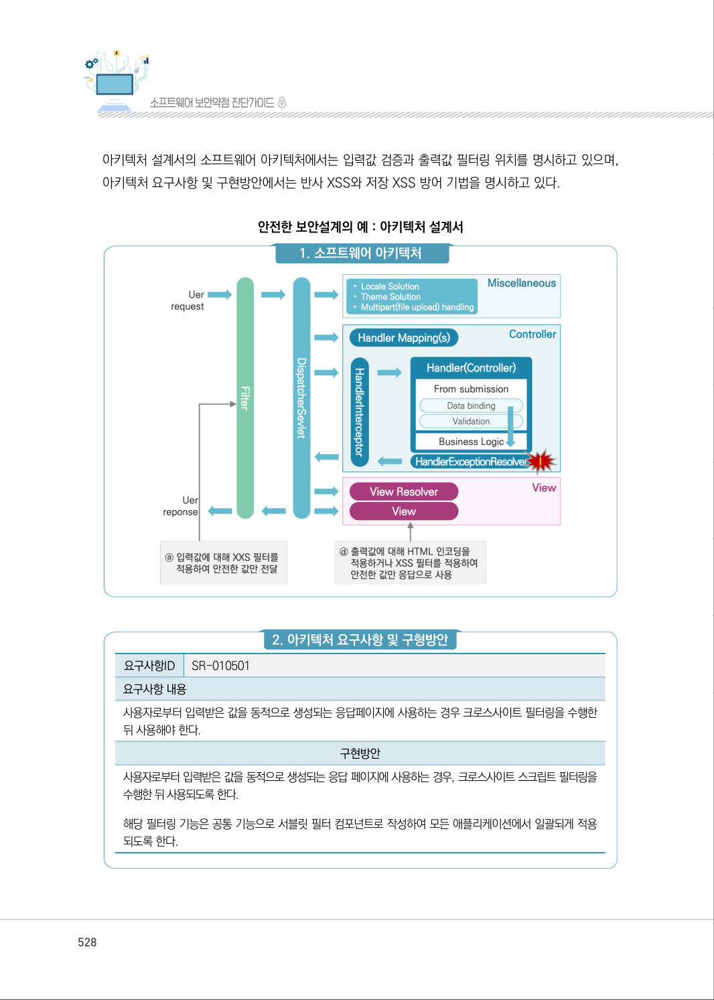
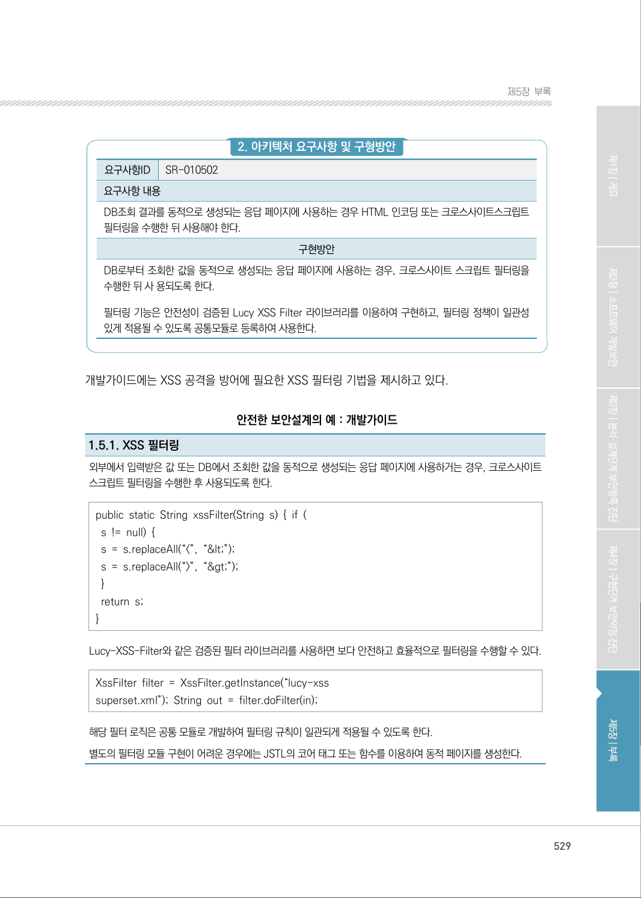
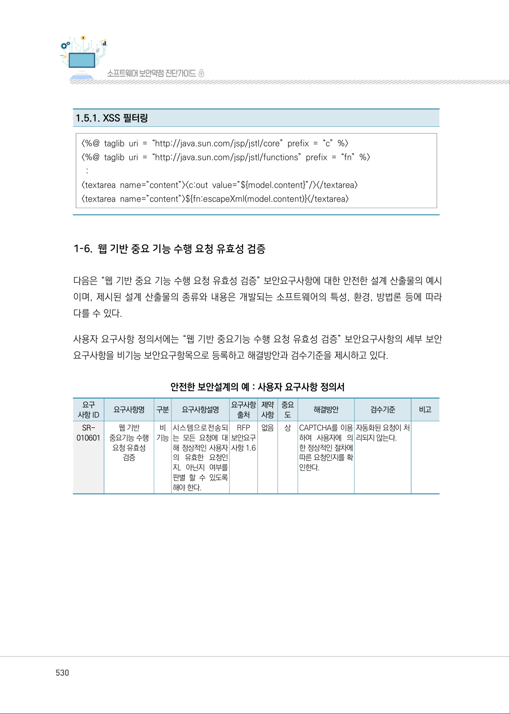

# 1-5. 웹 서비스 요청 및 결과 검증

> 변환 안내(원문 외): 아래 본문은 PDF 텍스트를 추출한 전사입니다. 코드 줄번호·특수 공백·원문 오류를 유지했습니다. 실행용 코드가 아닙니다. 표·그림·들여쓰기는 연결된 페이지 이미지와 대조하세요. 페이지 경계의 줄바꿈을 보존하며, 동일 페이지가 여러 항목에 나뉘면 각 항목의 본문은 해당 구간만 포함합니다.

### PDF 527페이지 / 인쇄 527페이지

<!-- source-page:SW-Diagnosis-2021:527; source-lines:0,2,3,4,5,6,7,8,9,10,11,12,13,14,15,16,17,18,19,20,21,22,23,24,25,26,27,28,29,30,31,32,33,34,35,36,37,38,39,40,41,42,43,44,45,46,47,48,49,50,51,52,53,54,55,56,57,58,59,60,61,62,63,64,65,66,67,68,69,70,71,72,73,74,75,76,77,78,79,80,81,82,83,84,85,86,87,88,89,90,91,92,93,94,95 -->

527

1-5. 웹 서비스 요청 및 결과 검증

다음은 “웹 서비스 요청 및 결과 검증” 보안요구사항에 대한 안전한 설계 산출물의 예시이며, 제시된 
설계 산출물의 종류와 내용은 개발되는 소프트웨어의 특성, 환경, 방법론 등에 따라 다를 수 있다.

사용자 요구사항 정의서에는 “웹 서비스 요청 및 결과 검증” 보안요구사항의 세부 보안요구사항을 
비기능 보안요구항목으로 등록하고 해결방안과 검수기준을 제시하고 있다. 

안전한 보안설계의 예 : 사용자 요구사항 정의서

```text
요구
사항 ID
요구사항명 
구분 
요구사항설명 
요구사항 
출처
제약 
사항
중요 
도
해결방안
검수기준
비고
SR-
010501
반사XSS
취약점방어
비 
기능
사용자로부터 입력
받은 값을 동적으로 
생성되는 응답페이
지에 사용하는 경우 
크로스사이트 필터 
링을 수행한 뒤 사
용해야 한다.
RFP 
보안요구 
사항 1.5
없음 
상
서블릿 필터 컴포넌
트에 XSS Filter 모
듈을 추가 한다.
반사 XSS 공격이 
차단 된다.
SR-
010502
저장XSS
취약점방어
DB조회 결과를 동
적으로 생성 되는 
응답페이지에 사용
하는 경우 HTML인 
코딩또는 크로스사
이트 스크립트 필터
링을 수행한 뒤 사
용해야 한다.
RFP 
보안요구 
사항 1.5
없음
상
<c:out>을 이용하여 
출력한다.
저장 XSS 공격이 
차단된다.
```

요구사항 추적표에는 사용자 요구사항 정의서에 등록된 “웹 서비스 요청 및 결과 검증” 보안요구사항의 
세부 보안요구사항이 분석, 설계, 구현, 시험 단계에서 어떻게 구체화되는지 추적할 수 있도록 관련 
산출물의 참조 정보를 제시하고 있다.

안전한 보안설계의 예 : 요구사항 추적표

```text
분석 단계
설계 단계
구현 
단계
시험 
단계
사용자 요구사항 명세서
...
아키텍처정의서
개발 
가이드
...
...
...
요구사항ID
요구사항 명
SR-010501
반사 XSS 취약점 방어 
아키텍처 요구사항 및 구현방안
SR- 010501
1.5.1
SR-010502
저장 XSS 취약점 방어 
아키텍처 요구사항 및 구현방안
SR- 010502 
1.5.2
```

<details><summary>원본 페이지 이미지 (변환 외 보존 자료)</summary>


</details>

### PDF 528페이지 / 인쇄 528페이지

<!-- source-page:SW-Diagnosis-2021:528; source-lines:0,1,2,3,4,5,6,7,8,9,10,11,12,13,14,15 -->

528

아키텍처 설계서의 소프트웨어 아키텍처에서는 입력값 검증과 출력값 필터링 위치를 명시하고 있으며, 
아키텍처 요구사항 및 구현방안에서는 반사 XSS와 저장 XSS 방어 기법을 명시하고 있다.

안전한 보안설계의 예 : 아키텍처 설계서

#### 1. 소프트웨어 아키텍처

#### 2. 아키텍처 요구사항 및 구형방안

요구사항ID

SR-010501

요구사항 내용
사용자로부터 입력받은 값을 동적으로 생성되는 응답페이지에 사용하는 경우 크로스사이트 필터링을 수행한 
뒤 사용해야 한다.

구현방안

사용자로부터 입력받은 값을 동적으로 생성되는 응답 페이지에 사용하는 경우, 크로스사이트 스크립트 필터링을 
수행한 뒤 사용되도록 한다.
해당 필터링 기능은 공통 기능으로 서블릿 필터 컴포넌트로 작성하여 모든 애플리케이션에서 일괄되게 적용
되도록 한다.

<details><summary>원본 페이지 이미지 (변환 외 보존 자료)</summary>



</details>

### PDF 529페이지 / 인쇄 529페이지

<!-- source-page:SW-Diagnosis-2021:529; source-lines:0,1,2,3,4,5,6,7,8,9,10,11,12,13,14,15,16,17,18,19,20,21,22,23,24,25,26,27,28,29 -->

529

제5장부록

#### 2. 아키텍처 요구사항 및 구형방안

요구사항ID

SR-010502

요구사항 내용
DB조회 결과를 동적으로 생성되는 응답 페이지에 사용하는 경우 HTML 인코딩 또는 크로스사이트스크립트 
필터링을 수행한 뒤 사용해야 한다. 

구현방안

DB로부터 조회한 값을 동적으로 생성되는 응답 페이지에 사용하는 경우, 크로스사이트 스크립트 필터링을 
수행한 뒤 사 용되도록 한다.
필터링 기능은 안전성이 검증된 Lucy XSS Filter 라이브러리를 이용하여 구현하고, 필터링 정책이 일관성 
있게 적용될 수 있도록 공통모듈로 등록하여 사용한다.

개발가이드에는 XSS 공격을 방어에 필요한 XSS 필터링 기법을 제시하고 있다.

안전한 보안설계의 예 : 개발가이드

1.5.1. XSS 필터링
외부에서 입력받은 값 또는 DB에서 조회한 값을 동적으로 생성되는 응답 페이지에 사용하거는 경우, 크로스사이트 
스크립트 필터링을 수행한 후 사용되도록 한다.

public static String xssFilter(String s) { if ( 
 s != null) { 
 s = s.replaceAll(“&lt;”, “&amp;lt;”); 
 s = s.replaceAll(“&gt;”, “&amp;gt;”); 
 } 
 return s; 
} 

Lucy-XSS-Filter와 같은 검증된 필터 라이브러리를 사용하면 보다 안전하고 효율적으로 필터링을 수행할 수 있다.

XssFilter filter = XssFilter.getInstance(“lucy-xss 
superset.xml”); String out = filter.doFilter(in);

해당 필터 로직은 공통 모듈로 개발하여 필터링 규칙이 일관되게 적용될 수 있도록 한다.
별도의 필터링 모듈 구현이 어려운 경우에는 JSTL의 코어 태그 또는 함수를 이용하여 동적 페이지를 생성한다.

<details><summary>원본 페이지 이미지 (변환 외 보존 자료)</summary>



</details>

### PDF 530페이지 / 인쇄 530페이지

<!-- source-page:SW-Diagnosis-2021:530; source-lines:1,2,3,4,5,6 -->

1.5.1. XSS 필터링

&lt;%@ taglib uri = “http://java.sun.com/jsp/jstl/core” prefix = “c” %&gt; 
&lt;%@ taglib uri = “http://java.sun.com/jsp/jstl/functions” prefix = “fn” %&gt; 
 : 
&lt;textarea name=”content”&gt;&lt;c:out value=”${model.content}”/&gt;&lt;/textarea&gt; 
&lt;textarea name=”content”&gt;${fn:escapeXml(model.content)}&lt;/textarea&gt;

<details><summary>원본 페이지 이미지 (변환 외 보존 자료)</summary>



</details>

---

## 탐색 링크 (원문 외)

[통합 인덱스](../../../INDEX.md)

