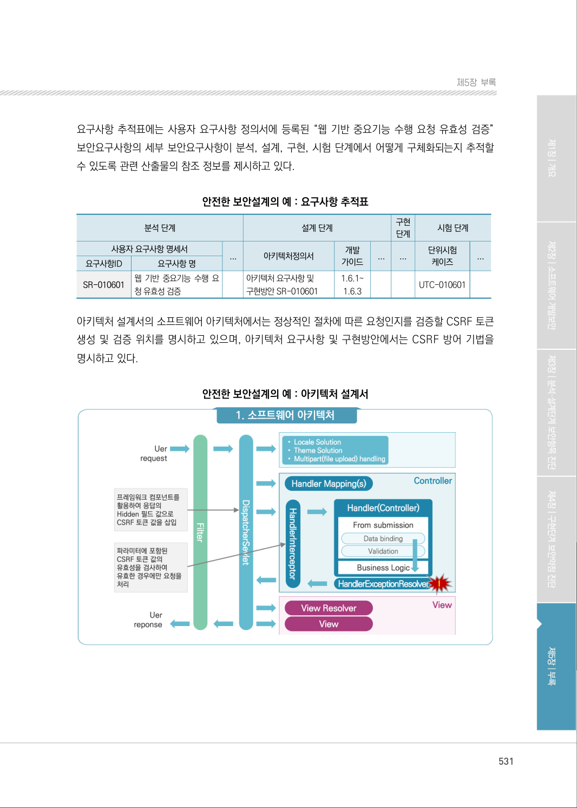
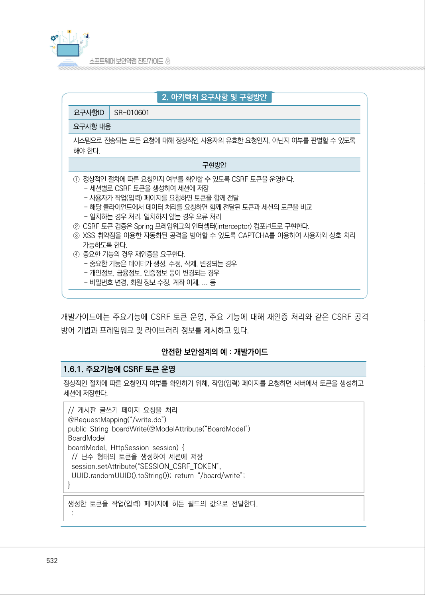
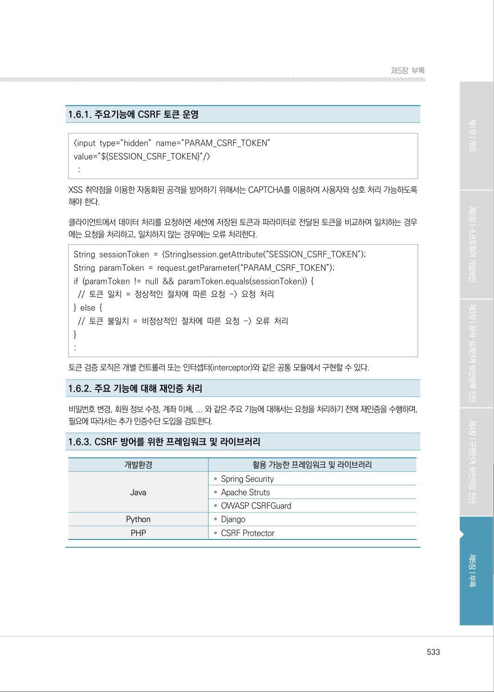

# 1-6. 웹 기반 중요 기능 수행 요청 유효성 검증

> 변환 안내(원문 외): 아래 본문은 PDF 텍스트를 추출한 전사입니다. 코드 줄번호·특수 공백·원문 오류를 유지했습니다. 실행용 코드가 아닙니다. 표·그림·들여쓰기는 연결된 페이지 이미지와 대조하세요. 페이지 경계의 줄바꿈을 보존하며, 동일 페이지가 여러 항목에 나뉘면 각 항목의 본문은 해당 구간만 포함합니다.

### PDF 530페이지 / 인쇄 530페이지

<!-- source-page:SW-Diagnosis-2021:530; source-lines:0,7,8,9,10,11,12,13,14,15,16,17,18,19,20,21,22,23,24,25,26,27,28,29,30,31,32,33,34,35,36,37,38,39,40,41,42,43,44,45,46,47,48,49,50,51,52,53,54 -->

530

1-6. 웹 기반 중요 기능 수행 요청 유효성 검증

다음은 “웹 기반 중요 기능 수행 요청 유효성 검증” 보안요구사항에 대한 안전한 설계 산출물의 예시
이며, 제시된 설계 산출물의 종류와 내용은 개발되는 소프트웨어의 특성, 환경, 방법론 등에 따라 
다를 수 있다.

사용자 요구사항 정의서에는 “웹 기반 중요기능 수행 요청 유효성 검증” 보안요구사항의 세부 보안
요구사항을 비기능 보안요구항목으로 등록하고 해결방안과 검수기준을 제시하고 있다.

안전한 보안설계의 예 : 사용자 요구사항 정의서

```text
요구
사항 ID
요구사항명 
구분 
요구사항설명 
요구사항 
출처
제약 
사항
중요 
도
해결방안
검수기준
비고
SR-
010601
웹 기반 
중요기능 수행 
요청 유효성 
검증
비 
기능
시스템으로전송되
는 모든 요청에 대
해 정상적인 사용자
의 유효한 요청인
지, 아닌지 여부를 
판별 할 수 있도록
해야 한다.
RFP 
보안요구 
사항 1.6
없음
상
CAPTCHA를 이용 
하여 사용자에 의 
한 정상적인 절차에
따른 요청인지를 확
인한다.
자동화된 요청이 처
리되지 않는다.
```

<details><summary>원본 페이지 이미지 (변환 외 보존 자료)</summary>


</details>

### PDF 531페이지 / 인쇄 531페이지

<!-- source-page:SW-Diagnosis-2021:531; source-lines:0,1,2,3,4,5,6,7,8,9,10,11,12,13,14,15,16,17,18,19,20,21,22,23,24,25,26,27,28,29,30,31,32,33,34,35 -->

531

제5장부록

요구사항 추적표에는 사용자 요구사항 정의서에 등록된 “웹 기반 중요기능 수행 요청 유효성 검증” 
보안요구사항의 세부 보안요구사항이 분석, 설계, 구현, 시험 단계에서 어떻게 구체화되는지 추적할 
수 있도록 관련 산출물의 참조 정보를 제시하고 있다.

안전한 보안설계의 예 : 요구사항 추적표

```text
분석 단계
설계 단계
구현 
단계
시험 단계
사용자 요구사항 명세서
...
아키텍처정의서
개발 
가이드
...
...
단위시험
케이즈
요구사항 명
웹 기반 중요기능 수행 요
청 유효성 검증
아키텍처 요구사항 및 
구현방안 SR-010601
1.6.1~ 
1.6.3 
UTC-010601
```

...

요구사항ID

SR-010601

아키텍처 설계서의 소프트웨어 아키텍처에서는 정상적인 절차에 따른 요청인지를 검증할 CSRF 토큰 
생성 및 검증 위치를 명시하고 있으며, 아키텍처 요구사항 및 구현방안에서는 CSRF 방어 기법을 
명시하고 있다.

안전한 보안설계의 예 : 아키텍처 설계서

#### 1. 소프트웨어 아키텍처

<details><summary>원본 페이지 이미지 (변환 외 보존 자료)</summary>



</details>

### PDF 532페이지 / 인쇄 532페이지

<!-- source-page:SW-Diagnosis-2021:532; source-lines:0,1,2,3,4,5,6,7,8,9,10,11,12,13,14,15,16,17,18,19,20,21,22,23,24,25,26,27,28,29,30,31,32,33,34,35,36 -->

532

#### 2. 아키텍처 요구사항 및 구형방안

요구사항ID

SR-010601

요구사항 내용
시스템으로 전송되는 모든 요청에 대해 정상적인 사용자의 유효한 요청인지, 아닌지 여부를 판별할 수 있도록 
해야 한다.

구현방안

①정상적인 절차에 따른 요청인지 여부를 확인할 수 있도록 CSRF 토큰을 운영한다.
- 세션별로 CSRF 토큰을 생성하여 세션에 저장
- 사용자가 작업(입력) 페이지를 요청하면 토큰을 함께 전달
- 해당 클라이언트에서 데이터 처리를 요청하면 함께 전달된 토큰과 세션의 토큰을 비교
- 일치하는 경우 처리, 일치하지 않는 경우 오류 처리
②CSRF 토큰 검증은 Spring 프레임워크의 인터셉터(interceptor) 컴포넌트로 구현한다.
③XSS 취약점을 이용한 자동화된 공격을 방어할 수 있도록 CAPTCHA를 이용하여 사용자와 상호 처리 
가능하도록 한다.
④중요한 기능의 경우 재인증을 요구한다.
- 중요한 기능은 데이터가 생성, 수정, 삭제, 변경되는 경우
- 개인정보, 금융정보, 인증정보 등이 변경되는 경우
- 비밀번호 변경, 회원 정보 수정, 계좌 이체, ... 등

개발가이드에는 주요기능에 CSRF 토큰 운영, 주요 기능에 대해 재인증 처리와 같은 CSRF 공격 
방어 기법과 프레임워크 및 라이브러리 정보를 제시하고 있다.

안전한 보안설계의 예 : 개발가이드

1.6.1. 주요기능에 CSRF 토큰 운영
정상적인 절차에 따른 요청인지 여부를 확인하기 위해, 작업(입력) 페이지를 요청하면 서버에서 토큰을 생성하고 
세션에 저장한다.
// 게시판 글쓰기 페이지 요청을 처리 
@RequestMapping(“/write.do”) 
public String boardWrite(@ModelAttribute(“BoardModel”)
BoardModel 
boardModel, HttpSession session) { 
 // 난수 형태의 토큰을 생성하여 세션에 저장 
 session.setAttribute(“SESSION_CSRF_TOKEN”,
 UUID.randomUUID().toString()); return “/board/write”; 
} 

생성한 토큰을 작업(입력) 페이지에 히든 필드의 값으로 전달한다. 
 :

<details><summary>원본 페이지 이미지 (변환 외 보존 자료)</summary>



</details>

### PDF 533페이지 / 인쇄 533페이지

<!-- source-page:SW-Diagnosis-2021:533; source-lines:0,1,2,3,4,5,6,7,8,9,10,11,12,13,14,15,16,17,18,19,20,21,22,23,24,25,26,27,28,29,30,31,32 -->

533

제5장부록

1.6.1. 주요기능에 CSRF 토큰 운영

&lt;input type=”hidden” name=”PARAM_CSRF_TOKEN”
value=”${SESSION_CSRF_TOKEN}”/&gt; 
 : 
XSS 취약점을 이용한 자동화된 공격을 방어하기 위해서는 CAPTCHA를 이용하여 사용자와 상호 처리 가능하도록 
해야 한다.
클라이언트에서 데이터 처리를 요청하면 세션에 저장된 토큰과 파라미터로 전달된 토큰을 비교하여 일치하는 경우
에는 요청을 처리하고, 일치하지 않는 경우에는 오류 처리한다.
String sessionToken = (String)session.getAttribute(“SESSION_CSRF_TOKEN”);
String paramToken = request.getParameter(“PARAM_CSRF_TOKEN”); 
if (paramToken != null &amp;&amp; paramToken.equals(sessionToken)) { 
 // 토큰 일치 = 정상적인 절차에 따른 요청 -&gt; 요청 처리 
} else { 
 // 토큰 불일치 = 비정상적인 절차에 따른 요청 -&gt; 오류 처리 
} 
: 
토큰 검증 로직은 개별 컨트롤러 또는 인터셉터(interceptor)와 같은 공통 모듈에서 구현할 수 있다.
1.6.2. 주요 기능에 대해 재인증 처리
비밀번호 변경, 회원 정보 수정, 계좌 이체, ... 와 같은 주요 기능에 대해서는 요청을 처리하기 전에 재인증을 수행하며, 
필요에 따라서는 추가 인증수단 도입을 검토한다.
1.6.3. CSRF 방어를 위한 프레임워크 및 라이브러리

```text
개발환경
활용 가능한 프레임워크 및 라이브러리
Java
• Spring Security
• Apache Struts
• OWASP CSRFGuard
Python
• Django
PHP
• CSRF Protector
```

<details><summary>원본 페이지 이미지 (변환 외 보존 자료)</summary>



</details>

### PDF 534페이지 / 인쇄 534페이지

<!-- source-page:SW-Diagnosis-2021:534; source-lines:1,2,3,4,5,6,7,8,9,10,11,12,13,14,15,16,17,18,19,20,21,22,23,24,25,26,27,28,29,30,31,32,33,34,35,36,37,38,39,40,41,42,43,44,45,46,47,48,49,50 -->

단위시험 케이스에는 정상적인 절차에 따른 요청인지 확인을 위해 발행한 CSRF 토큰을 검증하는 
절차와 방법을 제시하고 있다.

안전한 보안설계의 예 : 단위 테스트 케이스

```text
요구사항 ID
SR-010601
설명
관리자 및 사용자가 게시판에 등록, 조회, 수정, 삭제한다.
- 게시판은 공지사항, FAQ, Q&A, 자료실 모두를 포함한다.
- 공지사항과 자료실은 관리자만 등록, 수정, 삭제할 수 있다.
관련 컴포넌트 
ID
CMT_010601
관련 프로그램 
ID
케이스 ID
케이스 
명
작업 
권한 
시험 데이터
시험항목 및 처리절차 
예상결과 및 검증방법 
시험
결과
UTC_010601
게시판 
글쓰기/ 
CSRF 
토큰 검증
전체
게시물 데이터 
(제목, 내용, 
첨부 파일 등)
①메뉴에서 게시판을 선택 
②조회 화면 하단의 “등록” 
버튼 클릭 
③제목, 내용, 첨부파일을
입력하고 화면 하단에 
“저장” 버튼 클릭 
④조회 화면에 등록 여부 
확인
①브라우저의 소스 보기 기능을 이
용하여, PARAM_CSRF_TOKEN 
히든 필드가 존재하는지 확인한다. 
②브라우저의 개발자 도구를 이용
하여, PARAM_CSRF_TOKEN 
히든 필드의 값을 수정하거나 삭
제할 경우 게시물이 저장되지 않
는 것을 확인한다. (오류 메시지 
출력)
```

<details><summary>원본 페이지 이미지 (변환 외 보존 자료)</summary>


</details>

---

## 탐색 링크 (원문 외)

[통합 인덱스](../../../INDEX.md)

