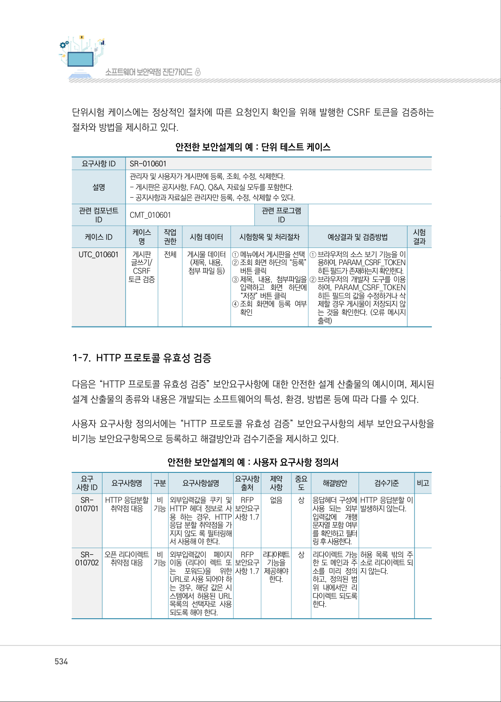
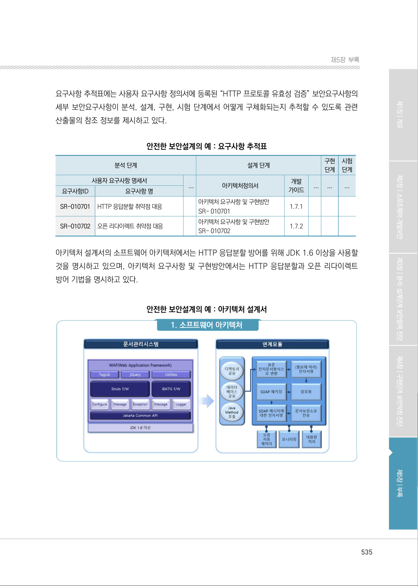
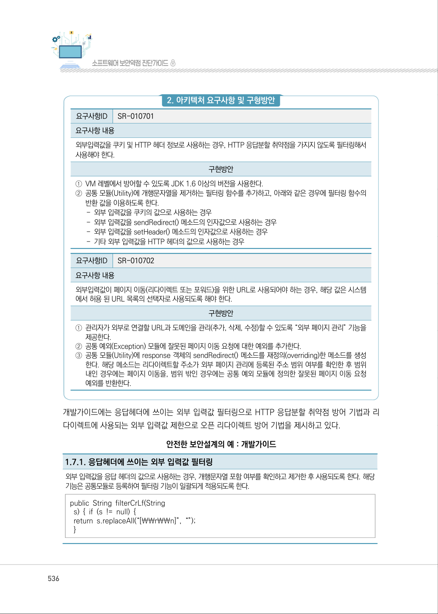
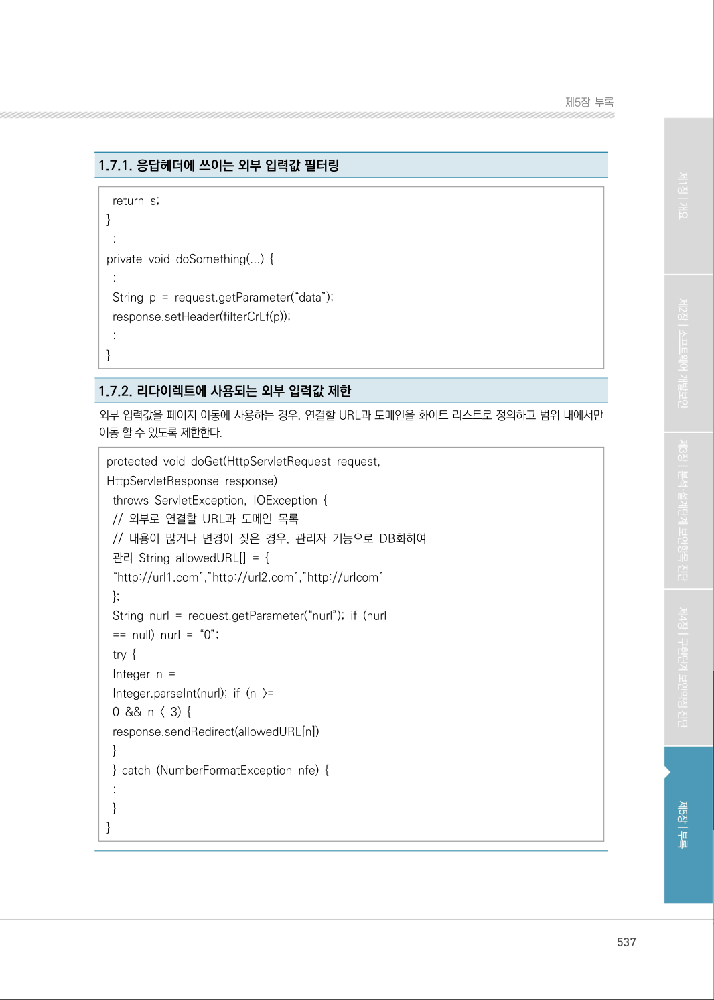

# 1-7. HTTP 프로토콜 유효성 검증

> 변환 안내(원문 외): 아래 본문은 PDF 텍스트를 추출한 전사입니다. 코드 줄번호·특수 공백·원문 오류를 유지했습니다. 실행용 코드가 아닙니다. 표·그림·들여쓰기는 연결된 페이지 이미지와 대조하세요. 페이지 경계의 줄바꿈을 보존하며, 동일 페이지가 여러 항목에 나뉘면 각 항목의 본문은 해당 구간만 포함합니다.

### PDF 534페이지 / 인쇄 534페이지

<!-- source-page:SW-Diagnosis-2021:534; source-lines:0,51,52,53,54,55,56,57,58,59,60,61,62,63,64,65,66,67,68,69,70,71,72,73,74,75,76,77,78,79,80,81,82,83,84,85,86,87,88,89,90,91,92,93,94,95,96,97,98,99,100,101,102,103,104,105,106,107,108,109,110,111,112,113,114,115,116,117,118,119,120,121,122,123,124,125,126,127,128,129,130 -->

534

1-7. HTTP 프로토콜 유효성 검증

다음은 “HTTP 프로토콜 유효성 검증” 보안요구사항에 대한 안전한 설계 산출물의 예시이며, 제시된 
설계 산출물의 종류와 내용은 개발되는 소프트웨어의 특성, 환경, 방법론 등에 따라 다를 수 있다.

사용자 요구사항 정의서에는 “HTTP 프로토콜 유효성 검증” 보안요구사항의 세부 보안요구사항을 
비기능 보안요구항목으로 등록하고 해결방안과 검수기준을 제시하고 있다.

안전한 보안설계의 예 : 사용자 요구사항 정의서

```text
요구
사항 ID
요구사항명 
구분 
요구사항설명 
요구사항 
출처
제약 
사항
중요 
도
해결방안
검수기준
비고
SR-
010701
HTTP 응답분할 
취약점 대응
비 
기능
외부입력값을 쿠키 및 
HTTP 헤더 정보로 사
용 하는 경우, HTTP 
응답 분할 취약점을 가
지지 않도 록 필터링해
서 사용해 야 한다.
RFP 
보안요구 
사항 1.7
없음 
상
응답헤더 구성에 
사용 되는 외부
입력값에 
개행 
문자열 포함 여부
를 확인하고 필터
링 후 사용한다.
HTTP 응답분할 이 
발생하지 않는다.
SR-
010702
오픈 리다이렉트 
취약점 대응
비 
기능
외부입력값이 페이지 
이동 (리다이 렉트 또
는 
포워드)을 
위한 
URL로 사용 되어야 하
는 경우, 해당 값은 시
스템에서 허용된 URL 
목록의 선택자로 사용
되도록 해야 한다.
RFP 
보안요구 
사항 1.7
리다이렉트
기능을 
제공해야 
한다.
상
리다이렉트 가능
한 도 메인과 주
소를 미리 정의
하고, 정의된 범
위 내에서만 리
다이렉트 되도록 
한다.
허용 목록 밖의 주
소로 리다이렉트 되
지 않는다.
```

<details><summary>원본 페이지 이미지 (변환 외 보존 자료)</summary>



</details>

### PDF 535페이지 / 인쇄 535페이지

<!-- source-page:SW-Diagnosis-2021:535; source-lines:0,1,2,3,4,5,6,7,8,9,10,11,12,13,14,15,16,17,18,19,20,21,22,23,24,25,26,27,28,29,30,31,32,33,34,35,36 -->

535

제5장부록

요구사항 추적표에는 사용자 요구사항 정의서에 등록된 “HTTP 프로토콜 유효성 검증” 보안요구사항의 
세부 보안요구사항이 분석, 설계, 구현, 시험 단계에서 어떻게 구체화되는지 추적할 수 있도록 관련 
산출물의 참조 정보를 제시하고 있다.

안전한 보안설계의 예 : 요구사항 추적표

```text
분석 단계
설계 단계
구현 
단계
사용자 요구사항 명세서
...
아키텍처정의서
개발 
가이드
...
...
요구사항 명
HTTP 응답분할 취약점 대응 
아키텍처 요구사항 및 구현방안
SR- 010701 
1.7.1
오픈 리다이렉트 취약점 대응 
아키텍처 요구사항 및 구현방안
SR- 010702 
1.7.2
```

시험 
단계

...

요구사항ID

SR-010701

SR-010702

아키텍처 설계서의 소프트웨어 아키텍처에서는 HTTP 응답분할 방어를 위해 JDK 1.6 이상을 사용할 
것을 명시하고 있으며, 아키텍처 요구사항 및 구현방안에서는 HTTP 응답분할과 오픈 리다이렉트 
방어 기법을 명시하고 있다.

안전한 보안설계의 예 : 아키텍처 설계서

#### 1. 소프트웨어 아키텍처

<details><summary>원본 페이지 이미지 (변환 외 보존 자료)</summary>



</details>

### PDF 536페이지 / 인쇄 536페이지

<!-- source-page:SW-Diagnosis-2021:536; source-lines:0,1,2,3,4,5,6,7,8,9,10,11,12,13,14,15,16,17,18,19,20,21,22,23,24,25,26,27,28,29,30,31,32,33,34,35,36,37 -->

536

#### 2. 아키텍처 요구사항 및 구형방안

요구사항ID

SR-010701

요구사항 내용
외부입력값을 쿠키 및 HTTP 헤더 정보로 사용하는 경우, HTTP 응답분할 취약점을 가지지 않도록 필터링해서 
사용해야 한다.

구현방안

①VM 레벨에서 방어할 수 있도록 JDK 1.6 이상의 버전을 사용한다. 
②공통 모듈(Utility)에 개행문자열을 제거하는 필터링 함수를 추가하고, 아래와 같은 경우에 필터링 함수의 
반환 값을 이용하도록 한다.
- 외부 입력값을 쿠키의 값으로 사용하는 경우 
- 외부 입력값을 sendRedirect() 메소드의 인자값으로 사용하는 경우 
- 외부 입력값을 setHeader() 메소드의 인자값으로 사용하는 경우 
- 기타 외부 입력값을 HTTP 헤더의 값으로 사용하는 경우

요구사항ID

SR-010702

요구사항 내용
외부입력값이 페이지 이동(리다이렉트 또는 포워드)을 위한 URL로 사용되어야 하는 경우, 해당 값은 시스템
에서 허용 된 URL 목록의 선택자로 사용되도록 해야 한다.

구현방안

①관리자가 외부로 연결할 URL과 도메인을 관리(추가, 삭제, 수정)할 수 있도록 “외부 페이지 관리” 기능을 
제공한다.
②공통 예외(Exception) 모듈에 잘못된 페이지 이동 요청에 대한 예외를 추가한다.
③공통 모듈(Utility)에 response 객체의 sendRedirect() 메소드를 재정의(overriding)한 메소드를 생성
한다. 해당 메소드는 리다이렉트할 주소가 외부 페이지 관리에 등록된 주소 범위 여부를 확인한 후 범위 
내인 경우에는 페이지 이동을, 범위 밖인 경우에는 공통 예외 모듈에 정의한 잘못된 페이지 이동 요청 
예외를 반환한다.

개발가이드에는 응답헤더에 쓰이는 외부 입력값 필터링으로 HTTP 응답분할 취약점 방어 기법과 리
다이렉트에 사용되는 외부 입력값 제한으로 오픈 리다이렉트 방어 기법을 제시하고 있다.

안전한 보안설계의 예 : 개발가이드

1.7.1. 응답헤더에 쓰이는 외부 입력값 필터링
외부 입력값을 응답 헤더의 값으로 사용하는 경우, 개행문자열 포함 여부를 확인하고 제거한 후 사용되도록 한다. 해당 
기능은 공통모듈로 등록하여 필터링 기능이 일괄되게 적용되도록 한다.
public String filterCrLf(String
 s) { if (s != null) { 
 return s.replaceAll(“[￦￦r￦￦n]”, “”); 
 }

<details><summary>원본 페이지 이미지 (변환 외 보존 자료)</summary>



</details>

### PDF 537페이지 / 인쇄 537페이지

<!-- source-page:SW-Diagnosis-2021:537; source-lines:0,1,2,3,4,5,6,7,8,9,10,11,12,13,14,15,16,17,18,19,20,21,22,23,24,25,26,27,28,29,30,31,32,33,34 -->

537

제5장부록

1.7.1. 응답헤더에 쓰이는 외부 입력값 필터링

 return s; 
} 
 : 
private void doSomething(...) { 
 : 
 String p = request.getParameter(“data”); 
 response.setHeader(filterCrLf(p)); 
 : 
} 

1.7.2. 리다이렉트에 사용되는 외부 입력값 제한
외부 입력값을 페이지 이동에 사용하는 경우, 연결할 URL과 도메인을 화이트 리스트로 정의하고 범위 내에서만 
이동 할 수 있도록 제한한다.
protected void doGet(HttpServletRequest request,
HttpServletResponse response)
 throws ServletException, IOException { 
 // 외부로 연결할 URL과 도메인 목록 
 // 내용이 많거나 변경이 잦은 경우, 관리자 기능으로 DB화하여 
 관리 String allowedURL[] = { 
 “http://url1.com”,”http://url2.com”,”http://urlcom” 
 }; 
 String nurl = request.getParameter(“nurl”); if (nurl 
 == null) nurl = “0”; 
 try { 
 Integer n =
 Integer.parseInt(nurl); if (n &gt;= 
 0 &amp;&amp; n &lt; 3) { 
 response.sendRedirect(allowedURL[n]) 
 } 
 } catch (NumberFormatException nfe) { 
 : 
 } 
}

<details><summary>원본 페이지 이미지 (변환 외 보존 자료)</summary>



</details>

---

## 탐색 링크 (원문 외)

[통합 인덱스](../../../INDEX.md)

