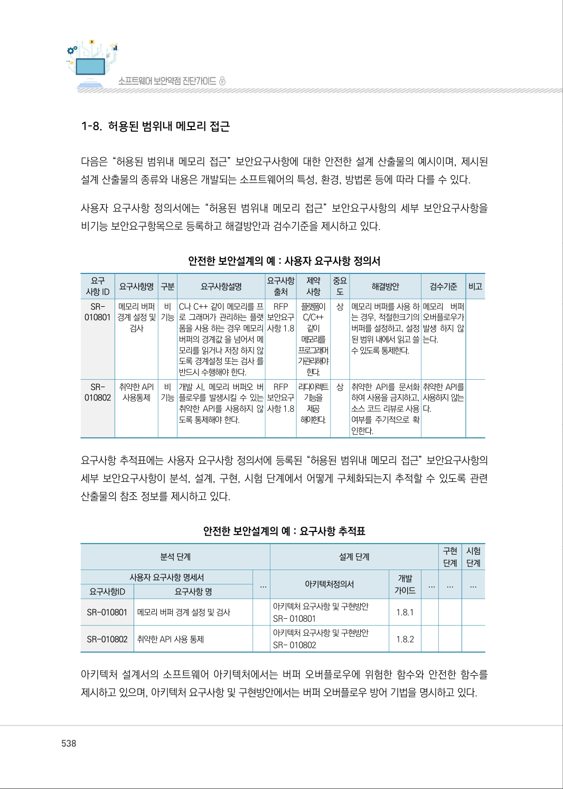
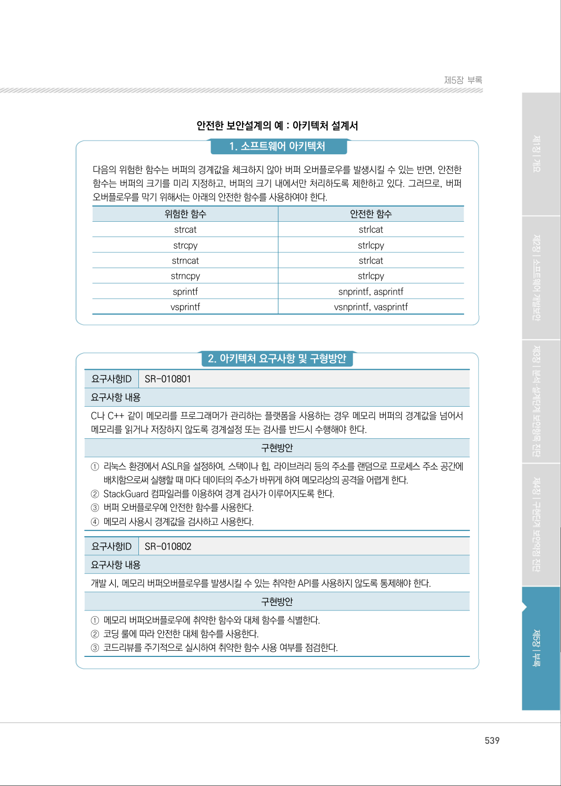
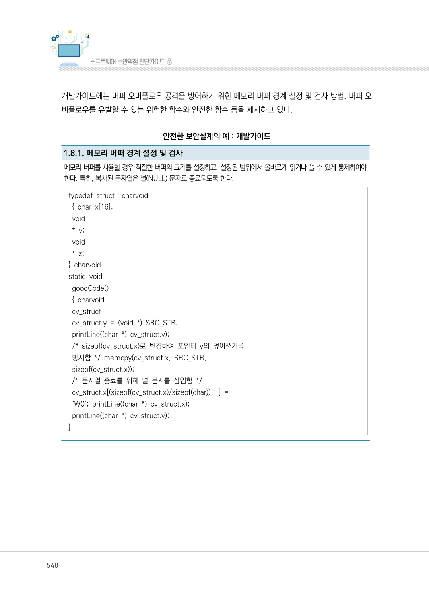

# 1-8. 허용된 범위내 메모리 접근

> 변환 안내(원문 외): 아래 본문은 PDF 텍스트를 추출한 전사입니다. 코드 줄번호·특수 공백·원문 오류를 유지했습니다. 실행용 코드가 아닙니다. 표·그림·들여쓰기는 연결된 페이지 이미지와 대조하세요. 페이지 경계의 줄바꿈을 보존하며, 동일 페이지가 여러 항목에 나뉘면 각 항목의 본문은 해당 구간만 포함합니다.

### PDF 538페이지 / 인쇄 538페이지

<!-- source-page:SW-Diagnosis-2021:538; source-lines:0,1,2,3,4,5,6,7,8,9,10,11,12,13,14,15,16,17,18,19,20,21,22,23,24,25,26,27,28,29,30,31,32,33,34,35,36,37,38,39,40,41,42,43,44,45,46,47,48,49,50,51,52,53,54,55,56,57,58,59,60,61,62,63,64,65,66,67,68,69,70,71,72,73,74,75,76,77,78,79,80,81,82,83,84,85,86,87,88,89,90,91,92,93,94,95,96,97,98,99,100,101,102,103,104,105,106,107,108,109,110,111 -->

538

1-8. 허용된 범위내 메모리 접근

다음은 “허용된 범위내 메모리 접근” 보안요구사항에 대한 안전한 설계 산출물의 예시이며, 제시된 
설계 산출물의 종류와 내용은 개발되는 소프트웨어의 특성, 환경, 방법론 등에 따라 다를 수 있다.

사용자 요구사항 정의서에는 “허용된 범위내 메모리 접근” 보안요구사항의 세부 보안요구사항을 
비기능 보안요구항목으로 등록하고 해결방안과 검수기준을 제시하고 있다.

안전한 보안설계의 예 : 사용자 요구사항 정의서

```text
요구
사항 ID
요구사항명 구분 
요구사항설명 
요구사항 
출처
제약 
사항
중요 
도
해결방안
검수기준
비고
SR-
010801
메모리 버퍼 
경계 설정 및 
검사
비 
기능
C나 C++ 같이 메모리를 프
로 그래머가 관리하는 플랫
폼을 사용 하는 경우 메모리 
버퍼의 경계값 을 넘어서 메
모리를 읽거나 저장 하지 않
도록 경계설정 또는 검사 를 
반드시 수행해야 한다.
RFP 
보안요구 
사항 1.8
플랫폼이 
C/C++ 
같이 
메모리를 
프로그래머 
가관리해야 
한다.
상
메모리 버퍼를 사용 하
는 경우, 적절한크기의 
버퍼를 설정하고, 설정
된 범위 내에서 읽고 쓸 
수 있도록 통제한다.
메모리 버퍼
오버플로우가 
발생 하지 않
는다.
SR-
010802
취약한 API
사용통제
비 
기능
개발 시, 메모리 버퍼오 버
플로우를 발생시킬 수 있는 
취약한 API를 사용하지 않
도록 통제해야 한다.
RFP 
보안요구 
사항 1.8
리다이렉트 
기능을
제공 
해야한다. 
상
취약한 API를 문서화
하여 사용을 금지하고, 
소스 코드 리뷰로 사용 
여부를 주기적으로 확
인한다.
취약한 API를 
사용하지 않는
다.
```

요구사항 추적표에는 사용자 요구사항 정의서에 등록된 “허용된 범위내 메모리 접근” 보안요구사항의 
세부 보안요구사항이 분석, 설계, 구현, 시험 단계에서 어떻게 구체화되는지 추적할 수 있도록 관련 
산출물의 참조 정보를 제시하고 있다.

안전한 보안설계의 예 : 요구사항 추적표

```text
분석 단계
설계 단계
구현 
단계
시험 
단계
사용자 요구사항 명세서
...
아키텍처정의서
개발 
가이드
...
...
...
요구사항ID
요구사항 명
SR-010801
메모리 버퍼 경계 설정 및 검사 
아키텍처 요구사항 및 구현방안
SR- 010801 
1.8.1
SR-010802
취약한 API 사용 통제 
아키텍처 요구사항 및 구현방안
SR- 010802 
1.8.2
```

아키텍처 설계서의 소프트웨어 아키텍처에서는 버퍼 오버플로우에 위험한 함수와 안전한 함수를 
제시하고 있으며, 아키텍처 요구사항 및 구현방안에서는 버퍼 오버플로우 방어 기법을 명시하고 있다.

<details><summary>원본 페이지 이미지 (변환 외 보존 자료)</summary>



</details>

### PDF 539페이지 / 인쇄 539페이지

<!-- source-page:SW-Diagnosis-2021:539; source-lines:0,1,2,3,4,5,6,7,8,9,10,11,12,13,14,15,16,17,18,19,20,21,22,23,24,25,26,27,28,29,30,31,32,33,34,35,36,37,38,39,40 -->

539

제5장부록

안전한 보안설계의 예 : 아키텍처 설계서

#### 1. 소프트웨어 아키텍처

다음의 위험한 함수는 버퍼의 경계값을 체크하지 않아 버퍼 오버플로우를 발생시킬 수 있는 반면, 안전한 
함수는 버퍼의 크기를 미리 지정하고, 버퍼의 크기 내에서만 처리하도록 제한하고 있다. 그러므로, 버퍼 
오버플로우를 막기 위해서는 아래의 안전한 함수를 사용하여야 한다.

|  |  |
| --- | --- |
| 위험한 함수 | 안전한 함수 |
| strcat | strlcat |
| strcpy | strlcpy |
| strncat | strlcat |
| strncpy | strlcpy |
| sprintf | snprintf, asprintf |
| vsprintf | vsnprintf, vasprintf |

#### 2. 아키텍처 요구사항 및 구형방안

요구사항ID

SR-010801

요구사항 내용
C나 C++ 같이 메모리를 프로그래머가 관리하는 플랫폼을 사용하는 경우 메모리 버퍼의 경계값을 넘어서 
메모리를 읽거나 저장하지 않도록 경계설정 또는 검사를 반드시 수행해야 한다.

구현방안

①리눅스 환경에서 ASLR을 설정하여, 스택이나 힙, 라이브러리 등의 주소를 랜덤으로 프로세스 주소 공간에 

배치함으로써 실행할 때 마다 데이터의 주소가 바뀌게 하여 메모리상의 공격을 어렵게 한다.
②StackGuard 컴파일러를 이용하여 경계 검사가 이루어지도록 한다.
③버퍼 오버플로우에 안전한 함수를 사용한다.
④메모리 사용시 경계값을 검사하고 사용한다.

요구사항ID

SR-010802

요구사항 내용
개발 시, 메모리 버퍼오버플로우를 발생시킬 수 있는 취약한 API를 사용하지 않도록 통제해야 한다.

구현방안

①메모리 버퍼오버플로우에 취약한 함수와 대체 함수를 식별한다.
②코딩 룰에 따라 안전한 대체 함수를 사용한다.
③코드리뷰를 주기적으로 실시하여 취약한 함수 사용 여부를 점검한다.

<details><summary>원본 페이지 이미지 (변환 외 보존 자료)</summary>



</details>

### PDF 540페이지 / 인쇄 540페이지

<!-- source-page:SW-Diagnosis-2021:540; source-lines:0,1,2,3,4,5,6,7,8,9,10,11,12,13,14,15,16,17,18,19,20,21,22,23,24,25,26,27 -->

540

개발가이드에는 버퍼 오버플로우 공격을 방어하기 위한 메모리 버퍼 경계 설정 및 검사 방법, 버퍼 오
버플로우를 유발할 수 있는 위험한 함수와 안전한 함수 등을 제시하고 있다.

안전한 보안설계의 예 : 개발가이드

1.8.1. 메모리 버퍼 경계 설정 및 검사
메모리 버퍼를 사용할 경우 적절한 버퍼의 크기를 설정하고, 설정된 범위에서 올바르게 읽거나 쓸 수 있게 통제하여야 
한다. 특히, 복사된 문자열은 널(NULL) 문자로 종료되도록 한다.
typedef struct _charvoid 
 { char x[16]; 
 void 
 * y;
 void 
 * z; 
} charvoid 
static void
 goodCode()
 { charvoid 
 cv_struct 
 cv_struct.y = (void *) SRC_STR;
 printLine((char *) cv_struct.y); 
 /* sizeof(cv_struct.x)로 변경하여 포인터 y의 덮어쓰기를 
 방지함 */ memcpy(cv_struct.x, SRC_STR,
 sizeof(cv_struct.x)); 
 /* 문자열 종료를 위해 널 문자를 삽입함 */
 cv_struct.x[(sizeof(cv_struct.x)/sizeof(char))-1] = 
 ‘￦0’; printLine((char *) cv_struct.x); 
 printLine((char *) cv_struct.y); 
}

<details><summary>원본 페이지 이미지 (변환 외 보존 자료)</summary>



</details>

### PDF 541페이지 / 인쇄 541페이지

<!-- source-page:SW-Diagnosis-2021:541; source-lines:1,2,3,4,5,6,7,8,9,10,11,12,13,14,15,16,17,18,19,20,21 -->

제5장부록

1.8.1. 메모리 버퍼 경계 설정 및 검사
위험한 함수는 버퍼의 경계값을 체크하지 않아 버퍼 오버플로우를 발생시킬 수 있으므로, 버퍼 오버플로우 공격을 
막기 위해서는 아래의 안전한 함수를 사용하여야 한다.

|  |  |
| --- | --- |
| 위험한 함수 | 안전한 함수 |
| strcat | strlcat |
| strcpy | strlcpy |
| strncat | strlcat |
| strncpy | strlcpy |
| sprintf | snprintf, asprintf |
| vsprintf | vsnprintf, vasprintf |
| gets | fgets |

코드 리뷰로 위험한 함수 사용 여부를 주기적으로 확인해야 한다.

<details><summary>원본 페이지 이미지 (변환 외 보존 자료)</summary>


</details>

---

## 탐색 링크 (원문 외)

[통합 인덱스](../../../INDEX.md)

