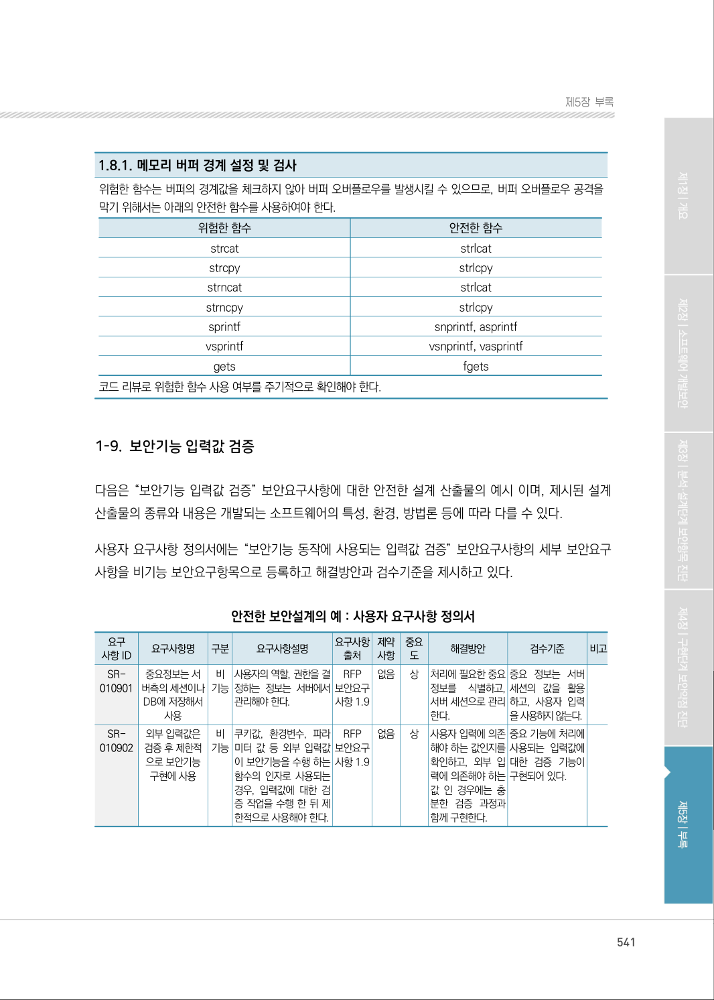
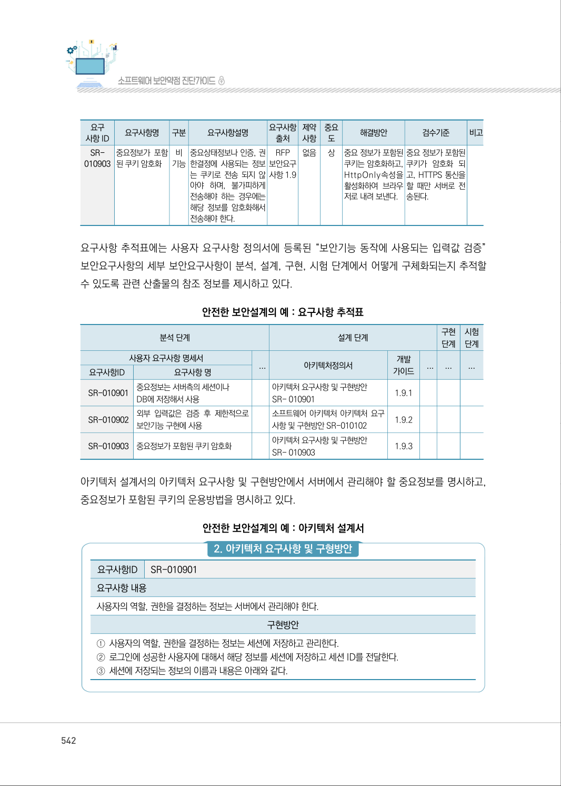
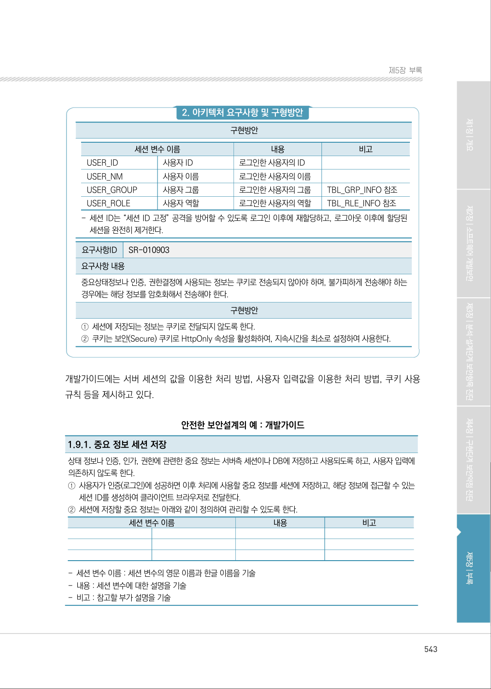
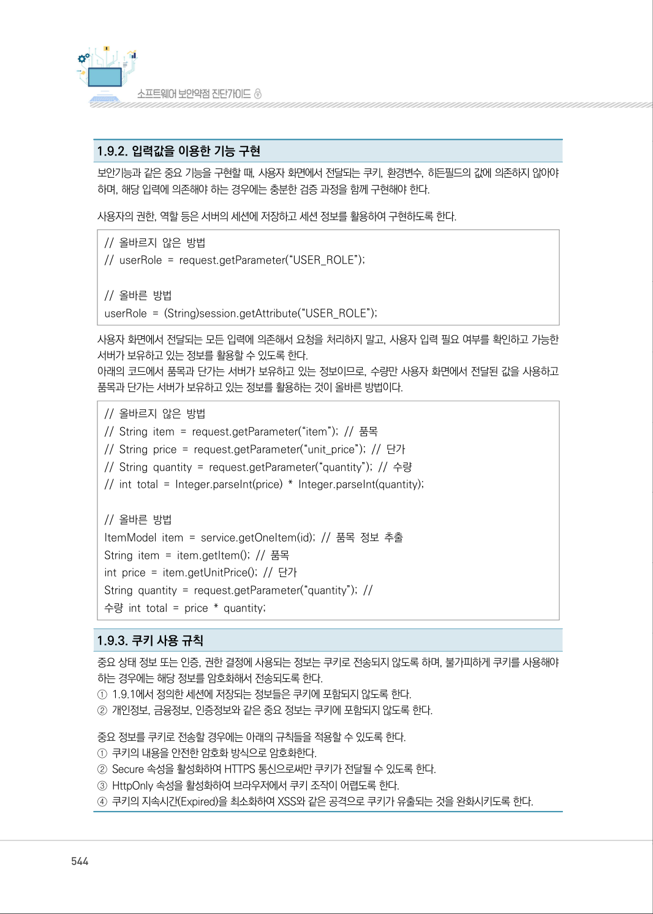
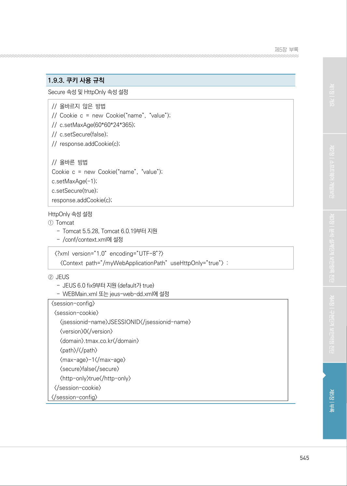
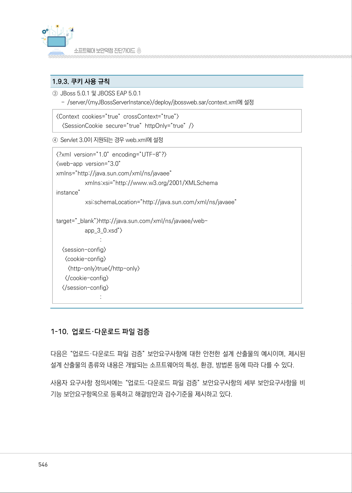

# 1-9. 보안기능 입력값 검증

> 변환 안내(원문 외): 아래 본문은 PDF 텍스트를 추출한 전사입니다. 코드 줄번호·특수 공백·원문 오류를 유지했습니다. 실행용 코드가 아닙니다. 표·그림·들여쓰기는 연결된 페이지 이미지와 대조하세요. 페이지 경계의 줄바꿈을 보존하며, 동일 페이지가 여러 항목에 나뉘면 각 항목의 본문은 해당 구간만 포함합니다.

### PDF 541페이지 / 인쇄 541페이지

<!-- source-page:SW-Diagnosis-2021:541; source-lines:0,22,23,24,25,26,27,28,29,30,31,32,33,34,35,36,37,38,39,40,41,42,43,44,45,46,47,48,49,50,51,52,53,54,55,56,57,58,59,60,61,62,63,64,65,66,67,68,69,70,71,72,73,74,75,76,77,78,79,80,81,82,83,84,85,86,87,88,89,90,91,92,93,94,95,96,97 -->

541

1-9. 보안기능 입력값 검증

다음은 “보안기능 입력값 검증” 보안요구사항에 대한 안전한 설계 산출물의 예시 이며, 제시된 설계 
산출물의 종류와 내용은 개발되는 소프트웨어의 특성, 환경, 방법론 등에 따라 다를 수 있다.

사용자 요구사항 정의서에는 “보안기능 동작에 사용되는 입력값 검증” 보안요구사항의 세부 보안요구 
사항을 비기능 보안요구항목으로 등록하고 해결방안과 검수기준을 제시하고 있다.

안전한 보안설계의 예 : 사용자 요구사항 정의서

```text
요구
사항 ID
요구사항명 
구분 
요구사항설명 
요구사항 
출처
제약 
사항
중요 
도
해결방안
검수기준
비고
SR-
010901
중요정보는 서 
버측의 세션이나 
DB에 저장해서 
사용
비 
기능
사용자의 역할, 권한을 결
정하는 정보는 서버에서 
관리해야 한다.
RFP 
보안요구 
사항 1.9
없음 
상
처리에 필요한 중요 
정보를 
식별하고, 
서버 세션으로 관리
한다.
중요 정보는 서버 
세션의 값을 활용 
하고, 사용자 입력
을 사용하지 않는다.
SR-
010902
외부 입력값은 
검증 후 제한적 
으로 보안기능 
구현에 사용
비 
기능
쿠키값, 환경변수, 파라 
미터 값 등 외부 입력값
이 보안기능을 수행 하는 
함수의 인자로 사용되는 
경우, 입력값에 대한 검
증 작업을 수행 한 뒤 제
한적으로 사용해야 한다.
RFP 
보안요구 
사항 1.9
없음 
상
사용자 입력에 의존 
해야 하는 값인지를 
확인하고, 외부 입
력에 의존해야 하는 
값 인 경우에는 충
분한 검증 과정과 
함께 구현한다.
중요 기능에 처리에 
사용되는 입력값에 
대한 검증 기능이 
구현되어 있다.
```

<details><summary>원본 페이지 이미지 (변환 외 보존 자료)</summary>



</details>

### PDF 542페이지 / 인쇄 542페이지

<!-- source-page:SW-Diagnosis-2021:542; source-lines:0,1,2,3,4,5,6,7,8,9,10,11,12,13,14,15,16,17,18,19,20,21,22,23,24,25,26,27,28,29,30,31,32,33,34,35,36,37,38,39,40,41,42,43,44,45,46,47,48,49,50,51,52,53,54,55,56,57,58,59,60,61,62,63,64,65,66,67,68,69,70,71,72,73,74,75,76,77,78,79,80,81,82,83,84,85,86,87,88,89,90,91 -->

542

```text
요구
사항 ID
요구사항명 
구분 
요구사항설명 
요구사항 
출처
제약 
사항
중요 
도
해결방안
검수기준
비고
SR-
010903
중요정보가 포함 
된 쿠키 암호화
비 
기능
중요상태정보나 인증, 권
한결정에 사용되는 정보 
는 쿠키로 전송 되지 않
아야 하며, 불가피하게 
전송해야 하는 경우에는 
해당 정보를 암호화해서 
전송해야 한다.
RFP 
보안요구 
사항 1.9
없음 
상
중요 정보가 포함된 
쿠키는 암호화하고, 
HttpOnly속성을 
활성화하여 브라우
저로 내려 보낸다.
중요 정보가 포함된 
쿠키가 암호화 되
고, HTTPS 통신을 
할 때만 서버로 전
송된다.
```

요구사항 추적표에는 사용자 요구사항 정의서에 등록된 “보안기능 동작에 사용되는 입력값 검증” 
보안요구사항의 세부 보안요구사항이 분석, 설계, 구현, 시험 단계에서 어떻게 구체화되는지 추적할 
수 있도록 관련 산출물의 참조 정보를 제시하고 있다.

안전한 보안설계의 예 : 요구사항 추적표

```text
분석 단계
설계 단계
구현 
단계
시험 
단계
사용자 요구사항 명세서
...
아키텍처정의서
개발 
가이드
...
...
...
요구사항ID
요구사항 명
SR-010901
중요정보는 서버측의 세션이나
DB에 저장해서 사용
아키텍처 요구사항 및 구현방안
SR- 010901
1.9.1
SR-010902
외부 입력값은 검증 후 제한적으로 
보안기능 구현에 사용
소프트웨어 아키텍처 아키텍처 요구
사항 및 구현방안 SR-010102
1.9.2
SR-010903
중요정보가 포함된 쿠키 암호화 
아키텍처 요구사항 및 구현방안
SR- 010903 
1.9.3
```

아키텍처 설계서의 아키텍처 요구사항 및 구현방안에서 서버에서 관리해야 할 중요정보를 명시하고, 
중요정보가 포함된 쿠키의 운용방법을 명시하고 있다.

안전한 보안설계의 예 : 아키텍처 설계서

#### 2. 아키텍처 요구사항 및 구형방안

요구사항ID

SR-010901

요구사항 내용
사용자의 역할, 권한을 결정하는 정보는 서버에서 관리해야 한다.

구현방안

①사용자의 역할, 권한을 결정하는 정보는 세션에 저장하고 관리한다. 
②로그인에 성공한 사용자에 대해서 해당 정보를 세션에 저장하고 세션 ID를 전달한다. 
③세션에 저장되는 정보의 이름과 내용은 아래와 같다.

<details><summary>원본 페이지 이미지 (변환 외 보존 자료)</summary>



</details>

### PDF 543페이지 / 인쇄 543페이지

<!-- source-page:SW-Diagnosis-2021:543; source-lines:0,1,2,3,4,5,6,7,8,9,10,11,12,13,14,15,16,17,18,19,20,21,22,23,24,25,26,27,28,29,30,31,32,33,34,35,36,37,38,39,40,41,42,43,44,45 -->

543

제5장부록

#### 2. 아키텍처 요구사항 및 구형방안

구현방안

```text
세션 변수 이름
내용
비고
USER_ID
사용자 ID 
로그인한 사용자의 ID
USER_NM
사용자 이름 
로그인한 사용자의 이름
USER_GROUP
사용자 그룹 
로그인한 사용자의 그룹 
TBL_GRP_INFO 참조
USER_ROLE
사용자 역할 
로그인한 사용자의 역할 
TBL_RLE_INFO 참조
```

- 세션 ID는 “세션 ID 고정” 공격을 방어할 수 있도록 로그인 이후에 재할당하고, 로그아웃 이후에 할당된 

세션을 완전히 제거한다.
요구사항ID

SR-010903

요구사항 내용
중요상태정보나 인증, 권한결정에 사용되는 정보는 쿠키로 전송되지 않아야 하며, 불가피하게 전송해야 하는 
경우에는 해당 정보를 암호화해서 전송해야 한다.

구현방안

①세션에 저장되는 정보는 쿠키로 전달되지 않도록 한다.
②쿠키는 보안(Secure) 쿠키로 HttpOnly 속성을 활성화하여, 지속시간을 최소로 설정하여 사용한다.

개발가이드에는 서버 세션의 값을 이용한 처리 방법, 사용자 입력값을 이용한 처리 방법, 쿠키 사용 
규칙 등을 제시하고 있다.

안전한 보안설계의 예 : 개발가이드

1.9.1. 중요 정보 세션 저장
상태 정보나 인증, 인가, 권한에 관련한 중요 정보는 서버측 세션이나 DB에 저장하고 사용되도록 하고, 사용자 입력에 
의존하지 않도록 한다.
①사용자가 인증(로그인)에 성공하면 이후 처리에 사용할 중요 정보를 세션에 저장하고, 해당 정보에 접근할 수 있는 

세션 ID를 생성하여 클라이언트 브라우저로 전달한다.
②세션에 저장할 중요 정보는 아래와 같이 정의하여 관리할 수 있도록 한다.

```text
세션 변수 이름
내용
비고
```

- 세션 변수 이름 : 세션 변수의 영문 이름과 한글 이름을 기술
- 내용 : 세션 변수에 대한 설명을 기술 
- 비고 : 참고할 부가 설명을 기술 

<details><summary>원본 페이지 이미지 (변환 외 보존 자료)</summary>



</details>

### PDF 544페이지 / 인쇄 544페이지

<!-- source-page:SW-Diagnosis-2021:544; source-lines:0,1,2,3,4,5,6,7,8,9,10,11,12,13,14,15,16,17,18,19,20,21,22,23,24,25,26,27,28,29,30,31,32,33 -->

544

1.9.2. 입력값을 이용한 기능 구현
보안기능과 같은 중요 기능을 구현할 때, 사용자 화면에서 전달되는 쿠키, 환경변수, 히든필드의 값에 의존하지 않아야 
하며, 해당 입력에 의존해야 하는 경우에는 충분한 검증 과정을 함께 구현해야 한다.
사용자의 권한, 역할 등은 서버의 세션에 저장하고 세션 정보를 활용하여 구현하도록 한다.
// 올바르지 않은 방법
// userRole = request.getParameter(“USER_ROLE”);

// 올바른 방법 
userRole = (String)session.getAttribute(“USER_ROLE”);
사용자 화면에서 전달되는 모든 입력에 의존해서 요청을 처리하지 말고, 사용자 입력 필요 여부를 확인하고 가능한 
서버가 보유하고 있는 정보를 활용할 수 있도록 한다.
아래의 코드에서 품목과 단가는 서버가 보유하고 있는 정보이므로, 수량만 사용자 화면에서 전달된 값을 사용하고 
품목과 단가는 서버가 보유하고 있는 정보를 활용하는 것이 올바른 방법이다.
// 올바르지 않은 방법
// String item = request.getParameter(“item”); // 품목 
// String price = request.getParameter(“unit_price”); // 단가 
// String quantity = request.getParameter(“quantity”); // 수량 
// int total = Integer.parseInt(price) * Integer.parseInt(quantity); 

// 올바른 방법
ItemModel item = service.getOneItem(id); // 품목 정보 추출 
String item = item.getItem(); // 품목 
int price = item.getUnitPrice(); // 단가 
String quantity = request.getParameter(“quantity”); // 
수량 int total = price * quantity;

1.9.3. 쿠키 사용 규칙
중요 상태 정보 또는 인증, 권한 결정에 사용되는 정보는 쿠키로 전송되지 않도록 하며, 불가피하게 쿠키를 사용해야 
하는 경우에는 해당 정보를 암호화해서 전송되도록 한다.
①1.9.1에서 정의한 세션에 저장되는 정보들은 쿠키에 포함되지 않도록 한다.
②개인정보, 금융정보, 인증정보와 같은 중요 정보는 쿠키에 포함되지 않도록 한다.
중요 정보를 쿠키로 전송할 경우에는 아래의 규칙들을 적용할 수 있도록 한다.
①쿠키의 내용을 안전한 암호화 방식으로 암호화한다.
②Secure 속성을 활성화하여 HTTPS 통신으로써만 쿠키가 전달될 수 있도록 한다.
③HttpOnly 속성을 활성화하여 브라우저에서 쿠키 조작이 어렵도록 한다.
④쿠키의 지속시간(Expired)을 최소화하여 XSS와 같은 공격으로 쿠키가 유출되는 것을 완화시키도록 한다.

<details><summary>원본 페이지 이미지 (변환 외 보존 자료)</summary>



</details>

### PDF 545페이지 / 인쇄 545페이지

<!-- source-page:SW-Diagnosis-2021:545; source-lines:0,1,2,3,4,5,6,7,8,9,10,11,12,13,14,15,16,17,18,19,20,21,22,23,24,25,26,27,28,29,30,31,32,33 -->

545

제5장부록

1.9.3. 쿠키 사용 규칙
Secure 속성 및 HttpOnly 속성 설정
// 올바르지 않은 방법
// Cookie c = new Cookie(“name”, “value”);
// c.setMaxAge(60*60*24*365);
// c.setSecure(false);
// response.addCookie(c);

// 올바른 방법
Cookie c = new Cookie(“name”, “value”);
c.setMaxAge(-1); 
c.setSecure(true);
response.addCookie(c);
HttpOnly 속성 설정
①Tomcat

- Tomcat 5.5.28, Tomcat 6.0.19부터 지원
- /conf/context.xml에 설정
 &lt;?xml version=”1.0” encoding=”UTF-8”?&gt; 
   &lt;Context path=”/myWebApplicationPath” useHttpOnly=”true”&gt; : 
②JEUS

- JEUS 6.0 fix9부터 지원 (default가 true) 
- WEBMain.xml 또는 jeus-web-dd.xml에 설정
&lt;session-config&gt;
 &lt;session-cookie&gt; 
   &lt;jsessionid-name&gt;JSESSIONID&lt;/jsessionid-name&gt;
   &lt;version&gt;0&lt;/version&gt; 
   &lt;domain&gt;.tmax.co.kr&lt;/domain&gt; 
   &lt;path&gt;/&lt;/path&gt; 
   &lt;max-age&gt;-1&lt;/max-age&gt; 
   &lt;secure&gt;false&lt;/secure&gt; 
   &lt;http-only&gt;true&lt;/http-only&gt; 
 &lt;/session-cookie&gt; 
&lt;/session-config&gt;

<details><summary>원본 페이지 이미지 (변환 외 보존 자료)</summary>



</details>

### PDF 546페이지 / 인쇄 546페이지

<!-- source-page:SW-Diagnosis-2021:546; source-lines:1,2,3,4,5,6,7,8,9,10,11,12,13,14,15,16,17,18,19,20,21 -->

1.9.3. 쿠키 사용 규칙
③JBoss 5.0.1 및 JBOSS EAP 5.0.1

- /server/&lt;myJBossServerInstance&gt;/deploy/jbossweb.sar/context.xml에 설정
&lt;Context cookies=”true” crossContext=”true”&gt; 
  &lt;SessionCookie secure=”true” httpOnly=”true” /&gt; 
④Servlet 3.0이 지원되는 경우 web.xml에 설정
&lt;?xml version=”1.0” encoding=”UTF-8”?&gt; 
&lt;web-app version=”3.0”
xmlns=”http://java.sun.com/xml/ns/javaee” 

xmlns:xsi=”http://www.w3.org/2001/XMLSchema 
instance”
          xsi:schemaLocation=”http://java.sun.com/xml/ns/javaee” 

target=”_blank”&gt;http://java.sun.com/xml/ns/javaee/web-

app_3_0.xsd”&gt; 
               : 
  &lt;session-config&gt; 
   &lt;cookie-config&gt; 
    &lt;http-only&gt;true&lt;/http-only&gt; 
   &lt;/cookie-config&gt; 
  &lt;/session-config&gt; 
               : 

<details><summary>원본 페이지 이미지 (변환 외 보존 자료)</summary>



</details>

---

## 탐색 링크 (원문 외)

[통합 인덱스](../../../INDEX.md)

