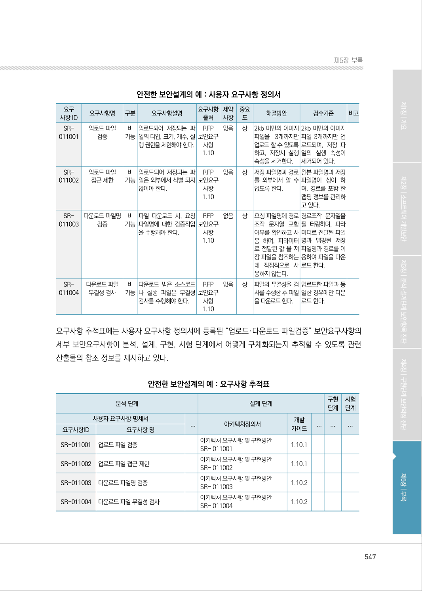
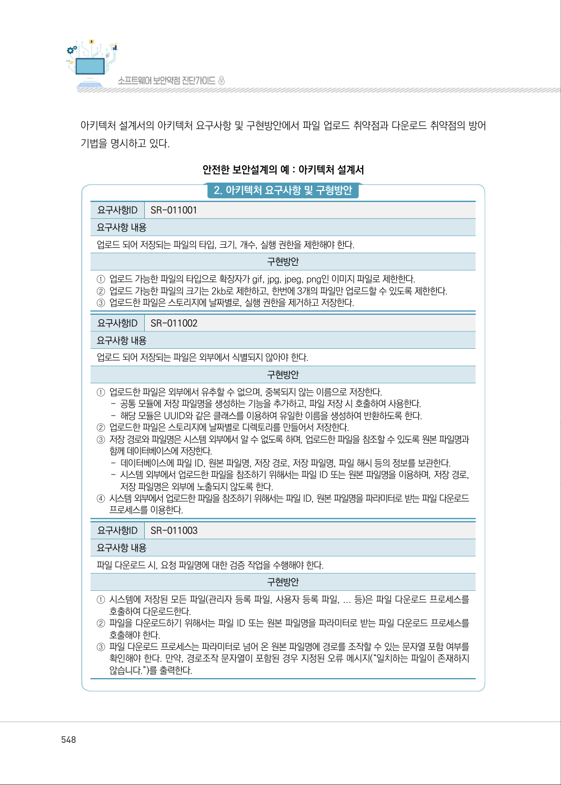
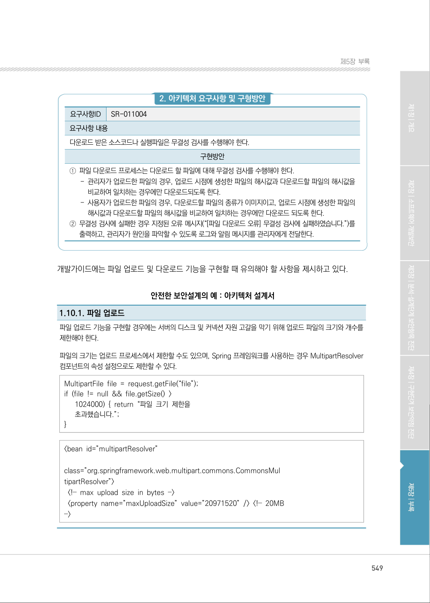
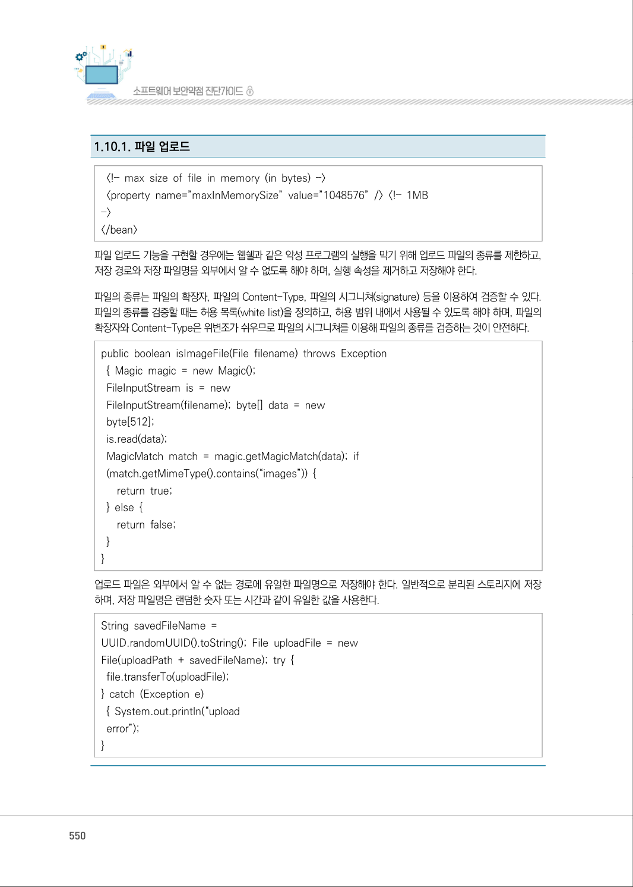
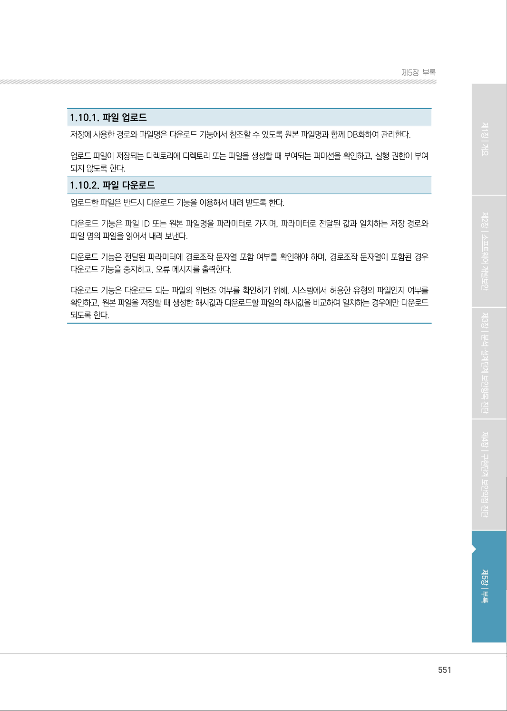

# 1-10. 업로드·다운로드 파일 검증

> 변환 안내(원문 외): 아래 본문은 PDF 텍스트를 추출한 전사입니다. 코드 줄번호·특수 공백·원문 오류를 유지했습니다. 실행용 코드가 아닙니다. 표·그림·들여쓰기는 연결된 페이지 이미지와 대조하세요. 페이지 경계의 줄바꿈을 보존하며, 동일 페이지가 여러 항목에 나뉘면 각 항목의 본문은 해당 구간만 포함합니다.

### PDF 546페이지 / 인쇄 546페이지

<!-- source-page:SW-Diagnosis-2021:546; source-lines:0,22,23,24,25,26 -->

546

1-10. 업로드·다운로드 파일 검증

다음은 “업로드·다운로드 파일 검증” 보안요구사항에 대한 안전한 설계 산출물의 예시이며, 제시된 
설계 산출물의 종류와 내용은 개발되는 소프트웨어의 특성, 환경, 방법론 등에 따라 다를 수 있다.

사용자 요구사항 정의서에는 “업로드·다운로드 파일 검증” 보안요구사항의 세부 보안요구사항을 비
기능 보안요구항목으로 등록하고 해결방안과 검수기준을 제시하고 있다.

<details><summary>원본 페이지 이미지 (변환 외 보존 자료)</summary>


</details>

### PDF 547페이지 / 인쇄 547페이지

<!-- source-page:SW-Diagnosis-2021:547; source-lines:0,1,2,3,4,5,6,7,8,9,10,11,12,13,14,15,16,17,18,19,20,21,22,23,24,25,26,27,28,29,30,31,32,33,34,35,36,37,38,39,40,41,42,43,44,45,46,47,48,49,50,51,52,53,54,55,56,57,58,59,60,61,62,63,64,65,66,67,68,69,70,71,72,73,74,75,76,77,78,79,80,81,82,83,84,85,86,87,88,89,90,91,92,93,94,95,96,97,98,99,100,101,102,103,104,105,106,107,108,109,110,111,112,113,114,115,116,117,118,119,120,121,122,123,124,125,126,127,128,129,130,131,132,133,134,135,136,137,138,139,140,141,142,143,144,145,146,147,148,149,150,151,152,153,154,155 -->

547

제5장부록

안전한 보안설계의 예 : 사용자 요구사항 정의서

```text
요구
사항 ID
요구사항명 
구분 
요구사항설명 
요구사항 
출처
제약 
사항
중요 
도
해결방안
검수기준
비고
SR-
011001
업로드 파일 
검증 
비 
기능
업로드되어 저장되는 파
일의 타입, 크기, 개수, 실
행 권한을 제한해야 한다.
RFP 
보안요구 
사항 
1.10
없음 
상
2kb 미만의 이미지 
파일을 3개까지만 
업로드 할 수 있도록 
하고, 저장시 실행 
속성을 제거한다.
2kb 미만의 이미지 
파일 3개까지만 업
로드되며, 저장 파
일의 실행 속성이 
제거되어 있다.
SR-
011002
업로드 파일 
접근 제한
비 
기능
업로드되어 저장되는 파
일은 외부에서 식별 되지 
않아야 한다.
RFP 
보안요구 
사항 
1.10
없음 
상
저장 파일명과 경로 
를 외부에서 알 수 
없도록 한다.
원본 파일명과 저장 
파일명이 상이 하
며, 경로를 포함 한 
맵핑 정보를 관리하
고 있다.
SR-
011003
다운로드 파일명 
검증
비 
기능
파일 다운로드 시, 요청 
파일명에 대한 검증작업 
을 수행해야 한다. 
RFP 
보안요구 
사항 
1.10
없음 
상
요청 파일명에 경로 
조작 문자열 포함 
여부를 확인하고 사
용 하며, 파라미터
로 전달된 값 을 저
장 파일을 참조하는
데 직접적으로 사 
용하지 않는다.
경로조작 문자열을 
필 터링하며, 파라
미터로 전달된 파일
명과 맵핑된 저장 
파일명과 경로를 이
용하여 파일을 다운
로드 한다.
SR-
011004
다운로드 파일 
무결성 검사
비 
기능
다운로드 받은 소스코드 
나 실행 파일은 무결성 
검사를 수행해야 한다.
RFP 
보안요구 
사항 
1.10
없음 
상
파일의 무결성을 검
사를 수행한 후 파일
을 다운로드 한다.
업로드한 파일과 동
일한 경우에만 다운
로드 한다.
```

요구사항 추적표에는 사용자 요구사항 정의서에 등록된 “업로드·다운로드 파일검증” 보안요구사항의 
세부 보안요구사항이 분석, 설계, 구현, 시험 단계에서 어떻게 구체화되는지 추적할 수 있도록 관련 
산출물의 참조 정보를 제시하고 있다.

안전한 보안설계의 예 : 요구사항 추적표

```text
분석 단계
설계 단계
구현 
단계
시험 
단계
사용자 요구사항 명세서
...
아키텍처정의서
개발 
가이드
...
...
...
요구사항ID
요구사항 명
SR-011001
업로드 파일 검증
아키텍처 요구사항 및 구현방안
SR- 011001
1.10.1
SR-011002
업로드 파일 접근 제한
아키텍처 요구사항 및 구현방안
SR- 011002
1.10.1
SR-011003
다운로드 파일명 검증
아키텍처 요구사항 및 구현방안
SR- 011003
1.10.2
SR-011004
다운로드 파일 무결성 검사
아키텍처 요구사항 및 구현방안
SR- 011004
1.10.2
```

<details><summary>원본 페이지 이미지 (변환 외 보존 자료)</summary>



</details>

### PDF 548페이지 / 인쇄 548페이지

<!-- source-page:SW-Diagnosis-2021:548; source-lines:0,1,2,3,4,5,6,7,8,9,10,11,12,13,14,15,16,17,18,19,20,21,22,23,24,25,26,27,28,29,30,31,32,33,34,35,36,37,38,39,40 -->

548

아키텍처 설계서의 아키텍처 요구사항 및 구현방안에서 파일 업로드 취약점과 다운로드 취약점의 방어 
기법을 명시하고 있다.

안전한 보안설계의 예 : 아키텍처 설계서

#### 2. 아키텍처 요구사항 및 구형방안

요구사항ID

SR-011001

요구사항 내용
업로드 되어 저장되는 파일의 타입, 크기, 개수, 실행 권한을 제한해야 한다.

구현방안

①업로드 가능한 파일의 타입으로 확장자가 gif, jpg, jpeg, png인 이미지 파일로 제한한다.
②업로드 가능한 파일의 크기는 2kb로 제한하고, 한번에 3개의 파일만 업로드할 수 있도록 제한한다.
③업로드한 파일은 스토리지에 날짜별로, 실행 권한을 제거하고 저장한다.
요구사항ID

SR-011002

요구사항 내용
업로드 되어 저장되는 파일은 외부에서 식별되지 않아야 한다.

구현방안

①업로드한 파일은 외부에서 유추할 수 없으며, 중복되지 않는 이름으로 저장한다.
- 공통 모듈에 저장 파일명을 생성하는 기능을 추가하고, 파일 저장 시 호출하여 사용한다.
- 해당 모듈은 UUID와 같은 클래스를 이용하여 유일한 이름을 생성하여 반환하도록 한다.
②업로드한 파일은 스토리지에 날짜별로 디렉토리를 만들어서 저장한다.
③저장 경로와 파일명은 시스템 외부에서 알 수 없도록 하며, 업로드한 파일을 참조할 수 있도록 원본 파일명과 
함께 데이터베이스에 저장한다.
- 데이터베이스에 파일 ID, 원본 파일명, 저장 경로, 저장 파일명, 파일 해시 등의 정보를 보관한다.
- 시스템 외부에서 업로드한 파일을 참조하기 위해서는 파일 ID 또는 원본 파일명을 이용하며, 저장 경로, 
저장 파일명은 외부에 노출되지 않도록 한다.
④시스템 외부에서 업로드한 파일을 참조하기 위해서는 파일 ID, 원본 파일명을 파라미터로 받는 파일 다운로드 
프로세스를 이용한다.
요구사항ID

SR-011003

요구사항 내용
파일 다운로드 시, 요청 파일명에 대한 검증 작업을 수행해야 한다.

구현방안

①시스템에 저장된 모든 파일(관리자 등록 파일, 사용자 등록 파일, ... 등)은 파일 다운로드 프로세스를 
호출하여 다운로드한다.
②파일을 다운로드하기 위해서는 파일 ID 또는 원본 파일명을 파라미터로 받는 파일 다운로드 프로세스를 
호출해야 한다.
③파일 다운로드 프로세스는 파라미터로 넘어 온 원본 파일명에 경로를 조작할 수 있는 문자열 포함 여부를 
확인해야 한다. 만약, 경로조작 문자열이 포함된 경우 지정된 오류 메시지(“일치하는 파일이 존재하지 
않습니다.”)를 출력한다.

<details><summary>원본 페이지 이미지 (변환 외 보존 자료)</summary>



</details>

### PDF 549페이지 / 인쇄 549페이지

<!-- source-page:SW-Diagnosis-2021:549; source-lines:0,1,2,3,4,5,6,7,8,9,10,11,12,13,14,15,16,17,18,19,20,21,22,23,24,25,26,27,28,29,30,31,32 -->

549

제5장부록

#### 2. 아키텍처 요구사항 및 구형방안

요구사항ID

SR-011004

요구사항 내용
다운로드 받은 소스코드나 실행파일은 무결성 검사를 수행해야 한다.

구현방안

①파일 다운로드 프로세스는 다운로드 할 파일에 대해 무결성 검사를 수행해야 한다.

- 관리자가 업로드한 파일의 경우, 업로드 시점에 생성한 파일의 해시값과 다운로드할 파일의 해시값을 

비교하여 일치하는 경우에만 다운로드되도록 한다.
- 사용자가 업로드한 파일의 경우, 다운로드할 파일의 종류가 이미지이고, 업로드 시점에 생성한 파일의 

해시값과 다운로드할 파일의 해시값을 비교하여 일치하는 경우에만 다운로드 되도록 한다.
②무결성 검사에 실패한 경우 지정된 오류 메시지(“[파일 다운로드 오류] 무결성 검사에 실패하였습니다.”)를 

출력하고, 관리자가 원인을 파악할 수 있도록 로그와 알림 메시지를 관리자에게 전달한다.

개발가이드에는 파일 업로드 및 다운로드 기능을 구현할 때 유의해야 할 사항을 제시하고 있다.

안전한 보안설계의 예 : 아키텍처 설계서

1.10.1. 파일 업로드
파일 업로드 기능을 구현할 경우에는 서버의 디스크 및 커넥션 자원 고갈을 막기 위해 업로드 파일의 크기와 개수를 
제한해야 한다.
파일의 크기는 업로드 프로세스에서 제한할 수도 있으며, Spring 프레임워크를 사용하는 경우 MultipartResolver 
컴포넌트의 속성 설정으로도 제한할 수 있다.
MultipartFile file = request.getFile(“file”);
if (file != null &amp;&amp; file.getSize() &gt;
   1024000) { return “파일 크기 제한을 
   초과했습니다.”; 
}

&lt;bean id=”multipartResolver”

class=”org.springframework.web.multipart.commons.CommonsMul 
tipartResolver”&gt; 
 &lt;!‐‐ max upload size in bytes ‐‐&gt;
 &lt;property name=”maxUploadSize” value=”20971520” /&gt; &lt;!‐‐ 20MB
‐‐&gt;

<details><summary>원본 페이지 이미지 (변환 외 보존 자료)</summary>



</details>

### PDF 550페이지 / 인쇄 550페이지

<!-- source-page:SW-Diagnosis-2021:550; source-lines:0,1,2,3,4,5,6,7,8,9,10,11,12,13,14,15,16,17,18,19,20,21,22,23,24,25,26,27,28,29,30,31,32,33 -->

550

1.10.1. 파일 업로드

 &lt;!‐‐ max size of file in memory (in bytes) ‐‐&gt; 
 &lt;property name=”maxInMemorySize” value=”1048576” /&gt; &lt;!‐‐ 1MB
‐‐&gt; 
&lt;/bean&gt; 
파일 업로드 기능을 구현할 경우에는 웹쉘과 같은 악성 프로그램의 실행을 막기 위해 업로드 파일의 종류를 제한하고, 
저장 경로와 저장 파일명을 외부에서 알 수 없도록 해야 하며, 실행 속성을 제거하고 저장해야 한다.
파일의 종류는 파일의 확장자, 파일의 Content-Type, 파일의 시그니쳐(signature) 등을 이용하여 검증할 수 있다. 
파일의 종류를 검증할 때는 허용 목록(white list)을 정의하고, 허용 범위 내에서 사용될 수 있도록 해야 하며, 파일의 
확장자와 Content-Type은 위변조가 쉬우므로 파일의 시그니쳐를 이용해 파일의 종류를 검증하는 것이 안전하다.
public boolean isImageFile(File filename) throws Exception
 { Magic magic = new Magic(); 
 FileInputStream is = new
 FileInputStream(filename); byte[] data = new 
 byte[512]; 
 is.read(data); 
 MagicMatch match = magic.getMagicMatch(data); if
 (match.getMimeType().contains(“images”)) { 
   return true; 
 } else { 
   return false; 
 } 
} 
업로드 파일은 외부에서 알 수 없는 경로에 유일한 파일명으로 저장해야 한다. 일반적으로 분리된 스토리지에 저장
하며, 저장 파일명은 랜덤한 숫자 또는 시간과 같이 유일한 값을 사용한다.
String savedFileName = 
UUID.randomUUID().toString(); File uploadFile = new
File(uploadPath + savedFileName); try { 
 file.transferTo(uploadFile); 
} catch (Exception e) 
 { System.out.println(“upload
 error”); 
}

<details><summary>원본 페이지 이미지 (변환 외 보존 자료)</summary>



</details>

### PDF 551페이지 / 인쇄 551페이지

<!-- source-page:SW-Diagnosis-2021:551; source-lines:0,1,2,3,4,5,6,7,8,9,10,11,12,13,14 -->

551

제5장부록

1.10.1. 파일 업로드
저장에 사용한 경로와 파일명은 다운로드 기능에서 참조할 수 있도록 원본 파일명과 함께 DB화하여 관리한다.
업로드 파일이 저장되는 디렉토리에 디렉토리 또는 파일을 생성할 때 부여되는 퍼미션을 확인하고, 실행 권한이 부여 
되지 않도록 한다.
1.10.2. 파일 다운로드
업로드한 파일은 반드시 다운로드 기능을 이용해서 내려 받도록 한다.
다운로드 기능은 파일 ID 또는 원본 파일명을 파라미터로 가지며, 파라미터로 전달된 값과 일치하는 저장 경로와 
파일 명의 파일을 읽어서 내려 보낸다.
다운로드 기능은 전달된 파라미터에 경로조작 문자열 포함 여부를 확인해야 하며, 경로조작 문자열이 포함된 경우 
다운로드 기능을 중지하고, 오류 메시지를 출력한다.
다운로드 기능은 다운로드 되는 파일의 위변조 여부를 확인하기 위해, 시스템에서 허용한 유형의 파일인지 여부를 
확인하고, 원본 파일을 저장할 때 생성한 해시값과 다운로드할 파일의 해시값을 비교하여 일치하는 경우에만 다운로드 
되도록 한다.

<details><summary>원본 페이지 이미지 (변환 외 보존 자료)</summary>



</details>

### PDF 552페이지 / 인쇄 552페이지

<!-- source-page:SW-Diagnosis-2021:552; source-lines:1 -->

#### 2. 보안기능

<details><summary>원본 페이지 이미지 (변환 외 보존 자료)</summary>


</details>

---

## 탐색 링크 (원문 외)

[통합 인덱스](../../../INDEX.md)

